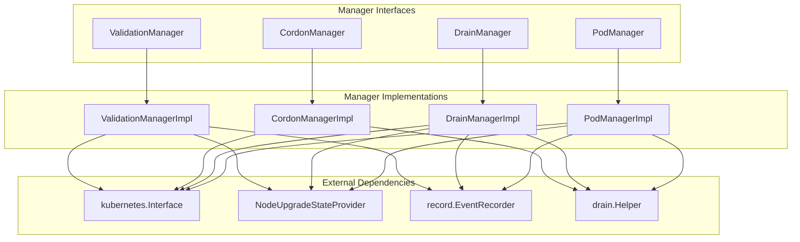
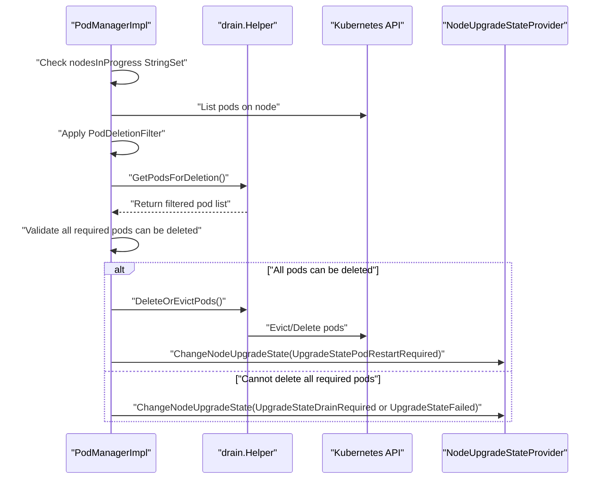
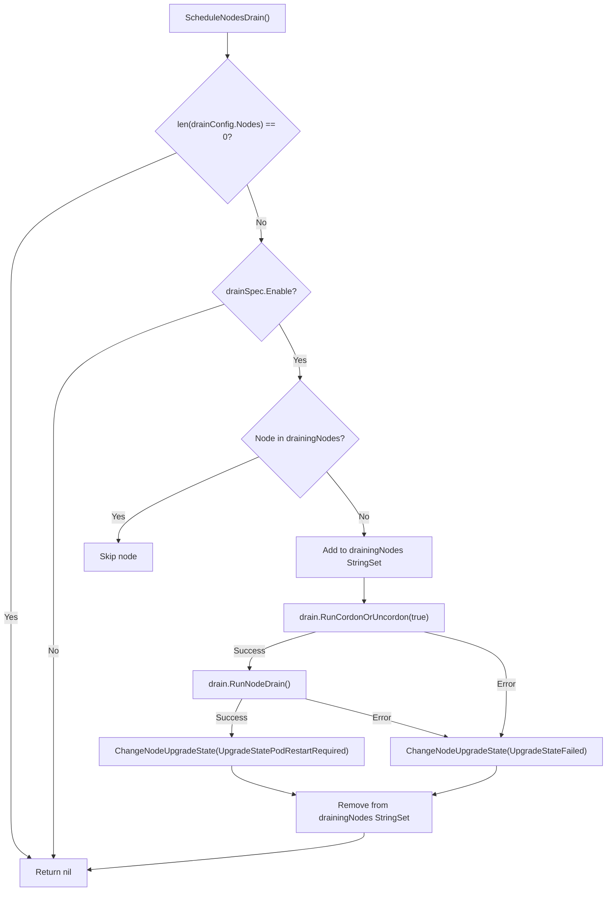
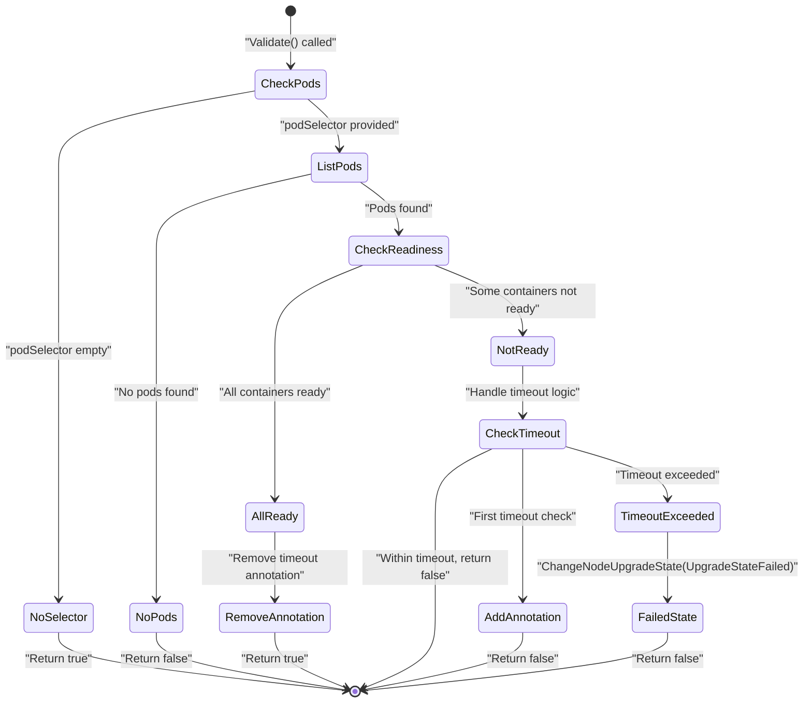
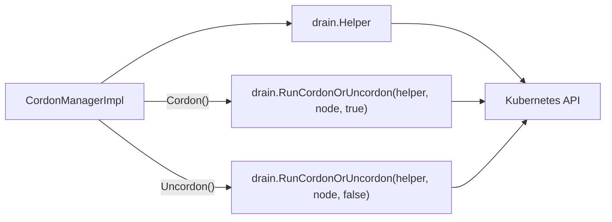
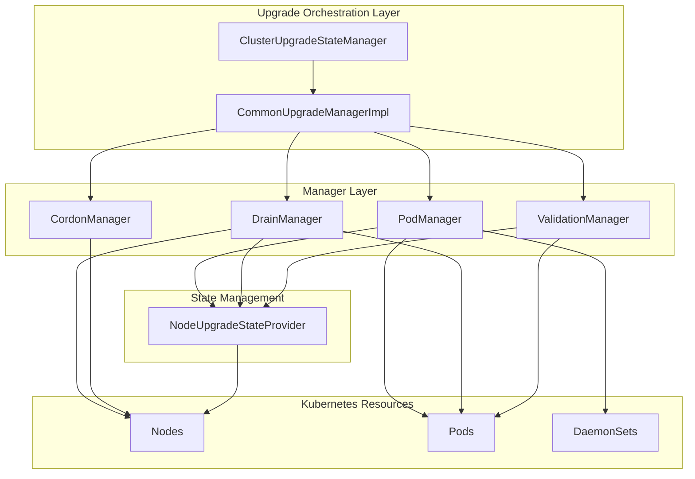

<!-- source: DeepWiki mcp.deepwiki.com · repo NVIDIA/k8s-operator-libs · page 3.3 Manager Components · fetched 2026-10-26 -->

# Manager Components

<details>
<summary>Relevant source files</summary>

The following files were used as context for generating this wiki page:

- [pkg/upgrade/cordon_manager.go](pkg/upgrade/cordon_manager.go)
- [pkg/upgrade/drain_manager.go](pkg/upgrade/drain_manager.go)
- [pkg/upgrade/mocks/ValidationManager.go](pkg/upgrade/mocks/ValidationManager.go)
- [pkg/upgrade/pod_manager.go](pkg/upgrade/pod_manager.go)
- [pkg/upgrade/validation_manager.go](pkg/upgrade/validation_manager.go)
- [pkg/upgrade/validation_manager_test.go](pkg/upgrade/validation_manager_test.go)

</details>


This document describes the specialized manager components that handle specific aspects of the driver upgrade process within the k8s-operator-libs upgrade system. These managers provide focused functionality for pod management, node operations, and validation tasks that are orchestrated by the broader upgrade workflow.

For information about the overall upgrade orchestration and state management, see [Core Upgrade System](#3). For details about the two upgrade execution modes that utilize these managers, see [Upgrade Modes](#3.2).

## Overview

The upgrade system employs a set of specialized manager components that encapsulate specific operational concerns during driver upgrades. Each manager implements a well-defined interface and handles a particular aspect of the upgrade workflow, from pod lifecycle management to node scheduling control.

### Manager Architecture



Sources: [pkg/upgrade/pod_manager.go:42-60](), [pkg/upgrade/drain_manager.go:38-50](), [pkg/upgrade/cordon_manager.go:26-36](), [pkg/upgrade/validation_manager.go:35-50]()

## PodManager

The `PodManager` handles pod lifecycle operations during driver upgrades, including pod deletion, restart scheduling, and completion monitoring.

### Interface and Implementation

| Method | Purpose |
|--------|---------|
| `ScheduleCheckOnPodCompletion` | Monitors pod completion status with configurable timeouts |
| `SchedulePodsRestart` | Schedules pod deletion to trigger restart |
| `SchedulePodEviction` | Evicts pods based on deletion filter criteria |
| `GetPodDeletionFilter` | Returns the filter function for pod selection |
| `GetPodControllerRevisionHash` | Extracts controller revision hash from pod labels |
| `GetDaemonsetControllerRevisionHash` | Gets latest DaemonSet controller revision |

### Key Components

The `PodManagerImpl` maintains several important components:

- **PodDeletionFilter**: A function type `func(corev1.Pod) bool` that determines which pods should be deleted during upgrades
- **StringSet**: Tracks nodes currently in progress to prevent concurrent operations
- **NodeUpgradeStateProvider**: Updates node state as pod operations complete

### Pod Eviction Workflow



Sources: [pkg/upgrade/pod_manager.go:122-229](), [pkg/upgrade/pod_manager.go:138-157]()

## DrainManager

The `DrainManager` handles complete node draining operations, which include cordoning the node and evicting all pods according to the configured drain specification.

### DrainConfiguration Structure

The `DrainConfiguration` struct combines drain specifications with target nodes:

```go
type DrainConfiguration struct {
    Spec  *v1alpha1.DrainSpec
    Nodes []*corev1.Node
}
```

### Drain Operation Flow



Sources: [pkg/upgrade/drain_manager.go:52-139](), [pkg/upgrade/drain_manager.go:33-36]()

## ValidationManager

The `ValidationManager` validates that driver upgrades completed successfully by monitoring validation pods for readiness.

### Validation Process

The validation process checks pods identified by a `podSelector` and ensures they are in Ready state within a configurable timeout period.

| Configuration | Default Value | Purpose |
|---------------|---------------|---------|
| `validationTimeoutSeconds` | 600 | Maximum time to wait for validation completion |
| `podSelector` | Configurable | Label selector to identify validation pods |

### Validation State Machine



Sources: [pkg/upgrade/validation_manager.go:70-116](), [pkg/upgrade/validation_manager.go:31-33](), [pkg/upgrade/validation_manager.go:139-175]()

## CordonManager

The `CordonManager` provides a simple interface for cordoning and uncordoning Kubernetes nodes, controlling their schedulability during upgrades.

### Interface Methods

The `CordonManager` interface exposes two primary operations:

- `Cordon(ctx context.Context, node *corev1.Node) error` - Marks node as unschedulable
- `Uncordon(ctx context.Context, node *corev1.Node) error` - Marks node as schedulable

### Implementation Details

The `CordonManagerImpl` is a lightweight wrapper around the Kubernetes `drain.Helper` functionality:



Sources: [pkg/upgrade/cordon_manager.go:38-48](), [pkg/upgrade/cordon_manager.go:50-56]()

## Manager Integration

The manager components work together within the broader upgrade system, with each manager focusing on its specific operational domain while contributing to the overall upgrade workflow.

### Manager Interaction Patterns



Sources: [pkg/upgrade/pod_manager.go:42-50](), [pkg/upgrade/drain_manager.go:38-45](), [pkg/upgrade/validation_manager.go:37-44](), [pkg/upgrade/cordon_manager.go:27-30]()

---

