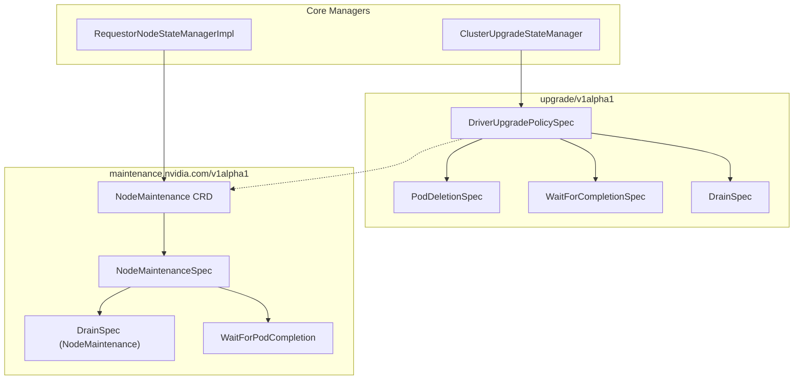
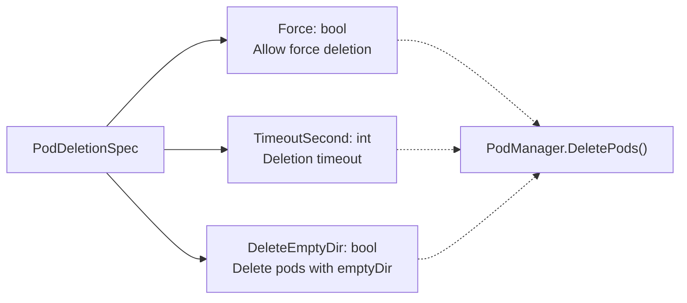
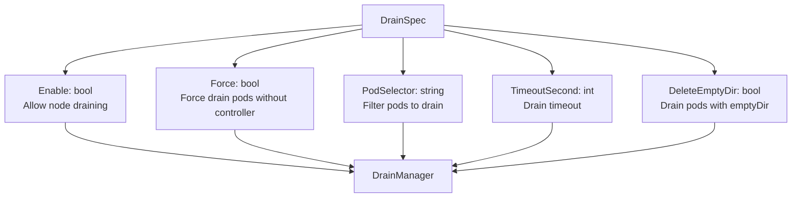
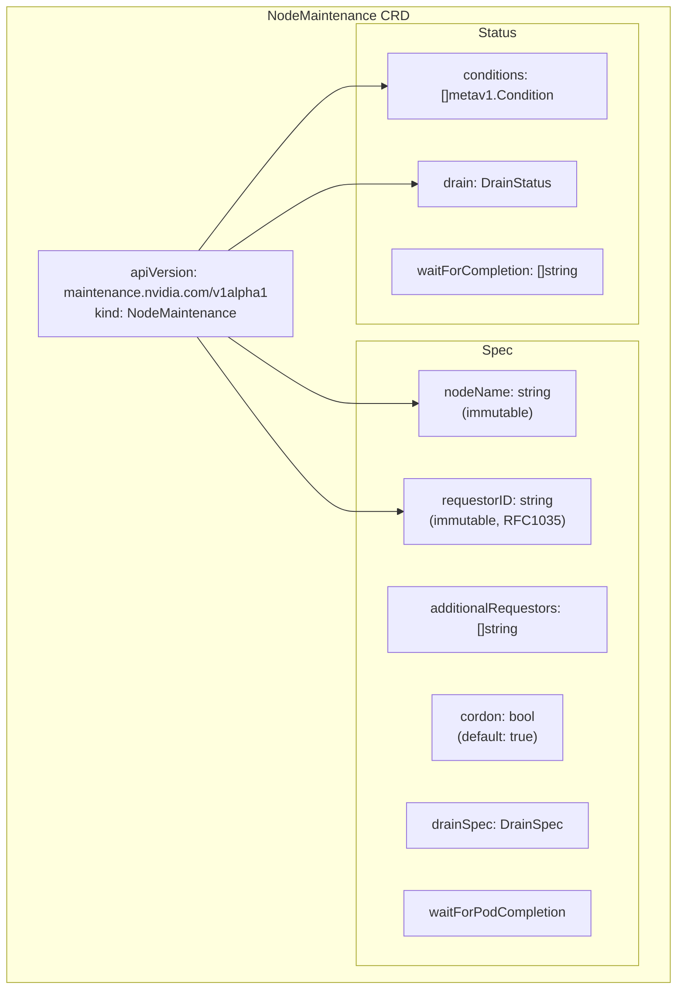
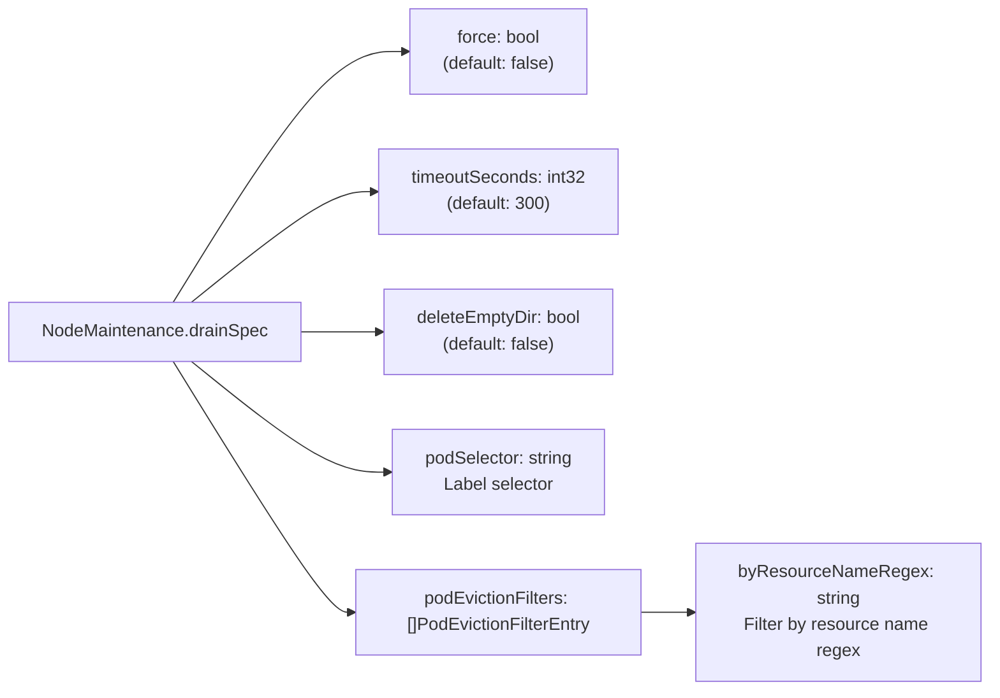
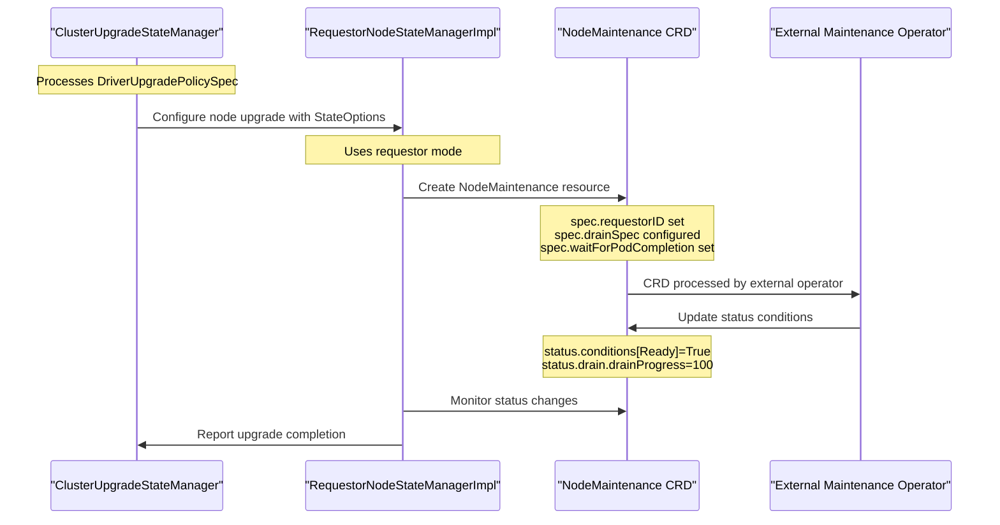

<!-- source: DeepWiki mcp.deepwiki.com · repo NVIDIA/k8s-operator-libs · page 4 APIs and Custom Resources · fetched 2026-10-26 -->

# APIs and Custom Resources

<details>
<summary>Relevant source files</summary>

The following files were used as context for generating this wiki page:

- [api/upgrade/v1alpha1/upgrade_spec.go](api/upgrade/v1alpha1/upgrade_spec.go)
- [api/upgrade/v1alpha1/zz_generated.deepcopy.go](api/upgrade/v1alpha1/zz_generated.deepcopy.go)
- [go.sum](go.sum)
- [hack/crd/bases/maintenance.nvidia.com_nodemaintenances.yaml](hack/crd/bases/maintenance.nvidia.com_nodemaintenances.yaml)

</details>


This page documents the APIs, Custom Resource Definitions (CRDs), and data structures that define the interfaces for the k8s-operator-libs upgrade management system. It covers the specifications for driver upgrade policies, node maintenance operations, and the relationships between these API components.

For information about the core upgrade workflow and state management, see [Core Upgrade System](#3). For details about the upgrade execution modes that consume these APIs, see [Upgrade Modes](#3.2).

## API Overview

The operator library defines two primary API surfaces:

- **DriverUpgradePolicy API** (`upgrade/v1alpha1`): Specifies configuration for automated driver upgrades
- **NodeMaintenance CRD** (`maintenance.nvidia.com/v1alpha1`): Manages node maintenance operations through external operators



**Sources:** [api/upgrade/v1alpha1/upgrade_spec.go:1-114](), [hack/crd/bases/maintenance.nvidia.com_nodemaintenances.yaml:1-286]()

## DriverUpgradePolicy API

The `DriverUpgradePolicySpec` defines the configuration for automated driver upgrade operations. This API specification is consumed by the `ClusterUpgradeStateManager` to orchestrate upgrade workflows.

### Core Configuration Structure

| Field | Type | Description |
|-------|------|-------------|
| `AutoUpgrade` | `bool` | Global switch for automatic upgrade feature |
| `MaxParallelUpgrades` | `int` | Maximum nodes that can be upgraded simultaneously |
| `MaxUnavailable` | `*intstr.IntOrString` | Maximum unavailable nodes during upgrade |
| `PodDeletion` | `*PodDeletionSpec` | Pod deletion behavior configuration |
| `WaitForCompletion` | `*WaitForCompletionSpec` | Job completion waiting configuration |
| `DrainSpec` | `*DrainSpec` | Node drain operation configuration |

**Sources:** [api/upgrade/v1alpha1/upgrade_spec.go:27-49]()

### PodDeletionSpec Configuration

The `PodDeletionSpec` controls how pods are deleted during upgrade operations:



**Sources:** [api/upgrade/v1alpha1/upgrade_spec.go:66-83]()

### WaitForCompletionSpec Configuration

The `WaitForCompletionSpec` defines criteria for waiting on job completions before proceeding with upgrades:

| Field | Type | Default | Description |
|-------|------|---------|-------------|
| `PodSelector` | `string` | `""` | Label selector for pods to wait for completion |
| `TimeoutSecond` | `int` | `0` | Wait timeout in seconds (0 = infinite) |

**Sources:** [api/upgrade/v1alpha1/upgrade_spec.go:51-64]()

### DrainSpec Configuration

The `DrainSpec` configures node drain behavior during upgrades:



**Sources:** [api/upgrade/v1alpha1/upgrade_spec.go:85-110]()

## NodeMaintenance CRD

The `NodeMaintenance` CRD enables integration with external maintenance operators for the requestor upgrade mode. It provides a standardized interface for coordinating node maintenance operations across different operator implementations.

### Resource Structure



**Sources:** [hack/crd/bases/maintenance.nvidia.com_nodemaintenances.yaml:36-164]()

### NodeMaintenance Spec Fields

| Field | Type | Constraints | Description |
|-------|------|-------------|-------------|
| `nodeName` | `string` | Immutable, required | Target node for maintenance |
| `requestorID` | `string` | Immutable, RFC1035 format, 2-63 chars | Maintenance requestor identifier |
| `additionalRequestors` | `[]string` | Set type | Additional requestor IDs sharing the maintenance |
| `cordon` | `bool` | Default: `true` | Mark node as unschedulable |
| `drainSpec` | `DrainSpec` | Optional | Node drain configuration |
| `waitForPodCompletion` | `WaitForPodCompletion` | Optional | Pod completion waiting criteria |

**Sources:** [hack/crd/bases/maintenance.nvidia.com_nodemaintenances.yaml:118-163]()

### NodeMaintenance DrainSpec

The NodeMaintenance `DrainSpec` extends the basic drain configuration with additional filtering capabilities:



**Sources:** [hack/crd/bases/maintenance.nvidia.com_nodemaintenances.yaml:72-117]()

### Status Conditions and Progress Tracking

The NodeMaintenance status provides detailed progress information:

| Condition Type | Description |
|----------------|-------------|
| `Ready` | Maintenance operation completion status |
| `Failed` | Maintenance operation failure status |

| Status Field | Type | Description |
|--------------|------|-------------|
| `drain.drainProgress` | `int32` | Drain completion percentage |
| `drain.totalPods` | `int32` | Total pods on node when draining started |
| `drain.evictionPods` | `int32` | Number of pods requiring eviction |
| `drain.waitForEviction` | `[]string` | Namespaced pod names awaiting eviction |
| `waitForCompletion` | `[]string` | Namespaced pod names awaiting completion |

**Sources:** [hack/crd/bases/maintenance.nvidia.com_nodemaintenances.yaml:166-280]()

## API Integration Patterns

The APIs work together to support different upgrade execution patterns:



**Sources:** [api/upgrade/v1alpha1/upgrade_spec.go:1-114](), [hack/crd/bases/maintenance.nvidia.com_nodemaintenances.yaml:1-286]()

## Generated Code and Runtime Objects

The API types include generated methods for Kubernetes runtime integration:

### DeepCopy Methods

The `DriverUpgradePolicySpec` implements required Kubernetes runtime methods:

- `DeepCopyInto(*DriverUpgradePolicySpec)`: In-place deep copy
- `DeepCopy() *DriverUpgradePolicySpec`: Allocating deep copy  
- `DeepCopyObject() runtime.Object`: Runtime object interface
- `GetObjectKind() schema.ObjectKind`: Object kind interface

**Sources:** [api/upgrade/v1alpha1/zz_generated.deepcopy.go:28-69](), [api/upgrade/v1alpha1/upgrade_spec.go:112-114]()

### Kubebuilder Annotations

The API definitions use kubebuilder annotations for code generation:

```go
// +kubebuilder:object:root=true
// +kubebuilder:object:generate=true
// +kubebuilder:default:=false
// +kubebuilder:validation:Minimum:=0
```

These annotations control CRD generation, default values, and validation constraints.

**Sources:** [api/upgrade/v1alpha1/upgrade_spec.go:24-26](), [api/upgrade/v1alpha1/upgrade_spec.go:31](), [api/upgrade/v1alpha1/upgrade_spec.go:36-37]()

---

