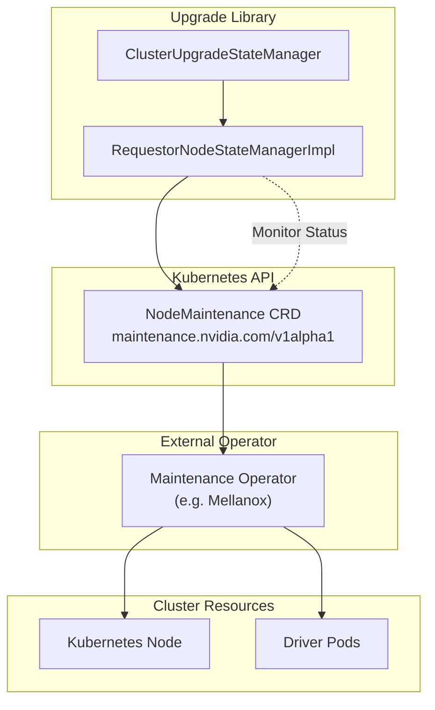
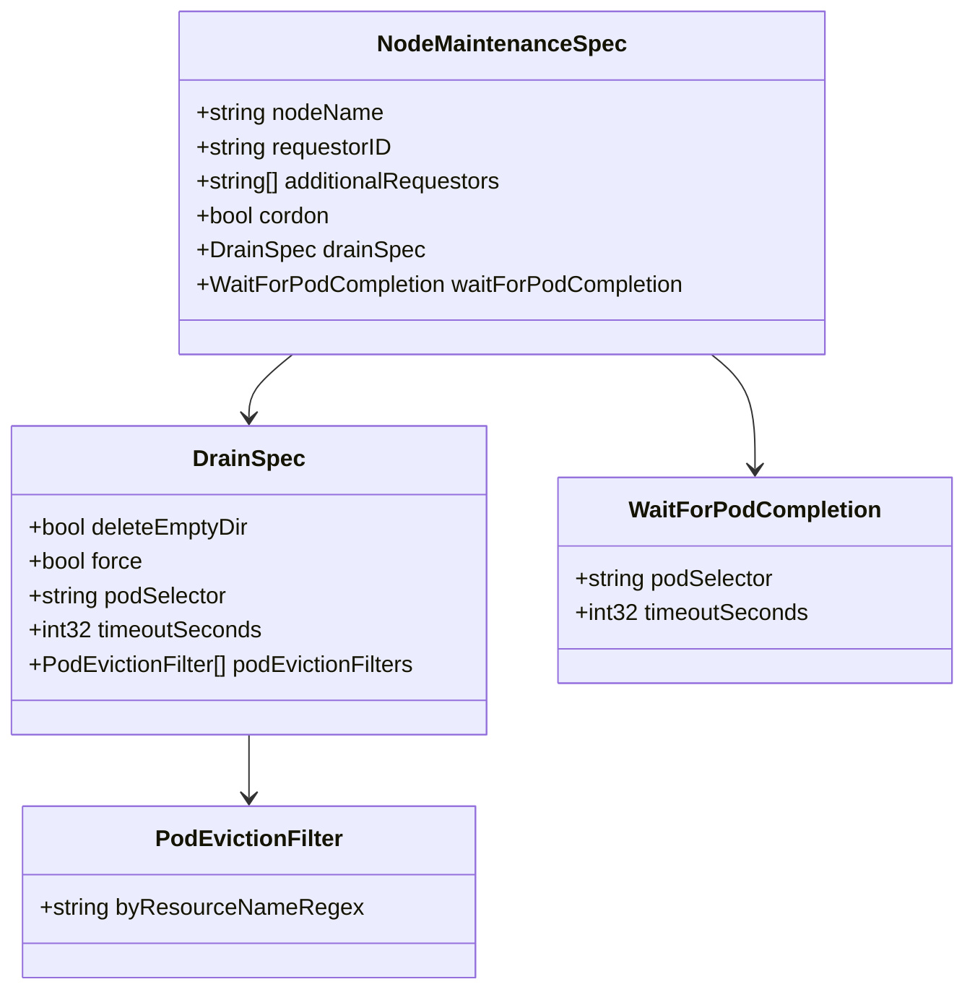
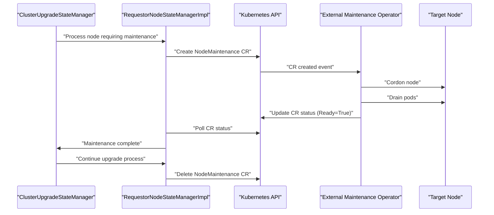
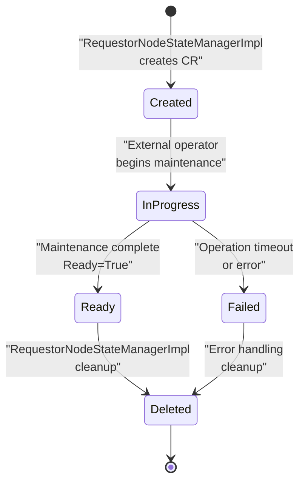

<!-- source: DeepWiki mcp.deepwiki.com · repo NVIDIA/k8s-operator-libs · page 4.1 NodeMaintenance CRD · fetched 2026-10-26 -->

# NodeMaintenance CRD

Relevant source files

The following files were used as context for generating this wiki page:

- [go.sum](go.sum)
- [hack/crd/bases/maintenance.nvidia.com_nodemaintenances.yaml](hack/crd/bases/maintenance.nvidia.com_nodemaintenances.yaml)

This document covers the NodeMaintenance Custom Resource Definition (CRD) used by the k8s-operator-libs upgrade system for coordinating node maintenance operations with external maintenance operators. This CRD enables the "requestor mode" upgrade workflow, where the upgrade library delegates actual node maintenance to a specialized external operator.

For information about the alternative "in-place mode" that performs direct node operations, see [Upgrade Modes](#3.2). For details about the overall upgrade orchestration system, see [Core Upgrade System](#3).

## Overview

The NodeMaintenance CRD provides a declarative API for requesting node maintenance operations from external maintenance operators. It serves as a communication interface between the upgrade library's `RequestorNodeStateManagerImpl` and external systems that can safely cordon, drain, and manage nodes during driver upgrades.

**Sources:** [hack/crd/bases/maintenance.nvidia.com_nodemaintenances.yaml:1-286]()

## API Specification

### Resource Identification

The NodeMaintenance CRD is defined with the following characteristics:

| Field | Value |
|-------|-------|
| API Group | `maintenance.nvidia.com` |
| Version | `v1alpha1` |
| Kind | `NodeMaintenance` |
| Scope | Namespaced |
| Plural | `nodemaintenances` |

**Sources:** [hack/crd/bases/maintenance.nvidia.com_nodemaintenances.yaml:8-15]()

### Spec Fields

The `NodeMaintenanceSpec` defines the desired maintenance operation:

#### Core Required Fields

- `nodeName` - Target node name (immutable after creation)
- `requestorID` - Domain name format identifier following RFC 1035 (immutable, 2-63 characters)

#### Optional Configuration Fields

- `additionalRequestors` - Set of additional requestor IDs sharing the maintenance request
- `cordon` - Whether to mark node as unschedulable (default: true) 
- `drainSpec` - Detailed drain configuration including timeout, pod selectors, and eviction filters
- `waitForPodCompletion` - Specification for waiting on pod completion before draining

**Sources:** [hack/crd/bases/maintenance.nvidia.com_nodemaintenances.yaml:55-164]()

### Status Fields

The `NodeMaintenanceStatus` tracks the maintenance operation progress:

| Field | Type | Purpose |
|-------|------|---------|
| `conditions` | `[]metav1.Condition` | Standard Kubernetes conditions for Ready/Failed states |
| `drain.drainProgress` | `int32` | Percentage of drain completion |
| `drain.totalPods` | `int32` | Total pods on node when draining started |
| `drain.evictionPods` | `int32` | Number of pods requiring eviction |
| `drain.waitForEviction` | `[]string` | Namespaced names of pods awaiting eviction |
| `waitForCompletion` | `[]string` | Namespaced names of pods awaiting completion |

**Sources:** [hack/crd/bases/maintenance.nvidia.com_nodemaintenances.yaml:165-280]()

### Printer Columns

The CRD defines custom columns for `kubectl` output:

| Column | JSONPath | Purpose |
|--------|----------|---------|
| Node | `.spec.nodeName` | Target node name |
| Requestor | `.spec.requestorID` | Requesting component ID |
| Ready | `.status.conditions[?(@.type=='Ready')].status` | Ready condition status |
| Phase | `.status.conditions[?(@.type=='Ready')].reason` | Current maintenance phase |
| Failed | `.status.conditions[?(@.type=='Failed')].reason` | Failure reason if applicable |

**Sources:** [hack/crd/bases/maintenance.nvidia.com_nodemaintenances.yaml:17-32]()

## Integration with Requestor Mode

The NodeMaintenance CRD is exclusively used by the requestor mode upgrade workflow. The integration follows this pattern:

### Code Entity Relationships

The key code entities involved in NodeMaintenance CRD operations:

- `RequestorNodeStateManagerImpl` - Creates and manages NodeMaintenance CRs
- `ClusterUpgradeStateManager` - Orchestrates the overall upgrade workflow
- External maintenance operators (e.g., Mellanox maintenance-operator) - Consume and act on CRs

**Sources:** Architecture diagrams and [go.sum:5-6]() (Mellanox maintenance-operator dependency)

## Lifecycle and State Management

### Creation Phase

NodeMaintenance CRs are created when:
1. A node transitions to `NodeMaintenanceRequired` state
2. The `RequestorNodeStateManagerImpl` determines maintenance is needed
3. Driver upgrade requires safe node preparation

### Monitoring Phase  

The requestor implementation continuously monitors the CR status:
- Polls for `Ready` condition transitions
- Tracks drain progress via status fields
- Handles timeout scenarios for maintenance operations

### Cleanup Phase

NodeMaintenance CRs are deleted after:
1. Maintenance operation completion (Ready=True)  
2. Successful driver pod restart and validation
3. Node transition to subsequent upgrade states

**Sources:** Architecture diagrams and upgrade state machine flows

## External Operator Compatibility

The NodeMaintenance CRD is designed for compatibility with existing maintenance operators. The primary known integration is with the Mellanox maintenance-operator, as evidenced by the dependency in the project.

Key compatibility considerations:
- Standard Kubernetes condition patterns for status reporting
- Flexible drain specifications supporting various workload types
- Extensible requestor ID system for multi-component coordination
- Timeout configuration for both pod completion and drain operations

**Sources:** [go.sum:5-6](), [hack/crd/bases/maintenance.nvidia.com_nodemaintenances.yaml:126-139]()

---

