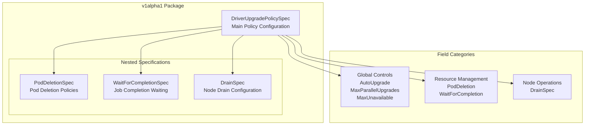
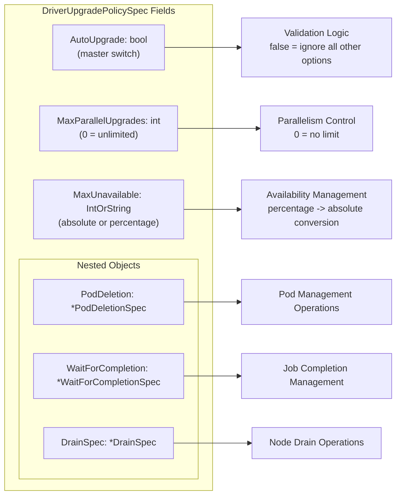
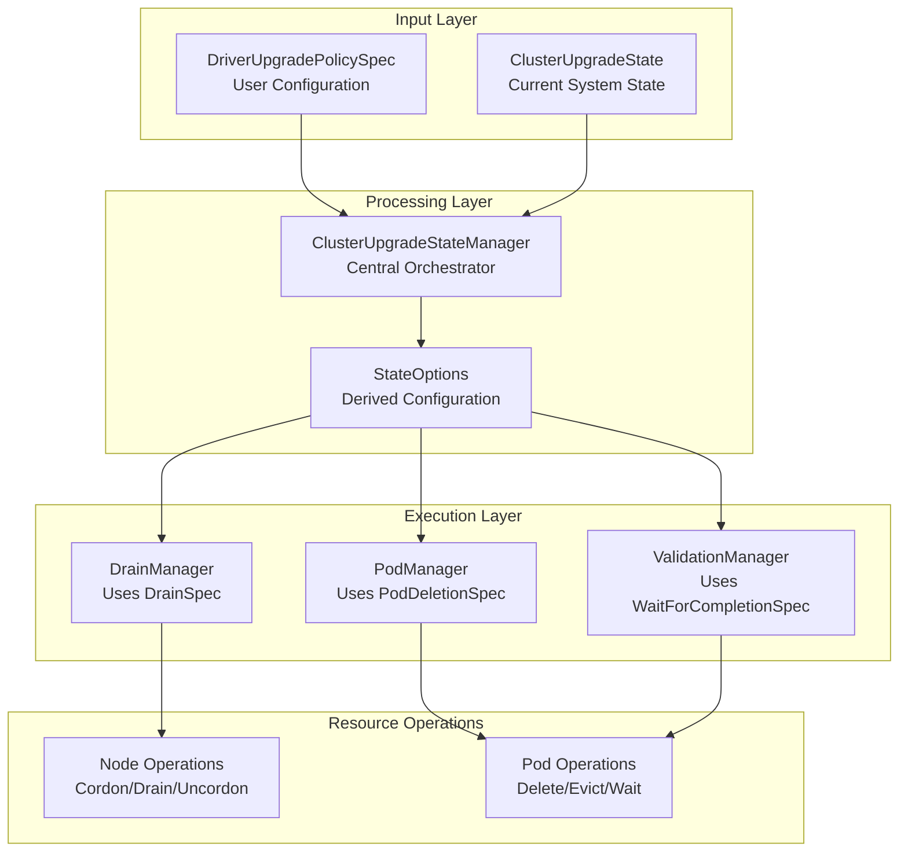

<!-- source: DeepWiki mcp.deepwiki.com · repo NVIDIA/k8s-operator-libs · page 4.2 DriverUpgradePolicy API · fetched 2026-10-26 -->

# DriverUpgradePolicy API

Relevant source files

The following files were used as context for generating this wiki page:

- [api/upgrade/v1alpha1/upgrade_spec.go](api/upgrade/v1alpha1/upgrade_spec.go)
- [api/upgrade/v1alpha1/zz_generated.deepcopy.go](api/upgrade/v1alpha1/zz_generated.deepcopy.go)

This document covers the DriverUpgradePolicy API specification, which defines the configuration schema for automatic driver upgrade policies in the k8s-operator-libs framework. The API provides declarative configuration for controlling upgrade behavior, timing, resource constraints, and node maintenance operations.

For information about how these policies are processed and executed, see [Core Upgrade System](#3). For details about node maintenance integration, see [NodeMaintenance CRD](#4.1).

## API Structure Overview

The DriverUpgradePolicy API is implemented in the `v1alpha1` version and consists of a main policy specification with nested configuration objects for different aspects of the upgrade process.

### Core API Components

Sources: [api/upgrade/v1alpha1/upgrade_spec.go:24-49]()

## DriverUpgradePolicySpec

The `DriverUpgradePolicySpec` serves as the root configuration object for upgrade policies, containing both global upgrade controls and references to specialized configuration objects.

### Primary Configuration Fields

| Field Name | Type | Default | Purpose |
|------------|------|---------|---------|
| `AutoUpgrade` | `bool` | `false` | Global switch for automatic upgrade feature |
| `MaxParallelUpgrades` | `int` | `1` | Maximum nodes that can be upgraded concurrently |
| `MaxUnavailable` | `*intstr.IntOrString` | `"25%"` | Maximum unavailable nodes during upgrade |

### Field Behavior and Validation

The `AutoUpgrade` field acts as a master switch - when set to `false`, all other upgrade options are ignored [api/upgrade/v1alpha1/upgrade_spec.go:28-32](). 

The `MaxParallelUpgrades` field supports unlimited parallelism when set to `0`, with a minimum validation of `0` [api/upgrade/v1alpha1/upgrade_spec.go:33-38]().

The `MaxUnavailable` field accepts both absolute numbers and percentages, with percentage values automatically converted to absolute numbers by rounding up [api/upgrade/v1alpha1/upgrade_spec.go:39-45]().

Sources: [api/upgrade/v1alpha1/upgrade_spec.go:27-49]()

## Supporting Specification Objects

### PodDeletionSpec

The `PodDeletionSpec` configures how pods using special resources are handled during upgrades.

| Field Name | Type | Default | Purpose |
|------------|------|---------|---------|
| `Force` | `bool` | `false` | Enables force deletion of pods |
| `TimeoutSecond` | `int` | `300` | Pod termination timeout in seconds |
| `DeleteEmptyDir` | `bool` | `false` | Allow deletion of pods with emptyDir volumes |

The timeout behavior supports infinite waiting when set to `0` [api/upgrade/v1alpha1/upgrade_spec.go:72-77]().

### WaitForCompletionSpec

The `WaitForCompletionSpec` defines waiting behavior for job completions before proceeding with node operations.

| Field Name | Type | Default | Purpose |
|------------|------|---------|---------|
| `PodSelector` | `string` | `""` | Label selector for pods to wait for |
| `TimeoutSecond` | `int` | `0` | Wait timeout in seconds (0 = infinite) |

The pod selector uses standard Kubernetes label selector syntax [api/upgrade/v1alpha1/upgrade_spec.go:53-57]().

### DrainSpec

The `DrainSpec` controls node draining operations during upgrades.

| Field Name | Type | Default | Purpose |
|------------|------|---------|---------|
| `Enable` | `bool` | `false` | Master switch for node draining |
| `Force` | `bool` | `false` | Enables force draining |
| `PodSelector` | `string` | `""` | Label selector for pods to drain |
| `TimeoutSecond` | `int` | `300` | Drain operation timeout |
| `DeleteEmptyDir` | `bool` | `false` | Allow draining pods with emptyDir volumes |

Sources: [api/upgrade/v1alpha1/upgrade_spec.go:85-110]()

## Integration with Upgrade System

The DriverUpgradePolicy API integrates with the broader upgrade orchestration system through well-defined interfaces and state management.

### Policy Processing Flow

Sources: [api/upgrade/v1alpha1/upgrade_spec.go:24-114]()

## Kubebuilder Annotations and Code Generation

The API leverages kubebuilder annotations for validation, default values, and code generation. The struct includes the `+kubebuilder:object:root=true` and `+kubebuilder:object:generate=true` annotations to enable automatic generation of runtime functions [api/upgrade/v1alpha1/upgrade_spec.go:25-26]().

### Generated Runtime Support

The code generation produces deep copy functions required for Kubernetes runtime integration:

- `DeepCopyInto()` - In-place deep copy implementation
- `DeepCopy()` - Factory method for creating deep copies  
- `DeepCopyObject()` - Runtime object interface implementation

These generated functions handle proper copying of pointer fields like `MaxUnavailable`, `PodDeletion`, `WaitForCompletion`, and `DrainSpec` [api/upgrade/v1alpha1/zz_generated.deepcopy.go:28-51]().

### Validation Rules

The API includes comprehensive validation through kubebuilder annotations:

- Minimum value constraints on integer fields
- Default value specifications for optional fields
- Type-safe handling of `IntOrString` values for flexible numeric configuration

Sources: [api/upgrade/v1alpha1/upgrade_spec.go:31-109](), [api/upgrade/v1alpha1/zz_generated.deepcopy.go:28-70]()

---

