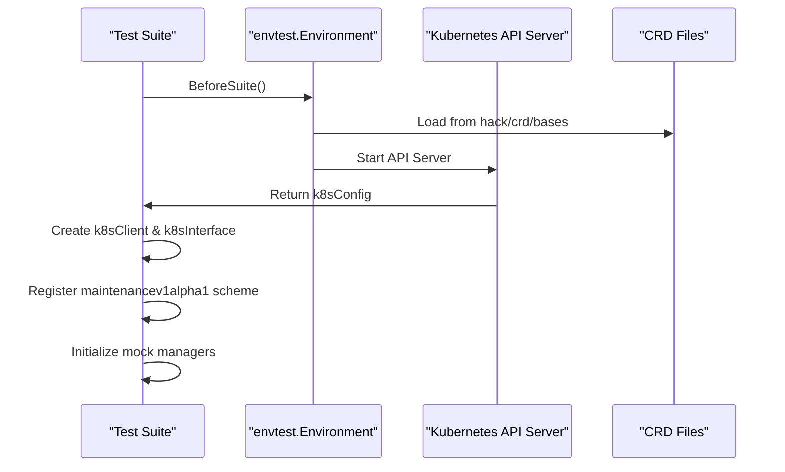
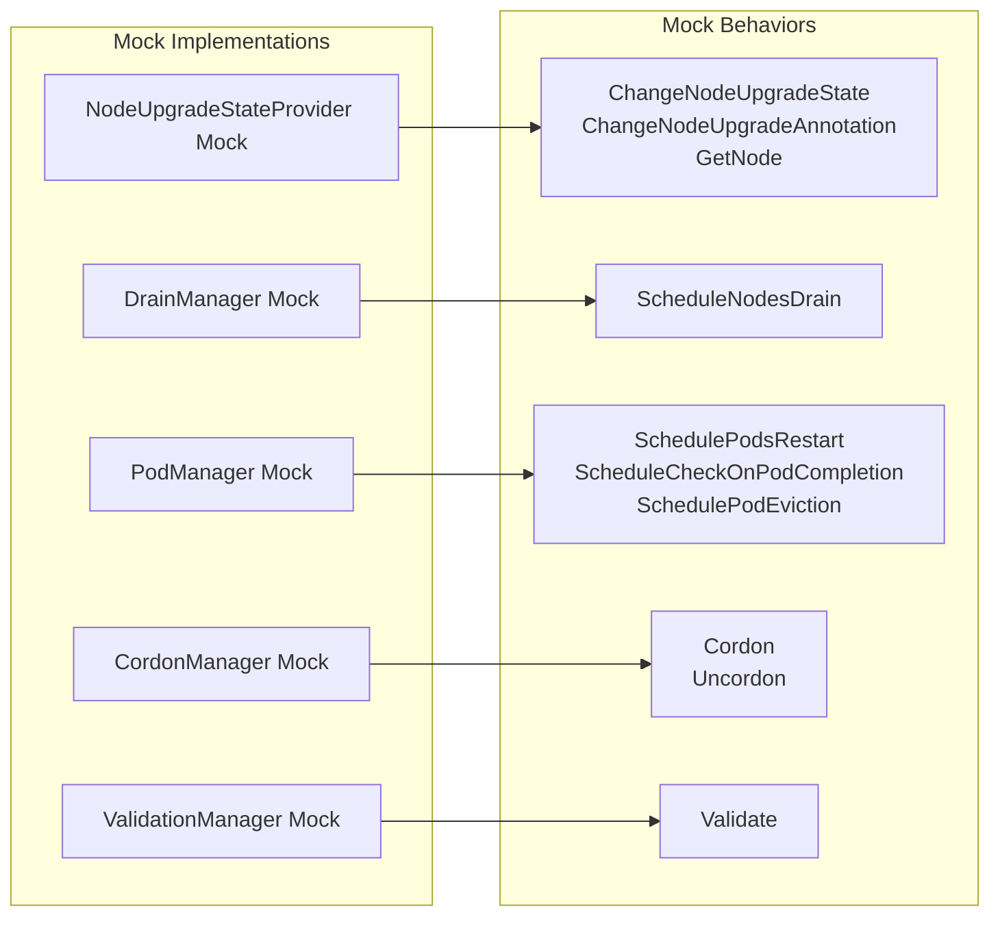
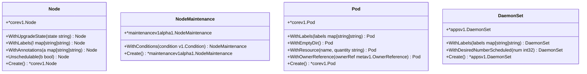
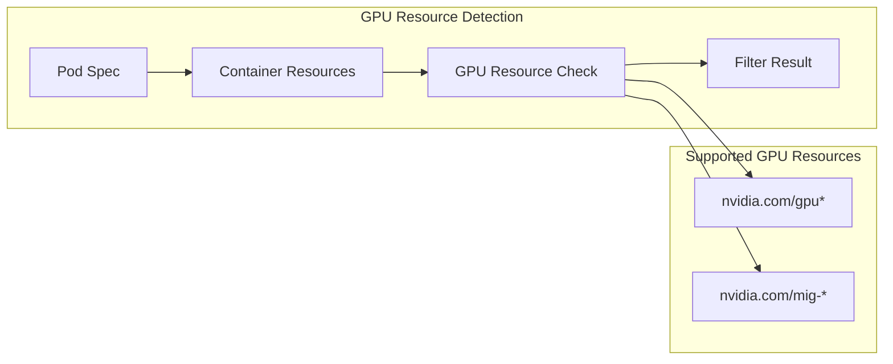
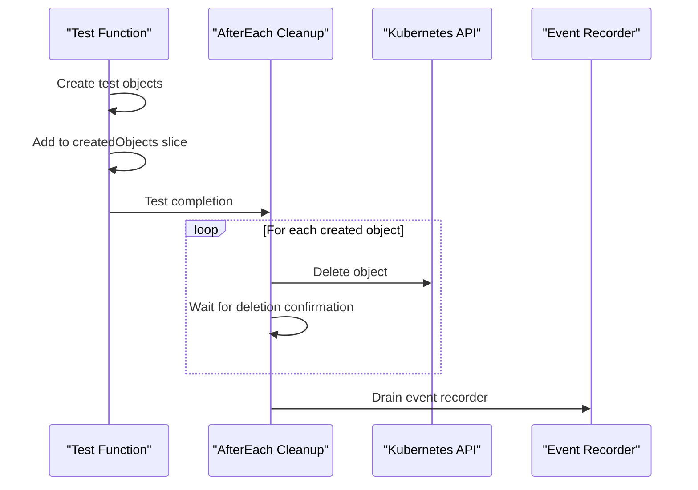

<!-- source: DeepWiki mcp.deepwiki.com · repo NVIDIA/k8s-operator-libs · page 5 Testing · fetched 2026-10-26 -->

# Testing

<details>
<summary>Relevant source files</summary>

The following files were used as context for generating this wiki page:

- [pkg/upgrade/pod_manager_test.go](pkg/upgrade/pod_manager_test.go)
- [pkg/upgrade/upgrade_suit_test.go](pkg/upgrade/upgrade_suit_test.go)

</details>


This document covers the testing framework, test infrastructure, and test suites used in the k8s-operator-libs repository. It explains how to run existing tests and how to extend the test coverage for new functionality.

For information about the core upgrade system being tested, see [Core Upgrade System](#3). For development practices and build system, see [Development Guide](#6).

## Testing Framework Architecture

The testing framework is built on Ginkgo (BDD-style Go testing) with Gomega assertions and uses controller-runtime's envtest for Kubernetes API integration testing.

```mermaid
graph TB
    subgraph "Test Framework Stack"
        Ginkgo["Ginkgo BDD Framework<br/>github.com/onsi/ginkgo/v2"]
        Gomega["Gomega Assertions<br/>github.com/onsi/gomega"]
        EnvTest["EnvTest Environment<br/>sigs.k8s.io/controller-runtime/pkg/envtest"]
    end
    
    subgraph "Test Environment"
        TestEnv["testEnv *envtest.Environment"]
        K8sConfig["k8sConfig *rest.Config"]
        K8sClient["k8sClient client.Client"]
        K8sInterface["k8sInterface kubernetes.Interface"]
    end
    
    subgraph "Mock System"
        NodeProvider["nodeUpgradeStateProvider mocks.NodeUpgradeStateProvider"]
        DrainMgr["drainManager mocks.DrainManager"]
        PodMgr["podManager mocks.PodManager"]
        CordonMgr["cordonManager mocks.CordonManager"]
        ValidationMgr["validationManager mocks.ValidationManager"]
    end
    
    subgraph "Test Utilities"
        TestHelpers["Test Object Builders<br/>Node, Pod, DaemonSet, NodeMaintenance"]
        EventRecorder["eventRecorder record.FakeRecorder"]
        TestContext["testCtx context.Context"]
    end
    
    Ginkgo --> TestEnv
    Gomega --> TestEnv
    EnvTest --> K8sConfig
    K8sConfig --> K8sClient
    K8sConfig --> K8sInterface
    
    TestEnv --> Mock System
    TestEnv --> TestHelpers
    
    TestHelpers --> EventRecorder
    TestHelpers --> TestContext
```

**Sources**: [pkg/upgrade/upgrade_suit_test.go:19-49](), [pkg/upgrade/upgrade_suit_test.go:58-73]()

## Test Environment Setup

The test environment is configured in the `BeforeSuite` function and provides a complete Kubernetes API server for integration testing.

### Environment Initialization

The test setup creates a real Kubernetes API server with CRDs loaded from the filesystem:

| Component | Configuration |
|-----------|--------------|
| Test Environment | `envtest.Environment` with CRD directory paths |
| CRD Location | `hack/crd/bases` directory |
| Scheme Registration | Includes `maintenancev1alpha1` from Mellanox maintenance operator |
| Driver Name | Set to "gpu" for testing |
| Signal Handler | Controller-runtime signal handler context |



**Sources**: [pkg/upgrade/upgrade_suit_test.go:81-113]()

### Mock System Configuration

The test suite uses comprehensive mocks for all manager components to isolate unit testing from external dependencies:



**Sources**: [pkg/upgrade/upgrade_suit_test.go:114-183]()

## Test Object Builders

The testing framework provides fluent builder patterns for creating Kubernetes objects with test-specific configurations.

### Node Builder

The `Node` builder creates test nodes with configurable upgrade states and labels:



**Sources**: [pkg/upgrade/upgrade_suit_test.go:216-261](), [pkg/upgrade/upgrade_suit_test.go:263-302](), [pkg/upgrade/upgrade_suit_test.go:304-355](), [pkg/upgrade/upgrade_suit_test.go:357-428]()

## Test Suites

### PodManager Test Suite

The `PodManager` test suite covers pod lifecycle management operations including restart scheduling, completion checking, and eviction scenarios.

#### Test Coverage Areas

| Test Area | Scenarios Covered |
|-----------|------------------|
| `SchedulePodsRestart` | Selective pod deletion, error handling, empty input handling |
| `ScheduleCheckOnPodCompletion` | Job completion detection, timeout handling, annotation tracking |
| `SchedulePodEviction` | GPU pod eviction, force deletion, empty dir handling |

#### Key Test Scenarios

```mermaid
graph TB
    subgraph "SchedulePodsRestart Tests"
        SPR1["Delete only specified pods"]
        SPR2["Handle invalid input gracefully"]
        SPR3["No-op on empty input"]
    end
    
    subgraph "ScheduleCheckOnPodCompletion Tests"
        SCP1["State change on job completion"]
        SCP2["No state change when jobs running"]
        SCP3["Timeout handling with annotations"]
    end
    
    subgraph "SchedulePodEviction Tests"
        SPE1["Force delete GPU pods"]
        SPE2["Fail without force, drain disabled"]
        SPE3["Fail without force, drain enabled"]
        SPE4["EmptyDir volume handling"]
    end
    
    SPR1 --> SPR2 --> SPR3
    SCP1 --> SCP2 --> SCP3
    SPE1 --> SPE2 --> SPE3 --> SPE4
```



**Sources**: [pkg/upgrade/pod_manager_test.go:65-115](), [pkg/upgrade/pod_manager_test.go:117-224](), [pkg/upgrade/pod_manager_test.go:226-431]()

### GPU Pod Filtering Logic

The test suite includes a `gpuPodSpecFilter` function that demonstrates how to identify GPU workloads:



**Sources**: [pkg/upgrade/pod_manager_test.go:433-453]()

## Test Lifecycle Management

### Setup and Teardown

The testing framework handles object lifecycle automatically:

| Phase | Operations |
|-------|------------|
| `BeforeEach` | Initialize `createdObjects` slice |
| Test Execution | Objects added to `createdObjects` when created |
| `AfterEach` | Delete all created objects, drain event recorder |
| `AfterSuite` | Stop test environment |

### Object Cleanup Strategy



**Sources**: [pkg/upgrade/upgrade_suit_test.go:191-214]()

## Running Tests

### Test Execution Commands

```bash
# Run all tests with Ginkgo
go test -v ./pkg/upgrade/...

# Run with verbose Ginkgo output
ginkgo -v ./pkg/upgrade/

# Run specific test suites
ginkgo -focus "PodManager" ./pkg/upgrade/
```

### Test Configuration

| Configuration | Value | Purpose |
|--------------|-------|---------|
| `PrimaryTestRequestorID` | `"nvidia.operator.com"` | Primary requestor ID for NodeMaintenance |
| `SecondaryTestRequestorID` | `"foo.bar.com"` | Secondary requestor for multi-tenant testing |
| Driver Name | `"gpu"` | Driver name used throughout tests |
| Event Recorder Buffer | 100 events | Fake event recorder capacity |

**Sources**: [pkg/upgrade/upgrade_suit_test.go:51-54](), [pkg/upgrade/upgrade_suit_test.go:69](), [pkg/upgrade/upgrade_suit_test.go:112]()

## Extending Tests

### Adding New Test Cases

To add new test cases for existing components:

1. Use the existing builder patterns (`NewNode`, `NewPod`, etc.)
2. Configure mock expectations for manager dependencies
3. Create test objects and add them to `createdObjects` for automatic cleanup
4. Use Gomega assertions for verification

### Creating New Test Builders

For new Kubernetes resources, follow the established pattern:

```go
type NewResource struct {
    *resourcev1.Resource
}

func NewResource(name, namespace string) NewResource {
    // Initialize resource
}

func (r NewResource) WithCustomProperty(value string) NewResource {
    // Configure property
    return r
}

func (r NewResource) Create() *resourcev1.Resource {
    // Create in test environment
    // Add to createdObjects
    return r.Resource
}
```

### Mock Configuration

When adding new manager dependencies, configure mock expectations in `BeforeSuite`:

```go
newManager := mocks.NewManager{}
newManager.
    On("MethodName", mock.Anything, mock.Anything).
    Return(expectedResult, nil)
```

**Sources**: [pkg/upgrade/upgrade_suit_test.go:114-183]()

---

