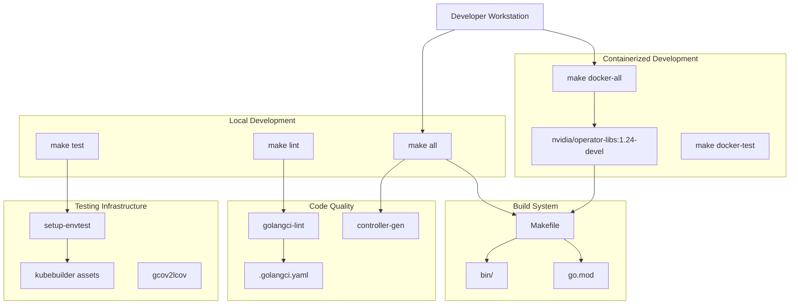
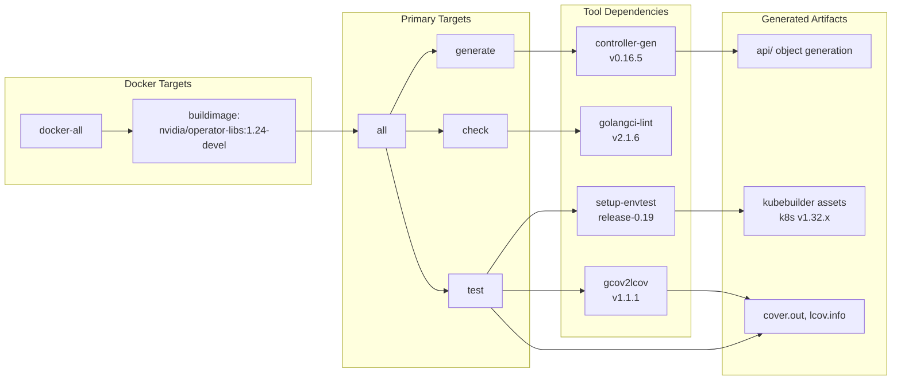
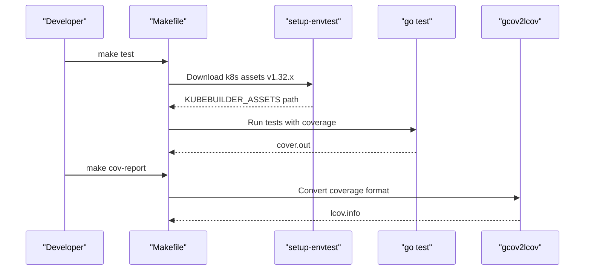
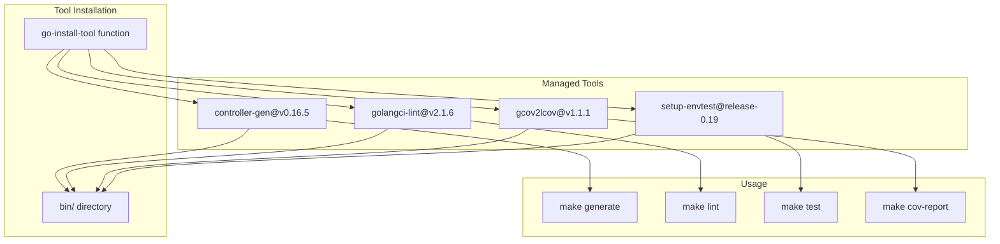

<!-- source: DeepWiki mcp.deepwiki.com · repo NVIDIA/k8s-operator-libs · page 6 Development Guide · fetched 2026-10-26 -->

# Development Guide

Relevant source files

The following files were used as context for generating this wiki page:

- [.golangci.yaml](.golangci.yaml)
- [Makefile](Makefile)
- [docker/Dockerfile.devel](docker/Dockerfile.devel)

This guide provides comprehensive information for developers working with the k8s-operator-libs codebase. It covers the build system, development environment setup, code quality standards, and contribution workflows. This document focuses on the development infrastructure and tooling rather than the core upgrade system functionality.

For information about the core upgrade system architecture, see [Architecture](#2). For details about testing frameworks and test execution, see [Testing](#5). For specific build system details, see [Build System](#6.1), and for code quality and CI/CD information, see [Code Quality and CI/CD](#6.2).

## Development Environment Overview

The k8s-operator-libs repository uses a standardized development environment built around Go 1.24, Make-based build automation, and containerized development workflows. The development infrastructure supports both local development and containerized builds for consistent environments across different platforms.

### Development Workflow

**Sources:** [Makefile:1-139](), [docker/Dockerfile.devel:1-16](), [.golangci.yaml:1-127]()

## Build System Architecture

The build system is centered around a comprehensive Makefile that provides both local and containerized development workflows. The system supports code generation, testing, linting, and coverage reporting.

### Core Build Targets and Dependencies

**Sources:** [Makefile:31-33](), [Makefile:62-81](), [Makefile:83-93](), [Makefile:96-126]()

## Code Generation and API Management

The codebase uses controller-gen for automatic code generation, particularly for Kubernetes API objects and Custom Resource Definitions (CRDs).

### Code Generation Process

| Target | Tool | Input Paths | Output | Purpose |
|--------|------|-------------|---------|---------|
| `generate` | `controller-gen` | `./api/...` | Generated Go files | Object methods for CRDs |
| `generate` | `go generate` | `$(MODULE)/...` | Various generated files | Go generate directives |

The `controller-gen` tool uses the header file at `hack/boilerplate.go.txt` for consistent license headers across generated files.

**Sources:** [Makefile:72-74](), [Makefile:83-84]()

## Testing Infrastructure

The testing system integrates with Kubernetes test environments using envtest and kubebuilder assets.

### Test Execution Flow

The test environment setup ensures that Kubernetes API server binaries are available for integration testing, enabling realistic testing of controller behaviors.

**Sources:** [Makefile:76-78](), [Makefile:80-81](), [Makefile:92-93]()

## Containerized Development

The repository supports containerized development to ensure consistent environments across different development machines and CI systems.

### Container Development Workflow

The Docker development environment uses a standardized base image built from the official Go image:

- **Base Image**: `golang:1.24`
- **Build Image**: `nvidia/operator-libs:1.24-devel`
- **User Mapping**: Preserves host user ID for file permissions
- **Cache Optimization**: Mounts Go and linting caches for faster builds

All standard make targets can be executed in containers using the `docker-` prefix (e.g., `make docker-test`, `make docker-lint`).

**Sources:** [Makefile:17-26](), [Makefile:98-126](), [docker/Dockerfile.devel:14-15]()

## Code Quality Standards

The codebase enforces strict code quality standards through golangci-lint with a comprehensive configuration covering 40+ linters.

### Linter Configuration Overview

| Category | Linters | Purpose |
|----------|---------|---------|
| **Code Issues** | `errcheck`, `govet`, `staticcheck`, `unused` | Detect bugs and issues |
| **Code Style** | `gofmt`, `goimports`, `misspell`, `whitespace` | Enforce consistent formatting |
| **Complexity** | `funlen`, `gocyclo`, `maintidx` | Control code complexity |
| **Security** | `gosec`, `forbidigo` | Security analysis |
| **Performance** | `prealloc`, `ineffassign` | Performance optimizations |

### Key Configuration Settings

- **Line Length**: 120 characters maximum
- **Function Length**: 120 lines, 58 statements maximum  
- **Cyclomatic Complexity**: 30 maximum
- **Import Organization**: Local prefixes for `github.com/NVIDIA/k8s-operator-libs`
- **Dependency Control**: Only allows NVIDIA, standard library, and approved Kubernetes packages

**Sources:** [.golangci.yaml:5-61](), [.golangci.yaml:75-93](), [.golangci.yaml:119-120]()

## Tool Management

The build system automatically manages development tools in a local `bin/` directory to ensure version consistency:

### Tool Versions and Management

The `go-install-tool` function ensures tools are only downloaded if not already present, improving build performance.

**Sources:** [Makefile:38-47](), [Makefile:127-133]()

## Development Commands Reference

### Essential Make Targets

| Command | Description | Dependencies |
|---------|-------------|-------------|
| `make all` | Full build: generate, check, test, coverage | `generate`, `check`, `test`, `cov-report` |
| `make check` | Run all code quality checks | `lint`, `go-check` |  
| `make lint` | Run golangci-lint | `golangci-lint` |
| `make go-check` | Verify go.mod consistency | None |
| `make generate` | Generate code and APIs | `controller-gen` |
| `make test` | Run test suite with coverage | `setup-envtest`, `generate` |
| `make cov-report` | Generate lcov coverage report | `gcov2lcov`, `test` |

### Docker Development Commands

| Command | Description |
|---------|-------------|
| `make docker-all` | Run full build in container |
| `make docker-test` | Run tests in container |
| `make docker-lint` | Run linting in container |
| `make .build-image` | Build development container image |

**Sources:** [Makefile:62-81](), [Makefile:114-125]()

---

