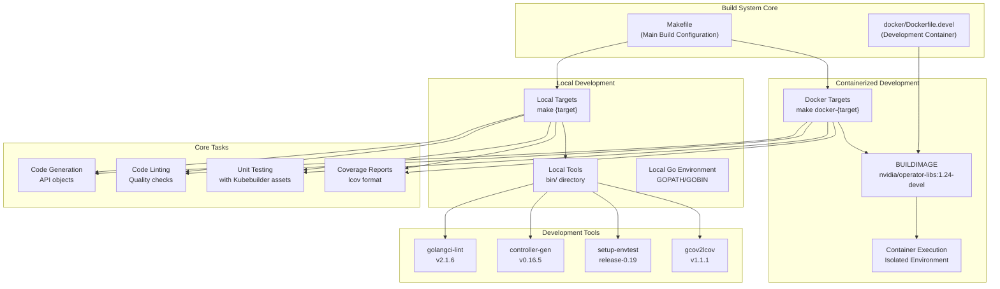
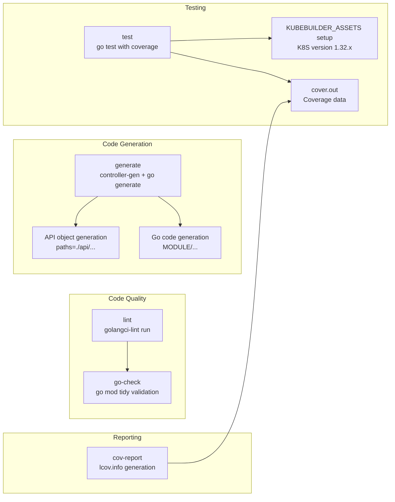
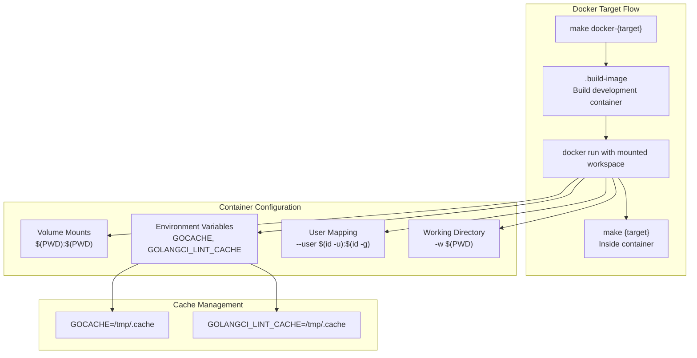
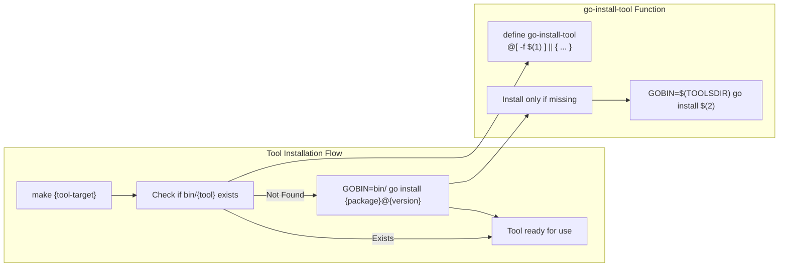

<!-- source: DeepWiki mcp.deepwiki.com · repo NVIDIA/k8s-operator-libs · page 6.1 Build System · fetched 2026-10-26 -->

# Build System

<details>
<summary>Relevant source files</summary>

The following files were used as context for generating this wiki page:

- [Makefile](Makefile)
- [docker/Dockerfile.devel](docker/Dockerfile.devel)

</details>


## Purpose and Scope

This document covers the Makefile-based build system used for developing, testing, and maintaining the k8s-operator-libs Go library. The build system provides both local and containerized development workflows, automated tool management, and comprehensive testing and code quality checks.

For information about code quality standards and CI/CD pipeline integration, see [Code Quality and CI/CD](#6.2).

## Build System Architecture

The build system centers around a comprehensive Makefile that orchestrates development tasks through both local and containerized execution modes.



**Sources:** [Makefile:1-139](), [docker/Dockerfile.devel:1-16]()

## Core Build Targets

The build system provides a comprehensive set of targets for different development workflows:

### Primary Targets

| Target | Purpose | Dependencies | Description |
|--------|---------|--------------|-------------|
| `all` | Complete build pipeline | `generate`, `check`, `test`, `cov-report` | Runs full development cycle |
| `check` | Code quality validation | `lint`, `go-check` | Validates code style and module consistency |
| `generate` | Code generation | `controller-gen` | Generates API objects and Go code |
| `test` | Unit testing | `setup-envtest`, `generate` | Runs test suite with Kubernetes assets |
| `cov-report` | Coverage reporting | `gcov2lcov`, `test` | Generates lcov coverage reports |

**Sources:** [Makefile:62-81]()

### Individual Task Targets



**Sources:** [Makefile:66-81]()

## Containerized Development Workflow

The build system supports containerized development through Docker targets and a development container image:

### Container Configuration

The development environment uses a minimal container based on the official Go image:

- **Base Image**: `golang:1.24` (configurable via `GOLANG_VERSION`)
- **Build Image Name**: `nvidia/operator-libs:1.24-devel` (default)
- **Container Registry**: Configurable via `REGISTRY` environment variable

**Sources:** [Makefile:19-26](), [docker/Dockerfile.devel:14-15]()

### Docker Target Execution



**Sources:** [Makefile:114-125]()

### Container Build Process

The container build process supports different execution modes:

- **Local Build**: `make .build-image` builds the development container locally
- **Remote Pull**: `make .pull-build-image` pulls from registry  
- **Remote Push**: `make .push-build-image` pushes to registry
- **Skip Build**: Set `SKIP_IMAGE_BUILD` to skip container building

**Sources:** [Makefile:97-112]()

## Tool Management System

The build system automatically manages development tools through a sophisticated download and caching mechanism:

### Tool Versions and Locations

| Tool | Version | Purpose | Installation Path |
|------|---------|---------|-------------------|
| `golangci-lint` | v2.1.6 | Code linting and style checking | `bin/golangci-lint` |
| `controller-gen` | v0.16.5 | Kubernetes API code generation | `bin/controller-gen` |
| `setup-envtest` | release-0.19 | Kubebuilder test environment | `bin/setup-envtest` |  
| `gcov2lcov` | v1.1.1 | Coverage format conversion | `bin/gcov2lcov` |

**Sources:** [Makefile:40-47]()

### Automatic Tool Installation

The build system uses the `go-install-tool` function for lazy tool installation:



**Sources:** [Makefile:127-133](), [Makefile:83-93]()

## Configuration and Environment Variables

The build system supports extensive configuration through environment variables:

### Core Configuration

| Variable | Default | Purpose |
|----------|---------|---------|
| `MODULE` | `github.com/NVIDIA/k8s-operator-libs` | Go module name |
| `DOCKER` | `docker` | Docker command to use |
| `GOLANG_VERSION` | `1.24` | Go version for containers |
| `GOOS` | `linux` | Target operating system |

### Image Configuration

| Variable | Default | Purpose |
|----------|---------|---------|
| `REGISTRY` | `nvidia` | Container registry |
| `IMAGE` | `$(REGISTRY)/operator-libs` | Base image name |
| `IMAGE_TAG` | `$(GOLANG_VERSION)` | Image tag |
| `BUILDIMAGE` | `$(IMAGE):$(IMAGE_TAG)-devel` | Full development image name |

### Testing Configuration

| Variable | Default | Purpose |
|----------|---------|---------|
| `ENVTEST_K8S_VERSION` | `1.32.x` | Kubernetes version for testing |
| `KUBEBUILDER_ASSETS` | Set by `setup-envtest` | Path to test binaries |

**Sources:** [Makefile:15-29](), [Makefile:76-78]()

## Build System Integration

The build system integrates with several external systems and follows established Go conventions:

### Go Module Integration

- Uses standard `go mod tidy` for dependency management
- Follows `GOPATH` and `GOBIN` conventions for tool installation
- Supports standard Go testing with `go test ./...`

### Shell Configuration

The build system configures bash for reliable script execution:
- **Shell**: `/usr/bin/env bash -o pipefail`
- **Flags**: `-ec` (exit on error, exit on command failure)
- Required for `setup-envtest.sh` compatibility

**Sources:** [Makefile:56-60]()

### Help System

A self-documenting help system extracts target descriptions from Makefile comments:

```bash
make help  # Shows all available targets with descriptions
```

The help system uses awk pattern matching to extract `## comment` annotations from target definitions.

**Sources:** [Makefile:135-138]()

---

