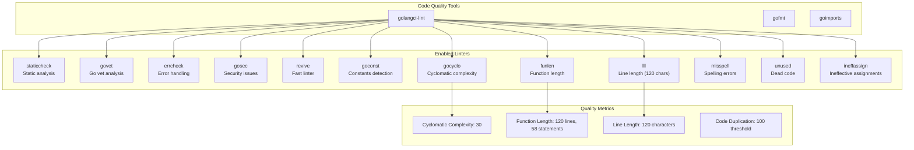
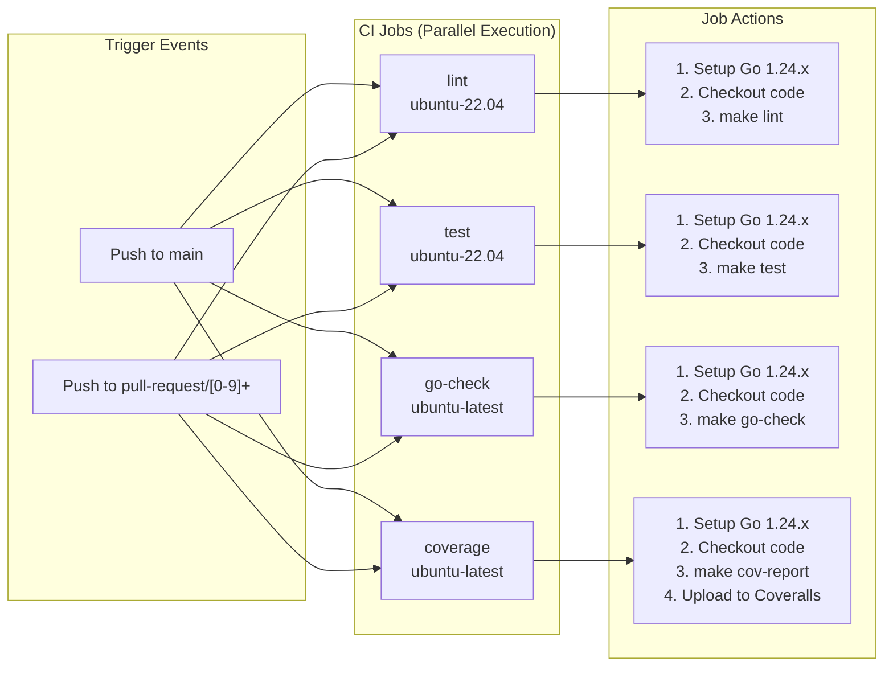
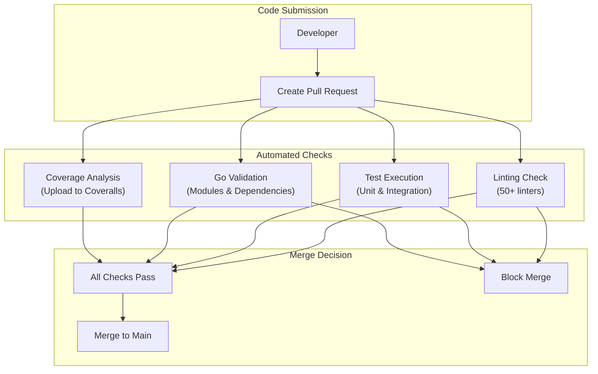

<!-- source: DeepWiki mcp.deepwiki.com · repo NVIDIA/k8s-operator-libs · page 6.2 Code Quality and CI/CD · fetched 2026-10-26 -->

# Code Quality and CI/CD

Relevant source files

The following files were used as context for generating this wiki page:

- [.github/copy-pr-bot.yaml](.github/copy-pr-bot.yaml)
- [.github/workflows/ci.yaml](.github/workflows/ci.yaml)
- [.golangci.yaml](.golangci.yaml)

This document covers the code quality standards, linting configuration, and continuous integration/continuous deployment (CI/CD) pipeline for the k8s-operator-libs repository. It explains the automated code quality checks, testing workflows, and development practices that ensure code reliability and maintainability. For information about the build system and development setup, see [Build System](#6.1). For details about testing frameworks and test execution, see [Testing](#5).

## Code Quality Standards

The repository enforces strict code quality standards through automated linting, formatting, and static analysis. The primary tool for code quality enforcement is `golangci-lint`, which runs a comprehensive set of linters to catch potential issues, enforce coding standards, and maintain code consistency.

### Linting Configuration

The linting configuration is defined in [.golangci.yaml:1-127]() and enables over 50 different linters to ensure comprehensive code quality checking. The configuration follows a strict approach with explicit linter selection rather than using defaults.

**Sources:** [.golangci.yaml:5-61](), [.golangci.yaml:75-96]()

### Dependency Management Rules

The linting configuration includes dependency guard rules that restrict which packages can be imported, ensuring proper architectural boundaries and preventing unwanted dependencies.

| Rule Category | Allowed Packages | Purpose |
|---------------|------------------|---------|
| Standard Library | `$gostd` | Core Go functionality |
| NVIDIA Packages | `github.com/NVIDIA` | Internal NVIDIA libraries |
| Logging | `github.com/go-logr/logr` | Structured logging |
| Kubernetes | `k8s.io`, `sigs.k8s.io` | Kubernetes ecosystem |

**Sources:** [.golangci.yaml:63-72]()

### Code Formatting Standards

The repository uses standard Go formatting tools with specific configuration for import organization:

- **gofmt**: Standard Go code formatting
- **goimports**: Import statement organization with local package prefixes set to `github.com/NVIDIA/k8s-operator-libs`

**Sources:** [.golangci.yaml:114-126]()

## CI/CD Pipeline

The continuous integration pipeline is implemented using GitHub Actions and defined in [.github/workflows/ci.yaml:1-70](). The pipeline consists of four parallel jobs that run on every push to main branch or pull request branches.

**Sources:** [.github/workflows/ci.yaml:15-70]()

### CI Jobs Breakdown

#### Lint Job
The `lint` job runs comprehensive code quality checks using the golangci-lint configuration. It executes the `make lint` target which processes all Go source files according to the linting rules defined in `.golangci.yaml`.

#### Test Job  
The `test` job executes the complete test suite using the `make test` target. This includes unit tests and integration tests for all components in the upgrade system.

#### Go-Check Job
The `go-check` job performs additional Go-specific validation through the `make go-check` target, which includes Go module validation, dependency checks, and other Go toolchain verifications.

#### Coverage Job
The `coverage` job generates test coverage reports using the `make cov-report` target and uploads the results to Coveralls for coverage tracking and reporting. The coverage data is generated in LCOV format for compatibility with external reporting tools.

**Sources:** [.github/workflows/ci.yaml:23-69]()

### Go Version Management

All CI jobs use Go version `1.24.x` as specified in the GitHub Actions workflow. This ensures consistency across all build and test environments and aligns with the project's Go version requirements.

**Sources:** [.github/workflows/ci.yaml:28-29](), [.github/workflows/ci.yaml:39-40](), [.github/workflows/ci.yaml:50-52](), [.github/workflows/ci.yaml:59-62]()

## Development Workflow Integration

The CI/CD pipeline integrates with the development workflow through automated pull request validation and branch protection. The copy-pr-bot configuration enables automatic copying of pull requests for internal development workflows.

### Branch Strategy
- **Main branch**: Protected branch requiring CI checks to pass
- **Pull request branches**: Follow the pattern `pull-request/[0-9]+`
- **Feature branches**: Must pass all CI checks before merging

### Quality Gates

**Sources:** [.github/workflows/ci.yaml:16-21](), [.github/copy-pr-bot.yaml:1-3]()

## Code Quality Exclusions

The linting configuration includes specific exclusions to handle generated code, third-party dependencies, and legacy code patterns appropriately.

### Excluded Paths
- `third_party$`: Third-party dependencies
- `builtin$`: Built-in utilities  
- `examples$`: Example code

### Excluded Presets
- `comments`: Comment-related linting rules
- `common-false-positives`: Known false positive patterns
- `legacy`: Legacy code compatibility
- `std-error-handling`: Standard error handling patterns

**Sources:** [.golangci.yaml:102-126]()

---

