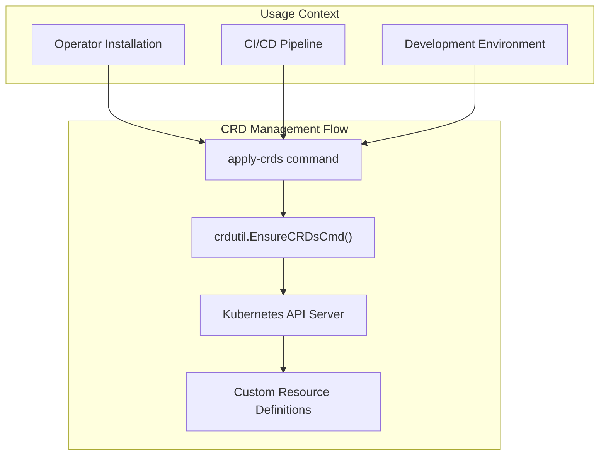
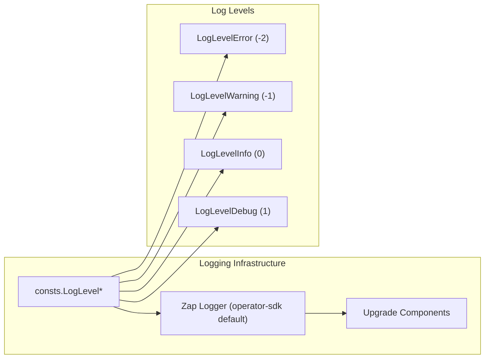
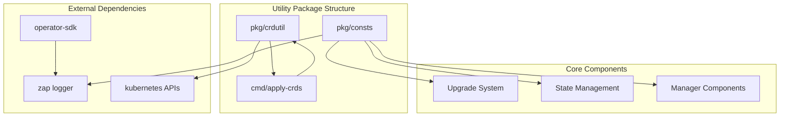

<!-- source: DeepWiki mcp.deepwiki.com · repo NVIDIA/k8s-operator-libs · page 7 Utilities and Helpers · fetched 2026-10-26 -->

# Utilities and Helpers

Relevant source files

The following files were used as context for generating this wiki page:

- [cmd/apply-crds/main.go](cmd/apply-crds/main.go)
- [pkg/consts/consts.go](pkg/consts/consts.go)

This page documents the utility functions, helper components, and supporting infrastructure that enable the core upgrade system functionality. These utilities provide common operations, constants, and tooling used throughout the k8s-operator-libs codebase.

For core upgrade system functionality, see [Core Upgrade System](#3). For build system documentation, see [Build System](#6.1).

## CRD Management Utilities

The library provides utilities for managing Custom Resource Definitions (CRDs) through the `crdutil` package. These utilities are essential for operators that need to install and manage CRDs programmatically.

### EnsureCRDsCmd Function

The primary CRD management utility is exposed through the `EnsureCRDsCmd` function, which provides a complete command-line interface for CRD installation and management.

**CRD Management Command Line Tool**

Sources: [cmd/apply-crds/main.go:1-24]()

The `apply-crds` command provides a standalone utility for CRD management operations. This tool encapsulates the complexity of CRD installation and updates, making it easy to integrate into deployment pipelines and development workflows.

## Constants and Configuration

The `consts` package provides shared constants used throughout the library, ensuring consistency across different components.

### Logging Level Constants

The library defines standard logging levels that integrate with the default zap logger used by operator-sdk:

| Constant | Value | Purpose |
|----------|--------|---------|
| `LogLevelError` | -2 | Error level logging |
| `LogLevelWarning` | -1 | Warning level logging |
| `LogLevelInfo` | 0 | Informational logging |
| `LogLevelDebug` | 1 | Debug level logging |

These constants provide a consistent logging interface across all upgrade management components.

**Logging Level Definitions**

Sources: [pkg/consts/consts.go:1-30]()

The logging constants are designed to work with zap logger but can be adapted for other logging frameworks if needed. The package comment indicates that different logger implementations may require adjustments to these values.

## Package Organization

The utilities are organized to support the overall library architecture without falling into specific functional packages:

**Utility Package Organization and Dependencies**

Sources: [pkg/consts/consts.go:19-21](), [cmd/apply-crds/main.go:19-22]()

The utility packages are designed to be foundational components that support higher-level functionality without creating circular dependencies. The `consts` package explicitly states that it contains "constants used throughout the projects and does not fall into a particular package", indicating its role as shared infrastructure.