# Page: Overview

# Overview

<details>
<summary>Relevant source files</summary>

The following files were used as context for generating this wiki page:

- [docs/automatic-ofed-upgrade.md](docs/automatic-ofed-upgrade.md)
- [go.mod](go.mod)
- [pkg/upgrade/safe_driver_load_manager.go](pkg/upgrade/safe_driver_load_manager.go)
- [pkg/upgrade/safe_driver_load_manager_test.go](pkg/upgrade/safe_driver_load_manager_test.go)

</details>


This document provides an overview of the NVIDIA k8s-operator-libs repository, a Go library designed for building Kubernetes operators that manage driver upgrade workflows. The library provides reusable components and state management capabilities for orchestrating complex node maintenance operations during driver upgrades.

For detailed information about the core upgrade system architecture, see [Architecture](#2). For specific upgrade modes and their implementation, see [Upgrade Modes](#3.2). For API specifications and custom resources, see [APIs and Custom Resources](#4).

## Purpose and Scope

The k8s-operator-libs repository is a specialized Go library that addresses the challenges of safely upgrading containerized drivers in Kubernetes clusters. The library focuses on three primary concerns:

**Driver Upgrade Orchestration**: Managing the complex workflow of upgrading drivers across cluster nodes while maintaining application availability and cluster stability.

**Safe Driver Loading**: Ensuring that nodes are properly prepared before driver loading to prevent workload disruption and resource access failures.

**Node Maintenance Coordination**: Providing flexible integration with external maintenance operators or direct node operations for cordoning, draining, and scheduling management.

The library is built as a reusable component that can be embedded into various NVIDIA operator projects, providing consistent upgrade behavior across different driver types (GPU drivers, network drivers, etc.).

## Library Architecture

The k8s-operator-libs follows a modular architecture centered around a state machine that manages node upgrade lifecycles. The library provides both direct node operations and external maintenance operator integration.

### Core Components

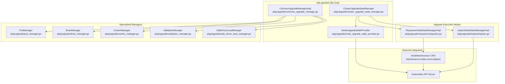

**Sources**: [go.mod:1-17](), [docs/automatic-ofed-upgrade.md:92-135](), [pkg/upgrade/safe_driver_load_manager.go:28-47]()

### Node Upgrade State Machine

The library implements a comprehensive state machine that tracks each node's progress through the upgrade workflow. The state machine ensures safe transitions and provides recovery mechanisms for failed operations.

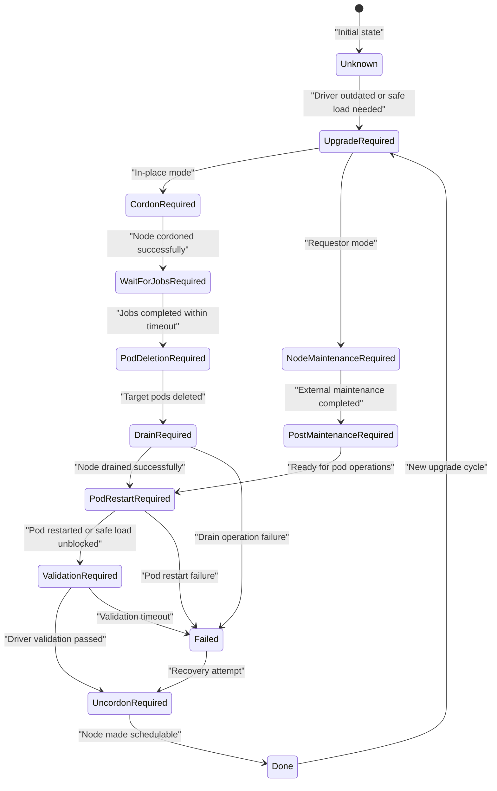

**Sources**: [docs/automatic-ofed-upgrade.md:70-84](), [docs/automatic-ofed-upgrade.md:86-90]()

## Key Features

### Dual Upgrade Modes

The library supports two distinct upgrade execution modes to accommodate different operational requirements and cluster configurations.

| Mode | Description | Use Case |
|------|-------------|----------|
| **In-place** | Direct node operations through Kubernetes API | Self-contained operators, simple deployments |
| **Requestor** | External maintenance operator integration | Complex maintenance workflows, multi-operator coordination |

**In-place Mode**: The library directly manages all node operations including cordoning, draining, and uncordoning through the standard Kubernetes API. This mode provides complete control over the upgrade process and maintains backward compatibility with existing operator implementations.

**Requestor Mode**: The library delegates node maintenance operations to an external maintenance operator via `NodeMaintenance` custom resources. This mode enables coordination between multiple operators and supports advanced maintenance policies.

**Sources**: [docs/automatic-ofed-upgrade.md:92-116](), [go.mod:6]()

### Safe Driver Loading

The safe driver loading feature prevents workload disruption during driver initialization by ensuring nodes are properly prepared before driver loading begins.

The implementation uses a two-phase approach:
1. **Blocking Phase**: Driver pod init container sets a safe load annotation and blocks until removed
2. **Preparation Phase**: Library cordons and drains the node, then removes the annotation to unblock loading

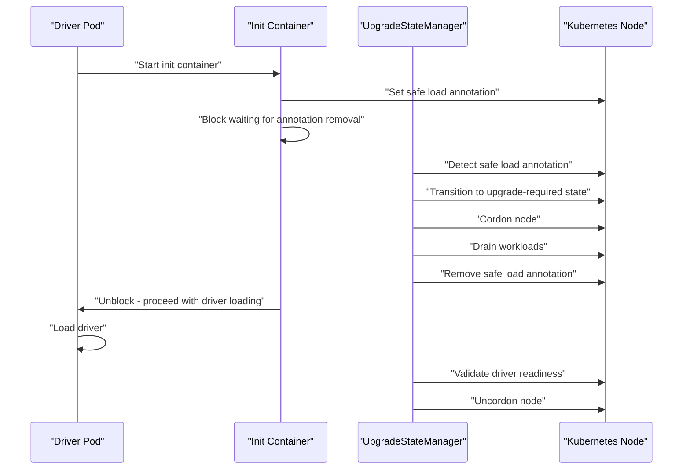

**Sources**: [docs/automatic-ofed-upgrade.md:43-66](), [pkg/upgrade/safe_driver_load_manager.go:49-71]()

### Node State Management

The library provides comprehensive node state tracking through labels and annotations. Each node's upgrade status is reflected in dedicated Kubernetes metadata that can be queried and monitored.

**State Labels**: The primary state is tracked via the `nvidia.com/<driver-name>-driver-upgrade-state` label with values including `upgrade-required`, `cordon-required`, `drain-required`, `validation-required`, `upgrade-done`, and `upgrade-failed`.

**Safe Load Annotations**: The safe driver loading mechanism uses the annotation key format defined in [pkg/upgrade/safe_driver_load_manager.go:58]() to coordinate between init containers and the upgrade state manager.

**Sources**: [docs/automatic-ofed-upgrade.md:70-84](), [pkg/upgrade/safe_driver_load_manager.go:49-71]()

## Integration Points

### Kubernetes API Dependencies

The library integrates extensively with the Kubernetes ecosystem through several key dependencies:

- **controller-runtime**: Provides the foundational controller framework and client interfaces
- **k8s.io/client-go**: Enables direct Kubernetes API interactions for node and pod operations
- **k8s.io/kubectl**: Supports drain operations and advanced node management capabilities

**Sources**: [go.mod:11-16]()

### External Maintenance Operator

When operating in requestor mode, the library integrates with the Mellanox maintenance operator through the `NodeMaintenance` custom resource definition. This enables sophisticated maintenance workflows and multi-operator coordination.

The integration supports both exclusive and shared-requestor patterns, allowing multiple operators to coordinate maintenance operations on the same nodes without conflicts.

**Sources**: [go.mod:6](), [docs/automatic-ofed-upgrade.md:117-135]()

### Embedding in Operator Projects

The library is designed to be embedded within larger operator projects as a reusable component. Operators can instantiate the `ClusterUpgradeStateManager` with appropriate configuration and integrate it into their reconciliation loops to provide automatic driver upgrade capabilities.

The modular design allows operators to customize specific aspects of the upgrade process while leveraging the core state management and orchestration logic provided by the library.

**Sources**: [go.mod:1](), [docs/automatic-ofed-upgrade.md:8-39]()

---

# Page: Architecture

# Architecture

<details>
<summary>Relevant source files</summary>

The following files were used as context for generating this wiki page:

- [pkg/upgrade/common_manager.go](pkg/upgrade/common_manager.go)
- [pkg/upgrade/consts.go](pkg/upgrade/consts.go)
- [pkg/upgrade/upgrade_state.go](pkg/upgrade/upgrade_state.go)

</details>


This document provides a comprehensive overview of the k8s-operator-libs system architecture, focusing on the core driver upgrade management components and their interactions. It covers the main orchestration components, state management, and the two supported upgrade modes.

For information about specific API definitions and custom resources, see [APIs and Custom Resources](#4). For details on individual manager components, see [Manager Components](#3.3).

## System Overview

The k8s-operator-libs library provides a state machine-driven approach to managing Kubernetes driver upgrades. The system is built around a central orchestrator that coordinates specialized managers to handle different aspects of the upgrade process.

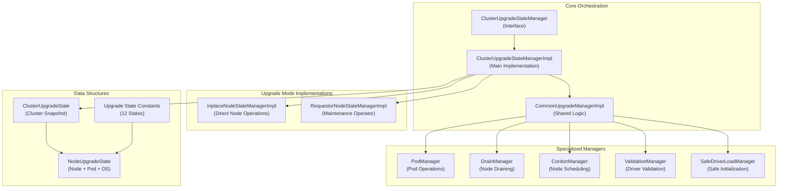

Sources: [pkg/upgrade/upgrade_state.go:34-92](), [pkg/upgrade/common_manager.go:22-54](), [pkg/upgrade/common_manager.go:82-133]()

## Core Upgrade Orchestration

The upgrade orchestration follows a well-defined flow from state building through processing. The `ClusterUpgradeStateManagerImpl` serves as the central coordinator.

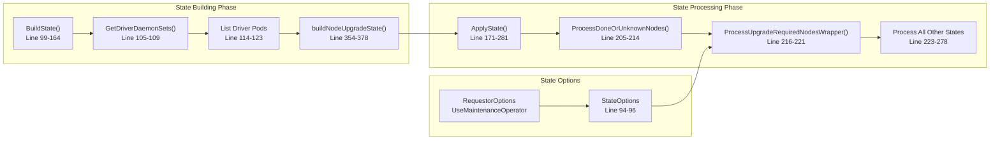

Sources: [pkg/upgrade/upgrade_state.go:98-164](), [pkg/upgrade/upgrade_state.go:171-281](), [pkg/upgrade/upgrade_state.go:94-96]()

## Upgrade State Machine

The system implements a comprehensive state machine with 12 distinct states that nodes transition through during driver upgrades.

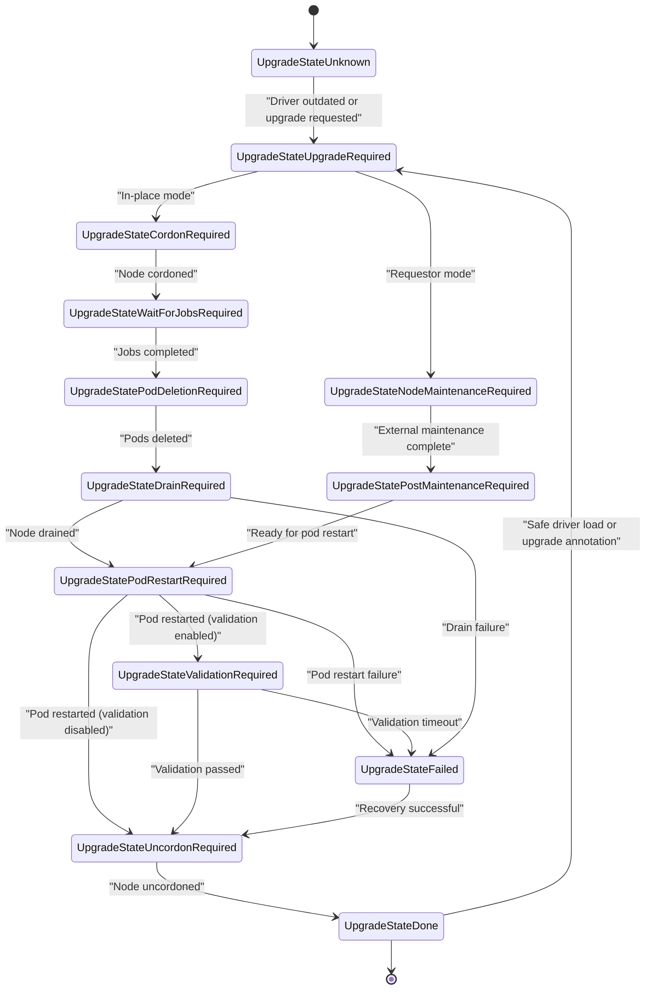

Sources: [pkg/upgrade/consts.go:48-82](), [pkg/upgrade/upgrade_state.go:184-198]()

## Manager Subsystem Architecture

The system uses specialized managers to handle different aspects of the upgrade process, all coordinated through the `CommonUpgradeManagerImpl`.

```mermaid
graph TB
    subgraph "State Provider Layer"
        NUSP["NodeUpgradeStateProvider<br/>(Labels & Annotations)"]
    end
    
    subgraph "Manager Layer"
        CUMI["CommonUpgradeManagerImpl"]
        
        PM["PodManager<br/>- SchedulePodsRestart()<br/>- SchedulePodEviction()<br/>- ScheduleCheckOnPodCompletion()"]
        
        DM["DrainManager<br/>- ScheduleNodesDrain()<br/>- DrainConfiguration"]
        
        CM["CordonManager<br/>- Cordon()<br/>- Uncordon()"]
        
        VM["ValidationManager<br/>- Validate()<br/>- podSelector"]
        
        SDLM["SafeDriverLoadManager<br/>- UnblockLoading()<br/>- IsWaitingForSafeDriverLoad()"]
    end
    
    subgraph "Processing Methods"
        ProcessCordon["ProcessCordonRequiredNodes()<br/>Line 361-379"]
        ProcessWait["ProcessWaitForJobsRequiredNodes()<br/>Line 384-419"]
        ProcessDeletion["ProcessPodDeletionRequiredNodes()<br/>Line 424-453"]
        ProcessDrain["ProcessDrainNodes()<br/>Line 329-357"]
        ProcessRestart["ProcessPodRestartNodes()<br/>Line 457-524"]
        ProcessValidation["ProcessValidationRequiredNodes()<br/>Line 573-603"]
    end
    
    CUMI --> PM
    CUMI --> DM
    CUMI --> CM
    CUMI --> VM
    CUMI --> SDLM
    CUMI --> NUSP
    
    ProcessCordon --> CM
    ProcessWait --> PM
    ProcessDeletion --> PM
    ProcessDrain --> DM
    ProcessRestart --> PM
    ProcessRestart --> SDLM
    ProcessValidation --> VM
    ProcessValidation --> SDLM
```

Sources: [pkg/upgrade/common_manager.go:82-133](), [pkg/upgrade/common_manager.go:361-379](), [pkg/upgrade/common_manager.go:384-419](), [pkg/upgrade/common_manager.go:424-453]()

## Upgrade Mode Comparison

The system supports two distinct upgrade modes, each implementing the `ProcessNodeStateManager` interface with different operational approaches.

| Aspect | In-Place Mode (`InplaceNodeStateManagerImpl`) | Requestor Mode (`RequestorNodeStateManagerImpl`) |
|--------|-----------------------------------------------|--------------------------------------------------|
| **Node Operations** | Direct Kubernetes API calls | External maintenance operator integration |
| **Cordoning** | Internal `CordonManager.Cordon()` | Via NodeMaintenance CRD |
| **Draining** | Internal `DrainManager.ScheduleNodesDrain()` | Handled by external operator |
| **State Flow** | `UpgradeRequired` → `CordonRequired` → ... | `UpgradeRequired` → `NodeMaintenanceRequired` → ... |
| **Dependencies** | Only Kubernetes API | NodeMaintenance CRDs + external operator |
| **Configuration** | Always available | Requires `UseMaintenanceOperator: true` |

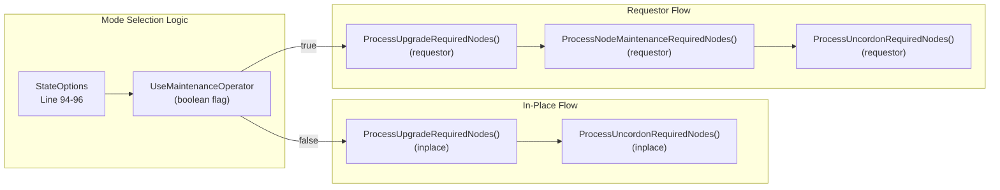

Sources: [pkg/upgrade/upgrade_state.go:287-325](), [pkg/upgrade/upgrade_state.go:57-92]()

---

# Page: Core Upgrade System

# Core Upgrade System

<details>
<summary>Relevant source files</summary>

The following files were used as context for generating this wiki page:

- [pkg/upgrade/upgrade_state.go](pkg/upgrade/upgrade_state.go)
- [pkg/upgrade/upgrade_state_test.go](pkg/upgrade/upgrade_state_test.go)

</details>


## Purpose and Scope

The Core Upgrade System is the central orchestration layer responsible for managing driver upgrades across Kubernetes clusters. This system implements a sophisticated state machine that coordinates node-by-node driver upgrades while respecting operational constraints such as maximum parallel upgrades, node availability requirements, and validation policies.

This document covers the core state management, orchestration logic, and upgrade workflows. For information about specific manager components (PodManager, DrainManager, etc.), see [Manager Components](#3.3). For details about upgrade modes implementation, see [Upgrade Modes](#3.2). For API specifications and custom resource definitions, see [APIs and Custom Resources](#4).

## System Architecture

The Core Upgrade System is built around the `ClusterUpgradeStateManager` interface and its primary implementation `ClusterUpgradeStateManagerImpl`. This manager serves as a state machine that processes cluster-wide upgrade states and coordinates transitions between upgrade phases.

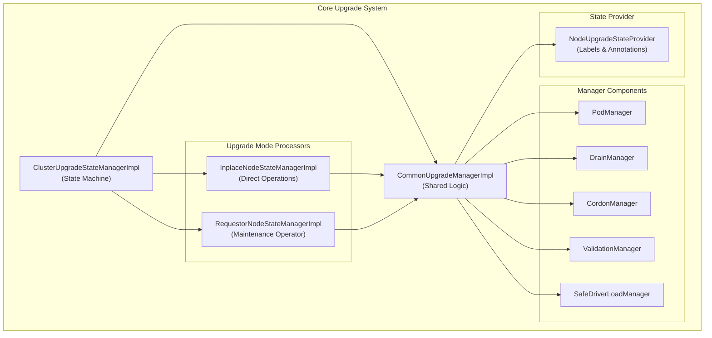

**Core State Management Flow**

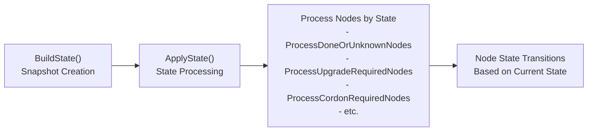

Sources: [pkg/upgrade/upgrade_state.go:34-92](), [pkg/upgrade/upgrade_state.go:98-164](), [pkg/upgrade/upgrade_state.go:166-281]()

## Upgrade State Machine

The system implements a comprehensive state machine with 12 distinct node upgrade states. Each state represents a specific phase in the upgrade lifecycle, with well-defined entry and exit conditions.

### State Definitions and Transitions

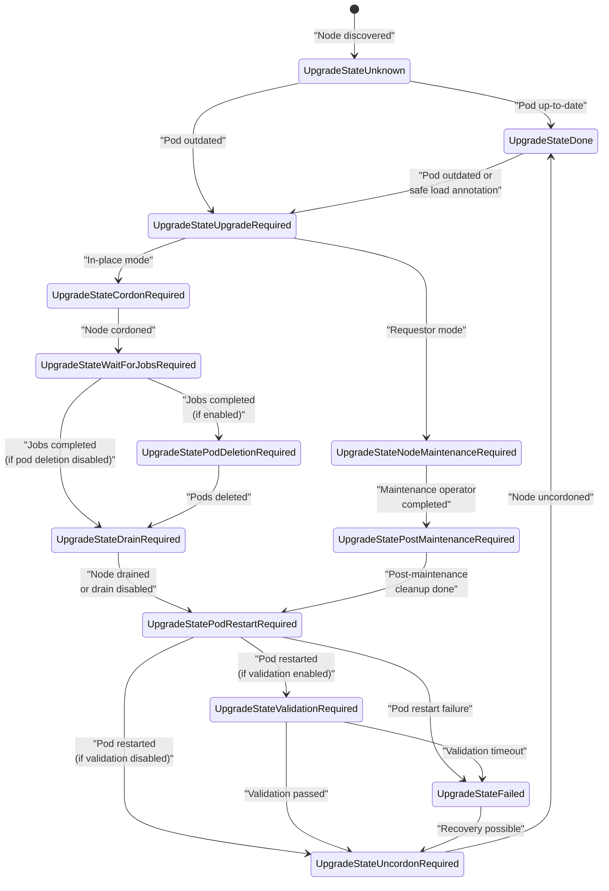

### State Processing Methods

The `ClusterUpgradeStateManagerImpl` processes nodes through dedicated methods for each state:

| State | Processing Method | Purpose |
|-------|------------------|---------|
| `UpgradeStateUnknown` / `UpgradeStateDone` | `ProcessDoneOrUnknownNodes()` | Determine if upgrade is needed |
| `UpgradeStateUpgradeRequired` | `ProcessUpgradeRequiredNodes()` | Start upgrade process |
| `UpgradeStateCordonRequired` | `ProcessCordonRequiredNodes()` | Cordon nodes |
| `UpgradeStateWaitForJobsRequired` | `ProcessWaitForJobsRequiredNodes()` | Wait for job completion |
| `UpgradeStatePodDeletionRequired` | `ProcessPodDeletionRequiredNodes()` | Delete pods (optional) |
| `UpgradeStateDrainRequired` | `ProcessDrainNodes()` | Drain nodes |
| `UpgradeStateNodeMaintenanceRequired` | `ProcessNodeMaintenanceRequiredNodes()` | Handle maintenance operator |
| `UpgradeStatePodRestartRequired` | `ProcessPodRestartNodes()` | Restart driver pods |
| `UpgradeStateValidationRequired` | `ProcessValidationRequiredNodes()` | Validate upgrade |
| `UpgradeStateUncordonRequired` | `ProcessUncordonRequiredNodes()` | Uncordon nodes |
| `UpgradeStateFailed` | `ProcessUpgradeFailedNodes()` | Handle failures |

Sources: [pkg/upgrade/upgrade_state.go:204-281](), [pkg/upgrade/upgrade_state_test.go:196-225](), [pkg/upgrade/upgrade_state_test.go:884-918]()

## Operational Constraints

The upgrade system enforces several operational constraints to maintain cluster stability and control upgrade velocity.

### Parallel Upgrade Limits

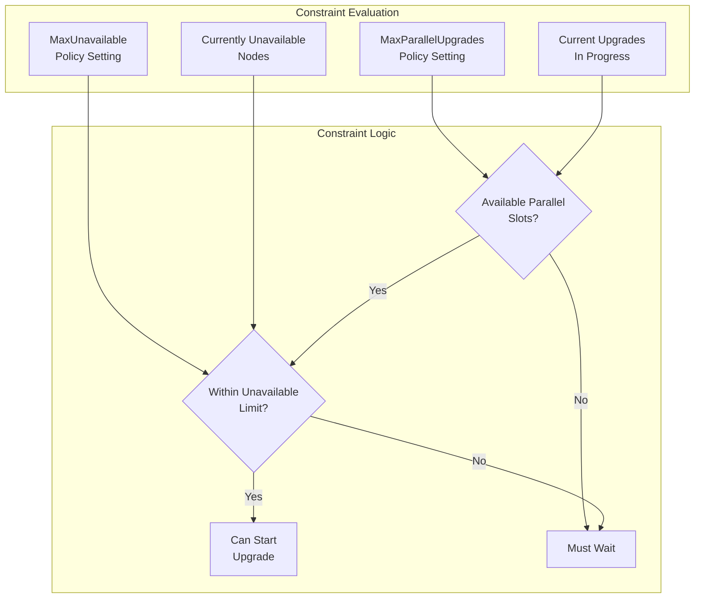

The system supports flexible upgrade constraints:
- `MaxParallelUpgrades`: Limits concurrent upgrades (0 = unlimited)
- `MaxUnavailable`: Limits total unavailable nodes (supports percentage or absolute values)
- The more restrictive constraint takes precedence

Sources: [pkg/upgrade/upgrade_state_test.go:294-349](), [pkg/upgrade/upgrade_state_test.go:384-440](), [pkg/upgrade/upgrade_state_test.go:514-544]()

### Node State Tracking

The system tracks node state through Kubernetes labels and annotations:

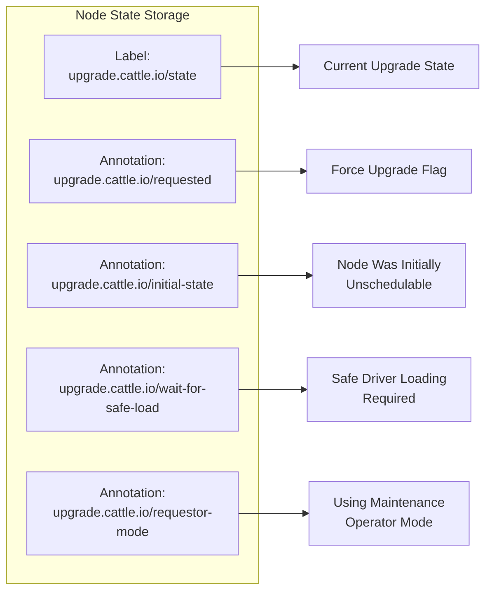

Sources: [pkg/upgrade/upgrade_state.go:354-378](), [pkg/upgrade/upgrade_state_test.go:226-270](), [pkg/upgrade/upgrade_state_test.go:271-293]()

## Key Processing Workflows  

### BuildState Workflow

The `BuildState()` method creates a point-in-time snapshot of the cluster upgrade state:

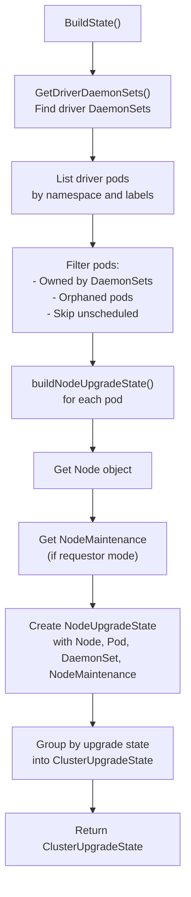

### ApplyState Workflow

The `ApplyState()` method processes the cluster state and applies upgrade policy:

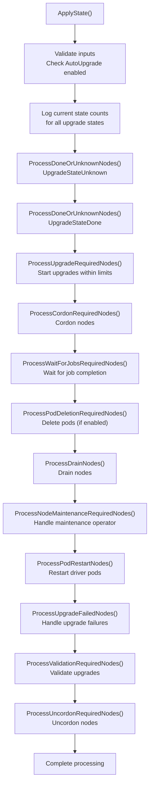

Sources: [pkg/upgrade/upgrade_state.go:98-164](), [pkg/upgrade/upgrade_state.go:166-281]()

## Integration Points

The Core Upgrade System integrates with several external components and systems:

### Kubernetes API Integration

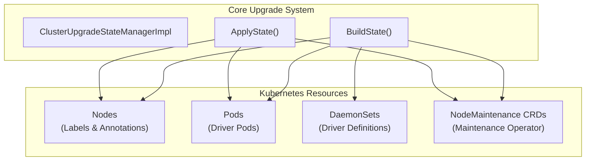

### Manager Component Integration

The Core Upgrade System delegates specific operations to specialized manager components:

| Manager | Responsibility | Integration Point |
|---------|---------------|-------------------|
| `PodManager` | Pod lifecycle operations | Pod restart, deletion, validation |
| `DrainManager` | Node draining operations | Node drain scheduling and monitoring |
| `CordonManager` | Node scheduling control | Cordon/uncordon operations |
| `ValidationManager` | Upgrade validation | Post-upgrade validation checks |
| `SafeDriverLoadManager` | Safe driver loading | Driver initialization coordination |
| `NodeUpgradeStateProvider` | State persistence | Node label/annotation management |

Sources: [pkg/upgrade/upgrade_state.go:57-62](), [pkg/upgrade/upgrade_state.go:327-350](), [pkg/upgrade/upgrade_state_test.go:46-71]()

---

# Page: State Management

# State Management

<details>
<summary>Relevant source files</summary>

The following files were used as context for generating this wiki page:

- [pkg/upgrade/consts.go](pkg/upgrade/consts.go)
- [pkg/upgrade/node_upgrade_state_provider.go](pkg/upgrade/node_upgrade_state_provider.go)
- [pkg/upgrade/util.go](pkg/upgrade/util.go)

</details>


This document covers the node upgrade state management system in the k8s-operator-libs upgrade package. It explains how nodes are tracked through various upgrade states, the mechanisms for state persistence, and the utilities that support state transitions during driver upgrades.

For information about upgrade execution modes, see [Upgrade Modes](#3.2). For details about the specialized managers that perform upgrade operations, see [Manager Components](#3.3).

## Overview

The state management system tracks the progress of driver upgrades on individual Kubernetes nodes using a comprehensive state machine with 12 distinct states. Each node's current state is persisted using Kubernetes labels and annotations, allowing the upgrade system to maintain progress across controller restarts and handle failure recovery.

The system uses a centralized `NodeUpgradeStateProvider` interface to ensure thread-safe, synchronized access to node state information and provides utilities for state transitions.

## Upgrade States

The upgrade system defines 12 distinct states that represent the complete lifecycle of a node upgrade process:

| State | Constant | Purpose |
|-------|----------|---------|
| Unknown | `UpgradeStateUnknown` | Initial state when upgrade flow is disabled or node hasn't been processed |
| Upgrade Required | `UpgradeStateUpgradeRequired` | Driver pod is outdated and requires upgrade |
| Cordon Required | `UpgradeStateCordonRequired` | Node needs to be made unschedulable |
| Wait for Jobs Required | `UpgradeStateWaitForJobsRequired` | Waiting for running jobs to complete |
| Pod Deletion Required | `UpgradeStatePodDeletionRequired` | Pods need to be deleted for upgrade to proceed |
| Drain Required | `UpgradeStateDrainRequired` | Node requires draining of workloads |
| Node Maintenance Required | `UpgradeStateNodeMaintenanceRequired` | External maintenance operator handles the node |
| Post Maintenance Required | `UpgradeStatePostMaintenanceRequired` | Post-maintenance operations needed |
| Pod Restart Required | `UpgradeStatePodRestartRequired` | Driver pod needs restart or safe load unblocking |
| Validation Required | `UpgradeStateValidationRequired` | New driver validation before completion |
| Uncordon Required | `UpgradeStateUncordonRequired` | Node ready to be made schedulable again |
| Done | `UpgradeStateDone` | Upgrade completed successfully |
| Failed | `UpgradeStateFailed` | Upgrade encountered an error |

### State Machine Flow

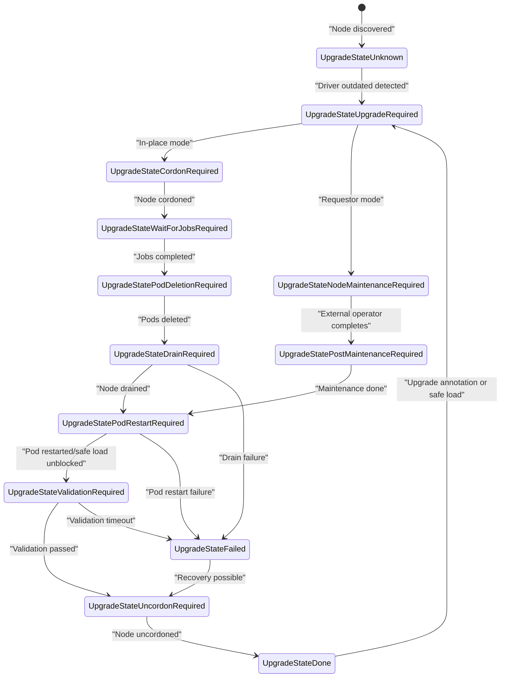

Sources: [pkg/upgrade/consts.go:49-82]()

## State Tracking Mechanism

The state management system uses Kubernetes node labels and annotations to persist upgrade state information. This approach ensures that state survives controller restarts and provides a declarative way to track upgrade progress.

### Labels and Annotations

The system uses formatted keys that incorporate the driver name to avoid conflicts:

```mermaid
graph TB
    subgraph "Node Labels"
        StateLabel["nvidia.com/{driver}-driver-upgrade-state<br/>Current upgrade state"]
        SkipLabel["nvidia.com/{driver}-driver-upgrade.skip<br/>Skip upgrade flag"]
    end
    
    subgraph "Node Annotations"
        SafeLoadAnnot["nvidia.com/{driver}-driver-upgrade.driver-wait-for-safe-load<br/>Safe load blocking"]
        InitialStateAnnot["nvidia.com/{driver}-driver-upgrade.node-initial-state.unschedulable<br/>Initial schedulability state"]
        WaitStartAnnot["nvidia.com/{driver}-driver-upgrade-wait-for-pod-completion-start-time<br/>Pod completion wait start time"]
        ValidationStartAnnot["nvidia.com/{driver}-driver-upgrade-validation-start-time<br/>Validation start time"]
        UpgradeRequestedAnnot["nvidia.com/{driver}-driver-upgrade-requested<br/>External upgrade request"]
        RequestorModeAnnot["nvidia.com/{driver}-driver-upgrade-requestor-mode<br/>Requestor mode flag"]
    end
    
    StateLabel --> |"Primary state tracking"| StateManagement["State Management System"]
    SkipLabel --> |"Upgrade control"| StateManagement
    SafeLoadAnnot --> |"Safe loading control"| StateManagement
    InitialStateAnnot --> |"Recovery information"| StateManagement
    WaitStartAnnot --> |"Timeout tracking"| StateManagement
    ValidationStartAnnot --> |"Timeout tracking"| StateManagement
    UpgradeRequestedAnnot --> |"External triggers"| StateManagement
    RequestorModeAnnot --> |"Mode selection"| StateManagement
```

The utility functions in [pkg/upgrade/util.go:106-131]() provide formatted key generation:

- `GetUpgradeStateLabelKey()` - Returns the primary state label key
- `GetUpgradeSkipNodeLabelKey()` - Returns the skip upgrade label key  
- `GetUpgradeDriverWaitForSafeLoadAnnotationKey()` - Returns safe load annotation key
- `GetUpgradeInitialStateAnnotationKey()` - Returns initial state annotation key
- `GetUpgradeRequestedAnnotationKey()` - Returns upgrade requested annotation key
- `GetUpgradeRequestorModeAnnotationKey()` - Returns requestor mode annotation key

Sources: [pkg/upgrade/consts.go:19-47](), [pkg/upgrade/util.go:106-131]()

## NodeUpgradeStateProvider

The `NodeUpgradeStateProvider` interface provides the core abstraction for state management operations. It ensures thread-safe access to node objects and maintains cache consistency.

### Interface Definition

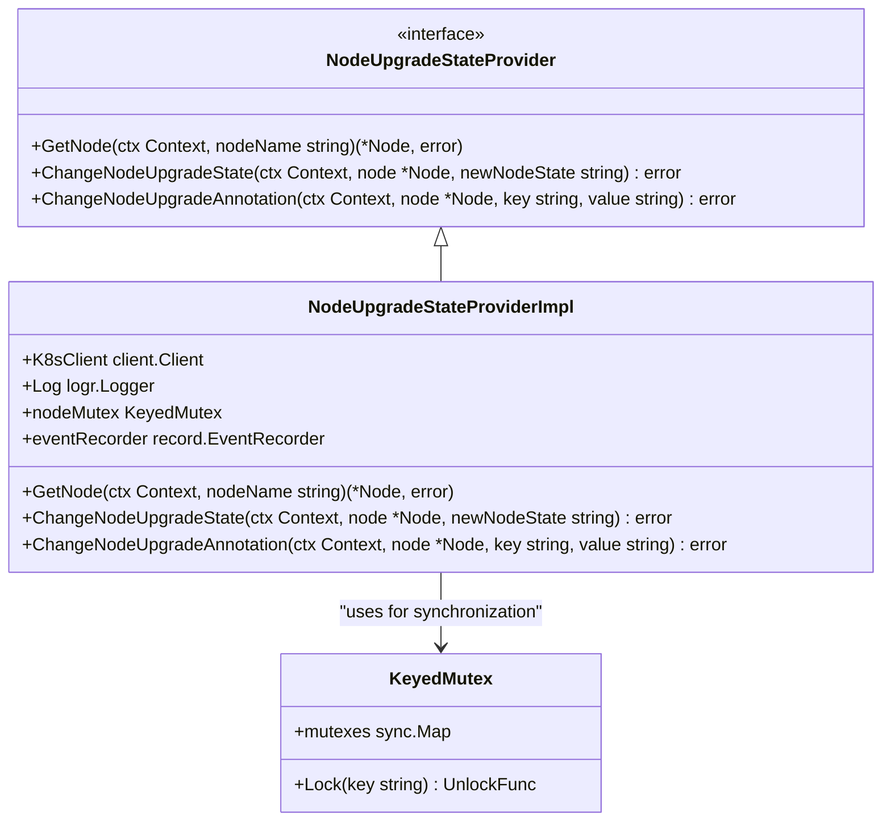

### Key Features

**Thread-Safe Access**: The `NodeUpgradeStateProviderImpl` uses a `KeyedMutex` to ensure that only one goroutine can modify a specific node at a time. This prevents race conditions during concurrent state changes.

**Cache Consistency**: After updating node labels or annotations, the provider polls the Kubernetes API until the operator cache reflects the changes. This ensures subsequent operations see the updated state.

**Event Recording**: State changes are recorded as Kubernetes events, providing audit trails and debugging information.

### State Change Process

The state change process follows these steps:

1. **Acquire Lock**: Use `KeyedMutex.Lock()` to get exclusive access to the node
2. **Apply Patch**: Use Kubernetes patch operations to update labels/annotations
3. **Wait for Cache**: Poll the API until the operator cache shows the updated values
4. **Release Lock**: Automatically release the lock when the function completes
5. **Record Event**: Log the state change as a Kubernetes event

Sources: [pkg/upgrade/node_upgrade_state_provider.go:33-56](), [pkg/upgrade/util.go:72-89]()

## State Management Architecture

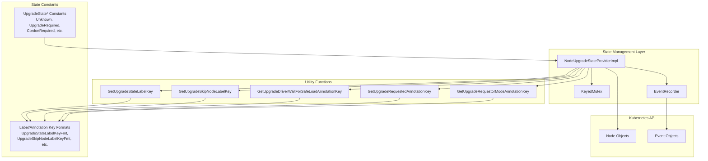

Sources: [pkg/upgrade/node_upgrade_state_provider.go:39-56](), [pkg/upgrade/util.go:91-161](), [pkg/upgrade/consts.go:19-83]()

## Synchronization and Thread Safety

The state management system provides several synchronization primitives to ensure safe concurrent access:

### KeyedMutex

The `KeyedMutex` class provides per-node locking using a sync.Map to store individual mutexes for each node name:

- **Lock Acquisition**: `Lock(key string) UnlockFunc` returns a function to release the lock
- **Automatic Cleanup**: Mutexes are created on-demand and stored efficiently
- **Deadlock Prevention**: Uses defer patterns to ensure locks are always released

### StringSet

The `StringSet` utility provides thread-safe set operations for tracking collections of node names or other string identifiers:

- **Thread-Safe Operations**: Add, Remove, Has, and Clear methods use read-write locks
- **Efficient Membership Testing**: O(1) lookup performance using internal map
- **Concurrent Access**: Multiple readers can access simultaneously, with exclusive writes

Sources: [pkg/upgrade/util.go:29-89]()

## State Persistence and Recovery

The state management system is designed to handle controller restarts and failures gracefully:

### Cache Synchronization

After updating node state, the system waits up to 10 seconds for the operator cache to reflect changes using `wait.PollImmediateUntil()`. This ensures that subsequent reconciliation loops see consistent state.

### Initial State Tracking

The system tracks whether a node was initially unschedulable before starting an upgrade using the `UpgradeInitialStateAnnotationKeyFmt` annotation. This allows proper restoration of the node's scheduling state after upgrade completion.

### Timeout Tracking

Time-based operations (job completion waits, validation timeouts) store their start times in node annotations, allowing the system to resume timeout calculations after controller restarts.

Sources: [pkg/upgrade/node_upgrade_state_provider.go:100-134](), [pkg/upgrade/node_upgrade_state_provider.go:171-197]()

---

# Page: Upgrade Modes

# Upgrade Modes

<details>
<summary>Relevant source files</summary>

The following files were used as context for generating this wiki page:

- [pkg/upgrade/upgrade_inplace.go](pkg/upgrade/upgrade_inplace.go)
- [pkg/upgrade/upgrade_requestor.go](pkg/upgrade/upgrade_requestor.go)

</details>


## Purpose and Scope

This document explains the two upgrade modes available in the k8s-operator-libs upgrade system: **In-Place Mode** and **Requestor Mode**. These modes determine how node maintenance operations are performed during driver upgrades. For details about the overall upgrade state management, see [State Management](#3.1). For information about the specific manager components used by these modes, see [Manager Components](#3.3).

## Overview

The upgrade system supports two distinct operational modes, each implementing the `ProcessNodeStateManager` interface but with different approaches to node maintenance:

- **In-Place Mode**: Directly performs node operations (cordon, drain, uncordon) using internal managers
- **Requestor Mode**: Delegates node maintenance to an external maintenance operator via NodeMaintenance custom resources

Both modes share common functionality through the `CommonUpgradeManagerImpl` base class but differ in their execution strategies for node maintenance operations.

## Architecture Overview

```mermaid
graph TB
    subgraph "Upgrade Mode Selection"
        Policy["DriverUpgradePolicySpec"]
        StateOpts["StateOptions"]
        ClusterMgr["ClusterUpgradeStateManager"]
    end
    
    subgraph "In-Place Mode Implementation"
        InPlace["InplaceNodeStateManagerImpl"]
        InPlaceNew["NewInplaceNodeStateManagerImpl()"]
        InPlaceProcess["ProcessUpgradeRequiredNodes()"]
        InPlaceUncordon["ProcessUncordonRequiredNodes()"]
    end
    
    subgraph "Requestor Mode Implementation" 
        Requestor["RequestorNodeStateManagerImpl"]
        RequestorNew["NewRequestorNodeStateManagerImpl()"]
        RequestorProcess["ProcessUpgradeRequiredNodes()"]
        RequestorMaint["ProcessNodeMaintenanceRequiredNodes()"]
        RequestorUncordon["ProcessUncordonRequiredNodes()"]
    end
    
    subgraph "External Integration"
        NodeMaintCRD["NodeMaintenance CRDs"]
        MaintOp["External Maintenance Operator"]
    end
    
    Policy --> ClusterMgr
    StateOpts --> ClusterMgr
    
    ClusterMgr --> InPlaceNew
    ClusterMgr --> RequestorNew
    
    InPlaceNew --> InPlace
    RequestorNew --> Requestor
    
    InPlace --> InPlaceProcess
    InPlace --> InPlaceUncordon
    
    Requestor --> RequestorProcess
    Requestor --> RequestorMaint
    Requestor --> RequestorUncordon
    
    RequestorProcess --> NodeMaintCRD
    NodeMaintCRD --> MaintOp
```

Sources: [pkg/upgrade/upgrade_inplace.go:28-40](), [pkg/upgrade/upgrade_requestor.go:84-273]()

## In-Place Mode

In-Place Mode performs node maintenance operations directly using internal managers. This mode provides full control over the upgrade process without external dependencies.

### Implementation Details

The `InplaceNodeStateManagerImpl` struct extends `CommonUpgradeManagerImpl` and implements direct node operations:

```mermaid
graph TD
    subgraph "InplaceNodeStateManagerImpl Structure"
        InPlaceImpl["InplaceNodeStateManagerImpl"]
        CommonImpl["*CommonUpgradeManagerImpl"]
        
        InPlaceImpl --> CommonImpl
    end
    
    subgraph "Core Methods"
        ProcessUpgrade["ProcessUpgradeRequiredNodes()"]
        ProcessUncordon["ProcessUncordonRequiredNodes()"]
        ProcessMaint["ProcessNodeMaintenanceRequiredNodes()"]
    end
    
    subgraph "Internal Operations"
        CordonMgr["CordonManager.Uncordon()"]
        StateProvider["NodeUpgradeStateProvider.ChangeNodeUpgradeState()"]
        UpgradeLogic["Direct Node State Transitions"]
    end
    
    InPlaceImpl --> ProcessUpgrade
    InPlaceImpl --> ProcessUncordon  
    InPlaceImpl --> ProcessMaint
    
    ProcessUpgrade --> UpgradeLogic
    ProcessUncordon --> CordonMgr
    ProcessUncordon --> StateProvider
    
    ProcessMaint -.-> NullOp["No-op implementation"]
```

Sources: [pkg/upgrade/upgrade_inplace.go:28-31](), [pkg/upgrade/upgrade_inplace.go:42-112](), [pkg/upgrade/upgrade_inplace.go:122-147]()

### Key Operations

In-Place Mode handles the following operations directly:

| Operation | Implementation | State Transition |
|-----------|---------------|------------------|
| Upgrade Initiation | `ProcessUpgradeRequiredNodes()` | `UpgradeRequired` → `CordonRequired` |
| Node Uncordoning | `ProcessUncordonRequiredNodes()` | `UncordonRequired` → `Done` |
| Maintenance Processing | `ProcessNodeMaintenanceRequiredNodes()` | No-op (returns immediately) |

The mode respects upgrade limits and availability constraints through `MaxParallelUpgrades` and `MaxUnavailable` policy settings.

Sources: [pkg/upgrade/upgrade_inplace.go:44-112](), [pkg/upgrade/upgrade_inplace.go:114-120](), [pkg/upgrade/upgrade_inplace.go:124-147]()

## Requestor Mode

Requestor Mode delegates node maintenance operations to an external maintenance operator by creating and managing NodeMaintenance custom resources.

### Configuration

Requestor Mode is configured through the `RequestorOptions` struct:

```mermaid
graph LR
    subgraph "RequestorOptions Configuration"
        UseMainOp["UseMaintenanceOperator: bool"]
        RequestorID["MaintenanceOPRequestorID: string"] 
        RequestorNS["MaintenanceOPRequestorNS: string"]
        NamePrefix["NodeMaintenanceNamePrefix: string"]
        PodFilter["MaintenanceOPPodEvictionFilter: []PodEvictionFiterEntry"]
    end
    
    subgraph "Environment Variables"
        EnvEnabled["MAINTENANCE_OPERATOR_ENABLED"]
        EnvID["MAINTENANCE_OPERATOR_REQUESTOR_ID"]
        EnvNS["MAINTENANCE_OPERATOR_REQUESTOR_NAMESPACE"]
        EnvPrefix["MAINTENANCE_OPERATOR_NODE_MAINTENANCE_PREFIX"]
    end
    
    subgraph "Default Values"
        DefaultNS["default namespace"]
        DefaultPrefix["nvidia-operator"]
        DefaultFilters["nvidia.com/gpu-*, nvidia.com/rdma*"]
    end
    
    EnvEnabled --> UseMainOp
    EnvID --> RequestorID
    EnvNS --> RequestorNS
    EnvPrefix --> NamePrefix
    
    DefaultNS -.-> RequestorNS
    DefaultPrefix -.-> NamePrefix
    DefaultFilters -.-> PodFilter
```

Sources: [pkg/upgrade/upgrade_requestor.go:68-82](), [pkg/upgrade/upgrade_requestor.go:526-546](), [pkg/upgrade/upgrade_requestor.go:46-53]()

### NodeMaintenance CRD Integration

The requestor mode creates and manages NodeMaintenance objects for each node requiring upgrade:

```mermaid
graph TD
    subgraph "NodeMaintenance Lifecycle"
        CreateNM["createNodeMaintenance()"]
        GetNM["GetNodeMaintenanceObj()"]
        UpdateNM["createOrUpdateNodeMaintenance()"]
        DeleteNM["deleteNodeMaintenance()"]
    end
    
    subgraph "NodeMaintenance Object Structure"
        NMName["Name: <prefix>-<node-name>"]
        NMSpec["Spec.RequestorID"]
        NMAdditional["Spec.AdditionalRequestors[]"]
        NMDrain["Spec.DrainSpec"]
        NMPodComp["Spec.WaitForPodCompletion"]
    end
    
    subgraph "External Operator Integration"
        ExtOp["External Maintenance Operator"]
        NMStatus["NodeMaintenance.Status.Conditions"]
        ReadyCond["ConditionReasonReady"]
    end
    
    CreateNM --> NMName
    CreateNM --> NMSpec
    UpdateNM --> NMAdditional
    
    NMDrain --> ExtOp
    NMPodComp --> ExtOp
    ExtOp --> NMStatus
    NMStatus --> ReadyCond
```

Sources: [pkg/upgrade/upgrade_requestor.go:176-200](), [pkg/upgrade/upgrade_requestor.go:320-368](), [pkg/upgrade/upgrade_requestor.go:436-451]()

### Requestor Mode Operations

Requestor Mode implements specialized processing for each upgrade state:

| Method | Purpose | Key Operations |
|--------|---------|---------------|
| `ProcessUpgradeRequiredNodes()` | Initiate maintenance requests | Create NodeMaintenance CRDs, set requestor mode annotation |
| `ProcessNodeMaintenanceRequiredNodes()` | Monitor maintenance progress | Check NodeMaintenance status conditions |
| `ProcessUncordonRequiredNodes()` | Clean up after maintenance | Delete/update NodeMaintenance CRDs, remove annotations |

The mode supports both exclusive ownership and shared NodeMaintenance objects through the `AdditionalRequestors` mechanism.

Sources: [pkg/upgrade/upgrade_requestor.go:275-319](), [pkg/upgrade/upgrade_requestor.go:416-452](), [pkg/upgrade/upgrade_requestor.go:454-488]()

## Mode Selection and Integration

### Factory Pattern Implementation

The upgrade system uses a factory pattern to instantiate the appropriate mode implementation:

```mermaid
graph TB
    subgraph "Mode Selection Logic"
        RequestorOpts["RequestorOptions"]
        CommonMgr["CommonUpgradeManagerImpl"]
        
        CheckEnabled{"UseMaintenanceOperator == true?"}
        
        CreateRequestor["NewRequestorNodeStateManagerImpl()"]
        CreateInPlace["NewInplaceNodeStateManagerImpl()"]
        
        RequestorImpl["RequestorNodeStateManagerImpl"]
        InPlaceImpl["InplaceNodeStateManagerImpl"]
        
        ErrorDisabled["ErrNodeMaintenanceUpgradeDisabled"]
    end
    
    RequestorOpts --> CheckEnabled
    CommonMgr --> CheckEnabled
    
    CheckEnabled -->|Yes| CreateRequestor
    CheckEnabled -->|No| ErrorDisabled
    
    CreateRequestor --> RequestorImpl
    CommonMgr --> CreateInPlace
    CreateInPlace --> InPlaceImpl
```

Sources: [pkg/upgrade/upgrade_requestor.go:259-273](), [pkg/upgrade/upgrade_inplace.go:33-40](), [pkg/upgrade/upgrade_requestor.go:56]()

### State Annotation Management

Both modes use node annotations to track upgrade mode state:

- `GetUpgradeRequestorModeAnnotationKey()`: Marks nodes in requestor mode
- `IsNodeInRequestorMode()`: Checks if a node is being handled by requestor mode
- Mode-specific processing: Each mode checks annotations to determine if it should handle a particular node

This annotation system prevents conflicts between the two modes when processing the same cluster.

Sources: [pkg/upgrade/upgrade_requestor.go:306](), [pkg/upgrade/upgrade_inplace.go:130](), [pkg/upgrade/upgrade_requestor.go:461]()

## Comparison Matrix

| Aspect | In-Place Mode | Requestor Mode |
|--------|---------------|----------------|
| **Dependencies** | Internal managers only | External maintenance operator |
| **Node Operations** | Direct via CordonManager | Indirect via NodeMaintenance CRDs |
| **State Transitions** | `UpgradeRequired` → `CordonRequired` | `UpgradeRequired` → `NodeMaintenanceRequired` |
| **Concurrency** | Managed internally | Delegated to external operator |
| **Configuration** | Minimal (uses common settings) | Rich options via `RequestorOptions` |
| **Error Handling** | Direct control | Dependent on external operator |
| **Multi-tenancy** | Single operator instance | Supports `AdditionalRequestors` |

Sources: [pkg/upgrade/upgrade_inplace.go:42-112](), [pkg/upgrade/upgrade_requestor.go:275-319](), [pkg/upgrade/upgrade_requestor.go:68-82]()

---

# Page: Manager Components

# Manager Components

<details>
<summary>Relevant source files</summary>

The following files were used as context for generating this wiki page:

- [pkg/upgrade/cordon_manager.go](pkg/upgrade/cordon_manager.go)
- [pkg/upgrade/drain_manager.go](pkg/upgrade/drain_manager.go)
- [pkg/upgrade/mocks/ValidationManager.go](pkg/upgrade/mocks/ValidationManager.go)
- [pkg/upgrade/pod_manager.go](pkg/upgrade/pod_manager.go)
- [pkg/upgrade/validation_manager.go](pkg/upgrade/validation_manager.go)
- [pkg/upgrade/validation_manager_test.go](pkg/upgrade/validation_manager_test.go)

</details>


This document describes the specialized manager components that handle specific aspects of the driver upgrade process within the k8s-operator-libs upgrade system. These managers provide focused functionality for pod management, node operations, and validation tasks that are orchestrated by the broader upgrade workflow.

For information about the overall upgrade orchestration and state management, see [Core Upgrade System](#3). For details about the two upgrade execution modes that utilize these managers, see [Upgrade Modes](#3.2).

## Overview

The upgrade system employs a set of specialized manager components that encapsulate specific operational concerns during driver upgrades. Each manager implements a well-defined interface and handles a particular aspect of the upgrade workflow, from pod lifecycle management to node scheduling control.

### Manager Architecture

```mermaid
graph TB
    subgraph "Manager Interfaces"
        PM[PodManager]
        DM[DrainManager] 
        CM[CordonManager]
        VM[ValidationManager]
    end
    
    subgraph "Manager Implementations"
        PMI["PodManagerImpl"]
        DMI["DrainManagerImpl"]
        CMI["CordonManagerImpl"]
        VMI["ValidationManagerImpl"]
    end
    
    subgraph "External Dependencies"
        K8sClient["kubernetes.Interface"]
        NUSP["NodeUpgradeStateProvider"]
        EventRecorder["record.EventRecorder"]
        DrainHelper["drain.Helper"]
    end
    
    PM --> PMI
    DM --> DMI
    CM --> CMI
    VM --> VMI
    
    PMI --> K8sClient
    PMI --> NUSP
    PMI --> EventRecorder
    PMI --> DrainHelper
    
    DMI --> K8sClient
    DMI --> NUSP
    DMI --> EventRecorder
    DMI --> DrainHelper
    
    CMI --> K8sClient
    CMI --> DrainHelper
    
    VMI --> K8sClient
    VMI --> NUSP
    VMI --> EventRecorder
```

Sources: [pkg/upgrade/pod_manager.go:42-60](), [pkg/upgrade/drain_manager.go:38-50](), [pkg/upgrade/cordon_manager.go:26-36](), [pkg/upgrade/validation_manager.go:35-50]()

## PodManager

The `PodManager` handles pod lifecycle operations during driver upgrades, including pod deletion, restart scheduling, and completion monitoring.

### Interface and Implementation

| Method | Purpose |
|--------|---------|
| `ScheduleCheckOnPodCompletion` | Monitors pod completion status with configurable timeouts |
| `SchedulePodsRestart` | Schedules pod deletion to trigger restart |
| `SchedulePodEviction` | Evicts pods based on deletion filter criteria |
| `GetPodDeletionFilter` | Returns the filter function for pod selection |
| `GetPodControllerRevisionHash` | Extracts controller revision hash from pod labels |
| `GetDaemonsetControllerRevisionHash` | Gets latest DaemonSet controller revision |

### Key Components

The `PodManagerImpl` maintains several important components:

- **PodDeletionFilter**: A function type `func(corev1.Pod) bool` that determines which pods should be deleted during upgrades
- **StringSet**: Tracks nodes currently in progress to prevent concurrent operations
- **NodeUpgradeStateProvider**: Updates node state as pod operations complete

### Pod Eviction Workflow

```mermaid
sequenceDiagram
    participant PM as "PodManagerImpl"
    participant DH as "drain.Helper"
    participant K8s as "Kubernetes API"
    participant NUSP as "NodeUpgradeStateProvider"
    
    PM->>PM: "Check nodesInProgress StringSet"
    PM->>K8s: "List pods on node"
    PM->>PM: "Apply PodDeletionFilter"
    PM->>DH: "GetPodsForDeletion()"
    DH-->>PM: "Return filtered pod list"
    PM->>PM: "Validate all required pods can be deleted"
    alt "All pods can be deleted"
        PM->>DH: "DeleteOrEvictPods()"
        DH->>K8s: "Evict/Delete pods"
        PM->>NUSP: "ChangeNodeUpgradeState(UpgradeStatePodRestartRequired)"
    else "Cannot delete all required pods"
        PM->>NUSP: "ChangeNodeUpgradeState(UpgradeStateDrainRequired or UpgradeStateFailed)"
    end
```

Sources: [pkg/upgrade/pod_manager.go:122-229](), [pkg/upgrade/pod_manager.go:138-157]()

## DrainManager

The `DrainManager` handles complete node draining operations, which include cordoning the node and evicting all pods according to the configured drain specification.

### DrainConfiguration Structure

The `DrainConfiguration` struct combines drain specifications with target nodes:

```go
type DrainConfiguration struct {
    Spec  *v1alpha1.DrainSpec
    Nodes []*corev1.Node
}
```

### Drain Operation Flow

```mermaid
flowchart TD
    Start["ScheduleNodesDrain()"] 
    CheckNodes{"len(drainConfig.Nodes) == 0?"}
    CheckSpec{"drainSpec.Enable?"}
    CheckInProgress{"Node in drainingNodes?"}
    AddToProgress["Add to drainingNodes StringSet"]
    Cordon["drain.RunCordonOrUncordon(true)"]
    Drain["drain.RunNodeDrain()"]
    Success["ChangeNodeUpgradeState(UpgradeStatePodRestartRequired)"]
    Failed["ChangeNodeUpgradeState(UpgradeStateFailed)"]
    Remove["Remove from drainingNodes StringSet"]
    
    Start --> CheckNodes
    CheckNodes -->|Yes| End["Return nil"]
    CheckNodes -->|No| CheckSpec
    CheckSpec -->|No| End
    CheckSpec -->|Yes| CheckInProgress
    CheckInProgress -->|Yes| Skip["Skip node"]
    CheckInProgress -->|No| AddToProgress
    AddToProgress --> Cordon
    Cordon -->|Success| Drain
    Cordon -->|Error| Failed
    Drain -->|Success| Success
    Drain -->|Error| Failed
    Success --> Remove
    Failed --> Remove
    Remove --> End
```

Sources: [pkg/upgrade/drain_manager.go:52-139](), [pkg/upgrade/drain_manager.go:33-36]()

## ValidationManager

The `ValidationManager` validates that driver upgrades completed successfully by monitoring validation pods for readiness.

### Validation Process

The validation process checks pods identified by a `podSelector` and ensures they are in Ready state within a configurable timeout period.

| Configuration | Default Value | Purpose |
|---------------|---------------|---------|
| `validationTimeoutSeconds` | 600 | Maximum time to wait for validation completion |
| `podSelector` | Configurable | Label selector to identify validation pods |

### Validation State Machine

```mermaid
stateDiagram-v2
    [*] --> CheckPods: "Validate() called"
    CheckPods --> NoSelector: "podSelector empty"
    CheckPods --> ListPods: "podSelector provided"
    NoSelector --> [*]: "Return true"
    ListPods --> NoPods: "No pods found"
    ListPods --> CheckReadiness: "Pods found"
    NoPods --> [*]: "Return false"
    CheckReadiness --> AllReady: "All containers ready"
    CheckReadiness --> NotReady: "Some containers not ready"
    AllReady --> RemoveAnnotation: "Remove timeout annotation"
    RemoveAnnotation --> [*]: "Return true"
    NotReady --> CheckTimeout: "Handle timeout logic"
    CheckTimeout --> AddAnnotation: "First timeout check"
    CheckTimeout --> TimeoutExceeded: "Timeout exceeded"
    CheckTimeout --> [*]: "Within timeout, return false"
    AddAnnotation --> [*]: "Return false"
    TimeoutExceeded --> FailedState: "ChangeNodeUpgradeState(UpgradeStateFailed)"
    FailedState --> [*]: "Return false"
```

Sources: [pkg/upgrade/validation_manager.go:70-116](), [pkg/upgrade/validation_manager.go:31-33](), [pkg/upgrade/validation_manager.go:139-175]()

## CordonManager

The `CordonManager` provides a simple interface for cordoning and uncordoning Kubernetes nodes, controlling their schedulability during upgrades.

### Interface Methods

The `CordonManager` interface exposes two primary operations:

- `Cordon(ctx context.Context, node *corev1.Node) error` - Marks node as unschedulable
- `Uncordon(ctx context.Context, node *corev1.Node) error` - Marks node as schedulable

### Implementation Details

The `CordonManagerImpl` is a lightweight wrapper around the Kubernetes `drain.Helper` functionality:

```mermaid
graph LR
    CM["CordonManagerImpl"] --> DH["drain.Helper"]
    DH --> K8sAPI["Kubernetes API"]
    
    CM --> |"Cordon()"| RunCordon["drain.RunCordonOrUncordon(helper, node, true)"]
    CM --> |"Uncordon()"| RunUncordon["drain.RunCordonOrUncordon(helper, node, false)"]
    
    RunCordon --> K8sAPI
    RunUncordon --> K8sAPI
```

Sources: [pkg/upgrade/cordon_manager.go:38-48](), [pkg/upgrade/cordon_manager.go:50-56]()

## Manager Integration

The manager components work together within the broader upgrade system, with each manager focusing on its specific operational domain while contributing to the overall upgrade workflow.

### Manager Interaction Patterns

```mermaid
graph TB
    subgraph "Upgrade Orchestration Layer"
        USM["ClusterUpgradeStateManager"]
        CUSM["CommonUpgradeManagerImpl"]
    end
    
    subgraph "Manager Layer"
        PM["PodManager"]
        DM["DrainManager"]
        CM["CordonManager"] 
        VM["ValidationManager"]
    end
    
    subgraph "State Management"
        NUSP["NodeUpgradeStateProvider"]
    end
    
    subgraph "Kubernetes Resources"
        Nodes["Nodes"]
        Pods["Pods"]
        DS["DaemonSets"]
    end
    
    USM --> CUSM
    CUSM --> PM
    CUSM --> DM
    CUSM --> CM
    CUSM --> VM
    
    PM --> NUSP
    DM --> NUSP
    VM --> NUSP
    
    PM --> Pods
    PM --> DS
    DM --> Nodes
    DM --> Pods
    CM --> Nodes
    VM --> Pods
    
    NUSP --> Nodes
```

Sources: [pkg/upgrade/pod_manager.go:42-50](), [pkg/upgrade/drain_manager.go:38-45](), [pkg/upgrade/validation_manager.go:37-44](), [pkg/upgrade/cordon_manager.go:27-30]()

---

# Page: APIs and Custom Resources

# APIs and Custom Resources

<details>
<summary>Relevant source files</summary>

The following files were used as context for generating this wiki page:

- [api/upgrade/v1alpha1/upgrade_spec.go](api/upgrade/v1alpha1/upgrade_spec.go)
- [api/upgrade/v1alpha1/zz_generated.deepcopy.go](api/upgrade/v1alpha1/zz_generated.deepcopy.go)
- [go.sum](go.sum)
- [hack/crd/bases/maintenance.nvidia.com_nodemaintenances.yaml](hack/crd/bases/maintenance.nvidia.com_nodemaintenances.yaml)

</details>


This page documents the APIs, Custom Resource Definitions (CRDs), and data structures that define the interfaces for the k8s-operator-libs upgrade management system. It covers the specifications for driver upgrade policies, node maintenance operations, and the relationships between these API components.

For information about the core upgrade workflow and state management, see [Core Upgrade System](#3). For details about the upgrade execution modes that consume these APIs, see [Upgrade Modes](#3.2).

## API Overview

The operator library defines two primary API surfaces:

- **DriverUpgradePolicy API** (`upgrade/v1alpha1`): Specifies configuration for automated driver upgrades
- **NodeMaintenance CRD** (`maintenance.nvidia.com/v1alpha1`): Manages node maintenance operations through external operators

```mermaid
graph TB
    subgraph "upgrade/v1alpha1"
        DUPS["DriverUpgradePolicySpec"]
        PDS["PodDeletionSpec"]
        WCS["WaitForCompletionSpec"]  
        DS["DrainSpec"]
    end
    
    subgraph "maintenance.nvidia.com/v1alpha1"
        NM["NodeMaintenance CRD"]
        NMS["NodeMaintenanceSpec"]
        NMDS["DrainSpec (NodeMaintenance)"]
        WCPS["WaitForPodCompletion"]
    end
    
    subgraph "Core Managers"
        CSM["ClusterUpgradeStateManager"]
        RNSM["RequestorNodeStateManagerImpl"]
    end
    
    DUPS --> PDS
    DUPS --> WCS
    DUPS --> DS
    
    NMS --> NMDS
    NMS --> WCPS
    NM --> NMS
    
    CSM --> DUPS
    RNSM --> NM
    
    DUPS -.-> NM
```

**Sources:** [api/upgrade/v1alpha1/upgrade_spec.go:1-114](), [hack/crd/bases/maintenance.nvidia.com_nodemaintenances.yaml:1-286]()

## DriverUpgradePolicy API

The `DriverUpgradePolicySpec` defines the configuration for automated driver upgrade operations. This API specification is consumed by the `ClusterUpgradeStateManager` to orchestrate upgrade workflows.

### Core Configuration Structure

| Field | Type | Description |
|-------|------|-------------|
| `AutoUpgrade` | `bool` | Global switch for automatic upgrade feature |
| `MaxParallelUpgrades` | `int` | Maximum nodes that can be upgraded simultaneously |
| `MaxUnavailable` | `*intstr.IntOrString` | Maximum unavailable nodes during upgrade |
| `PodDeletion` | `*PodDeletionSpec` | Pod deletion behavior configuration |
| `WaitForCompletion` | `*WaitForCompletionSpec` | Job completion waiting configuration |
| `DrainSpec` | `*DrainSpec` | Node drain operation configuration |

**Sources:** [api/upgrade/v1alpha1/upgrade_spec.go:27-49]()

### PodDeletionSpec Configuration

The `PodDeletionSpec` controls how pods are deleted during upgrade operations:

```mermaid
graph LR
    PDS["PodDeletionSpec"]
    
    PDS --> Force["Force: bool<br/>Allow force deletion"]
    PDS --> Timeout["TimeoutSecond: int<br/>Deletion timeout"]
    PDS --> EmptyDir["DeleteEmptyDir: bool<br/>Delete pods with emptyDir"]
    
    Force -.-> PodMgr["PodManager.DeletePods()"]
    Timeout -.-> PodMgr
    EmptyDir -.-> PodMgr
```

**Sources:** [api/upgrade/v1alpha1/upgrade_spec.go:66-83]()

### WaitForCompletionSpec Configuration

The `WaitForCompletionSpec` defines criteria for waiting on job completions before proceeding with upgrades:

| Field | Type | Default | Description |
|-------|------|---------|-------------|
| `PodSelector` | `string` | `""` | Label selector for pods to wait for completion |
| `TimeoutSecond` | `int` | `0` | Wait timeout in seconds (0 = infinite) |

**Sources:** [api/upgrade/v1alpha1/upgrade_spec.go:51-64]()

### DrainSpec Configuration

The `DrainSpec` configures node drain behavior during upgrades:

```mermaid
graph TB
    DS["DrainSpec"]
    
    DS --> Enable["Enable: bool<br/>Allow node draining"]
    DS --> Force["Force: bool<br/>Force drain pods without controller"]
    DS --> Selector["PodSelector: string<br/>Filter pods to drain"]
    DS --> Timeout["TimeoutSecond: int<br/>Drain timeout"]
    DS --> EmptyDir["DeleteEmptyDir: bool<br/>Drain pods with emptyDir"]
    
    Enable --> DrainMgr["DrainManager"]
    Force --> DrainMgr
    Selector --> DrainMgr
    Timeout --> DrainMgr
    EmptyDir --> DrainMgr
```

**Sources:** [api/upgrade/v1alpha1/upgrade_spec.go:85-110]()

## NodeMaintenance CRD

The `NodeMaintenance` CRD enables integration with external maintenance operators for the requestor upgrade mode. It provides a standardized interface for coordinating node maintenance operations across different operator implementations.

### Resource Structure

```mermaid
graph TB
    subgraph "NodeMaintenance CRD"
        NM["apiVersion: maintenance.nvidia.com/v1alpha1<br/>kind: NodeMaintenance"]
        
        subgraph "Spec"
            NodeName["nodeName: string<br/>(immutable)"]
            RequestorID["requestorID: string<br/>(immutable, RFC1035)"]
            AdditionalRequestors["additionalRequestors: []string"]
            Cordon["cordon: bool<br/>(default: true)"]
            DrainSpec["drainSpec: DrainSpec"]
            WaitForPodCompletion["waitForPodCompletion"]
        end
        
        subgraph "Status"
            Conditions["conditions: []metav1.Condition"]
            DrainStatus["drain: DrainStatus"]
            WaitList["waitForCompletion: []string"]
        end
    end
    
    NM --> NodeName
    NM --> RequestorID
    NM --> Conditions
    NM --> DrainStatus
```

**Sources:** [hack/crd/bases/maintenance.nvidia.com_nodemaintenances.yaml:36-164]()

### NodeMaintenance Spec Fields

| Field | Type | Constraints | Description |
|-------|------|-------------|-------------|
| `nodeName` | `string` | Immutable, required | Target node for maintenance |
| `requestorID` | `string` | Immutable, RFC1035 format, 2-63 chars | Maintenance requestor identifier |
| `additionalRequestors` | `[]string` | Set type | Additional requestor IDs sharing the maintenance |
| `cordon` | `bool` | Default: `true` | Mark node as unschedulable |
| `drainSpec` | `DrainSpec` | Optional | Node drain configuration |
| `waitForPodCompletion` | `WaitForPodCompletion` | Optional | Pod completion waiting criteria |

**Sources:** [hack/crd/bases/maintenance.nvidia.com_nodemaintenances.yaml:118-163]()

### NodeMaintenance DrainSpec

The NodeMaintenance `DrainSpec` extends the basic drain configuration with additional filtering capabilities:

```mermaid
graph LR
    NMDS["NodeMaintenance.drainSpec"]
    
    NMDS --> Force["force: bool<br/>(default: false)"]
    NMDS --> Timeout["timeoutSeconds: int32<br/>(default: 300)"] 
    NMDS --> EmptyDir["deleteEmptyDir: bool<br/>(default: false)"]
    NMDS --> PodSelector["podSelector: string<br/>Label selector"]
    NMDS --> EvictionFilters["podEvictionFilters: []PodEvictionFilterEntry"]
    
    EvictionFilters --> ResourceRegex["byResourceNameRegex: string<br/>Filter by resource name regex"]
```

**Sources:** [hack/crd/bases/maintenance.nvidia.com_nodemaintenances.yaml:72-117]()

### Status Conditions and Progress Tracking

The NodeMaintenance status provides detailed progress information:

| Condition Type | Description |
|----------------|-------------|
| `Ready` | Maintenance operation completion status |
| `Failed` | Maintenance operation failure status |

| Status Field | Type | Description |
|--------------|------|-------------|
| `drain.drainProgress` | `int32` | Drain completion percentage |
| `drain.totalPods` | `int32` | Total pods on node when draining started |
| `drain.evictionPods` | `int32` | Number of pods requiring eviction |
| `drain.waitForEviction` | `[]string` | Namespaced pod names awaiting eviction |
| `waitForCompletion` | `[]string` | Namespaced pod names awaiting completion |

**Sources:** [hack/crd/bases/maintenance.nvidia.com_nodemaintenances.yaml:166-280]()

## API Integration Patterns

The APIs work together to support different upgrade execution patterns:

```mermaid
sequenceDiagram
    participant CSM as "ClusterUpgradeStateManager"
    participant RNSM as "RequestorNodeStateManagerImpl" 
    participant NM as "NodeMaintenance CRD"
    participant ExtOp as "External Maintenance Operator"
    
    Note over CSM: Processes DriverUpgradePolicySpec
    CSM->>RNSM: Configure node upgrade with StateOptions
    Note over RNSM: Uses requestor mode
    
    RNSM->>NM: Create NodeMaintenance resource
    Note over NM: spec.requestorID set<br/>spec.drainSpec configured<br/>spec.waitForPodCompletion set
    
    NM->>ExtOp: CRD processed by external operator
    ExtOp->>NM: Update status conditions
    Note over NM: status.conditions[Ready]=True<br/>status.drain.drainProgress=100
    
    RNSM->>NM: Monitor status changes
    RNSM->>CSM: Report upgrade completion
```

**Sources:** [api/upgrade/v1alpha1/upgrade_spec.go:1-114](), [hack/crd/bases/maintenance.nvidia.com_nodemaintenances.yaml:1-286]()

## Generated Code and Runtime Objects

The API types include generated methods for Kubernetes runtime integration:

### DeepCopy Methods

The `DriverUpgradePolicySpec` implements required Kubernetes runtime methods:

- `DeepCopyInto(*DriverUpgradePolicySpec)`: In-place deep copy
- `DeepCopy() *DriverUpgradePolicySpec`: Allocating deep copy  
- `DeepCopyObject() runtime.Object`: Runtime object interface
- `GetObjectKind() schema.ObjectKind`: Object kind interface

**Sources:** [api/upgrade/v1alpha1/zz_generated.deepcopy.go:28-69](), [api/upgrade/v1alpha1/upgrade_spec.go:112-114]()

### Kubebuilder Annotations

The API definitions use kubebuilder annotations for code generation:

```go
// +kubebuilder:object:root=true
// +kubebuilder:object:generate=true
// +kubebuilder:default:=false
// +kubebuilder:validation:Minimum:=0
```

These annotations control CRD generation, default values, and validation constraints.

**Sources:** [api/upgrade/v1alpha1/upgrade_spec.go:24-26](), [api/upgrade/v1alpha1/upgrade_spec.go:31](), [api/upgrade/v1alpha1/upgrade_spec.go:36-37]()

---

# Page: NodeMaintenance CRD

# NodeMaintenance CRD

<details>
<summary>Relevant source files</summary>

The following files were used as context for generating this wiki page:

- [go.sum](go.sum)
- [hack/crd/bases/maintenance.nvidia.com_nodemaintenances.yaml](hack/crd/bases/maintenance.nvidia.com_nodemaintenances.yaml)

</details>


This document covers the NodeMaintenance Custom Resource Definition (CRD) used by the k8s-operator-libs upgrade system for coordinating node maintenance operations with external maintenance operators. This CRD enables the "requestor mode" upgrade workflow, where the upgrade library delegates actual node maintenance to a specialized external operator.

For information about the alternative "in-place mode" that performs direct node operations, see [Upgrade Modes](#3.2). For details about the overall upgrade orchestration system, see [Core Upgrade System](#3).

## Overview

The NodeMaintenance CRD provides a declarative API for requesting node maintenance operations from external maintenance operators. It serves as a communication interface between the upgrade library's `RequestorNodeStateManagerImpl` and external systems that can safely cordon, drain, and manage nodes during driver upgrades.

```mermaid
graph TB
    subgraph "Upgrade Library"
        RNSM["RequestorNodeStateManagerImpl"]
        CSM["ClusterUpgradeStateManager"]
    end
    
    subgraph "Kubernetes API"
        NM_CRD["NodeMaintenance CRD<br/>maintenance.nvidia.com/v1alpha1"]
    end
    
    subgraph "External Operator"
        MaintOp["Maintenance Operator<br/>(e.g. Mellanox)"]
    end
    
    subgraph "Cluster Resources"
        Node["Kubernetes Node"]
        Pods["Driver Pods"]
    end
    
    CSM --> RNSM
    RNSM --> NM_CRD
    NM_CRD --> MaintOp
    MaintOp --> Node
    MaintOp --> Pods
    
    RNSM -.-> |"Monitor Status"| NM_CRD
```

**Sources:** [hack/crd/bases/maintenance.nvidia.com_nodemaintenances.yaml:1-286]()

## API Specification

### Resource Identification

The NodeMaintenance CRD is defined with the following characteristics:

| Field | Value |
|-------|-------|
| API Group | `maintenance.nvidia.com` |
| Version | `v1alpha1` |
| Kind | `NodeMaintenance` |
| Scope | Namespaced |
| Plural | `nodemaintenances` |

**Sources:** [hack/crd/bases/maintenance.nvidia.com_nodemaintenances.yaml:8-15]()

### Spec Fields

The `NodeMaintenanceSpec` defines the desired maintenance operation:

```mermaid
classDiagram
    class NodeMaintenanceSpec {
        +string nodeName
        +string requestorID  
        +string[] additionalRequestors
        +bool cordon
        +DrainSpec drainSpec
        +WaitForPodCompletion waitForPodCompletion
    }
    
    class DrainSpec {
        +bool deleteEmptyDir
        +bool force
        +string podSelector
        +int32 timeoutSeconds
        +PodEvictionFilter[] podEvictionFilters
    }
    
    class WaitForPodCompletion {
        +string podSelector
        +int32 timeoutSeconds
    }
    
    class PodEvictionFilter {
        +string byResourceNameRegex
    }
    
    NodeMaintenanceSpec --> DrainSpec
    NodeMaintenanceSpec --> WaitForPodCompletion  
    DrainSpec --> PodEvictionFilter
```

#### Core Required Fields

- `nodeName` - Target node name (immutable after creation)
- `requestorID` - Domain name format identifier following RFC 1035 (immutable, 2-63 characters)

#### Optional Configuration Fields

- `additionalRequestors` - Set of additional requestor IDs sharing the maintenance request
- `cordon` - Whether to mark node as unschedulable (default: true) 
- `drainSpec` - Detailed drain configuration including timeout, pod selectors, and eviction filters
- `waitForPodCompletion` - Specification for waiting on pod completion before draining

**Sources:** [hack/crd/bases/maintenance.nvidia.com_nodemaintenances.yaml:55-164]()

### Status Fields

The `NodeMaintenanceStatus` tracks the maintenance operation progress:

| Field | Type | Purpose |
|-------|------|---------|
| `conditions` | `[]metav1.Condition` | Standard Kubernetes conditions for Ready/Failed states |
| `drain.drainProgress` | `int32` | Percentage of drain completion |
| `drain.totalPods` | `int32` | Total pods on node when draining started |
| `drain.evictionPods` | `int32` | Number of pods requiring eviction |
| `drain.waitForEviction` | `[]string` | Namespaced names of pods awaiting eviction |
| `waitForCompletion` | `[]string` | Namespaced names of pods awaiting completion |

**Sources:** [hack/crd/bases/maintenance.nvidia.com_nodemaintenances.yaml:165-280]()

### Printer Columns

The CRD defines custom columns for `kubectl` output:

| Column | JSONPath | Purpose |
|--------|----------|---------|
| Node | `.spec.nodeName` | Target node name |
| Requestor | `.spec.requestorID` | Requesting component ID |
| Ready | `.status.conditions[?(@.type=='Ready')].status` | Ready condition status |
| Phase | `.status.conditions[?(@.type=='Ready')].reason` | Current maintenance phase |
| Failed | `.status.conditions[?(@.type=='Failed')].reason` | Failure reason if applicable |

**Sources:** [hack/crd/bases/maintenance.nvidia.com_nodemaintenances.yaml:17-32]()

## Integration with Requestor Mode

The NodeMaintenance CRD is exclusively used by the requestor mode upgrade workflow. The integration follows this pattern:

```mermaid
sequenceDiagram
    participant CSM as "ClusterUpgradeStateManager"
    participant RNSM as "RequestorNodeStateManagerImpl" 
    participant K8s as "Kubernetes API"
    participant MaintOp as "External Maintenance Operator"
    participant Node as "Target Node"
    
    CSM->>RNSM: "Process node requiring maintenance"
    RNSM->>K8s: "Create NodeMaintenance CR"
    K8s->>MaintOp: "CR created event"
    MaintOp->>Node: "Cordon node"
    MaintOp->>Node: "Drain pods"
    MaintOp->>K8s: "Update CR status (Ready=True)"
    RNSM->>K8s: "Poll CR status"
    RNSM->>CSM: "Maintenance complete"
    CSM->>RNSM: "Continue upgrade process"
    RNSM->>K8s: "Delete NodeMaintenance CR"
```

### Code Entity Relationships

The key code entities involved in NodeMaintenance CRD operations:

- `RequestorNodeStateManagerImpl` - Creates and manages NodeMaintenance CRs
- `ClusterUpgradeStateManager` - Orchestrates the overall upgrade workflow
- External maintenance operators (e.g., Mellanox maintenance-operator) - Consume and act on CRs

**Sources:** Architecture diagrams and [go.sum:5-6]() (Mellanox maintenance-operator dependency)

## Lifecycle and State Management

### Creation Phase

NodeMaintenance CRs are created when:
1. A node transitions to `NodeMaintenanceRequired` state
2. The `RequestorNodeStateManagerImpl` determines maintenance is needed
3. Driver upgrade requires safe node preparation

### Monitoring Phase  

The requestor implementation continuously monitors the CR status:
- Polls for `Ready` condition transitions
- Tracks drain progress via status fields
- Handles timeout scenarios for maintenance operations

### Cleanup Phase

NodeMaintenance CRs are deleted after:
1. Maintenance operation completion (Ready=True)  
2. Successful driver pod restart and validation
3. Node transition to subsequent upgrade states

```mermaid
stateDiagram-v2
    [*] --> Created: "RequestorNodeStateManagerImpl<br/>creates CR"
    Created --> InProgress: "External operator<br/>begins maintenance"
    InProgress --> Ready: "Maintenance complete<br/>Ready=True" 
    InProgress --> Failed: "Operation timeout<br/>or error"
    Ready --> Deleted: "RequestorNodeStateManagerImpl<br/>cleanup"
    Failed --> Deleted: "Error handling<br/>cleanup"
    Deleted --> [*]
```

**Sources:** Architecture diagrams and upgrade state machine flows

## External Operator Compatibility

The NodeMaintenance CRD is designed for compatibility with existing maintenance operators. The primary known integration is with the Mellanox maintenance-operator, as evidenced by the dependency in the project.

Key compatibility considerations:
- Standard Kubernetes condition patterns for status reporting
- Flexible drain specifications supporting various workload types
- Extensible requestor ID system for multi-component coordination
- Timeout configuration for both pod completion and drain operations

**Sources:** [go.sum:5-6](), [hack/crd/bases/maintenance.nvidia.com_nodemaintenances.yaml:126-139]()

---

# Page: DriverUpgradePolicy API

# DriverUpgradePolicy API

<details>
<summary>Relevant source files</summary>

The following files were used as context for generating this wiki page:

- [api/upgrade/v1alpha1/upgrade_spec.go](api/upgrade/v1alpha1/upgrade_spec.go)
- [api/upgrade/v1alpha1/zz_generated.deepcopy.go](api/upgrade/v1alpha1/zz_generated.deepcopy.go)

</details>


This document covers the DriverUpgradePolicy API specification, which defines the configuration schema for automatic driver upgrade policies in the k8s-operator-libs framework. The API provides declarative configuration for controlling upgrade behavior, timing, resource constraints, and node maintenance operations.

For information about how these policies are processed and executed, see [Core Upgrade System](#3). For details about node maintenance integration, see [NodeMaintenance CRD](#4.1).

## API Structure Overview

The DriverUpgradePolicy API is implemented in the `v1alpha1` version and consists of a main policy specification with nested configuration objects for different aspects of the upgrade process.

### Core API Components

```mermaid
graph TB
    subgraph "v1alpha1 Package"
        DUPS["DriverUpgradePolicySpec<br/>Main Policy Configuration"]
        
        subgraph "Nested Specifications"
            PDS["PodDeletionSpec<br/>Pod Deletion Policies"]
            WFCS["WaitForCompletionSpec<br/>Job Completion Waiting"]
            DS["DrainSpec<br/>Node Drain Configuration"]
        end
    end
    
    DUPS --> PDS
    DUPS --> WFCS
    DUPS --> DS
    
    subgraph "Field Categories"
        GlobalControls["Global Controls<br/>AutoUpgrade<br/>MaxParallelUpgrades<br/>MaxUnavailable"]
        ResourceMgmt["Resource Management<br/>PodDeletion<br/>WaitForCompletion"]
        NodeOps["Node Operations<br/>DrainSpec"]
    end
    
    DUPS --> GlobalControls
    DUPS --> ResourceMgmt
    DUPS --> NodeOps
```

Sources: [api/upgrade/v1alpha1/upgrade_spec.go:24-49]()

## DriverUpgradePolicySpec

The `DriverUpgradePolicySpec` serves as the root configuration object for upgrade policies, containing both global upgrade controls and references to specialized configuration objects.

### Primary Configuration Fields

| Field Name | Type | Default | Purpose |
|------------|------|---------|---------|
| `AutoUpgrade` | `bool` | `false` | Global switch for automatic upgrade feature |
| `MaxParallelUpgrades` | `int` | `1` | Maximum nodes that can be upgraded concurrently |
| `MaxUnavailable` | `*intstr.IntOrString` | `"25%"` | Maximum unavailable nodes during upgrade |

### Field Behavior and Validation

The `AutoUpgrade` field acts as a master switch - when set to `false`, all other upgrade options are ignored [api/upgrade/v1alpha1/upgrade_spec.go:28-32](). 

The `MaxParallelUpgrades` field supports unlimited parallelism when set to `0`, with a minimum validation of `0` [api/upgrade/v1alpha1/upgrade_spec.go:33-38]().

The `MaxUnavailable` field accepts both absolute numbers and percentages, with percentage values automatically converted to absolute numbers by rounding up [api/upgrade/v1alpha1/upgrade_spec.go:39-45]().

```mermaid
graph LR
    subgraph "DriverUpgradePolicySpec Fields"
        AU["AutoUpgrade: bool<br/>(master switch)"]
        MPU["MaxParallelUpgrades: int<br/>(0 = unlimited)"]
        MU["MaxUnavailable: IntOrString<br/>(absolute or percentage)"]
        
        subgraph "Nested Objects"
            PD["PodDeletion: *PodDeletionSpec"]
            WFC["WaitForCompletion: *WaitForCompletionSpec"] 
            DS["DrainSpec: *DrainSpec"]
        end
    end
    
    AU --> ValidationLogic["Validation Logic<br/>false = ignore all other options"]
    MPU --> ParallelismControl["Parallelism Control<br/>0 = no limit"]
    MU --> AvailabilityMgmt["Availability Management<br/>percentage -> absolute conversion"]
    
    PD --> PodMgmt["Pod Management Operations"]
    WFC --> JobMgmt["Job Completion Management"]
    DS --> NodeMgmt["Node Drain Operations"]
```

Sources: [api/upgrade/v1alpha1/upgrade_spec.go:27-49]()

## Supporting Specification Objects

### PodDeletionSpec

The `PodDeletionSpec` configures how pods using special resources are handled during upgrades.

| Field Name | Type | Default | Purpose |
|------------|------|---------|---------|
| `Force` | `bool` | `false` | Enables force deletion of pods |
| `TimeoutSecond` | `int` | `300` | Pod termination timeout in seconds |
| `DeleteEmptyDir` | `bool` | `false` | Allow deletion of pods with emptyDir volumes |

The timeout behavior supports infinite waiting when set to `0` [api/upgrade/v1alpha1/upgrade_spec.go:72-77]().

### WaitForCompletionSpec

The `WaitForCompletionSpec` defines waiting behavior for job completions before proceeding with node operations.

| Field Name | Type | Default | Purpose |
|------------|------|---------|---------|
| `PodSelector` | `string` | `""` | Label selector for pods to wait for |
| `TimeoutSecond` | `int` | `0` | Wait timeout in seconds (0 = infinite) |

The pod selector uses standard Kubernetes label selector syntax [api/upgrade/v1alpha1/upgrade_spec.go:53-57]().

### DrainSpec

The `DrainSpec` controls node draining operations during upgrades.

| Field Name | Type | Default | Purpose |
|------------|------|---------|---------|
| `Enable` | `bool` | `false` | Master switch for node draining |
| `Force` | `bool` | `false` | Enables force draining |
| `PodSelector` | `string` | `""` | Label selector for pods to drain |
| `TimeoutSecond` | `int` | `300` | Drain operation timeout |
| `DeleteEmptyDir` | `bool` | `false` | Allow draining pods with emptyDir volumes |

Sources: [api/upgrade/v1alpha1/upgrade_spec.go:85-110]()

## Integration with Upgrade System

The DriverUpgradePolicy API integrates with the broader upgrade orchestration system through well-defined interfaces and state management.

### Policy Processing Flow

```mermaid
graph TB
    subgraph "Input Layer"
        Policy["DriverUpgradePolicySpec<br/>User Configuration"]
        ClusterState["ClusterUpgradeState<br/>Current System State"]
    end
    
    subgraph "Processing Layer"
        CSM["ClusterUpgradeStateManager<br/>Central Orchestrator"]
        StateOpts["StateOptions<br/>Derived Configuration"]
    end
    
    subgraph "Execution Layer"
        PodMgr["PodManager<br/>Uses PodDeletionSpec"]
        DrainMgr["DrainManager<br/>Uses DrainSpec"] 
        ValidationMgr["ValidationManager<br/>Uses WaitForCompletionSpec"]
    end
    
    subgraph "Resource Operations"
        NodeOps["Node Operations<br/>Cordon/Drain/Uncordon"]
        PodOps["Pod Operations<br/>Delete/Evict/Wait"]
    end
    
    Policy --> CSM
    ClusterState --> CSM
    CSM --> StateOpts
    
    StateOpts --> PodMgr
    StateOpts --> DrainMgr
    StateOpts --> ValidationMgr
    
    PodMgr --> PodOps
    DrainMgr --> NodeOps
    ValidationMgr --> PodOps
```

Sources: [api/upgrade/v1alpha1/upgrade_spec.go:24-114]()

## Kubebuilder Annotations and Code Generation

The API leverages kubebuilder annotations for validation, default values, and code generation. The struct includes the `+kubebuilder:object:root=true` and `+kubebuilder:object:generate=true` annotations to enable automatic generation of runtime functions [api/upgrade/v1alpha1/upgrade_spec.go:25-26]().

### Generated Runtime Support

The code generation produces deep copy functions required for Kubernetes runtime integration:

- `DeepCopyInto()` - In-place deep copy implementation
- `DeepCopy()` - Factory method for creating deep copies  
- `DeepCopyObject()` - Runtime object interface implementation

These generated functions handle proper copying of pointer fields like `MaxUnavailable`, `PodDeletion`, `WaitForCompletion`, and `DrainSpec` [api/upgrade/v1alpha1/zz_generated.deepcopy.go:28-51]().

### Validation Rules

The API includes comprehensive validation through kubebuilder annotations:

- Minimum value constraints on integer fields
- Default value specifications for optional fields
- Type-safe handling of `IntOrString` values for flexible numeric configuration

Sources: [api/upgrade/v1alpha1/upgrade_spec.go:31-109](), [api/upgrade/v1alpha1/zz_generated.deepcopy.go:28-70]()

---

# Page: Testing

# Testing

<details>
<summary>Relevant source files</summary>

The following files were used as context for generating this wiki page:

- [pkg/upgrade/pod_manager_test.go](pkg/upgrade/pod_manager_test.go)
- [pkg/upgrade/upgrade_suit_test.go](pkg/upgrade/upgrade_suit_test.go)

</details>


This document covers the testing framework, test infrastructure, and test suites used in the k8s-operator-libs repository. It explains how to run existing tests and how to extend the test coverage for new functionality.

For information about the core upgrade system being tested, see [Core Upgrade System](#3). For development practices and build system, see [Development Guide](#6).

## Testing Framework Architecture

The testing framework is built on Ginkgo (BDD-style Go testing) with Gomega assertions and uses controller-runtime's envtest for Kubernetes API integration testing.

```mermaid
graph TB
    subgraph "Test Framework Stack"
        Ginkgo["Ginkgo BDD Framework<br/>github.com/onsi/ginkgo/v2"]
        Gomega["Gomega Assertions<br/>github.com/onsi/gomega"]
        EnvTest["EnvTest Environment<br/>sigs.k8s.io/controller-runtime/pkg/envtest"]
    end
    
    subgraph "Test Environment"
        TestEnv["testEnv *envtest.Environment"]
        K8sConfig["k8sConfig *rest.Config"]
        K8sClient["k8sClient client.Client"]
        K8sInterface["k8sInterface kubernetes.Interface"]
    end
    
    subgraph "Mock System"
        NodeProvider["nodeUpgradeStateProvider mocks.NodeUpgradeStateProvider"]
        DrainMgr["drainManager mocks.DrainManager"]
        PodMgr["podManager mocks.PodManager"]
        CordonMgr["cordonManager mocks.CordonManager"]
        ValidationMgr["validationManager mocks.ValidationManager"]
    end
    
    subgraph "Test Utilities"
        TestHelpers["Test Object Builders<br/>Node, Pod, DaemonSet, NodeMaintenance"]
        EventRecorder["eventRecorder record.FakeRecorder"]
        TestContext["testCtx context.Context"]
    end
    
    Ginkgo --> TestEnv
    Gomega --> TestEnv
    EnvTest --> K8sConfig
    K8sConfig --> K8sClient
    K8sConfig --> K8sInterface
    
    TestEnv --> Mock System
    TestEnv --> TestHelpers
    
    TestHelpers --> EventRecorder
    TestHelpers --> TestContext
```

**Sources**: [pkg/upgrade/upgrade_suit_test.go:19-49](), [pkg/upgrade/upgrade_suit_test.go:58-73]()

## Test Environment Setup

The test environment is configured in the `BeforeSuite` function and provides a complete Kubernetes API server for integration testing.

### Environment Initialization

The test setup creates a real Kubernetes API server with CRDs loaded from the filesystem:

| Component | Configuration |
|-----------|--------------|
| Test Environment | `envtest.Environment` with CRD directory paths |
| CRD Location | `hack/crd/bases` directory |
| Scheme Registration | Includes `maintenancev1alpha1` from Mellanox maintenance operator |
| Driver Name | Set to "gpu" for testing |
| Signal Handler | Controller-runtime signal handler context |

```mermaid
sequenceDiagram
    participant Test as "Test Suite"
    participant EnvTest as "envtest.Environment"
    participant K8sAPI as "Kubernetes API Server"
    participant CRDs as "CRD Files"
    
    Test->>EnvTest: BeforeSuite()
    EnvTest->>CRDs: Load from hack/crd/bases
    EnvTest->>K8sAPI: Start API Server
    K8sAPI->>Test: Return k8sConfig
    Test->>Test: Create k8sClient & k8sInterface
    Test->>Test: Register maintenancev1alpha1 scheme
    Test->>Test: Initialize mock managers
```

**Sources**: [pkg/upgrade/upgrade_suit_test.go:81-113]()

### Mock System Configuration

The test suite uses comprehensive mocks for all manager components to isolate unit testing from external dependencies:

```mermaid
graph LR
    subgraph "Mock Implementations"
        NSP["NodeUpgradeStateProvider Mock"]
        DM["DrainManager Mock"]
        PM["PodManager Mock"]
        CM["CordonManager Mock"]
        VM["ValidationManager Mock"]
    end
    
    subgraph "Mock Behaviors"
        NSP_Methods["ChangeNodeUpgradeState<br/>ChangeNodeUpgradeAnnotation<br/>GetNode"]
        DM_Methods["ScheduleNodesDrain"]
        PM_Methods["SchedulePodsRestart<br/>ScheduleCheckOnPodCompletion<br/>SchedulePodEviction"]
        CM_Methods["Cordon<br/>Uncordon"]
        VM_Methods["Validate"]
    end
    
    NSP --> NSP_Methods
    DM --> DM_Methods
    PM --> PM_Methods
    CM --> CM_Methods
    VM --> VM_Methods
```

**Sources**: [pkg/upgrade/upgrade_suit_test.go:114-183]()

## Test Object Builders

The testing framework provides fluent builder patterns for creating Kubernetes objects with test-specific configurations.

### Node Builder

The `Node` builder creates test nodes with configurable upgrade states and labels:

```mermaid
classDiagram
    class Node {
        +*corev1.Node
        +WithUpgradeState(state string) Node
        +WithLabels(l map[string]string) Node
        +WithAnnotations(a map[string]string) Node
        +Unschedulable(b bool) Node
        +Create() *corev1.Node
    }
    
    class NodeMaintenance {
        +*maintenancev1alpha1.NodeMaintenance
        +WithConditions(condition v1.Condition) NodeMaintenance
        +Create() *maintenancev1alpha1.NodeMaintenance
    }
    
    class Pod {
        +*corev1.Pod
        +WithLabels(labels map[string]string) Pod
        +WithEmptyDir() Pod
        +WithResource(name, quantity string) Pod
        +WithOwnerReference(ownerRef metav1.OwnerReference) Pod
        +Create() *corev1.Pod
    }
    
    class DaemonSet {
        +*appsv1.DaemonSet
        +WithLabels(labels map[string]string) DaemonSet
        +WithDesiredNumberScheduled(num int32) DaemonSet
        +Create() *appsv1.DaemonSet
    }
```

**Sources**: [pkg/upgrade/upgrade_suit_test.go:216-261](), [pkg/upgrade/upgrade_suit_test.go:263-302](), [pkg/upgrade/upgrade_suit_test.go:304-355](), [pkg/upgrade/upgrade_suit_test.go:357-428]()

## Test Suites

### PodManager Test Suite

The `PodManager` test suite covers pod lifecycle management operations including restart scheduling, completion checking, and eviction scenarios.

#### Test Coverage Areas

| Test Area | Scenarios Covered |
|-----------|------------------|
| `SchedulePodsRestart` | Selective pod deletion, error handling, empty input handling |
| `ScheduleCheckOnPodCompletion` | Job completion detection, timeout handling, annotation tracking |
| `SchedulePodEviction` | GPU pod eviction, force deletion, empty dir handling |

#### Key Test Scenarios

```mermaid
graph TB
    subgraph "SchedulePodsRestart Tests"
        SPR1["Delete only specified pods"]
        SPR2["Handle invalid input gracefully"]
        SPR3["No-op on empty input"]
    end
    
    subgraph "ScheduleCheckOnPodCompletion Tests"
        SCP1["State change on job completion"]
        SCP2["No state change when jobs running"]
        SCP3["Timeout handling with annotations"]
    end
    
    subgraph "SchedulePodEviction Tests"
        SPE1["Force delete GPU pods"]
        SPE2["Fail without force, drain disabled"]
        SPE3["Fail without force, drain enabled"]
        SPE4["EmptyDir volume handling"]
    end
    
    SPR1 --> SPR2 --> SPR3
    SCP1 --> SCP2 --> SCP3
    SPE1 --> SPE2 --> SPE3 --> SPE4
```

**Sources**: [pkg/upgrade/pod_manager_test.go:65-115](), [pkg/upgrade/pod_manager_test.go:117-224](), [pkg/upgrade/pod_manager_test.go:226-431]()

### GPU Pod Filtering Logic

The test suite includes a `gpuPodSpecFilter` function that demonstrates how to identify GPU workloads:

```mermaid
graph LR
    subgraph "GPU Resource Detection"
        Pod["Pod Spec"]
        Containers["Container Resources"]
        GPUCheck["GPU Resource Check"]
        Result["Filter Result"]
    end
    
    Pod --> Containers
    Containers --> GPUCheck
    GPUCheck --> Result
    
    subgraph "Supported GPU Resources"
        GPU["nvidia.com/gpu*"]
        MIG["nvidia.com/mig-*"]
    end
    
    GPUCheck --> GPU
    GPUCheck --> MIG
```

**Sources**: [pkg/upgrade/pod_manager_test.go:433-453]()

## Test Lifecycle Management

### Setup and Teardown

The testing framework handles object lifecycle automatically:

| Phase | Operations |
|-------|------------|
| `BeforeEach` | Initialize `createdObjects` slice |
| Test Execution | Objects added to `createdObjects` when created |
| `AfterEach` | Delete all created objects, drain event recorder |
| `AfterSuite` | Stop test environment |

### Object Cleanup Strategy

```mermaid
sequenceDiagram
    participant Test as "Test Function"
    participant Cleanup as "AfterEach Cleanup"
    participant K8s as "Kubernetes API"
    participant Events as "Event Recorder"
    
    Test->>Test: Create test objects
    Test->>Test: Add to createdObjects slice
    Test->>Cleanup: Test completion
    
    loop For each created object
        Cleanup->>K8s: Delete object
        Cleanup->>Cleanup: Wait for deletion confirmation
    end
    
    Cleanup->>Events: Drain event recorder
```

**Sources**: [pkg/upgrade/upgrade_suit_test.go:191-214]()

## Running Tests

### Test Execution Commands

```bash
# Run all tests with Ginkgo
go test -v ./pkg/upgrade/...

# Run with verbose Ginkgo output
ginkgo -v ./pkg/upgrade/

# Run specific test suites
ginkgo -focus "PodManager" ./pkg/upgrade/
```

### Test Configuration

| Configuration | Value | Purpose |
|--------------|-------|---------|
| `PrimaryTestRequestorID` | `"nvidia.operator.com"` | Primary requestor ID for NodeMaintenance |
| `SecondaryTestRequestorID` | `"foo.bar.com"` | Secondary requestor for multi-tenant testing |
| Driver Name | `"gpu"` | Driver name used throughout tests |
| Event Recorder Buffer | 100 events | Fake event recorder capacity |

**Sources**: [pkg/upgrade/upgrade_suit_test.go:51-54](), [pkg/upgrade/upgrade_suit_test.go:69](), [pkg/upgrade/upgrade_suit_test.go:112]()

## Extending Tests

### Adding New Test Cases

To add new test cases for existing components:

1. Use the existing builder patterns (`NewNode`, `NewPod`, etc.)
2. Configure mock expectations for manager dependencies
3. Create test objects and add them to `createdObjects` for automatic cleanup
4. Use Gomega assertions for verification

### Creating New Test Builders

For new Kubernetes resources, follow the established pattern:

```go
type NewResource struct {
    *resourcev1.Resource
}

func NewResource(name, namespace string) NewResource {
    // Initialize resource
}

func (r NewResource) WithCustomProperty(value string) NewResource {
    // Configure property
    return r
}

func (r NewResource) Create() *resourcev1.Resource {
    // Create in test environment
    // Add to createdObjects
    return r.Resource
}
```

### Mock Configuration

When adding new manager dependencies, configure mock expectations in `BeforeSuite`:

```go
newManager := mocks.NewManager{}
newManager.
    On("MethodName", mock.Anything, mock.Anything).
    Return(expectedResult, nil)
```

**Sources**: [pkg/upgrade/upgrade_suit_test.go:114-183]()

---

# Page: Development Guide

# Development Guide

<details>
<summary>Relevant source files</summary>

The following files were used as context for generating this wiki page:

- [.golangci.yaml](.golangci.yaml)
- [Makefile](Makefile)
- [docker/Dockerfile.devel](docker/Dockerfile.devel)

</details>


This guide provides comprehensive information for developers working with the k8s-operator-libs codebase. It covers the build system, development environment setup, code quality standards, and contribution workflows. This document focuses on the development infrastructure and tooling rather than the core upgrade system functionality.

For information about the core upgrade system architecture, see [Architecture](#2). For details about testing frameworks and test execution, see [Testing](#5). For specific build system details, see [Build System](#6.1), and for code quality and CI/CD information, see [Code Quality and CI/CD](#6.2).

## Development Environment Overview

The k8s-operator-libs repository uses a standardized development environment built around Go 1.24, Make-based build automation, and containerized development workflows. The development infrastructure supports both local development and containerized builds for consistent environments across different platforms.

### Development Workflow

```mermaid
flowchart TD
    Dev["Developer Workstation"]
    
    subgraph "Local Development"
        LocalBuild["make all"]
        LocalTest["make test"]
        LocalLint["make lint"]
    end
    
    subgraph "Containerized Development" 
        DockerBuild["make docker-all"]
        BuildImage["nvidia/operator-libs:1.24-devel"]
        DockerTest["make docker-test"]
    end
    
    subgraph "Build System"
        Makefile["Makefile"]
        Tools["bin/"]
        GoMod["go.mod"]
    end
    
    subgraph "Code Quality"
        GolangciLint["golangci-lint"]
        GolangciConfig[".golangci.yaml"]
        CodeGen["controller-gen"]
    end
    
    subgraph "Testing Infrastructure"
        EnvTest["setup-envtest"]
        K8sAssets["kubebuilder assets"]
        TestCoverage["gcov2lcov"]
    end
    
    Dev --> LocalBuild
    Dev --> DockerBuild
    
    LocalBuild --> Makefile
    DockerBuild --> BuildImage
    BuildImage --> Makefile
    
    Makefile --> Tools
    Makefile --> GoMod
    
    LocalLint --> GolangciLint
    GolangciLint --> GolangciConfig
    
    LocalTest --> EnvTest
    EnvTest --> K8sAssets
    
    LocalBuild --> CodeGen
```

**Sources:** [Makefile:1-139](), [docker/Dockerfile.devel:1-16](), [.golangci.yaml:1-127]()

## Build System Architecture

The build system is centered around a comprehensive Makefile that provides both local and containerized development workflows. The system supports code generation, testing, linting, and coverage reporting.

### Core Build Targets and Dependencies

```mermaid
flowchart LR
    subgraph "Primary Targets"
        All["all"]
        Check["check"]
        Test["test"]
        Generate["generate"]
    end
    
    subgraph "Tool Dependencies"
        ControllerGen["controller-gen<br/>v0.16.5"]
        GolangciLint["golangci-lint<br/>v2.1.6"]
        Gcov2lcov["gcov2lcov<br/>v1.1.1"]
        SetupEnvtest["setup-envtest<br/>release-0.19"]
    end
    
    subgraph "Generated Artifacts"
        CodeGenFiles["api/ object generation"]
        TestAssets["kubebuilder assets<br/>k8s v1.32.x"]
        CoverageReport["cover.out, lcov.info"]
    end
    
    subgraph "Docker Targets"
        DockerAll["docker-all"]
        BuildImage["buildimage:<br/>nvidia/operator-libs:1.24-devel"]
    end
    
    All --> Generate
    All --> Check
    All --> Test
    
    Check --> GolangciLint
    Generate --> ControllerGen
    Test --> SetupEnvtest
    Test --> CoverageReport
    
    ControllerGen --> CodeGenFiles
    SetupEnvtest --> TestAssets
    Test --> Gcov2lcov
    Gcov2lcov --> CoverageReport
    
    DockerAll --> BuildImage
    BuildImage --> All
```

**Sources:** [Makefile:31-33](), [Makefile:62-81](), [Makefile:83-93](), [Makefile:96-126]()

## Code Generation and API Management

The codebase uses controller-gen for automatic code generation, particularly for Kubernetes API objects and Custom Resource Definitions (CRDs).

### Code Generation Process

| Target | Tool | Input Paths | Output | Purpose |
|--------|------|-------------|---------|---------|
| `generate` | `controller-gen` | `./api/...` | Generated Go files | Object methods for CRDs |
| `generate` | `go generate` | `$(MODULE)/...` | Various generated files | Go generate directives |

The `controller-gen` tool uses the header file at `hack/boilerplate.go.txt` for consistent license headers across generated files.

**Sources:** [Makefile:72-74](), [Makefile:83-84]()

## Testing Infrastructure

The testing system integrates with Kubernetes test environments using envtest and kubebuilder assets.

### Test Execution Flow

```mermaid
sequenceDiagram
    participant Dev as "Developer"
    participant Make as "Makefile"
    participant SetupEnvtest as "setup-envtest"
    participant GoTest as "go test"
    participant Gcov2lcov as "gcov2lcov"
    
    Dev->>Make: make test
    Make->>SetupEnvtest: Download k8s assets v1.32.x
    SetupEnvtest-->>Make: KUBEBUILDER_ASSETS path
    Make->>GoTest: Run tests with coverage
    GoTest-->>Make: cover.out
    
    Dev->>Make: make cov-report
    Make->>Gcov2lcov: Convert coverage format
    Gcov2lcov-->>Make: lcov.info
```

The test environment setup ensures that Kubernetes API server binaries are available for integration testing, enabling realistic testing of controller behaviors.

**Sources:** [Makefile:76-78](), [Makefile:80-81](), [Makefile:92-93]()

## Containerized Development

The repository supports containerized development to ensure consistent environments across different development machines and CI systems.

### Container Development Workflow

The Docker development environment uses a standardized base image built from the official Go image:

- **Base Image**: `golang:1.24`
- **Build Image**: `nvidia/operator-libs:1.24-devel`
- **User Mapping**: Preserves host user ID for file permissions
- **Cache Optimization**: Mounts Go and linting caches for faster builds

All standard make targets can be executed in containers using the `docker-` prefix (e.g., `make docker-test`, `make docker-lint`).

**Sources:** [Makefile:17-26](), [Makefile:98-126](), [docker/Dockerfile.devel:14-15]()

## Code Quality Standards

The codebase enforces strict code quality standards through golangci-lint with a comprehensive configuration covering 40+ linters.

### Linter Configuration Overview

| Category | Linters | Purpose |
|----------|---------|---------|
| **Code Issues** | `errcheck`, `govet`, `staticcheck`, `unused` | Detect bugs and issues |
| **Code Style** | `gofmt`, `goimports`, `misspell`, `whitespace` | Enforce consistent formatting |
| **Complexity** | `funlen`, `gocyclo`, `maintidx` | Control code complexity |
| **Security** | `gosec`, `forbidigo` | Security analysis |
| **Performance** | `prealloc`, `ineffassign` | Performance optimizations |

### Key Configuration Settings

- **Line Length**: 120 characters maximum
- **Function Length**: 120 lines, 58 statements maximum  
- **Cyclomatic Complexity**: 30 maximum
- **Import Organization**: Local prefixes for `github.com/NVIDIA/k8s-operator-libs`
- **Dependency Control**: Only allows NVIDIA, standard library, and approved Kubernetes packages

**Sources:** [.golangci.yaml:5-61](), [.golangci.yaml:75-93](), [.golangci.yaml:119-120]()

## Tool Management

The build system automatically manages development tools in a local `bin/` directory to ensure version consistency:

### Tool Versions and Management

```mermaid
graph TD
    subgraph "Tool Installation"
        GoInstallTool["go-install-tool function"]
        ToolsDir["bin/ directory"]
    end
    
    subgraph "Managed Tools"
        ControllerGenTool["controller-gen@v0.16.5"]
        GolangciLintTool["golangci-lint@v2.1.6"] 
        Gcov2lcovTool["gcov2lcov@v1.1.1"]
        SetupEnvtestTool["setup-envtest@release-0.19"]
    end
    
    subgraph "Usage"
        Generate["make generate"]
        Lint["make lint"]
        Test["make test"]
        Coverage["make cov-report"]
    end
    
    GoInstallTool --> ControllerGenTool
    GoInstallTool --> GolangciLintTool
    GoInstallTool --> Gcov2lcovTool
    GoInstallTool --> SetupEnvtestTool
    
    ControllerGenTool --> ToolsDir
    GolangciLintTool --> ToolsDir
    Gcov2lcovTool --> ToolsDir
    SetupEnvtestTool --> ToolsDir
    
    ControllerGenTool --> Generate
    GolangciLintTool --> Lint
    SetupEnvtestTool --> Test
    Gcov2lcovTool --> Coverage
```

The `go-install-tool` function ensures tools are only downloaded if not already present, improving build performance.

**Sources:** [Makefile:38-47](), [Makefile:127-133]()

## Development Commands Reference

### Essential Make Targets

| Command | Description | Dependencies |
|---------|-------------|-------------|
| `make all` | Full build: generate, check, test, coverage | `generate`, `check`, `test`, `cov-report` |
| `make check` | Run all code quality checks | `lint`, `go-check` |  
| `make lint` | Run golangci-lint | `golangci-lint` |
| `make go-check` | Verify go.mod consistency | None |
| `make generate` | Generate code and APIs | `controller-gen` |
| `make test` | Run test suite with coverage | `setup-envtest`, `generate` |
| `make cov-report` | Generate lcov coverage report | `gcov2lcov`, `test` |

### Docker Development Commands

| Command | Description |
|---------|-------------|
| `make docker-all` | Run full build in container |
| `make docker-test` | Run tests in container |
| `make docker-lint` | Run linting in container |
| `make .build-image` | Build development container image |

**Sources:** [Makefile:62-81](), [Makefile:114-125]()

---

# Page: Build System

# Build System

<details>
<summary>Relevant source files</summary>

The following files were used as context for generating this wiki page:

- [Makefile](Makefile)
- [docker/Dockerfile.devel](docker/Dockerfile.devel)

</details>


## Purpose and Scope

This document covers the Makefile-based build system used for developing, testing, and maintaining the k8s-operator-libs Go library. The build system provides both local and containerized development workflows, automated tool management, and comprehensive testing and code quality checks.

For information about code quality standards and CI/CD pipeline integration, see [Code Quality and CI/CD](#6.2).

## Build System Architecture

The build system centers around a comprehensive Makefile that orchestrates development tasks through both local and containerized execution modes.

```mermaid
graph TB
    subgraph "Build System Core"
        Makefile["Makefile<br/>(Main Build Configuration)"]
        DockerfileDevel["docker/Dockerfile.devel<br/>(Development Container)"]
    end
    
    subgraph "Local Development"
        LocalTargets["Local Targets<br/>make {target}"]
        LocalTools["Local Tools<br/>bin/ directory"]
        LocalGo["Local Go Environment<br/>GOPATH/GOBIN"]
    end
    
    subgraph "Containerized Development"
        DockerTargets["Docker Targets<br/>make docker-{target}"]
        BuildImage["BUILDIMAGE<br/>nvidia/operator-libs:1.24-devel"]
        ContainerExecution["Container Execution<br/>Isolated Environment"]
    end
    
    subgraph "Development Tools"
        GolangciLint["golangci-lint<br/>v2.1.6"]
        ControllerGen["controller-gen<br/>v0.16.5"]
        SetupEnvtest["setup-envtest<br/>release-0.19"]
        Gcov2lcov["gcov2lcov<br/>v1.1.1"]
    end
    
    subgraph "Core Tasks"
        Generate["Code Generation<br/>API objects"]
        Lint["Code Linting<br/>Quality checks"]
        Test["Unit Testing<br/>with Kubebuilder assets"]
        Coverage["Coverage Reports<br/>lcov format"]
    end
    
    Makefile --> LocalTargets
    Makefile --> DockerTargets
    DockerfileDevel --> BuildImage
    DockerTargets --> BuildImage
    BuildImage --> ContainerExecution
    
    LocalTargets --> LocalTools
    LocalTools --> GolangciLint
    LocalTools --> ControllerGen
    LocalTools --> SetupEnvtest
    LocalTools --> Gcov2lcov
    
    LocalTargets --> Generate
    LocalTargets --> Lint
    LocalTargets --> Test
    LocalTargets --> Coverage
    
    DockerTargets --> Generate
    DockerTargets --> Lint
    DockerTargets --> Test
    DockerTargets --> Coverage
```

**Sources:** [Makefile:1-139](), [docker/Dockerfile.devel:1-16]()

## Core Build Targets

The build system provides a comprehensive set of targets for different development workflows:

### Primary Targets

| Target | Purpose | Dependencies | Description |
|--------|---------|--------------|-------------|
| `all` | Complete build pipeline | `generate`, `check`, `test`, `cov-report` | Runs full development cycle |
| `check` | Code quality validation | `lint`, `go-check` | Validates code style and module consistency |
| `generate` | Code generation | `controller-gen` | Generates API objects and Go code |
| `test` | Unit testing | `setup-envtest`, `generate` | Runs test suite with Kubernetes assets |
| `cov-report` | Coverage reporting | `gcov2lcov`, `test` | Generates lcov coverage reports |

**Sources:** [Makefile:62-81]()

### Individual Task Targets

```mermaid
graph LR
    subgraph "Code Quality"
        Lint["lint<br/>golangci-lint run"]
        GoCheck["go-check<br/>go mod tidy validation"]
    end
    
    subgraph "Code Generation" 
        Generate["generate<br/>controller-gen + go generate"]
        ControllerGenTask["API object generation<br/>paths=./api/..."]
        GoGenerateTask["Go code generation<br/>MODULE/..."]
    end
    
    subgraph "Testing"
        TestTask["test<br/>go test with coverage"]
        EnvSetup["KUBEBUILDER_ASSETS setup<br/>K8S version 1.32.x"]
        CoverProfile["cover.out<br/>Coverage data"]
    end
    
    subgraph "Reporting"
        CovReport["cov-report<br/>lcov.info generation"]
    end
    
    Lint --> GoCheck
    Generate --> ControllerGenTask
    Generate --> GoGenerateTask  
    TestTask --> EnvSetup
    TestTask --> CoverProfile
    CovReport --> CoverProfile
```

**Sources:** [Makefile:66-81]()

## Containerized Development Workflow

The build system supports containerized development through Docker targets and a development container image:

### Container Configuration

The development environment uses a minimal container based on the official Go image:

- **Base Image**: `golang:1.24` (configurable via `GOLANG_VERSION`)
- **Build Image Name**: `nvidia/operator-libs:1.24-devel` (default)
- **Container Registry**: Configurable via `REGISTRY` environment variable

**Sources:** [Makefile:19-26](), [docker/Dockerfile.devel:14-15]()

### Docker Target Execution

```mermaid
graph TB
    subgraph "Docker Target Flow"
        DockerTarget["make docker-{target}"]
        BuildImageCheck[".build-image<br/>Build development container"]
        ContainerRun["docker run with mounted workspace"]
        MakeExecution["make {target}<br/>Inside container"]
    end
    
    subgraph "Container Configuration"
        Volumes["Volume Mounts<br/>$(PWD):$(PWD)"]
        Environment["Environment Variables<br/>GOCACHE, GOLANGCI_LINT_CACHE"]
        UserMapping["User Mapping<br/>--user $(id -u):$(id -g)"]
        WorkDir["Working Directory<br/>-w $(PWD)"]
    end
    
    subgraph "Cache Management"
        GoCache["GOCACHE=/tmp/.cache"]
        LintCache["GOLANGCI_LINT_CACHE=/tmp/.cache"]
    end
    
    DockerTarget --> BuildImageCheck
    BuildImageCheck --> ContainerRun
    ContainerRun --> MakeExecution
    
    ContainerRun --> Volumes
    ContainerRun --> Environment
    ContainerRun --> UserMapping
    ContainerRun --> WorkDir
    
    Environment --> GoCache
    Environment --> LintCache
```

**Sources:** [Makefile:114-125]()

### Container Build Process

The container build process supports different execution modes:

- **Local Build**: `make .build-image` builds the development container locally
- **Remote Pull**: `make .pull-build-image` pulls from registry  
- **Remote Push**: `make .push-build-image` pushes to registry
- **Skip Build**: Set `SKIP_IMAGE_BUILD` to skip container building

**Sources:** [Makefile:97-112]()

## Tool Management System

The build system automatically manages development tools through a sophisticated download and caching mechanism:

### Tool Versions and Locations

| Tool | Version | Purpose | Installation Path |
|------|---------|---------|-------------------|
| `golangci-lint` | v2.1.6 | Code linting and style checking | `bin/golangci-lint` |
| `controller-gen` | v0.16.5 | Kubernetes API code generation | `bin/controller-gen` |
| `setup-envtest` | release-0.19 | Kubebuilder test environment | `bin/setup-envtest` |  
| `gcov2lcov` | v1.1.1 | Coverage format conversion | `bin/gcov2lcov` |

**Sources:** [Makefile:40-47]()

### Automatic Tool Installation

The build system uses the `go-install-tool` function for lazy tool installation:

```mermaid
graph LR
    subgraph "Tool Installation Flow"
        TargetCall["make {tool-target}"]
        CheckExists["Check if bin/{tool} exists"]
        DownloadTool["GOBIN=bin/ go install {package}@{version}"]
        ToolReady["Tool ready for use"]
    end
    
    subgraph "go-install-tool Function"
        FunctionDef["define go-install-tool<br/>@[ -f $(1) ] || { ... }"]
        ConditionalInstall["Install only if missing"]
        GoInstallCmd["GOBIN=$(TOOLSDIR) go install $(2)"]
    end
    
    TargetCall --> CheckExists
    CheckExists -->|"Not Found"| DownloadTool
    CheckExists -->|"Exists"| ToolReady
    DownloadTool --> ToolReady
    
    CheckExists --> FunctionDef
    DownloadTool --> ConditionalInstall
    ConditionalInstall --> GoInstallCmd
```

**Sources:** [Makefile:127-133](), [Makefile:83-93]()

## Configuration and Environment Variables

The build system supports extensive configuration through environment variables:

### Core Configuration

| Variable | Default | Purpose |
|----------|---------|---------|
| `MODULE` | `github.com/NVIDIA/k8s-operator-libs` | Go module name |
| `DOCKER` | `docker` | Docker command to use |
| `GOLANG_VERSION` | `1.24` | Go version for containers |
| `GOOS` | `linux` | Target operating system |

### Image Configuration

| Variable | Default | Purpose |
|----------|---------|---------|
| `REGISTRY` | `nvidia` | Container registry |
| `IMAGE` | `$(REGISTRY)/operator-libs` | Base image name |
| `IMAGE_TAG` | `$(GOLANG_VERSION)` | Image tag |
| `BUILDIMAGE` | `$(IMAGE):$(IMAGE_TAG)-devel` | Full development image name |

### Testing Configuration

| Variable | Default | Purpose |
|----------|---------|---------|
| `ENVTEST_K8S_VERSION` | `1.32.x` | Kubernetes version for testing |
| `KUBEBUILDER_ASSETS` | Set by `setup-envtest` | Path to test binaries |

**Sources:** [Makefile:15-29](), [Makefile:76-78]()

## Build System Integration

The build system integrates with several external systems and follows established Go conventions:

### Go Module Integration

- Uses standard `go mod tidy` for dependency management
- Follows `GOPATH` and `GOBIN` conventions for tool installation
- Supports standard Go testing with `go test ./...`

### Shell Configuration

The build system configures bash for reliable script execution:
- **Shell**: `/usr/bin/env bash -o pipefail`
- **Flags**: `-ec` (exit on error, exit on command failure)
- Required for `setup-envtest.sh` compatibility

**Sources:** [Makefile:56-60]()

### Help System

A self-documenting help system extracts target descriptions from Makefile comments:

```bash
make help  # Shows all available targets with descriptions
```

The help system uses awk pattern matching to extract `## comment` annotations from target definitions.

**Sources:** [Makefile:135-138]()

---

# Page: Code Quality and CI/CD

# Code Quality and CI/CD

<details>
<summary>Relevant source files</summary>

The following files were used as context for generating this wiki page:

- [.github/copy-pr-bot.yaml](.github/copy-pr-bot.yaml)
- [.github/workflows/ci.yaml](.github/workflows/ci.yaml)
- [.golangci.yaml](.golangci.yaml)

</details>


This document covers the code quality standards, linting configuration, and continuous integration/continuous deployment (CI/CD) pipeline for the k8s-operator-libs repository. It explains the automated code quality checks, testing workflows, and development practices that ensure code reliability and maintainability. For information about the build system and development setup, see [Build System](#6.1). For details about testing frameworks and test execution, see [Testing](#5).

## Code Quality Standards

The repository enforces strict code quality standards through automated linting, formatting, and static analysis. The primary tool for code quality enforcement is `golangci-lint`, which runs a comprehensive set of linters to catch potential issues, enforce coding standards, and maintain code consistency.

### Linting Configuration

The linting configuration is defined in [.golangci.yaml:1-127]() and enables over 50 different linters to ensure comprehensive code quality checking. The configuration follows a strict approach with explicit linter selection rather than using defaults.

```mermaid
graph TB
    subgraph "Code Quality Tools"
        GolangCI["golangci-lint"]
        GoFmt["gofmt"]
        GoImports["goimports"]
    end
    
    subgraph "Enabled Linters"
        StaticCheck["staticcheck<br/>Static analysis"]
        GoVet["govet<br/>Go vet analysis"]
        Errcheck["errcheck<br/>Error handling"]
        GoSec["gosec<br/>Security issues"]
        Revive["revive<br/>Fast linter"]
        GoConst["goconst<br/>Constants detection"]
        GoCyclo["gocyclo<br/>Cyclomatic complexity"]
        FunLen["funlen<br/>Function length"]
        LineLength["lll<br/>Line length (120 chars)"]
        Misspell["misspell<br/>Spelling errors"]
        Unused["unused<br/>Dead code"]
        Ineffassign["ineffassign<br/>Ineffective assignments"]
    end
    
    subgraph "Quality Metrics"
        ComplexityLimit["Cyclomatic Complexity: 30"]
        FunctionLimits["Function Length: 120 lines, 58 statements"]
        LineLengthLimit["Line Length: 120 characters"]
        DuplicationThreshold["Code Duplication: 100 threshold"]
    end
    
    GolangCI --> StaticCheck
    GolangCI --> GoVet
    GolangCI --> Errcheck
    GolangCI --> GoSec
    GolangCI --> Revive
    GolangCI --> GoConst
    GolangCI --> GoCyclo
    GolangCI --> FunLen
    GolangCI --> LineLength
    GolangCI --> Misspell
    GolangCI --> Unused
    GolangCI --> Ineffassign
    
    GoCyclo --> ComplexityLimit
    FunLen --> FunctionLimits
    LineLength --> LineLengthLimit
```

**Sources:** [.golangci.yaml:5-61](), [.golangci.yaml:75-96]()

### Dependency Management Rules

The linting configuration includes dependency guard rules that restrict which packages can be imported, ensuring proper architectural boundaries and preventing unwanted dependencies.

| Rule Category | Allowed Packages | Purpose |
|---------------|------------------|---------|
| Standard Library | `$gostd` | Core Go functionality |
| NVIDIA Packages | `github.com/NVIDIA` | Internal NVIDIA libraries |
| Logging | `github.com/go-logr/logr` | Structured logging |
| Kubernetes | `k8s.io`, `sigs.k8s.io` | Kubernetes ecosystem |

**Sources:** [.golangci.yaml:63-72]()

### Code Formatting Standards

The repository uses standard Go formatting tools with specific configuration for import organization:

- **gofmt**: Standard Go code formatting
- **goimports**: Import statement organization with local package prefixes set to `github.com/NVIDIA/k8s-operator-libs`

**Sources:** [.golangci.yaml:114-126]()

## CI/CD Pipeline

The continuous integration pipeline is implemented using GitHub Actions and defined in [.github/workflows/ci.yaml:1-70](). The pipeline consists of four parallel jobs that run on every push to main branch or pull request branches.

```mermaid
graph LR
    subgraph "Trigger Events"
        MainPush["Push to main"]
        PRBranch["Push to pull-request/[0-9]+"]
    end
    
    subgraph "CI Jobs (Parallel Execution)"
        LintJob["lint<br/>ubuntu-22.04"]
        TestJob["test<br/>ubuntu-22.04"] 
        GoCheckJob["go-check<br/>ubuntu-latest"]
        CoverageJob["coverage<br/>ubuntu-latest"]
    end
    
    subgraph "Job Actions"
        LintActions["1. Setup Go 1.24.x<br/>2. Checkout code<br/>3. make lint"]
        TestActions["1. Setup Go 1.24.x<br/>2. Checkout code<br/>3. make test"]
        GoCheckActions["1. Setup Go 1.24.x<br/>2. Checkout code<br/>3. make go-check"]
        CoverageActions["1. Setup Go 1.24.x<br/>2. Checkout code<br/>3. make cov-report<br/>4. Upload to Coveralls"]
    end
    
    MainPush --> LintJob
    MainPush --> TestJob
    MainPush --> GoCheckJob
    MainPush --> CoverageJob
    
    PRBranch --> LintJob
    PRBranch --> TestJob
    PRBranch --> GoCheckJob
    PRBranch --> CoverageJob
    
    LintJob --> LintActions
    TestJob --> TestActions
    GoCheckJob --> GoCheckActions
    CoverageJob --> CoverageActions
```

**Sources:** [.github/workflows/ci.yaml:15-70]()

### CI Jobs Breakdown

#### Lint Job
The `lint` job runs comprehensive code quality checks using the golangci-lint configuration. It executes the `make lint` target which processes all Go source files according to the linting rules defined in `.golangci.yaml`.

#### Test Job  
The `test` job executes the complete test suite using the `make test` target. This includes unit tests and integration tests for all components in the upgrade system.

#### Go-Check Job
The `go-check` job performs additional Go-specific validation through the `make go-check` target, which includes Go module validation, dependency checks, and other Go toolchain verifications.

#### Coverage Job
The `coverage` job generates test coverage reports using the `make cov-report` target and uploads the results to Coveralls for coverage tracking and reporting. The coverage data is generated in LCOV format for compatibility with external reporting tools.

**Sources:** [.github/workflows/ci.yaml:23-69]()

### Go Version Management

All CI jobs use Go version `1.24.x` as specified in the GitHub Actions workflow. This ensures consistency across all build and test environments and aligns with the project's Go version requirements.

**Sources:** [.github/workflows/ci.yaml:28-29](), [.github/workflows/ci.yaml:39-40](), [.github/workflows/ci.yaml:50-52](), [.github/workflows/ci.yaml:59-62]()

## Development Workflow Integration

The CI/CD pipeline integrates with the development workflow through automated pull request validation and branch protection. The copy-pr-bot configuration enables automatic copying of pull requests for internal development workflows.

### Branch Strategy
- **Main branch**: Protected branch requiring CI checks to pass
- **Pull request branches**: Follow the pattern `pull-request/[0-9]+`
- **Feature branches**: Must pass all CI checks before merging

### Quality Gates
```mermaid
graph TB
    subgraph "Code Submission"
        Developer["Developer"]
        PRCreate["Create Pull Request"]
    end
    
    subgraph "Automated Checks"
        LintGate["Linting Check<br/>(50+ linters)"]
        TestGate["Test Execution<br/>(Unit & Integration)"]
        GoCheckGate["Go Validation<br/>(Modules & Dependencies)"]
        CoverageGate["Coverage Analysis<br/>(Upload to Coveralls)"]
    end
    
    subgraph "Merge Decision"
        AllChecksPass["All Checks Pass"]
        MergeToMain["Merge to Main"]
        BlockMerge["Block Merge"]
    end
    
    Developer --> PRCreate
    PRCreate --> LintGate
    PRCreate --> TestGate
    PRCreate --> GoCheckGate
    PRCreate --> CoverageGate
    
    LintGate --> AllChecksPass
    TestGate --> AllChecksPass
    GoCheckGate --> AllChecksPass
    CoverageGate --> AllChecksPass
    
    AllChecksPass --> MergeToMain
    
    LintGate --> BlockMerge
    TestGate --> BlockMerge
    GoCheckGate --> BlockMerge
```

**Sources:** [.github/workflows/ci.yaml:16-21](), [.github/copy-pr-bot.yaml:1-3]()

## Code Quality Exclusions

The linting configuration includes specific exclusions to handle generated code, third-party dependencies, and legacy code patterns appropriately.

### Excluded Paths
- `third_party$`: Third-party dependencies
- `builtin$`: Built-in utilities  
- `examples$`: Example code

### Excluded Presets
- `comments`: Comment-related linting rules
- `common-false-positives`: Known false positive patterns
- `legacy`: Legacy code compatibility
- `std-error-handling`: Standard error handling patterns

**Sources:** [.golangci.yaml:102-126]()

---

# Page: Utilities and Helpers

# Utilities and Helpers

<details>
<summary>Relevant source files</summary>

The following files were used as context for generating this wiki page:

- [cmd/apply-crds/main.go](cmd/apply-crds/main.go)
- [pkg/consts/consts.go](pkg/consts/consts.go)

</details>


This page documents the utility functions, helper components, and supporting infrastructure that enable the core upgrade system functionality. These utilities provide common operations, constants, and tooling used throughout the k8s-operator-libs codebase.

For core upgrade system functionality, see [Core Upgrade System](#3). For build system documentation, see [Build System](#6.1).

## CRD Management Utilities

The library provides utilities for managing Custom Resource Definitions (CRDs) through the `crdutil` package. These utilities are essential for operators that need to install and manage CRDs programmatically.

### EnsureCRDsCmd Function

The primary CRD management utility is exposed through the `EnsureCRDsCmd` function, which provides a complete command-line interface for CRD installation and management.

```mermaid
graph TB
    subgraph "CRD Management Flow"
        ApplyCmd["apply-crds command"]
        CRDUtil["crdutil.EnsureCRDsCmd()"]
        K8sAPI["Kubernetes API Server"]
        CRDs["Custom Resource Definitions"]
    end
    
    ApplyCmd --> CRDUtil
    CRDUtil --> K8sAPI
    K8sAPI --> CRDs
    
    subgraph "Usage Context"
        Operator["Operator Installation"]
        CI["CI/CD Pipeline"] 
        Development["Development Environment"]
    end
    
    Operator --> ApplyCmd
    CI --> ApplyCmd
    Development --> ApplyCmd
```

**CRD Management Command Line Tool**

Sources: [cmd/apply-crds/main.go:1-24]()

The `apply-crds` command provides a standalone utility for CRD management operations. This tool encapsulates the complexity of CRD installation and updates, making it easy to integrate into deployment pipelines and development workflows.

## Constants and Configuration

The `consts` package provides shared constants used throughout the library, ensuring consistency across different components.

### Logging Level Constants

The library defines standard logging levels that integrate with the default zap logger used by operator-sdk:

| Constant | Value | Purpose |
|----------|--------|---------|
| `LogLevelError` | -2 | Error level logging |
| `LogLevelWarning` | -1 | Warning level logging |
| `LogLevelInfo` | 0 | Informational logging |
| `LogLevelDebug` | 1 | Debug level logging |

These constants provide a consistent logging interface across all upgrade management components.

```mermaid
graph LR
    subgraph "Logging Infrastructure"
        Constants["consts.LogLevel*"]
        ZapLogger["Zap Logger (operator-sdk default)"]
        Components["Upgrade Components"]
    end
    
    Constants --> ZapLogger
    ZapLogger --> Components
    
    subgraph "Log Levels"
        Error["LogLevelError (-2)"]
        Warning["LogLevelWarning (-1)"]
        Info["LogLevelInfo (0)"]
        Debug["LogLevelDebug (1)"]
    end
    
    Constants --> Error
    Constants --> Warning  
    Constants --> Info
    Constants --> Debug
```

**Logging Level Definitions**

Sources: [pkg/consts/consts.go:1-30]()

The logging constants are designed to work with zap logger but can be adapted for other logging frameworks if needed. The package comment indicates that different logger implementations may require adjustments to these values.

## Package Organization

The utilities are organized to support the overall library architecture without falling into specific functional packages:

```mermaid
graph TB
    subgraph "Utility Package Structure"
        ConstsPackage["pkg/consts"]
        CRDUtilPackage["pkg/crdutil"]
        CommandTools["cmd/apply-crds"]
    end
    
    subgraph "Core Components"
        UpgradeSystem["Upgrade System"]
        StateManagement["State Management"]  
        Managers["Manager Components"]
    end
    
    subgraph "External Dependencies"
        OperatorSDK["operator-sdk"]
        ZapLogger["zap logger"]
        K8sAPIs["kubernetes APIs"]
    end
    
    ConstsPackage --> UpgradeSystem
    ConstsPackage --> StateManagement
    ConstsPackage --> Managers
    
    CRDUtilPackage --> CommandTools
    CRDUtilPackage --> K8sAPIs
    
    ConstsPackage --> ZapLogger
    OperatorSDK --> ZapLogger
    
    CommandTools --> CRDUtilPackage
```

**Utility Package Organization and Dependencies**

Sources: [pkg/consts/consts.go:19-21](), [cmd/apply-crds/main.go:19-22]()

The utility packages are designed to be foundational components that support higher-level functionality without creating circular dependencies. The `consts` package explicitly states that it contains "constants used throughout the projects and does not fall into a particular package", indicating its role as shared infrastructure.