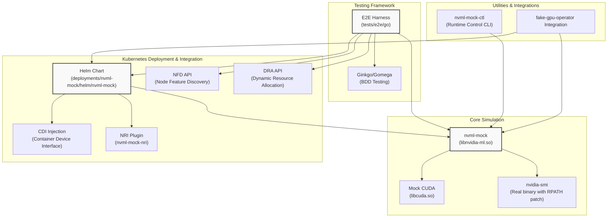
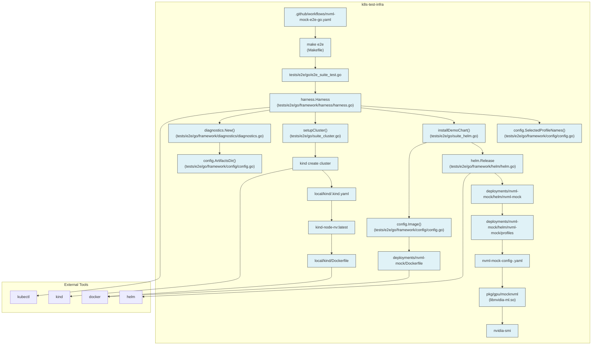
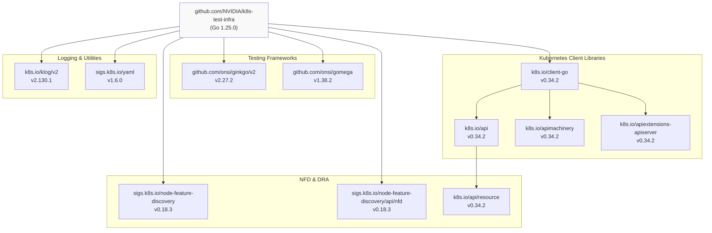

<!-- source: DeepWiki mcp.deepwiki.com · repo NVIDIA/k8s-test-infra · page 1 Overview · fetched 2026-10-26 -->

# Overview

<details>
<summary>Relevant source files</summary>

The following files were used as context for generating this wiki page:

- [.github/workflows/nvml-mock-e2e-go.yaml](.github/workflows/nvml-mock-e2e-go.yaml)
- [Makefile](Makefile)
- [README.md](README.md)
- [docs/README.md](docs/README.md)
- [docs/architecture.md](docs/architecture.md)
- [docs/demo/kind.yaml](docs/demo/kind.yaml)
- [docs/demo/with-fgo/README.md](docs/demo/with-fgo/README.md)
- [docs/examples.md](docs/examples.md)
- [docs/img/logo-title.png](docs/img/logo-title.png)
- [docs/img/logo.png](docs/img/logo.png)
- [docs/integrations/fake-gpu-operator.md](docs/integrations/fake-gpu-operator.md)
- [docs/quickstart.md](docs/quickstart.md)
- [tests/e2e/README.md](tests/e2e/README.md)
- [tests/e2e/go/e2e_suite_test.go](tests/e2e/go/e2e_suite_test.go)
- [tests/e2e/go/framework/config/config.go](tests/e2e/go/framework/config/config.go)
- [tests/e2e/go/framework/harness/harness.go](tests/e2e/go/framework/harness/harness.go)
- [tests/e2e/go/suite_cluster.go](tests/e2e/go/suite_cluster.go)
- [tests/e2e/go/suite_helm.go](tests/e2e/go/suite_helm.go)

</details>


## Purpose and Scope

The `k8s-test-infra` repository provides testing infrastructure for Kubernetes environments with specialized support for NVIDIA GPU simulation, Node Feature Discovery (NFD), and Dynamic Resource Allocation (DRA). The core of this repository is `nvml-mock`, a system designed to simulate NVIDIA GPUs on CPU nodes, enabling comprehensive testing of GPU-aware Kubernetes components without physical hardware [README.md:18-20](). This includes testing the NVIDIA Device Plugin, NVIDIA DRA Driver, and NVIDIA GPU Operator [README.md:41-44]().

This page provides a high-level overview of the repository's purpose, core components, and architectural patterns, with a focus on the `nvml-mock` system. For detailed information on specific subsystems, refer to:
- The `nvml-mock` GPU simulation system: [nvml-mock System](#9)
- Build process and development workflow: [Getting Started](#2)
- Testing patterns and practices: [Testing with Ginkgo](#5)
- Kubernetes API integration: [Kubernetes APIs and Integration](#6)
- CI/CD automation: [CI/CD Pipeline](#4)

## Repository Structure

The repository is organized around several key components that work together to provide Kubernetes testing capabilities, primarily centered around the `nvml-mock` system:


Sources: [README.md:21-22, 48-62, 68-70, 86-89, 91-94](), [docs/README.md:10-15]()

## Core Components

### nvml-mock: GPU Simulation System

The central component of this repository is `nvml-mock`, a system that simulates NVIDIA GPUs on CPU nodes. It provides a mock `libnvidia-ml.so` library that intercepts NVML API calls, allowing applications like `nvidia-smi` and GPU-aware Kubernetes components to function without actual NVIDIA hardware [README.md:68-69](), [docs/README.md:10]()

Key features of `nvml-mock` include:
- **Mock NVML Library**: Implements over 400 NVML C API exports, with 111 configurable behaviors and 289 stubs [docs/README.md:10]().
- **Mock CUDA Library**: Provides early support for 15 CUDA functions related to initialization, device management, and memory [docs/README.md:11]().
- **`nvidia-smi` Integration**: Uses the real `nvidia-smi` binary with an RPATH patch, backed by the mock NVML library, to produce realistic output [docs/README.md:12]().
- **YAML Configuration**: GPU profiles are defined in YAML files, allowing for flexible simulation of various NVIDIA GPU architectures and configurations [docs/README.md:10]().
- **GPU Profiles**: Supports a range of GPU profiles including `a100`, `h100`, `b200`, `gb200`, `gb300`, `l40s`, and `t4`, each with specific VRAM and architecture characteristics [docs/README.md:17-26]().
- **Runtime Control**: The `nvml-mock-ctl` CLI tool allows dynamic modification of simulated GPU state on a running node [docs/README.md:44]().

Example usage of `nvml-mock` with `nvidia-smi`:
```bash
LD_LIBRARY_PATH=. MOCK_NVML_CONFIG=configs/mock-nvml-config-a100.yaml nvidia-smi
```
This command runs `nvidia-smi` using the mock library configured with an A100 GPU profile [docs/examples.md:18-19]().

Sources: [README.md:18-20, 68-70](), [docs/README.md:10-26, 44](), [docs/examples.md:18-19]()

### Kubernetes Integration

`nvml-mock` is designed for seamless integration with Kubernetes:
- **Helm Chart Deployment**: Deployed as a DaemonSet via a Helm chart, enabling easy installation and management within a Kubernetes cluster [README.md:35](), [docs/README.md:13]().
- **CDI Injection**: Supports Container Device Interface (CDI) specifications for integration with the GPU Operator [docs/README.md:14]().
- **NRI Plugin**: The `nvml-mock-nri` containerd NRI plugin enables node-wide ambient GPU injection into ordinary pods without requiring explicit GPU requests or hostPath mounts [README.md:61]().
- **Node Feature Discovery (NFD)**: `nvml-mock` can write NFD feature files, triggering node labeling based on simulated hardware features [README.md:62]().
- **Dynamic Resource Allocation (DRA)**: Integrates with the DRA driver to publish simulated GPU resources as `ResourceSlice` objects, enabling DRA-based scheduling [README.md:58]().

Sources: [README.md:35, 58, 61-62](), [docs/README.md:13-14]()

### E2E Testing Framework

The repository includes a comprehensive end-to-end (E2E) testing framework built on Go, Ginkgo, and Gomega [README.md:48-50](). This harness manages the full lifecycle of test scenarios:
1.  **Cluster Creation**: Creates a multi-node Kind cluster [tests/e2e/README.md:17]().
2.  **Image Management**: Builds and loads the `nvml-mock` Docker image into Kind [tests/e2e/README.md:16, 18]().
3.  **Helm Deployment**: Installs `nvml-mock` into a dedicated namespace [tests/e2e/README.md:19]().
4.  **Validation**: Runs various checks for each selected GPU profile [tests/e2e/README.md:20]().
5.  **Diagnostics**: Collects logs and cluster state on failure [tests/e2e/README.md:21]().
6.  **Teardown**: Optionally deletes the Kind cluster [tests/e2e/README.md:22]().

The E2E tests cover various scenarios:
- **Standalone Demo**: Validates `nvml-mock` chart installation, `nvidia-smi` output, NVLink/fabricmanager, InfiniBand, PCI sysfs, and cross-node checks [README.md:55]().
- **Failure Injection**: Tests healthy, ECC, lost, and fallen-off-bus GPU modes [README.md:56]().
- **DRA Driver**: Validates mock driver files, `nvidia-smi`, `ResourceSlices`, and DRA `ResourceClaim` scheduling [README.md:57-58]().
- **GPU Operator**: Verifies GPU Operator installation, validator pod startup, GFD labels, and allocatable GPUs [README.md:59]().
- **Multi-Node Fleet**: Tests heterogeneous A100/T4 workers, mock files, InfiniBand behavior, device plugin resources, and GPU workload scheduling [README.md:60]().
- **Node-Wide NRI Injection**: Validates ambient mock GPU injection into ordinary pods [README.md:61]().
- **NFD Label Provenance**: Ensures NFD creates `feature.node.kubernetes.io/pci-10de.present` labels from `nvml-mock`'s feature files [README.md:62]().

The `Makefile` provides targets for running these E2E scenarios, such as `make e2e`, `make e2e-dra`, `make e2e-gpu-operator`, `make e2e-multi-node`, `make e2e-nri`, and `make e2e-nfd` [Makefile:152-156]().

Sources: [README.md:48-62](), [tests/e2e/README.md:14-22](), [Makefile:152-156]()

### Integrations

The repository supports integration with other GPU simulation and management tools:
- **fake-gpu-operator (FGO)**: `nvml-mock` can integrate with Run:ai's `fake-gpu-operator` to enable mixed clusters where `nvml-mock` provides driver-level fidelity on a few "real" nodes, while FGO handles API-level scale simulation on many "fake" nodes [README.md:88](), [docs/integrations/fake-gpu-operator.md:5-10](). This allows for comprehensive testing combining driver fidelity with large-scale Kubernetes API simulation [docs/integrations/fake-gpu-operator.md:13-23]().

Sources: [README.md:88](), [docs/integrations/fake-gpu-operator.md:5-10, 13-23]()

## Repository Structure (Code Entity View)

The following diagram illustrates the relationship between key system names and their corresponding code entities within the repository.


Sources: [Makefile:136, 139, 141, 146, 166](), [tests/e2e/go/suite_helm.go:36-45, 48-78](), [tests/e2e/go/suite_cluster.go:60-77](), [tests/e2e/go/framework/config/config.go:58-78, 81-82, 115](), [deployments/nvml-mock/Dockerfile](), [local/kind/Dockerfile](), [local/kind/default.kind.yaml](), [docs/demo/kind.yaml](), [docs/README.md:12]()

## Module Dependency Graph

The repository is structured as a single Go module with carefully curated dependencies. The `go.mod` file specifies the Go version as `1.25.0` [go.mod:3]().


Sources: [go.mod:1-61]()

## Vendoring Strategy

The repository uses Go module vendoring to ensure reproducible builds. All dependencies are stored in the `vendor/` directory, and the build system enforces that vendored dependencies remain synchronized with `go.mod` and `go.sum` through automated checks [Makefile:48-50, 78-82]().

The vendoring approach provides:
-   **Build Reproducibility**: Identical builds regardless of network availability or upstream changes.
-   **Security**: Fixed dependency versions that have been reviewed.
-   **Offline Development**: No network required for builds once dependencies are vendored.

Sources: [Makefile:48-50, 78-82]()

## Key Utilities

### Certificate Generation

The repository leverages `k8s.io/client-go/util/cert` for generating self-signed certificates and certificate authorities. This is essential for testing secure Kubernetes components that require TLS.
-   `NewSelfSignedCACert`: Creates a certificate authority.
-   `GenerateSelfSignedCertKey`: Creates host certificates with subject alternative names.
-   Support for both IP addresses and DNS names in certificates.

Sources: [vendor/k8s.io/client-go/util/cert/cert.go:1-277]()

### YAML/JSON Manifest Processing

The `k8s.io/apimachinery/pkg/util/yaml` package provides sophisticated YAML and JSON decoding capabilities:
-   **YAMLOrJSONDecoder**: Automatically detects and decodes both YAML and JSON formats.
-   **YAMLToJSONDecoder**: Converts YAML documents to JSON for processing.
-   **Multi-document streams**: Handles YAML files with multiple documents separated by `---`.

These utilities enable tests to load Kubernetes manifests from files and apply them to test clusters.

Sources: [vendor/k8s.io/apimachinery/pkg/util/yaml/decoder.go:1-486]()

### Structured Logging

The repository uses `k8s.io/klog/v2` (v2.130.1) for structured logging, which provides:
-   Compatibility with both traditional klog API and modern structured logging.
-   Integration with `go-logr` and `log/slog`.
-   Verbosity levels for controlling log output.
-   Structured key-value logging for machine-readable output.

Sources: [go.mod:12]()

## Build and Development Environment

The repository requires **Go 1.25.0** as specified in the module declaration [go.mod:3](). Version management is centralized with the Go version defined in build configuration and extracted by CI pipelines [Makefile:17]().

Build artifacts include:
-   **`nv-ci-bot` binary**: The main executable in `bin/nv-ci-bot` [Makefile:31]().
-   **Docker images**: Development, `nvml-mock`, and `kind-nvidia-cdi` images [Makefile:132](), [deployments/nvml-mock/Dockerfile](), [local/kind/Dockerfile]().
-   **Test reports**: JSON and JUnit format test results.

Sources: [go.mod:3](), [Makefile:17, 31, 132](), [deployments/nvml-mock/Dockerfile](), [local/kind/Dockerfile]()

## Project Ownership

The project is maintained by NVIDIA engineers, as defined in the `OWNERS` file:

**Reviewers and Approvers:**
-   ArangoGutierrez
-   kklues
-   elezar

Sources: [OWNERS:1-11]()

## Next Steps

For practical information on working with this repository:
-   **Setting up your development environment**: [Getting Started](#2)
-   **Building the project**: [Building from Source](#2.2)
-   **Writing and running tests**: [Testing with Ginkgo](#5)
-   **Understanding the CI/CD pipeline**: [GitHub Actions Workflows](#4.1)

For deeper architectural understanding:
-   **Module dependencies and vendoring**: [Module Dependencies](#3.1)
-   **Kubernetes client operations**: [Kubernetes Client-Go Operations](#6.1)
-   **NFD and DRA APIs**: [Node Feature Discovery (NFD) API](#6.2) and [Dynamic Resource Allocation (DRA) API](#6.3)

---

