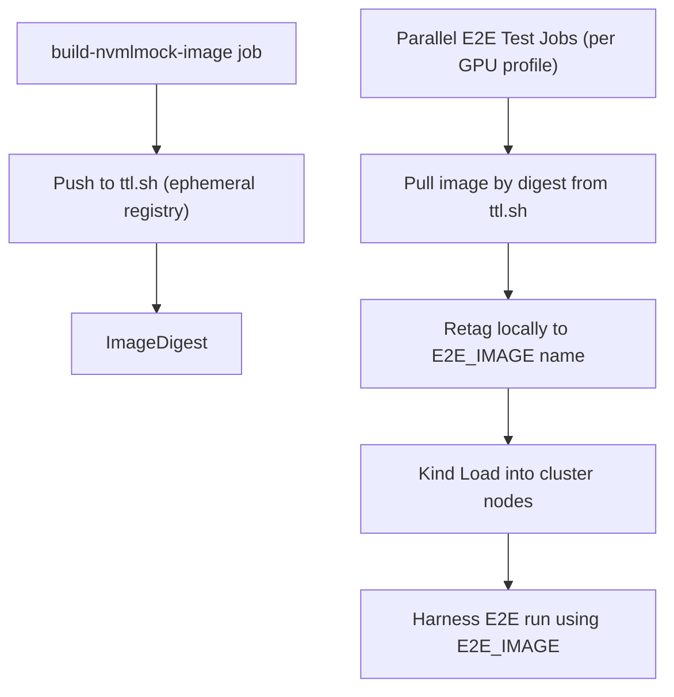

<!-- source: DeepWiki mcp.deepwiki.com · repo NVIDIA/k8s-test-infra · page 10 E2E Test Scenarios · fetched 2026-10-26 -->

# E2E Test Scenarios

<details>
<summary>Relevant source files</summary>

The following files were used as context for generating this wiki page:

- [.github/workflows/nvml-mock-e2e-go.yaml](.github/workflows/nvml-mock-e2e-go.yaml)
- [Makefile](Makefile)
- [README.md](README.md)
- [tests/e2e/README.md](tests/e2e/README.md)
- [tests/e2e/VERSION-MATRIX.md](tests/e2e/VERSION-MATRIX.md)
- [tests/e2e/go/assertions/resources.go](tests/e2e/go/assertions/resources.go)
- [tests/e2e/go/e2e_suite_test.go](tests/e2e/go/e2e_suite_test.go)
- [tests/e2e/go/framework/config/config.go](tests/e2e/go/framework/config/config.go)
- [tests/e2e/go/framework/harness/harness.go](tests/e2e/go/framework/harness/harness.go)
- [tests/e2e/go/framework/helm/helm.go](tests/e2e/go/framework/helm/helm.go)
- [tests/e2e/go/framework/helm/helm_test.go](tests/e2e/go/framework/helm/helm_test.go)
- [tests/e2e/go/framework/kube/kube.go](tests/e2e/go/framework/kube/kube.go)
- [tests/e2e/go/suite_cluster.go](tests/e2e/go/suite_cluster.go)
- [tests/e2e/go/suite_helm.go](tests/e2e/go/suite_helm.go)

</details>


This page provides a high-level overview of the end-to-end (E2E) test scenarios in the k8s-test-infra repository, focusing on the integration testing of NVIDIA GPU simulation components using the nvml-mock system. It introduces the key subsystems involved in E2E tests: the test harness framework that orchestrates cluster lifecycle and test execution, the various scenario categories validating different integrations, and the continuous integration (CI) image distribution strategy enabling fast and repeatable test runs.

The page serves as a parent overview linking to detailed child pages that document each aspect more thoroughly.

---

## Purpose and Scope

The E2E testing suite validates the full software stack for GPU simulation on Kubernetes, employing the `nvml-mock` library to simulate GPUs in a Kind cluster environment without requiring physical NVIDIA hardware. These tests cover:

- Standalone testing of the nvml-mock Helm chart and GPU profile simulation.
- Dynamic Resource Allocation (DRA) API integration.
- GPU Operator integration.
- Node-wide NVIDIA Runtime Interface (NRI) injection.
- Node Feature Discovery (NFD) label provenance.
- Multi-node heterogeneous cluster topologies.

The tests run through a Go/Ginkgo harness that manages the entire lifecycle of cluster creation, Helm deployments, and validations. The CI system builds and distributes container images efficiently for parallel test execution.

This page outlines the E2E test ecosystem and links to deeper documentation on the harness, scenarios, and CI workflows.

---

## 1. E2E Harness Framework Overview

The core of the E2E tests is the harness framework (`harness.Harness` struct), which encapsulates three main adapters tightly coupled to a single Kind cluster instance:

- **Cluster**: Manages the lifecycle of the Kind cluster (create, delete, load images).
- **Kube Client**: Provides Kubernetes API interactions implemented as a wrapper over `kubectl` commands, enabling strongly typed object access and command execution.
- **Helm Client**: Wraps the `helm` CLI for chart deployment and upgrade with wait and timeout controls.

The harness owns the cluster lifecycle unless running in "AttachExisting" mode, where it attaches to an externally provisioned cluster (e.g., managed through Tilt).

Key features include:

- Reading cluster profiles from `config.SelectedProfileNames()` to determine GPU simulation topologies.
- Running Helm `upgrade --install` to deploy the `nvml-mock` Helm chart repeatedly for different GPU profiles on the same cluster (avoiding cluster rebuilds).
- Collecting detailed diagnostics on test failure using a "collectOnFailure" pattern.
- Handling environment-controlled behaviors like skipping image builds when a pre-built image is provided.

For detailed architecture and API, see [E2E Harness Framework](#10.1).

```mermaid
flowchart TD
  subgraph Harness Framework
    H[harness.Harness]
    C[cluster.Cluster]
    K[kube.Client]
    Hl[helm.Client]
  end

  H --> C
  H --> K
  H --> Hl

  subgraph Config
    P[config.SelectedProfileNames()]
  end

  H --> P
```

Sources:  
- `tests/e2e/go/framework/harness/harness.go:21-99`  
- `tests/e2e/go/framework/config/config.go:13-136`  
- `tests/e2e/go/suite_cluster.go:6-78`  
- `tests/e2e/README.md:6-136`  

---

## 2. Test Scenarios Overview

The E2E tests are organized into distinct scenario categories, each validating specific functional integrations or features:

| Scenario               | Purpose/Validation Highlights                                                                                                              | Profiles                                                                                     |
|------------------------|-------------------------------------------------------------------------------------------------------------------------------------------|----------------------------------------------------------------------------------------------|
| **Standalone Demo**     | Validates `nvml-mock` Helm chart installation, GPU files, `nvidia-smi` output, NVLink topology, InfiniBand devices, PCI sysfs layout, and cross-node communication. | Configurable profiles, defaulting to `gb200` locally, broader sets in CI (`a100`, `h100`, etc.) |
| **Failure Injection**   | Tests GPU states such as ECC errors, lost device, and fallen-off-bus conditions to verify failure handling and rollback.                 | Same profiles as Standalone                                                                  |
| **Dynamic Resource Allocation (DRA)** | Validates mock GPU driver files, ResourceSlices, ResourceClaim scheduling, and DRA driver readiness.                                  | Same profiles as Standalone                                                                  |
| **GPU Operator**        | Tests GPU Operator installation, validator pod startup, GPU Feature Discovery labels, and allocatable GPU resources reported by device plugin. | Same profiles as Standalone                                                                  |
| **Node-Wide NRI Injection** | Confirms ambient injection of mock GPUs into pods without explicit GPU requests or hostPath mounts.                                    | Same profiles as Standalone                                                                  |
| **Node Feature Discovery (NFD) Label Provenance** | Checks that NFD correctly derives PCI vendor node labels from feature files written by `nvml-mock`, ensuring proper label ownership. | Pinned to `a100` profile (vendor consistent)                                                |
| **Multi-Node Fleet**    | Validates heterogeneous A100/T4 multi-node Kind topology, InfiniBand behavior, device plugin resources, and GPU workload scheduling.    | Fixed multi-node cluster topology                                                            |

Each scenario resides in its own Go test file under `tests/e2e/go/` named `scenario_*.go`. The Makefile exposes dedicated targets for each scenario, enabling independent test execution and CI matrix orchestration.

Example commands:
```bash
make e2e                        # default local test with profile gb200
make e2e E2E_PROFILES=a100      # test single explicit profile
make e2e-dra                   # test the DRA scenario
make e2e-gpu-operator          # test the GPU Operator scenario
make e2e-multi-node            # test the multi-node scenario
make e2e-nri                   # test node-wide NRI injection
make e2e-nfd                   # test NFD label provenance
```

For extensive test behavior (including Helm release patterns, validation assertions, and scenario orchestration), see [Test Scenarios](#10.2).

```mermaid
flowchart LR
  subgraph Scenarios
    STAND[Standalone Demo]
    FAIL[Failure Injection]
    DRA[Dynamic Resource Allocation (DRA)]
    GPUOP[GPU Operator]
    NRI[Node-Wide NRI Injection]
    NFD[Node Feature Discovery (NFD) Label Provenance]
    MULTI[Multi-Node Fleet]
  end

  STAND --> "Makefile e2e target"
  FAIL --> "Makefile e2e target"
  DRA --> "Makefile e2e-dra"
  GPUOP --> "Makefile e2e-gpu-operator"
  NRI --> "Makefile e2e-nri"
  NFD --> "Makefile e2e-nfd"
  MULTI --> "Makefile e2e-multi-node"

  "Makefile e2e target" --> Harness[Harness Framework]
```

Sources:  
- `tests/e2e/README.md:6-163`  
- `Makefile:141-160`  
- `README.md:48-74`  

---

## 3. CI Image Distribution Strategy

The E2E test CI workflow optimizes build and image distribution for scalable, parallel test execution:

- A single job builds the `nvml-mock` container image once per commit and pushes it to the ephemeral `ttl.sh` registry (a registry with 24-hour TTL and anonymous access), e.g., `ttl.sh/nvml-mock-<sha>:24h`.
- Each parallel test job (one per GPU profile) pulls the image by digest (pinning to immutable content), then retags it locally and loads it into Kind nodes to avoid rebuilding.
- Similar pattern used for the custom Kind node image (including NVIDIA container toolkit) for the standalone scenario.
- The CI matrix triggers runs with different GPU profiles as job parameters, reducing redundant image build costs and speeding up test turnaround.
- The Go harness (`nvml-mock-e2e-go`) integrates seamlessly with this strategy via environment variables (`E2E_IMAGE`, `E2E_SKIP_BUILD`, etc.) to either build or consume the prebuilt images.

This approach also works transparently on fork pull requests, as `ttl.sh` requires no authentication.

For implementation details on the ephemeral registry usage, digest pinning, matrix job design, and Go workflow integration, see [CI Image Distribution Strategy](#10.3).



Sources:  
- `.github/workflows/nvml-mock-e2e-go.yaml:15-161`  
- `README.md:48-74`  

---

## Summary

The E2E testing layer in k8s-test-infra implements comprehensive integration tests for GPU simulation workloads on Kubernetes, efficiently managed via a Go-based harness that controls cluster lifecycle and Helm deployments. The scenarios cover a wide range of real-world usage patterns and third-party component integrations, all executed on ephemeral Kind clusters and powered by container images distributed through a fast, ephemeral registry system.

Each of the three core pillars—Harness Framework, Test Scenarios, and CI Image Distribution—has dedicated documentation as child pages linked below:

- [E2E Harness Framework](#10.1) — Harness struct, lifecycle management, clients, profiling, and diagnostics.  
- [Test Scenarios](#10.2) — Details of standalone, DRA, GPU Operator, NRI, NFD scenarios; Makefile targets and GPU profiles used in CI.  
- [CI Image Distribution Strategy](#10.3) — Ephemeral registry usage, digest pinning, matrix job structures, and Go harness integration.

Refer to those pages for technical depth and code-level explanations.

---

# Related Pages

- **[E2E Harness Framework](#10.1)**
- **[Test Scenarios](#10.2)**
- **[CI Image Distribution Strategy](#10.3)**

---

# Sources

- `README.md:18-74`  
- `.github/workflows/nvml-mock-e2e-go.yaml:15-161`  
- `Makefile:141-160`  
- `tests/e2e/README.md:6-163`  
- `tests/e2e/go/framework/harness/harness.go:21-99`  
- `tests/e2e/go/framework/config/config.go:13-136`  
- `tests/e2e/go/suite_cluster.go:6-78`  
- `tests/e2e/go/framework/helm/helm.go:18-130`  
- `tests/e2e/go/framework/kube/kube.go:6-229`

---

