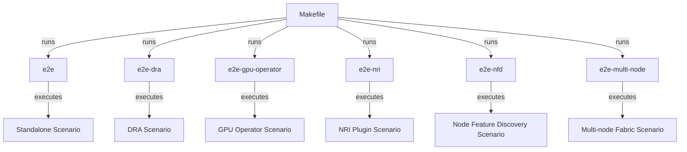
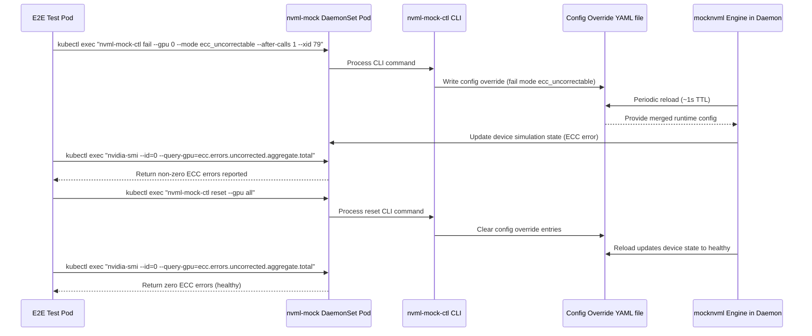

<!-- source: DeepWiki mcp.deepwiki.com · repo NVIDIA/k8s-test-infra · page 10.2 Test Scenarios · fetched 2026-10-26 -->

# 10.2 Test Scenarios

<details>
<summary>Relevant source files</summary>

The following files were used as context for generating this wiki page:

- [cmd/nvml-mock-ctl/main.go](cmd/nvml-mock-ctl/main.go)
- [cmd/nvml-mock-ctl/main_test.go](cmd/nvml-mock-ctl/main_test.go)
- [docs/nvml-mock-ctl.md](docs/nvml-mock-ctl.md)
- [pkg/gpu/mockctl/config_override.go](pkg/gpu/mockctl/config_override.go)
- [pkg/gpu/mockctl/config_override_test.go](pkg/gpu/mockctl/config_override_test.go)
- [pkg/gpu/mocknvml/engine/gpm.go](pkg/gpu/mocknvml/engine/gpm.go)
- [tests/e2e/gfd-mock.yaml](tests/e2e/gfd-mock.yaml)
- [tests/e2e/go/assertions/dcgm.go](tests/e2e/go/assertions/dcgm.go)
- [tests/e2e/go/scenario_gpu_operator_test.go](tests/e2e/go/scenario_gpu_operator_test.go)
- [tests/e2e/go/scenario_nfd_test.go](tests/e2e/go/scenario_nfd_test.go)
- [tests/e2e/go/scenario_runtime_control.go](tests/e2e/go/scenario_runtime_control.go)
- [tests/e2e/go/scenario_standalone_test.go](tests/e2e/go/scenario_standalone_test.go)
- [tests/e2e/gpu-operator-values.yaml](tests/e2e/gpu-operator-values.yaml)
- [tests/e2e/kind-gpu-operator-config.yaml](tests/e2e/kind-gpu-operator-config.yaml)
- [tests/e2e/validate-iblinkinfo.sh](tests/e2e/validate-iblinkinfo.sh)
- [tests/e2e/validate-ibnetdiscover.sh](tests/e2e/validate-ibnetdiscover.sh)
- [tests/e2e/validate-ibv-devinfo.sh](tests/e2e/validate-ibv-devinfo.sh)
- [tests/e2e/validate-nvidia-smi.sh](tests/e2e/validate-nvidia-smi.sh)
- [tests/e2e/validator-mock.yaml](tests/e2e/validator-mock.yaml)

</details>


This section documents the end-to-end (E2E) test scenarios implemented in the `k8s-test-infra` repository. These scenarios exercise the standalone standalone nvml-mock DaemonSet, Dynamic Resource Allocation (DRA), GPU Operator integration, Node Resource Interface (NRI) plugin, Node Feature Discovery (NFD), and multi-node GPU fabric simulations. It covers the test implementations, their organization under Ginkgo, key test logic and assertions, their Makefile targets, and details the GPU profile matrix used in Continuous Integration (CI).

---

## Purpose and Scope

The E2E test scenarios validate the integration and functionality of various GPU simulation and orchestration subsystems on Kubernetes clusters managed in the `k8s-test-infra` project. They cover:

- The standalone nvml-mock GPU simulation validating device appearance, driver files, topology, and dynamic runtime controls.
- DRA mode testing resource slices and driver integration.
- GPU Operator compatibility validating operator installation over the mock driver.
- NRI plugin injection and opt-out behaviors.
- NFD scenarios proving GPU feature label provenance and node labelling.
- Multi-node tests validating the ComputeDomain NVLink and InfiniBand fabric simulation cross-node communication.

Each scenario runs on a Kubernetes Kind cluster configured per test with Helm charts and uses Ginkgo test containers to structure parallel and ordered test execution. Runtime control tests utilize the `nvml-mock-ctl` CLI to mutate GPU states live.

---

## 1. Standalone Scenario

### Overview

This scenario exercises the basic standalone nvml-mock DaemonSet using multiple GPU profiles in a single Kind cluster. The cluster is installed once for all selected GPU profiles (default profile "gb200"). Each profile triggers a Helm upgrade reinstalling the nvml-mock chart with that specific GPU profile for the simulated devices. Tests validate:

- Node labelling with `nvidia.com/gpu.present=true`.
- The rendering of the fake GPU Operator profile ConfigMaps.
- Layout of device plugin mock driver files.
- `nvidia-smi` queries reporting simulated devices and their metrics.
- NVLink topology exposure gated behind FabricManager readiness.
- InfiniBand mock interface (`ibstatus`, `ibv_devinfo`) validation.
- PCI Sysfs topology existence.
- Cross-node InfiniBand ping (`ibping`) and link info scan (`iblinkinfo`).
- Runtime failure injection and metric pinning via `nvml-mock-ctl`.

### Implementation Details

The Go scenario is implemented in `tests/e2e/go/scenario_standalone_test.go` within a Ginkgo `Describe("nvml-mock standalone")` container [tests/e2e/go/scenario_standalone_test.go:37-177](). Setup happens once in `BeforeAll` with:

- `setupCluster()` which creates the Kind cluster with a demo Kind config for selected GPU profiles.
- `demoKindConfig()` generates Kind cluster configuration controlled by profile names.
- Profile-specific Helm `upgrade --install` calls for reconfiguration per profile.

Key verification tests use "Labels", "fgo" (fake GPU operator), "mockfiles", "nvidia-smi", "nvlink", "ib", "pcisysfs", and "ibping" labels to organize and parallelize them.

The runtime control tests (labelled "runtime-control") use helper assertions that directly call `nvml-mock-ctl` commands via `Exec()` into the daemon pod and check effects through `nvidia-smi` queries. These include:

- Inject ECC errors, mark GPUs lost, pin temperatures, power, fan speeds, and more.
- Targeting by GPU index or UUID.
- Resetting overrides.

### Key Functions / Classes

- `setupCluster(ctx, clusterName, kindConfig, testPrefix)` manages cluster lifecycle and Helm deploys the nvml-mock chart.
- Assertions like `assertions.NvidiaSMI()`, `assertions.DevicePluginMockFiles()`, `assertions.NVLink()`, and `assertions.IBPing()` perform domain-specific checks.
- Runtime control helpers such as `nvmlMockCtl()` and `assertRuntimeECCInjection()` interact with `nvml-mock-ctl` [tests/e2e/go/scenario_standalone_test.go:37-177, tests/e2e/go/scenario_runtime_control.go:46-173]().

### Makefile Target

- `make e2e` runs this standalone scenario along with other basic tests.

---

## 2. Dynamic Resource Allocation (DRA) Scenario

### Overview

The DRA scenario validates the Dynamic Resource Allocation driver integration with the nvml-mock system's simulated GPU resources. It tests resource slices, claims, and device-class functionality through DRA CRDs.

### Implementation Details

The primary test suite uses the `e2e-dra` Makefile target. It instantiates a Kind cluster with demo configs that enable DRA, installs DRA Helm charts, and runs tests that verify:

- ResourceSlice and ResourceClaim creation and lifecycle.
- DeviceClass object interaction.
- GPU resource publish and consume workflows.

Assertions verify resource presence and correctness via the Kubernetes API and device plugin reports.

---

## 3. GPU Operator Scenario

### Overview

Tests the compatibility of the GPU Operator Helm chart when deployed on top of the mock NVML environment.

### Implementation Details

A Kind cluster installs the nvml-mock chart, then overlays the GPU Operator Helm chart set with the mock driver disabled and configured via a values overlay file `tests/e2e/gpu-operator-values.yaml`:

- Driver disabled to ensure mock NVML simulates.
- Toolkit disabled; mock libs placed by DaemonSet.
- DRA driver standalone chart.
- DCGM exporter enabled for metric checks.
- MIG disabled since mock NVML doesn't support it.

The test verifies operator pod launches, device plugin discovery, GFD node labelling, and validator checks for readiness.

---

## 4. Node Resource Interface (NRI) Scenario

### Overview

Validates the nvml-mock-nri containerd plugin behavior for node-wide injection and opt-out annotation.

### Implementation Details

The scenario tests:

- The injection of the mock NVML libs and devices via NRI plugin.
- The opt-out annotation on pods to disable injection.
- Correct device visibility inside containers.
- Liveness and readiness probes of the NRI plugin.

---

## 5. Node Feature Discovery (NFD) Scenario

### Overview

Proves that the PCI vendor label `feature.node.kubernetes.io/pci-10de.present` is correctly derived from NFD's local source reading the mock feature files written by nvml-mock.

### Implementation Details

- Uses Helm to install the NFD chart and add its repository.
- Validates that before NFD deployment, the PCI vendor label is absent on nodes.
- Confirms that the feature file `/host/etc/kubernetes/node-feature-discovery/features.d/nvml-mock.features` contains the expected `pci-10de.present=true` line.
- After installing NFD, waits for the node label presence and verifies label ownership via the NFD annotation.

---

## 6. Multi-node Scenario

### Overview

Validates the ComputeDomain multi-node NVLink and InfiniBand fabric simulation across multiple Kind nodes.

### Implementation Details

- Sets up a multi-node cluster with the mock fabric enabled.
- Runs cross-node InfiniBand tests using `ibping` and `iblinkinfo` validated by helper shell scripts (`validate-ibping.sh`, `validate-iblinkinfo.sh`, `validate-ibnetdiscover.sh`).
- Tests ensure cross-node fabric discovery and communication are functional.
- Validates that certain profiles (e.g. `l40s` and `t4`) disable IB and skip IB tests.

---

## GPU Profile Matrix in CI

The CI environment runs E2E tests with a matrix of GPU profiles simulating various NVIDIA GPU models, including but not limited to:

- `a100`
- `h100`
- `b200`
- `gb200`
- `gb300`
- `l40s`
- `t4`

These profiles represent different hardware configurations and influence test coverage of topology, metrics, and failure modes.

---

## Makefile Targets Overview

| Makefile Target | Scenario / Description                                    |
|-----------------|----------------------------------------------------------|
| `e2e`           | Run standalone scenario on default GPU profiles          |
| `e2e-dra`       | Run tests with Dynamic Resource Allocation enabled        |
| `e2e-gpu-operator` | Run GPU Operator compatibility tests                     |
| `e2e-nri`       | Run Node Resource Interface plugin tests                   |
| `e2e-nfd`       | Run Node Feature Discovery related label provenance tests  |
| `e2e-multi-node`| Run multi-node ComputeDomain fabric simulation tests       |

---

## Data Flow and Architecture in E2E Scenarios

The E2E test architecture typically follows this flow:

1. **Cluster Setup**: Create a Kubernetes Kind cluster with appropriate config overlays including number of nodes, GPU profiles, feature flags (DRA, NRI, etc).
2. **Helm Chart Installation**: Deploy the `nvml-mock` DaemonSet Helm chart to provide the mock libraries, device simulation, and driver files in each node.
3. **Scenario-specific Helm/Deployment**: For scenarios that require additional components (GPU Operator, NFD, DRA), install the corresponding Helm charts or Kubernetes manifests.
4. **Test Pod Execution**: Inside the cluster, test pods execute assertions via Kubernetes API calls, `kubectl exec` commands (e.g. running `nvidia-smi`, `ibping`), and reading node labels and annotations.
5. **Runtime Control**: For runtime mutation tests, the `nvml-mock-ctl` CLI is exec'd into the DaemonSet pods to mutate runtime GPU simulation state without restarts.
6. **Assertions & Reporting**: Use Ginkgo/Gomega to assert conditions, collect diagnostics on failures, and report structured test results.

---

## Key Code Entities and Their Roles

```mermaid
flowchart TB
	subgraph "E2E Harness and Scenarios"
		H[harness.Harness<br/>(tests/e2e/go/framework/harness/harness.go)]
		C[config.SelectedProfileNames()<br/>(tests/e2e/go/framework/config/config.go)]
		SC[Standalone Scenario<br/>(scenario_standalone_test.go)]
		RC[Runtime Control<br/>(scenario_runtime_control.go)]
		NFD[Node Feature Discovery Scenario<br/>(scenario_nfd_test.go)]
		GPUO[GPU Operator Scenario<br/>(scenario_gpu_operator_test.go)]
		DRA[DRA Scenario<br/>(e2e-dra)]
		NRI[NRI Scenario<br/>(e2e-nri)]
		MLT[MULTI-NODE Scenario<br/>(e2e-multi-node)]
	end

	subgraph "Runtime Control"
		ctl["nvml-mock-ctl CLI<br/>(cmd/nvml-mock-ctl/main.go)"]
		ovr["Config Override<br/>YAML (overrides.yaml)"]
		eng["mocknvml/engine<br/>(pkg/gpu/mocknvml/engine)"]
	end

	subgraph "Supporting Scripts"
		ibping["validate-ibping.sh<br/>validate-iblinkinfo.sh<br/>validate-ibnetdiscover.sh"]
	end

	H -->|uses| C
	SC -->|uses| H
	RC -->|execs| ctl
	ctl -->|writes| ovr
	ovr -->|read by| eng
	scenario_codes["Assertions in scenario tests"] -->|call| RC
	MLT -->|runs| ibping
```

- The `harness.Harness` struct manages cluster lifecycle, Helm and Kube clients.
- The `config.SelectedProfileNames()` returns GPU profiles enabled in the run.
- Standalone scenario (`scenario_standalone_test.go`) creates cluster and tests each profile.
- Runtime Control tests (`scenario_runtime_control.go`) invoke `nvml-mock-ctl` CLI inside pods to mutate GPU state dynamically.
- The `nvml-mock-ctl` CLI edits a node-local config override file, which is hot-reloaded by the engine (mocknvml/engine) code inside the driver shim library.
- Supporting shell scripts validate fabric connectivity in multi-node scenarios.

Sources:  
- `tests/e2e/go/scenario_standalone_test.go` (lines 1-177)  
- `tests/e2e/go/scenario_runtime_control.go` (lines 1-320)  
- `cmd/nvml-mock-ctl/main.go` (lines 1-200)  
- `pkg/gpu/mockctl/config_override.go` (lines 1-184)  
- `tests/e2e/validate-ibping.sh`, `validate-iblinkinfo.sh`, `validate-ibnetdiscover.sh`  
- `tests/e2e/go/scenario_nfd_test.go` (lines 1-145)  
- `tests/e2e/gpu-operator-values.yaml`

---

## GPU Profile Matrix in CI

The CI system runs a matrix of test runs cycling through these GPU profiles to validate broad coverage:

| Profile Name | Use in Tests                 | Comments                      |
|--------------|-----------------------------|-------------------------------|
| `a100`       | Standalone, NFD             | Common HPC GPU profile         |
| `h100`       | Standalone                  | Latest Hopper architecture     |
| `b200`       | Standalone                  | New NVIDIA base architecture   |
| `gb200`      | Default Standalone, others  | Good baseline for development  |
| `gb300`      | Standalone                  | New generation base GPU        |
| `l40s`       | Standalone, Multi-node      | Data center GPU with IB off    |
| `t4`         | Standalone, Multi-node      | Cloud GPU, IB disabled         |

Profiles influence:

- Number of GPUs simulated per node.
- Feature enablement (e.g., InfiniBand enabled or disabled).
- Dynamic metrics and failure injection availability.

Local dev can override `E2E_PROFILES` environment variable to run specific profiles quickly (e.g., `make e2e E2E_PROFILES=a100`).

Sources:  
- `tests/e2e/go/scenario_standalone_test.go:21-42`  
- `tests/e2e/gpu-operator-values.yaml`  

---

## Makefile Targets Summary



- `make e2e`: Default standalone test suite, running nvml-mock standalone with selected GPU profiles.
- `make e2e-dra`: Tests DRA integration.
- `make e2e-gpu-operator`: Tests GPU Operator Helm chart installs over mock NVML.
- `make e2e-nri`: Runs tests for NRI node-wide injection plugin.
- `make e2e-nfd`: Runs Node Feature Discovery label provenance validation.
- `make e2e-multi-node`: Runs multi-node ComputeDomain fabric and IB communication tests.

Sources:  
- `tests/e2e/go/scenario_standalone_test.go`  
- `tests/e2e/go/scenario_nfd_test.go`  
- `tests/e2e/gpu-operator-values.yaml`  

---

## Example Flow: Runtime Control Scenario

The runtime control scenarios validate that GPU failure and metric overrides can be injected live into the running DaemonSet pods without disruption.



Sources:  
- `tests/e2e/go/scenario_runtime_control.go:42-173`  
- `cmd/nvml-mock-ctl/main.go:14-146`  
- `pkg/gpu/mockctl/config_override.go:14-184`  

---

## Summary

The E2E test scenarios within `k8s-test-infra` comprehensively cover key GPU simulation and integration features across container runtime, Kubernetes resource APIs, driver injection, node labelling, and multi-node fabric behaviors. They leverage a shared Kubernetes cluster lifecycle harness, multiple Helm chart overlays, and powerful runtime mutation via `nvml-mock-ctl`. The test suite's modular design allows targeted testing of subsystems (DRA, GPU Operator, NFD, NRI) and collective validation with a range of GPU profiles, ensuring robust system behavior and integration for NVIDIA GPU simulations in Kubernetes environments.

---

---

