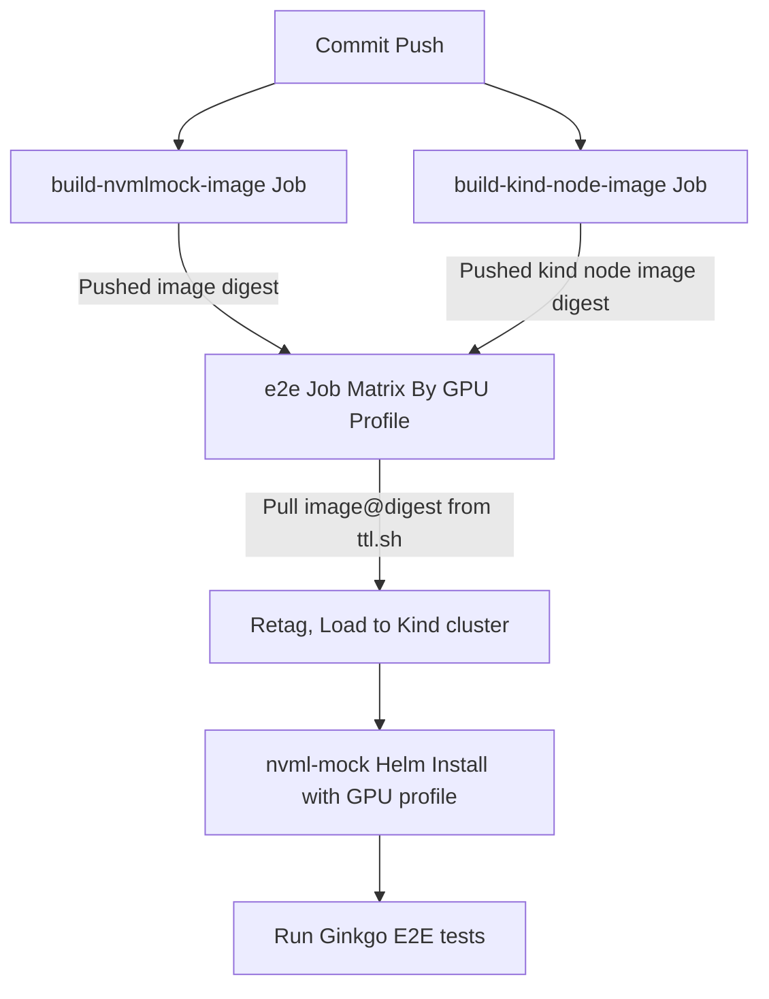
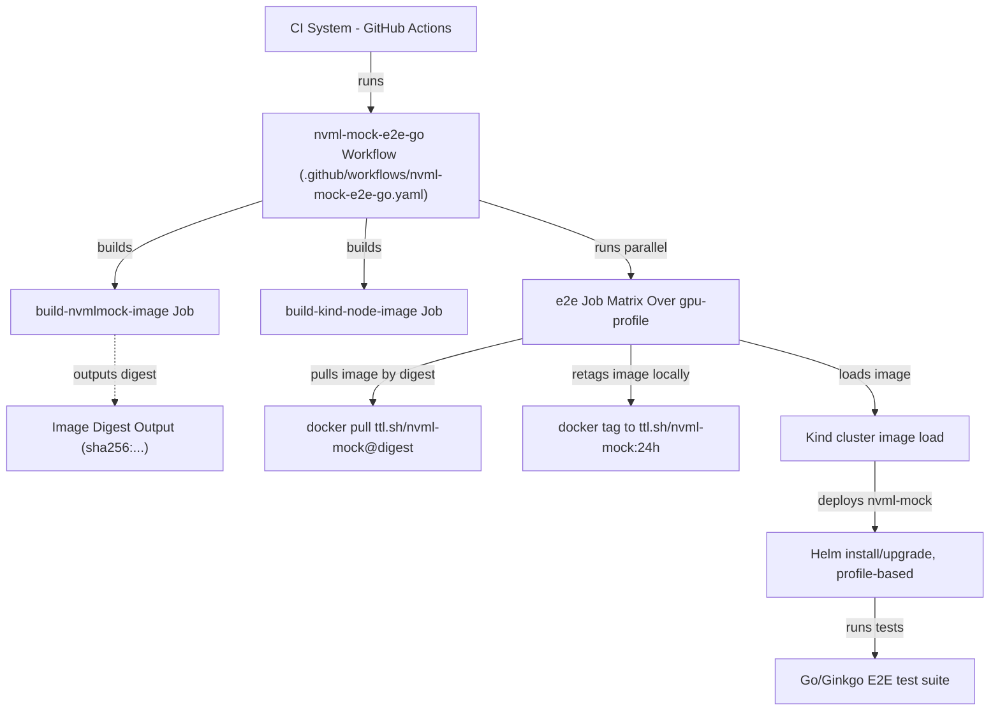
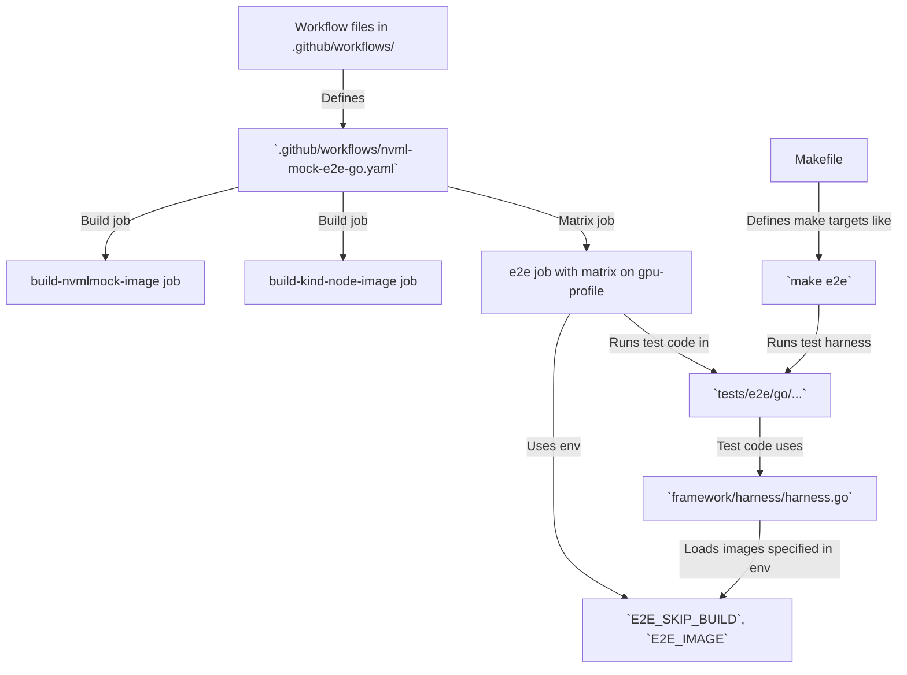

<!-- source: DeepWiki mcp.deepwiki.com · repo NVIDIA/k8s-test-infra · page 10.3 CI Image Distribution Strategy · fetched 2026-10-26 -->

# CI Image Distribution Strategy

<details>
<summary>Relevant source files</summary>

The following files were used as context for generating this wiki page:

- [.github/workflows/code_scanning.yaml](.github/workflows/code_scanning.yaml)
- [.github/workflows/golang.yaml](.github/workflows/golang.yaml)
- [.github/workflows/helm-publish.yaml](.github/workflows/helm-publish.yaml)
- [.github/workflows/helm.yaml](.github/workflows/helm.yaml)
- [.github/workflows/nvml-mock-e2e-go.yaml](.github/workflows/nvml-mock-e2e-go.yaml)
- [.github/workflows/nvml-mock-publish.yaml](.github/workflows/nvml-mock-publish.yaml)
- [.github/workflows/scorecard.yaml](.github/workflows/scorecard.yaml)
- [.github/workflows/variables.yaml](.github/workflows/variables.yaml)
- [Makefile](Makefile)
- [README.md](README.md)
- [deployments/devel/Dockerfile](deployments/devel/Dockerfile)
- [tests/e2e/README.md](tests/e2e/README.md)
- [tests/e2e/ci/nvml-mock.values.yaml](tests/e2e/ci/nvml-mock.values.yaml)
- [tests/e2e/go/e2e_suite_test.go](tests/e2e/go/e2e_suite_test.go)
- [tests/e2e/go/framework/config/config.go](tests/e2e/go/framework/config/config.go)
- [tests/e2e/go/framework/harness/harness.go](tests/e2e/go/framework/harness/harness.go)
- [tests/e2e/go/suite_cluster.go](tests/e2e/go/suite_cluster.go)
- [tests/e2e/go/suite_helm.go](tests/e2e/go/suite_helm.go)

</details>


This page (section 10.3) explains how the k8s-test-infra repository implements its Continuous Integration (CI) image distribution strategy, focusing on the ephemeral registry pattern used with ttl.sh, digest-pinned image references for immutable image pulls, the matrix-based parallel job structure in the E2E testing workflow, and the architecture of the `nvml-mock-e2e-go` workflow that enables parallel end-to-end (E2E) test runs efficiently.

---

## Purpose and Scope

This strategy is designed to optimize the CI process for the `nvml-mock` GPU simulation system and related Kubernetes tests by:

- Avoiding redundant image builds across parallel test jobs.
- Ensuring consistent, immutable, and retriable image references.
- Supporting GPU profile matrix testing in parallel CI jobs.
- Simplifying image distribution using an ephemeral, public container registry that requires no authentication.

This page provides full technical detail, including workflow orchestration, image tagging semantics, and the internal flow of how images are built, published, consumed, and used in the parallel E2E test job matrix.

---

## ttl.sh Ephemeral Registry Pattern

### Overview

The repository leverages the anonymous public container registry service [ttl.sh](https://ttl.sh), which allows pushing container images with a fixed time-to-live (TTL) and pull them anonymously without authentication. This registry supports ephemeral image storage capped at 24 hours TTL.

### How It Works in CI

- A dedicated CI job builds the `nvml-mock` container image once per commit and pushes it to ttl.sh, with the tag format:

  ```
  ttl.sh/nvml-mock-${GITHUB_SHA}:24h
  ```

  where `${GITHUB_SHA}` is the GitHub commit SHA associated with the current run. The TTL is set to 24 hours, ensuring images are available long enough for subsequent CI jobs to pull them without persistent storage costs.

- Multiple parallel E2E test jobs then pull this image by its **digest** (not tag) from ttl.sh to guarantee immutability and avoid race conditions stemming from tag overwrites.

- Each parallel job retags the pulled image locally with the same ttl.sh tag (for compatibility with the test harness) and then loads the image into the Kind cluster.

- Because ttl.sh requires no authentication, this pattern works on pull request forks without requiring repository secrets.

### Benefits

- **Build once, use many:** Image is built a single time and distributed to all jobs.
- **Immutable references:** Pulling by digest protects against tag mutations.
- **No auth complexity:** Works seamlessly on fork PRs without credential sharing.
- **TTL-based cleanup:** Keeps storage free of stale images automatically.

---

## Digest-Pinned Image References

The critical implementation detail is that test jobs **do not rely on image tags alone** because:

- Tags are ephemeral and can be overwritten.
- CI jobs run asynchronously; a tag could be moved before a job starts pulling.
- Pulling by image digest (`sha256:<hash>`) guarantees the exact image version.

The builder job outputs the pushed image digest (`sha256:...`). This digest is passed as an output variable and picked up by all dependent jobs, which use it to pull with explicit reference, like:

```
docker pull ttl.sh/nvml-mock-${GITHUB_SHA}@sha256:<digest>
docker tag ttl.sh/nvml-mock-${GITHUB_SHA}@sha256:<digest> ttl.sh/nvml-mock-${GITHUB_SHA}:24h
```

This pattern safeguards all downstream consumers from accidental image mutations caused by concurrent pushes or retries.

---

## Parallel Matrix Job Structure for GPU Profiles

The E2E testing workflow uses a **matrix strategy** over a list of GPU profiles to run parallel jobs that each test a distinct simulated GPU topology.

- Profiles include `a100, h100, b200, gb200, gb300, t4` by default for CI.
- The matrix axis is the GPU profile (`gpu-profile`).
- The matrix jobs share the pre-built image from the build job via the ttl.sh registry and pull it by digest.
- Each job runs a focused subset of tests against the cluster with that GPU profile installed via Helm.

### Matrix Benefits

- Parallelization reduces overall CI time substantially.
- Isolation ensures tests for one profile cannot interfere with others.
- The single image build suffices to cover all profiles since profiles are enabled at Helm install time dynamically.

---

## `nvml-mock-e2e-go` Workflow Detailed Architecture

The core GitHub Actions workflow implementing this strategy is `.github/workflows/nvml-mock-e2e-go.yaml`.

### Key Jobs

| Job Name              | Role                                                                               |
|-----------------------|------------------------------------------------------------------------------------|
| `build-nvmlmock-image`| Builds and pushes the `nvml-mock` Docker image to `ttl.sh`. Outputs the digest.    |
| `build-kind-node-image`| Builds a custom Kind node image with Nvidia container toolkit, pushed likewise to `ttl.sh`. |
| `e2e`                 | Runs the main E2E test suite, in a GPU profile matrix job that depends on image build jobs and pulls the image by digest.|

### Workflow Data Flow



---

### `build-nvmlmock-image` Job

- Uses `docker/build-push-action` to build multi-arch image for `nvml-mock` from `deployments/nvml-mock/Dockerfile`.
- Tags image as `ttl.sh/nvml-mock-${GITHUB_SHA}:24h` and pushes to ttl.sh.
- Caches build layers with GitHub Actions cache.
- Outputs the image digest (`sha256:...`) to ensure future jobs pull the exact image.
  
### `build-kind-node-image` Job

- Builds a custom Kind node image augmented with `nvidia-container-toolkit`.
- Pushes to `ttl.sh/kind-node-nv-${GITHUB_SHA}:24h`.
- Output the image digest similarly.

### `e2e` Job (Matrix)

- Declares a matrix over the GPU profiles (default `["a100", "h100", "b200", "gb200", "gb300", "t4"]`).
- Depends on `build-nvmlmock-image` and `build-kind-node-image`.
- In each matrix execution:
  - Pulls the `nvml-mock` image by the digest output of the builder job.
  - Retags the image locally with the ttl.sh tag.
  - Loads the image into the Kind environment.
  - Sets `E2E_SKIP_BUILD=true` to avoid rebuilding the Docker image locally.
  - Uses the pulled image to deploy the nvml-mock chart via Helm.
  - Executes the Go/Ginkgo E2E tests scoped to the given GPU profile.
  
---

## Workflow Code Snippet Highlights

```yaml
# Excerpt from .github/workflows/nvml-mock-e2e-go.yaml showing job dependencies
jobs:
  build-nvmlmock-image:
    runs-on: ubuntu-latest
    outputs:
      digest: ${{ steps.build.outputs.digest }}
    steps:
      # Build steps omitted
  build-kind-node-image:
    runs-on: ubuntu-latest
    outputs:
      digest: ${{ steps.build.outputs.digest }}
    steps:
      # Build Kind node image
  e2e:
    needs: [build-nvmlmock-image, build-kind-node-image]
    runs-on: ubuntu-latest
    strategy:
      fail-fast: false
      matrix:
        gpu-profile: ${{ fromJson(inputs.gpu_profiles) }}
    steps:
      - name: Pull nvml-mock image by digest
        run: |
          docker pull ttl.sh/nvml-mock-${{ github.sha }}@${{ needs.build-nvmlmock-image.outputs.digest }}
          docker tag ttl.sh/nvml-mock-${{ github.sha }}@${{ needs.build-nvmlmock-image.outputs.digest }} ttl.sh/nvml-mock-${{ github.sha }}:24h
```

---

## nvml-mock E2E Harness Usage

The local test harness in `./tests/e2e/go` consumes the distributed image similarly:

- When `E2E_SKIP_BUILD` is true, the harness does not build the Docker image but uses the specified `E2E_IMAGE` (ttl.sh reference).
- Harness loads this image into the Kind cluster and proceeds with Helm-based deployment and validation.
- This consistent approach unifies local developer runs and CI runs.

---

## Summary Diagram: Natural Language to Code Entities



---

## Summary Diagram: Code Repository Files to Concepts



---

## Additional Notes

- The build caching is optimized per job using GitHub Action cache scoped by job to reduce redundant rebuilds.
- The `e2e` job sets `E2E_SKIP_BUILD=true` explicitly, so the GitHub runners do not rebuild images locally but use the injected ones.
- The ephemeral nature of ttl.sh is embraced as a caching layer; images older than 24h expire, ensuring cluster retainment or reruns must rebuild or repush.
- Extensibility for adding new GPU profiles is straightforward with the matrix job expansion.

---

# References

- GitHub Actions workflow for nvml-mock E2E Go: `.github/workflows/nvml-mock-e2e-go.yaml` [33:1586-1687]()
- README overview of Ginkgo E2E and image usage: `README.md` [18:67-67]()
- Makefile related to cluster creation and E2E test entrypoint: `Makefile` [10:139-156]()
- Tests/E2E README describing parallel profiles and image loading: `tests/e2e/README.md` [3:160-261]()

Sources:  
`.github/workflows/nvml-mock-e2e-go.yaml, README.md, Makefile, tests/e2e/README.md`

---

