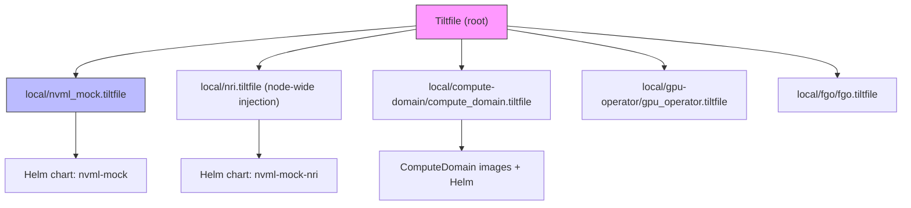

<!-- source: DeepWiki mcp.deepwiki.com · repo NVIDIA/k8s-test-infra · page 11 Local Development Environment · fetched 2026-10-26 -->

# Local Development Environment

<details>
<summary>Relevant source files</summary>

The following files were used as context for generating this wiki page:

- [Tiltfile](Tiltfile)
- [docs/demo/README.md](docs/demo/README.md)
- [docs/demo/node-wide-injection/README.md](docs/demo/node-wide-injection/README.md)
- [docs/demo/node-wide-injection/run.sh](docs/demo/node-wide-injection/run.sh)
- [docs/demo/nv-sentinel/README.md](docs/demo/nv-sentinel/README.md)
- [docs/demo/nv-sentinel/gpu-operator-values.yaml](docs/demo/nv-sentinel/gpu-operator-values.yaml)
- [docs/demo/nv-sentinel/kind.yaml](docs/demo/nv-sentinel/kind.yaml)
- [docs/demo/nv-sentinel/mongodb.yaml](docs/demo/nv-sentinel/mongodb.yaml)
- [docs/demo/nv-sentinel/nvsentinel-values.yaml](docs/demo/nv-sentinel/nvsentinel-values.yaml)
- [docs/demo/nv-sentinel/run.sh](docs/demo/nv-sentinel/run.sh)
- [docs/demo/nv-sentinel/sample-workload.yaml](docs/demo/nv-sentinel/sample-workload.yaml)
- [docs/demo/standalone/README.md](docs/demo/standalone/README.md)
- [docs/demo/standalone/demo.sh](docs/demo/standalone/demo.sh)
- [local/.gitignore](local/.gitignore)
- [local/README.md](local/README.md)
- [local/compute-domain/compute_domain.tiltfile](local/compute-domain/compute_domain.tiltfile)
- [local/compute-domain/dra-driver.values.yaml](local/compute-domain/dra-driver.values.yaml)
- [local/compute-domain/nvml-mock.values.yaml](local/compute-domain/nvml-mock.values.yaml)
- [local/compute-domain/rebind.topology.yaml](local/compute-domain/rebind.topology.yaml)
- [local/compute-domain/scenarios/check-fabric.sh](local/compute-domain/scenarios/check-fabric.sh)
- [local/nvml_mock.tiltfile](local/nvml_mock.tiltfile)

</details>


The local development environment in `k8s-test-infra` is designed to enable contributors to build, deploy, and test the nvml-mock GPU simulation stack and its related components interactively on local Kubernetes clusters managed via Kind. This environment centers around Tilt as a live-reload orchestrator, enabling rapid iteration, debugging, and scenario experimentation. It supports various deployment modes of nvml-mock, integration with NVIDIA GPU Operator, NVIDIA DRA driver, Run:ai Fake GPU Operator (FGO), and advanced scenarios like ComputeDomain.

This page provides a high-level overview of the local development setup, including the Tilt-based workflow, Kind cluster profiles, Helm value layering strategy, and scenario-specific configurations that facilitate simulation of heterogeneous GPU fleets, integration demos, and multi-node GPU fabric simulation. For detailed guides and technical deep-dives, see the linked child pages.

---

## Tilt-Based Local Development Workflow

At the core of local development is **Tilt**, a powerful live-reload Kubernetes resource orchestrator used here to build Docker images, render Helm charts, and manage deployments in a synchronized manner.

- The root `Tiltfile` (repository root) acts as a thin orchestrator that loads and delegates to sub-Tiltfiles under `local/` for each consumer component or scenario.
- The core nvml-mock GPU simulation stack lifecycle is defined in `local/nvml_mock.tiltfile`.
- Other components such as GPU Operator, DRA driver, FGO, and ComputeDomain have dedicated sub-Tiltfiles, e.g., `local/gpu-operator/gpu_operator.tiltfile`, `local/dra/dra.tiltfile`, `local/fgo/fgo.tiltfile`, and `local/compute-domain/compute_domain.tiltfile`.
- Flags passed to `tilt up` (e.g., `--gpu-profile`, `--multi-gpu-profile`, `--gpu-operator`, `--dra`, `--fgo`, `--compute-domain`) turn on specific components and scenarios, controlling image builds, Helm install parameters, and cluster topology.

This modular orchestrator approach allows independent consumer components or scenarios to request their own overlays and Helm value files while sharing a common base nvml-mock stack.

```mermaid
flowchart TB
    TL[Tilt CLI]
    TF[Tiltfile (root)]
    NM[local/nvml_mock.tiltfile]
    GO[local/gpu-operator/gpu_operator.tiltfile]
    DR[local/dra/dra.tiltfile]
    FG[local/fgo/fgo.tiltfile]
    CD[local/compute-domain/compute_domain.tiltfile]
    
    TL --> TF
    TF --> NM
    TF --> GO
    TF --> DR
    TF --> FG
    TF --> CD
```
*Diagram 1: Tilt orchestrator loads consumer and scenario sub-Tiltfiles to build and deploy components.*

Tilt supports automatic live reload upon source or configuration changes, enabling immediate feedback. Image builds and Helm chart Helm upgrades are managed as `helm_resource` targets within Tilt, supporting image pins to pre-built images (e.g., TTL.sh) for CI integration.

For full details including flag descriptions, the structure of the Tiltfiles, and live-reload behavior, see the child page [Tilt Development Workflow](#11.1).

Sources: `Tiltfile:1-154`, `local/nvml_mock.tiltfile:1-154`, `local/README.md:1-145`

---

## Kind Cluster Profiles and Topologies

Local testing and demos run on Kind clusters configured to simulate various Kubernetes topologies and node shapes:

| Profile           | Kind Config File                         | Cluster Name                    | Typical Usage                              |
|-------------------|----------------------------------------|--------------------------------|--------------------------------------------|
| `default` (base)  | `local/kind/default.kind.yaml`          | `kind-gpu-test`                 | Most development, basic, GPU Operator, DRA, FGO, multi-GPU-profile |
| `compute-domain`  | `local/kind/compute-domain.kind.yaml`   | `kind-nvml-mock-compute-domain`| Advanced NVLink fabric simulation, 4-worker topology |

- The default cluster profile creates 1 control-plane and 2 worker nodes labeled for nvml-mock GPU simulation with distinct GPU profile node labels (`a100` and `t4`).
- The ComputeDomain profile provides a 4-worker cluster setup designed for multi-node GPU fabric simulation with NVLink clique clustering.

Kind images used are custom-built via `local/kind/Dockerfile` (`kind-node-nv:latest`), preinstalled with the NVIDIA container runtime to enable GPU simulation tools such as nvidia-container-toolkit in CDI mode.

Cluster creation and teardown are automated through Makefile targets:

```bash
# Create default cluster (1 CP + 2 workers)
make cluster-create

# Create compute-domain profile cluster (1 CP + 4 workers)
make cluster-create PROFILE=compute-domain

# Delete cluster (must match PROFILE)
make cluster-delete PROFILE=compute-domain
```

This separation enables dedicated testing for different development scenarios, ensuring a stable baseline for component installation and upgrade testing.

Sources: `local/README.md:5-145`, `docs/demo/nv-sentinel/kind.yaml:1-34`

---

## Helm Value Overrides and Layering

The nvml-mock Helm chart deploys the mock GPU stack with flexible configuration. To support local development configurations, the Helm values are layered by Tilt and by manual overrides:

| Source File                           | Committed | Purpose                                                                                |
|-------------------------------------|-----------|----------------------------------------------------------------------------------------|
| Chart Defaults                      | —         | Base settings baked into the Helm chart                                               |
| `local/nvml-mock.values.yaml`        | Yes       | Shared local development baseline settings (e.g., InfiniBand mode, rollout settings)  |
| `local/<consumer>/nvml-mock.values.yaml` | Yes       | Consumer-specific tweaks (e.g., GPU Operator or DRA mock integration overrides)       |
| `local/nvml-mock.values.local.yaml`  | No (gitignored) | Individual developer overrides to tune settings absent from VCS to avoid commit noise |

The overlay order ensures that specific consumer overlays and personal settings override previous layers, enabling flexible development without polluting the shared repository state.

For example, the compute-domain scenario uses `local/compute-domain/nvml-mock.values.yaml` to adjust GPU counts and topology overlays required for multi-node simulation.

Sources: `local/README.md:121-145`, `local/nvml_mock.tiltfile:73-154`

---

## Scenario-Specific Tiltfile Configurations

Several demo and scenario directories under `docs/demo/` and matching Tiltfiles in `local/` provide prepackaged environments illustrating typical usage patterns:

- **Standalone Demo** (`docs/demo/standalone`): Deploy nvml-mock with a single Helm release using FGO-style GPU labels without a separate GPU operator. The `demo.sh` script automates cluster creation, image build and load, and Helm install with configurable GPU profiles and counts.

- **Node-Wide Injection Demo** (`docs/demo/node-wide-injection`): Demonstrates containerd NRI-based node-wide injection allowing pods to consume mock GPUs without explicit resource requests or spec mutation. It also illustrates compute-domain fabric identity propagation through the NRI plugin. Deploys a dedicated cluster with the `nvml-mock-nri` DaemonSet and test workloads.

- **ComputeDomain Demo** (`docs/demo/compute-domain`): Simulates multi-node NVLink fabric topology with a GB200 profile on a 4-worker cluster. Exercises real `nvidia-imex` daemon gRPC domain with topology rebind triggers from Tilt manual actions.

- **NVSentinel Demo** (`docs/demo/nv-sentinel`): Shows thermal-margin detection and remediation by NVSentinel using mock GPUs and GPU Operator with DCGM in standalone mode. Includes MongoDB TLS setup, cert-manager dependencies, and node draining workflows.

- **With Fake GPU Operator (FGO)** (`docs/demo/with-fgo`): Integrates Run:ai's Fake GPU Operator to simulate scale pools alongside nvml-mock for integration pools.

Each scenario exposes a `Tiltfile` or script that sets up the cluster topology, builds/loads images, and applies Helm charts with scenario-specific values, often passing flags to Tilt to activate necessary subcomponents.



*Diagram 2: Scenario-specific Tiltfiles and their Helm charts under the Tilt orchestrator.*

Developers can run these demos via simple scripts (`./demo.sh`, `./run.sh`) and leverage Tilt flags for customizations like selecting GPU profile (`--gpu-profile`), enabling GPU Operator (`--gpu-operator`), or multi-profile heterogenous fleet mode (`--multi-gpu-profile`).

For detailed step-by-step guides and integrations, see the child page [Demo Scenarios and Integration Examples](#11.2).

Sources: `docs/demo/standalone/demo.sh:1-149`, `docs/demo/node-wide-injection/README.md:1-116`, `local/README.md:83-99`, `docs/demo/nv-sentinel/README.md:1-153`

---

## Summary and Next Steps

This page introduced the local development environment infrastructure for the k8s-test-infra repository, focusing on:

- The **Tilt-based workflow** that manages Docker image builds, Helm chart deployments, and multi-component orchestration via modular Tiltfiles.
- The use of **Kind cluster profiles** to support varying node topologies and GPU fleet heterogeneity for simulation and testing.
- How **Helm values are layered** to provide a flexible and composable configuration system for local tweaks and consumer-specific overrides.
- The role of **scenario-specific Tiltfiles and demos** to document complex integration examples and multi-node simulations.

To adopt this environment:

1. Install prerequisites: Kind, Tilt, Helm, Docker, kubectl.
2. Create the appropriate Kind cluster (`make cluster-create`).
3. Start the development environment by running `tilt up` with desired flags.
4. Explore and run demo scenarios via their scripts.

For comprehensive usage instructions, hands-on tutorials, and reference documentation, see the child pages:

- [Tilt Development Workflow](#11.1)
- [Demo Scenarios and Integration Examples](#11.2)

---

**Sources:**

- `Tiltfile:1-154`  
- `local/nvml_mock.tiltfile:1-154`  
- `local/README.md:1-145`  
- `docs/demo/standalone/demo.sh:1-149`  
- `docs/demo/node-wide-injection/README.md:1-116`  
- `docs/demo/nv-sentinel/README.md:1-153`  
- `docs/demo/nv-sentinel/kind.yaml:1-34`

---

