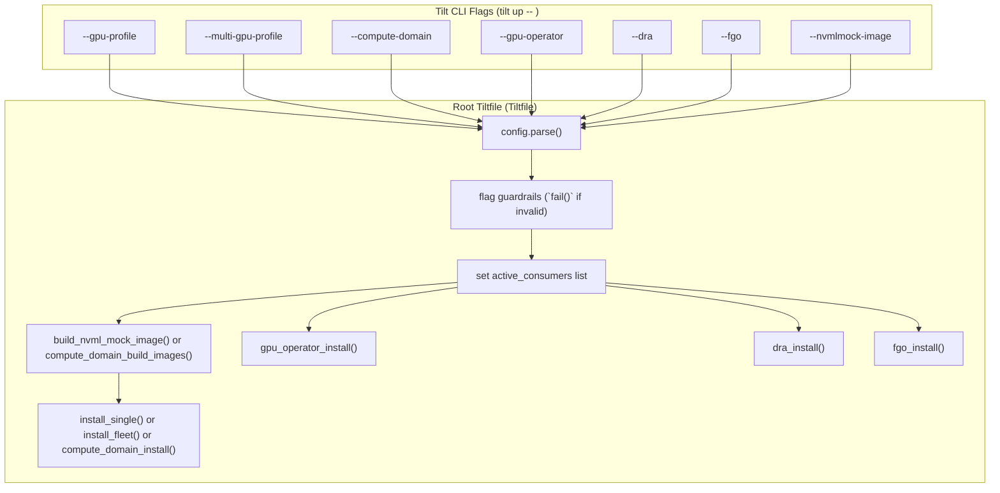

<!-- source: DeepWiki mcp.deepwiki.com · repo NVIDIA/k8s-test-infra · page 11.1 Tilt Development Workflow · fetched 2026-10-26 -->

# Tilt Development Workflow

<details>
<summary>Relevant source files</summary>

The following files were used as context for generating this wiki page:

- [Tiltfile](Tiltfile)
- [docs/demo/node-wide-injection/README.md](docs/demo/node-wide-injection/README.md)
- [docs/demo/node-wide-injection/run.sh](docs/demo/node-wide-injection/run.sh)
- [docs/demo/standalone/README.md](docs/demo/standalone/README.md)
- [docs/demo/standalone/demo.sh](docs/demo/standalone/demo.sh)
- [local/.gitignore](local/.gitignore)
- [local/README.md](local/README.md)
- [local/compute-domain/compute_domain.tiltfile](local/compute-domain/compute_domain.tiltfile)
- [local/compute-domain/dra-driver.values.yaml](local/compute-domain/dra-driver.values.yaml)
- [local/compute-domain/nvml-mock.values.yaml](local/compute-domain/nvml-mock.values.yaml)
- [local/compute-domain/rebind.topology.yaml](local/compute-domain/rebind.topology.yaml)
- [local/compute-domain/scenarios/check-fabric.sh](local/compute-domain/scenarios/check-fabric.sh)
- [local/nvml_mock.tiltfile](local/nvml_mock.tiltfile)

</details>


This page documents the local development workflow powered by Tilt for the `k8s-test-infra` repository, focusing on how to use its command line flags to customize cluster test environments, the structure of the Tiltfile configuration, and the live reload behavior that accelerates development. 

The documentation covers key Tilt flags that control GPU profile selection, GPU Operator and Dynamic Resource Allocation (DRA) integration, Run:ai Fake GPU Operator (FGO) usage, and ComputeDomain fabric simulation. It explains the modular architecture of the main Tiltfile and its composition of sub-Tiltfiles that encapsulate deployment units. Lastly, it details the live reload mechanisms designed for efficient iterative development.

---

## Overview

The repository's local development environment relies on [Tilt](https://tilt.dev/) — an orchestrator that manages Kubernetes cluster lifecycle, image builds, Helm charts, and live reload of code changes. Contributors invoke `tilt up` with optional flags to launch a simulated Kubernetes ecosystem with mock NVML GPU devices, relevant operators, and specialized drivers. 

Key configurable aspects include:

- The GPU profile(s) installed on the mock nodes
- Enabling NVIDIA GPU Operator deployment for Kubernetes integration
- Enabling NVIDIA Dynamic Resource Allocation (DRA) driver functionality
- Enabling Run:ai Fake GPU Operator (FGO) alternative
- Running the ComputeDomain multi-node NVLink fabric simulation
- Deploying a heterogeneous GPU profile fleet with per-profile releases

These options flexibly compose complex local test clusters matching many CI and demo scenarios. The Tiltfile system is designed to be modular, composable, and safe, guarding conflicting flag combinations.

---

## Tilt `up` Command Flags

The main workflow is driven by command line flags passed to `tilt up` after `--`. These flags control deployment shape and integrations:

| Flag                 | Description                                                                                                           |
|----------------------|-----------------------------------------------------------------------------------------------------------------------|
| `--gpu-profile`       | Select a single GPU profile (e.g. `a100`, `h100`, `b200`, `gb200`, `gb300`, `l40s`, `t4`) to simulate for the mock DaemonSet.<br>Ignored if `--multi-gpu-profile` is set. Default is `a100`. |
| `--multi-gpu-profile` | Deploy one nvml-mock Helm release per GPU profile pinned to nodes by label. Simulates a heterogeneous GPU fleet (default profiles are `a100` and `t4`). Conflicts with `--compute-domain`. No explicit profile needed. |
| `--gpu-operator`      | Deploy NVIDIA GPU Operator alongside nvml-mock. Composes with homogeneous or heterogeneous multis. Mutually exclusive with `--fgo`. |
| `--dra`               | Deploy NVIDIA DRA driver on top of nvml-mock. Composes with `--gpu-operator` or independently. Each multi-profile releases publishes distinct ResourceSlices. |
| `--fgo`               | Deploy Run:ai Fake GPU Operator alongside nvml-mock, splitting workers into "integration" and "scale" pools.<br>Mutually exclusive with `--gpu-operator` and `--compute-domain`. Ignored if `--multi-gpu-profile` is not also set. |
| `--compute-domain`    | Run the ComputeDomain scenario: a 4-worker kind cluster configured with GB200 profile and a NVLink topology overlay providing GPU fabric simulation.<br>Mutually exclusive with `--multi-gpu-profile` and explicit `--gpu-profile` flags. Operator is allowed but experimental. |

### Examples

```bash
tilt up -- --gpu-profile h100
tilt up -- --multi-gpu-profile --gpu-operator --dra
tilt up -- --fgo --multi-gpu-profile
tilt up -- --compute-domain --dra
```

### Flag Interaction Guardrails

- `--compute-domain` cannot be combined with `--multi-gpu-profile` or explicit `--gpu-profile`.
- `--fgo` cannot be combined with `--gpu-operator` or `--compute-domain`.
- `--nvmlmock-image` (a CI override for pre-built images) cannot be used with `--compute-domain`.

The Tiltfile enforces these rules at runtime and fails Tilt start with an error if violated.

---

## Tiltfile Structure and Composition

The main `Tiltfile` located at the repository root is an orchestrator that loads sub-Tiltfiles representing related deployment concerns.

### Modular Architecture

- **local/nvml_mock.tiltfile**: Core nvml-mock image build and Helm release installation functions.
- **local/gpu-operator/gpu_operator.tiltfile**: Installs NVIDIA GPU Operator Helm release.
- **local/dra/dra.tiltfile**: Installs NVIDIA DRA driver Helm release.
- **local/fgo/fgo.tiltfile**: Installs Fake GPU Operator Helm release.
- **local/compute-domain/compute_domain.tiltfile**: Special scenario for the ComputeDomain multi-node NVLink fabric simulation.

The root `Tiltfile` uses `config.define_*` calls to define command line flags, processes flag values to set boolean toggles, and depending on flags, calls build and install functions for one or more components.

### Main Control Flow

```python
# Parse config flags (gpu-profile, multi-gpu-profile, compute-domain, gpu-operator, dra, fgo, nvmlmock-image)
cfg = config.parse()

# Validate incompatible flag combinations
if with_compute_domain and multi_gpu_profile:
    fail(...)
if with_fgo and with_gpu_operator:
    fail(...)
...

# Determine kubectl context to restrict allowed contexts (guardrail)
allow_k8s_contexts(k8s_context)

# Compose nvml-mock image build and release installation
if with_compute_domain:
    compute_domain_build_images(...)
    nvml_mock_releases = compute_domain_install(...)
elif multi_gpu_profile:
    build_nvml_mock_image(...)
    nvml_mock_releases = install_fleet(...)
else:
    build_nvml_mock_image(...)
    nvml_mock_releases = install_single(...)

# Add GPU Operator product if requested
if with_gpu_operator:
    gpu_operator_install(...)

# Add DRA driver if requested
if with_dra:
    dra_install(...)

# Add Fake GPU Operator if requested
if with_fgo:
    fgo_install(...)
```

The above logic guarantees that the correct images and Helm releases are built and deployed. The `nvml_mock_releases` variable tracks the set of installed nvml-mock resources for dependency wiring.

### Image Build Behavior

- If `--nvmlmock-image` is specified, indicating a pre-built image reference, the Docker build is skipped and Helm releases are pinned to that image by overriding the image repository and tag.
- Otherwise the nvml-mock image is built locally from the root Dockerfile.

### Helm Values Overlay

Each consumer or scenario can optionally provide Helm value YAML overlays under `local/<consumer>/nvml-mock.values.yaml` to tweak Helm Chart values and the mock GPU config. These are layered on top of a shared baseline `local/nvml-mock.values.yaml`. Users can also add personal overrides `local/nvml-mock.values.local.yaml` ignored by git.

---

## Live Reload Behavior

Tilt's core value is live reload for iterative development:

- **File Watches**: The `docker_build()` call in `local/nvml_mock.tiltfile` declares explicit watched files and folders including source code, vendor dependencies, Helm charts, and overlays.
- **Helm Chart Reload**: `helm_resource()` dependency on built images triggers pod rollouts for changed images or chart values.
- **Config Overlays**: Changes to Helm value overlay files in `local/*.yaml` trigger reload of nvml-mock Helm releases.
- **Sub-Tiltfiles**: Loaded sub-Tiltfiles are pure import-only by design; all build/install effects occur within functions, enabling clean orchestration in the root `Tiltfile`.
- **Flag Compositions**: Since features like GPU Operator and DRA are incorporated with independent Helm releases and overlays, their files are watched separately, reducing full rebuild scope.

This design minimizes unnecessary rebuilds while enabling fast mutation of mock GPU profiles, cluster topology, or operator flags.

---

## Dataflow and Key Functions/Classes

### Flag Parsing and Guardrails (`Tiltfile:39-94`)

- Flags are defined with `config.define_string` and `config.define_bool`.
- After parsing, incompatible flag combinations are checked and `fail()` invoked to abort.
- Kubernetes context is restricted to known local cluster contexts for safety (`allow_k8s_contexts()`).

### Core nvml-mock Build and Install (`local/nvml_mock.tiltfile`)

- `build_nvml_mock_image(nvmlmock_image='')`: runs `docker_build()` unless image is pre-built.
- `_install(...)`: generic Helm release install helper building `--set` flags for profile and overlays.
- `install_single(profile, active_consumers, nvmlmock_image='')`: installs one Helm release named `nvml-mock`.
- `install_fleet(active_consumers, profiles=FLEET_PROFILES, nvmlmock_image='')`: installs per-profile Helm releases pinned by nodeSelector.

### Consumer Installation (`Tiltfile:114-123`)

- Each consumer (`gpu-operator`, `dra`, `fgo`) is added conditionally to `active_consumers`.
- Corresponding consumer Tiltfiles export `install()` functions called here, passing `nvml_mock_releases`.

### ComputeDomain Scenario (`Tiltfile:130-133`)

- Calls `compute_domain_build_images(with_dra)`
- Then calls `compute_domain_install(active_consumers)`
- The scenario overrides default image building and installation, guarded to exclude other multi-profile or explicit profile usage.

---

## Mermaid Diagrams

### Diagram 1: Tilt CLI Flags to Code Path Mapping



*This diagram shows how user flags passed on the command line propagate through the root Tiltfile's main logical flow.*

---

### Diagram 2: Tiltfile Modular Composition and Helm Deployment

```mermaid
graph TD
    subgraph "Tiltfile Import Graph"
        root[Tiltfile]

        nvml_mock["local/nvml_mock.tiltfile"]
        gpu_op["local/gpu-operator/gpu_operator.tiltfile"]
        dra["local/dra/dra.tiltfile"]
        fgo["local/fgo/fgo.tiltfile"]
        compute_domain["local/compute-domain/compute_domain.tiltfile"]

        root --> nvml_mock
        root --> gpu_op
        root --> dra
        root --> fgo
        root --> compute_domain
    end

    subgraph "nvml_mock.tiltfile"
        build_img["build_nvml_mock_image()"]
        install_single["install_single()"]
        install_fleet["install_fleet()"]
    end

    subgraph "Scenario: compute_domain"
        cd_build["compute_domain_build_images()"]
        cd_install["compute_domain_install()"]
    end

    root -->|calls| build_img
    root -->|calls| install_single
    root -->|calls| install_fleet

    root -->|calls| gpu_op_install["gpu_operator_install()"]
    root -->|calls| dra_install["dra_install()"]
    root -->|calls| fgo_install["fgo_install()"]
    root -->|calls| cd_build
    root -->|calls| cd_install

    build_img --> helm_nvml["nvml-mock Helm release(s)"]
    install_single --> helm_nvml
    install_fleet --> helm_nvml
    cd_install --> helm_nvml
    gpu_op_install --> helm_gpu_operator["gpu-operator Helm release"]
    dra_install --> helm_dra["dra Helm release"]
    fgo_install --> helm_fgo["fgo Helm release"]
```



*Shows the modular Tiltfile import and function call structure leading to Helm release deployments for the nvml-mock stack and optional consumers.*

---

## Summary

- `tilt up --` is the entry point with several key flags controlling GPU profile(s) and integration consumers.
- The root `Tiltfile` parses these flags, verifies no conflicts, determines the active deployment components, and orchestrates builds and Helm installs dynamically.
- The core nvml-mock stack is installed as one release for homogeneous profiling (`--gpu-profile`), or multi-release fleet for heterogeneous nodes (`--multi-gpu-profile`).
- Specialized scenario `--compute-domain` forces a dedicated cluster topology and layered image build/install path.
- Deployment of GPU Operator, DRA driver, and Fake GPU Operator are composable via boolean flags, except where explicitly mutually exclusive.
- The Tiltfiles use layered Helm value YAML files for fine local config and support personal overrides.
- Live reload watches all image source and Helm values overlays, triggering fast image rebuilds and pod rollouts.

This design provides a flexible, composable, and high-performance local Kubernetes development environment consistent with CI and demo cluster shapes.

---

## Sources

- `Tiltfile:1-154`  
- `local/nvml_mock.tiltfile:1-154`  
- `local/README.md:1-145`  
- `docs/demo/standalone/demo.sh:1-150`  
- `docs/demo/node-wide-injection/README.md:1-116`  
- `docs/demo/node-wide-injection/run.sh:1-160`  
- `local/compute-domain/nvml-mock.values.yaml:1-25`  
- `local/compute-domain/compute_domain.tiltfile` (referenced but content not shown)

---

