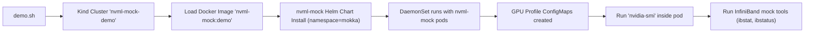
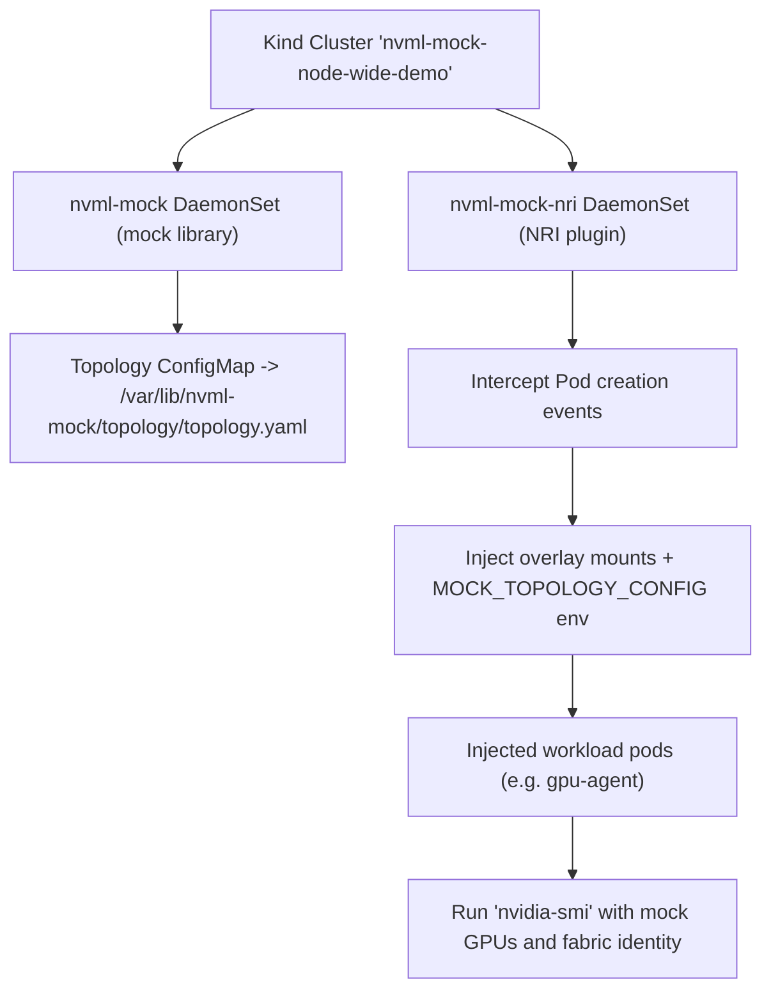
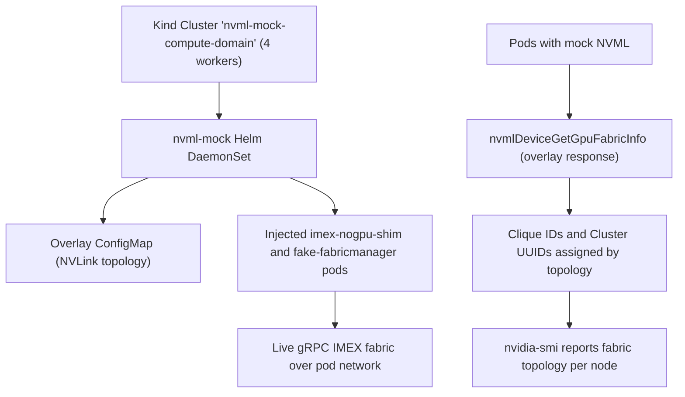
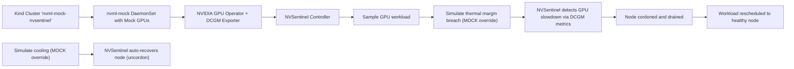
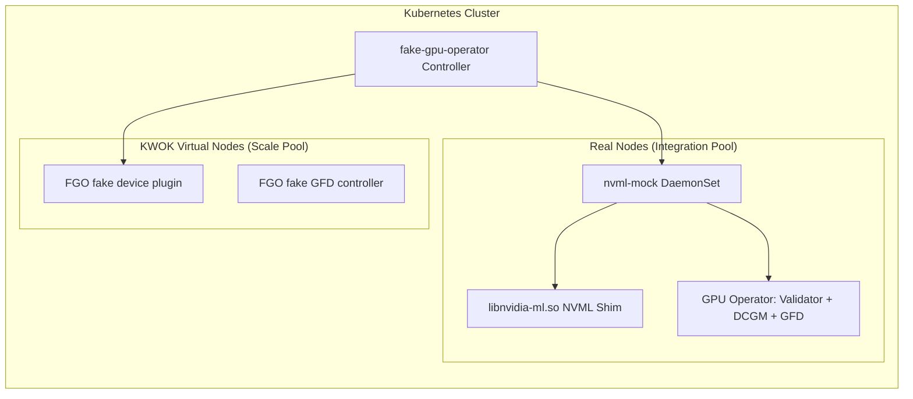

<!-- source: DeepWiki mcp.deepwiki.com · repo NVIDIA/k8s-test-infra · page 11.2 Demo Scenarios and Integration Examples · fetched 2026-10-26 -->

# Demo Scenarios and Integration Examples

<details>
<summary>Relevant source files</summary>

The following files were used as context for generating this wiki page:

- [Tiltfile](Tiltfile)
- [deployments/nvml-mock/helm/nvml-mock/templates/NOTES.txt](deployments/nvml-mock/helm/nvml-mock/templates/NOTES.txt)
- [deployments/nvml-mock/helm/nvml-mock/templates/integrations-fgo.yaml](deployments/nvml-mock/helm/nvml-mock/templates/integrations-fgo.yaml)
- [docs/README.md](docs/README.md)
- [docs/architecture.md](docs/architecture.md)
- [docs/demo/README.md](docs/demo/README.md)
- [docs/demo/kind.yaml](docs/demo/kind.yaml)
- [docs/demo/node-wide-injection/README.md](docs/demo/node-wide-injection/README.md)
- [docs/demo/node-wide-injection/run.sh](docs/demo/node-wide-injection/run.sh)
- [docs/demo/nv-sentinel/README.md](docs/demo/nv-sentinel/README.md)
- [docs/demo/nv-sentinel/gpu-operator-values.yaml](docs/demo/nv-sentinel/gpu-operator-values.yaml)
- [docs/demo/nv-sentinel/kind.yaml](docs/demo/nv-sentinel/kind.yaml)
- [docs/demo/nv-sentinel/mongodb.yaml](docs/demo/nv-sentinel/mongodb.yaml)
- [docs/demo/nv-sentinel/nvsentinel-values.yaml](docs/demo/nv-sentinel/nvsentinel-values.yaml)
- [docs/demo/nv-sentinel/run.sh](docs/demo/nv-sentinel/run.sh)
- [docs/demo/nv-sentinel/sample-workload.yaml](docs/demo/nv-sentinel/sample-workload.yaml)
- [docs/demo/standalone/README.md](docs/demo/standalone/README.md)
- [docs/demo/standalone/demo.sh](docs/demo/standalone/demo.sh)
- [docs/demo/with-fgo/README.md](docs/demo/with-fgo/README.md)
- [docs/examples.md](docs/examples.md)
- [docs/integrations/fake-gpu-operator.md](docs/integrations/fake-gpu-operator.md)
- [docs/quickstart.md](docs/quickstart.md)
- [local/README.md](local/README.md)
- [local/nvml_mock.tiltfile](local/nvml_mock.tiltfile)

</details>


This page documents practical, runnable demonstration scenarios and integration examples for `k8s-test-infra`, focusing on the `nvml-mock` GPU simulation system and its integration with Kubernetes environments. We cover the standalone demo, node-wide injection demo with NRI, the ComputeDomain fabric simulation demo, the NVSentinel thermal margin detection demo, and full integration with Run:ai’s fake-gpu-operator (FGO).

These demos serve both as end-to-end usage references showcasing real cluster deployments, and as integration exemplars combining `nvml-mock` with related GPU lifecycle tooling.

---

## 1. Standalone Demo

The standalone demo deploys `nvml-mock` on a local Kind cluster with GPU device simulation configured directly by `nvml-mock` itself. It mimics GPU Operator labels and ConfigMaps inline, without relying on an external GPU operator or injections.

### Implementation and Flow

- The demo starts by creating a Kind cluster named `nvml-mock-demo` with 1 control-plane and 3 worker nodes based on a local Kind config.
- It builds the `nvml-mock:demo` Docker image from the repo root and loads it into the Kind cluster.
- It installs the `nvml-mock` Helm chart into the `mokka` namespace with parameters:
  - GPU profile set via `GPU_PROFILE` environment variable (default "h100").
  - GPU count per node set via `GPU_COUNT` (default 8).
  - The flag to enable `fakeGpuOperator` integration for generating standard GPU profile ConfigMaps.
- The demo verifies successful deployment by checking DaemonSet rollout, existence of profile ConfigMaps, running `nvidia-smi` inside a pod, and validating InfiniBand mock device status.

The demo script `docs/demo/standalone/demo.sh` orchestrates these steps with detailed logging and error checking.

### Key Components

- **Kind cluster**: test environment for Kubernetes, pinned to context `kind-nvml-mock-demo`.
- **Docker image**: builds and loads the `nvml-mock` image with the embedded mock NVML library and tools.
- **Helm chart**: configures daemonset pods running the mock GPU driver and exposes simulated devices.
- **Profile ConfigMaps**: six ConfigMaps generated representing different profile fields for consumers like GPU Feature Discovery.
- **Validation**: bash script snippets run `nvidia-smi` and IB tools to confirm mock device realism.



This demo presents a fully self-contained GPU simulation environment for initial exploration or standalone testing.

Sources:  
`docs/demo/standalone/demo.sh:1-148`  
`docs/demo/standalone/README.md:1-48`  

---

## 2. Node-Wide Injection Demo (NRI)

This demo exercises the **Node Resource Interface (NRI)** plugin integration that transparently injects the mock GPU environment *ambiently*, without requiring pods to declare GPU requests or annotations or mutate pod specs explicitly.

### Architecture and Behavior

- A dedicated Kind cluster (`nvml-mock-node-wide-demo`) with 4 worker nodes is created and configured for containerd with NRI enabled.
- The Helm chart deploys two DaemonSets:
  - `nvml-mock` running the mock NVML stack.
  - `nvml-mock-nri` NRI plugin that:
    - Monitors pod creation events on the node.
    - Injects bind-mounts of the mock device nodes and environment variables (e.g., `MOCK_TOPOLOGY_CONFIG`) into pods transparently.
    - Supplies container `LD_PRELOAD` shims allowing any container to behave as if a GPU is present.
- The `nvml-mock-nri` plugin is aware of node fabric topology and injects node identity into pods to simulate **ComputeDomain fabric identity**.
- An example `gpu-agent` DaemonSet runs as a workload in the default namespace without GPU requests; injection enables it to run `nvidia-smi` and verify the fabric topology data in its container.
- The NRI plugin excludes injection into its own DaemonSet namespace (`mokka`) and core Kubernetes namespaces (`kube-system`) as a trust boundary.

### Data Flow

1. Cluster topology ConfigMap with overlay information is mounted into the `nvml-mock` DaemonSet pod.
2. The `setup.sh` script copies the topology YAML into `/var/lib/nvml-mock/topology/topology.yaml` on the host.
3. The NRI plugin bind-mounts this topology file into injected containers as `MOCK_TOPOLOGY_CONFIG`.
4. The mock NVML library reads this variable and applies node-specific cluster UUIDs and clique IDs to `nvidia-smi` output dynamically.

### Key Files & Functions

- `docs/demo/node-wide-injection/run.sh` controls cluster creation, image build/load, Helm install with NRI enabled, and workload deployment.
- NRI plugin code (in `pkg/nri/nvml-mock-nri`) hooks kube container creation to inject mounts/env, based on annotations and node name.
- Overlay patching of `clusterUuid` and `cliqueId` in the mock engine applies fabric identity injected by NRI.



This demo illustrates seamless node-level GPU simulation integration enabling any pod to transparently leverage mock GPUs.

Sources:  
`docs/demo/node-wide-injection/README.md:1-116`  
`docs/demo/node-wide-injection/run.sh`  

---

## 3. ComputeDomain Demo (NVLink Fabric Simulation)

This demonstration showcases the **ComputeDomain fabric simulation** with multi-node NVLink topology overlays, simulating GPU interconnect fabrics dynamically.

### Overview

- A Kind cluster named `nvml-mock-compute-domain` with 1 control-plane and 4 workers is provisioned.
- The Helm chart deploys `nvml-mock` with:
  - The `gb200` GPU profile enabling NVLink5 fabric APIs.
  - A cluster-level topology ConfigMap defining NVLink cliques and fabric clusters.
  - The real NVIDIA `nvidia-imex` daemon injected in **NO GPU** mode with the `imex-nogpu-shim` to establish a live gRPC domain across pods.
- The nodes are split into cliques by topology label (e.g., workers 1-2 clique 0, 3-4 clique 1).
- The demo runs diagnostic checks (`check-fabric`) asserting nodes report correct `cliqueId` and cluster UUID based on the overlay.
- A Helm upgrade can rebind all nodes to a new fabric clique dynamically without rebuilding images.

### Internal Mechanics

- The overlay ConfigMap is mounted inside the daemonset pod and virtual devices override `nvmlDeviceGetGpuFabricInfo()` calls.
- `imex-nogpu-shim` and the fake fabric manager provide real handshake and peer-death detection on gRPC links, emulating a hardware fabric interconnect.
- The fabric info is exposed via the mock NVML shim injected into pods, allowing `nvidia-smi` and fabric tools to query it.



This demo shows advanced multi-node fabric simulation fully integrated with Kubernetes networking.

Sources:  
`docs/demo/compute-domain/README.md:1-82`  
`docs/demo/compute-domain/run.sh`  

---

## 4. NVSentinel Demo (Thermal Margin Detection and Remediation)

The NVSentinel demo integrates the mock GPUs with NVIDIA's GPU Operator and `NVSentinel` thermal margin detection and remediation system.

### Demo Steps

- A Kind cluster `nvml-mock-nvsentinel` with 1 control-plane and 2 workers is created.
- The cluster deploys:
  - The `nvml-mock` Helm chart with simulated GPUs.
  - The NVIDIA GPU Operator in standalone mode with DCGM exporter.
  - The NVSentinel controller and a sample thermal margin-aware workload.
- One worker's mock GPU is artificially heated past its thermal slowdown threshold by dynamic configuration overrides.
- NVSentinel detects the thermal margin crossing using telemetry from DCGM + metadata-collector slowdown offset.
- NVSentinel responds by cordoning and draining the affected node.
- The sample workload reschedules to the healthy node.
- After simulated cooling, NVSentinel automatically recovers by uncordoning the node without restarting DCGM.

### Integration Points

- Real DCGM metrics are served by the mock NVML shim inside pods.
- NVSentinel uses Kubernetes events and node conditions.
- The demo manifests (`docs/demo/nv-sentinel/`) include MongoDB backend, sample workloads, and GPU operator values.



This demo exemplifies full-stack thermal detection and auto-remediation using `nvml-mock` as the GPU telemetry source.

Sources:  
`docs/demo/nv-sentinel/README.md:1-100`  
`docs/demo/nv-sentinel/run.sh`  

---

## 5. fake-gpu-operator (FGO) Integration Example

This is a full integration scenario combining `nvml-mock` with Run:ai's **fake-gpu-operator** (FGO) to simulate large heterogeneous Kubernetes GPU fleets.

### Why Combine `nvml-mock` and FGO?

| Capability                  | FGO Alone   | nvml-mock Alone | FGO + nvml-mock    |
|-----------------------------|-------------|-----------------|--------------------|
| Kubernetes API GPU simulation| Yes         | Yes             | Yes                |
| KWOK virtual nodes (scale)   | Yes         | No              | Yes                |
| Real NVML API inside pods    | No          | Yes             | Yes                |
| Real `nvidia-smi` output     | Limited     | Yes             | Yes                |
| DCGM Metrics                | Synthetic   | N/A             | Real on mock nodes  |
| GPU Operator validation     | No          | Yes             | Yes                |
| Fractional GPUs             | Yes         | No              | Yes (KWOK nodes)   |
| Large scale testing (>1000 nodes) | Yes   | No              | Yes (KWOK + mock)  |

### Architecture



### Setup Steps

1. Create a Kind cluster (`nvml-mock-fgo-demo`).
2. Optionally build and load the local `nvml-mock:demo` image.
3. Install `nvml-mock` Helm chart with `integrations.fakeGpuOperator.enabled=true` to produce GPU profile ConfigMaps consumable by FGO.
4. Install the `fake-gpu-operator` Helm chart with topology mapping pools:
   - **integration** uses backend `mock` (nvml-mock).
   - **scale** uses backend `fake` (FGO's lightweight shim).
5. Verify DaemonSets run on appropriate pools and that GPU profile ConfigMaps exist.
6. Confirm `nvidia-smi` works inside pods on integration nodes.

### GPU Profile ConfigMaps

- Created by `nvml-mock` Helm chart when FGO integration enabled.
- Named like `nvml-mock-profile-a100`, `nvml-mock-profile-h100`, etc.
- FGO watches and consumes these for scheduling topology.

### Customization

- Profile labels can be overridden to fit FGO topology requirements via `values.yaml`.

### Troubleshooting Highlights

- Verify `integrations.fakeGpuOperator.enabled=true` is set.
- Confirm presence and correct labels on ConfigMaps.
- Check `kubectl get pods` shows `nvml-mock` DaemonSet running on integration pool nodes and FGO pods on scale pool nodes.

Sources:  
`docs/integrations/fake-gpu-operator.md:1-200`  
`docs/demo/with-fgo/README.md:1-115`  

---

## Summary of Demo Usage Patterns

| Demo Scenario               | Cluster Name                 | Key Features                                    | Requirements                         |
|----------------------------|-----------------------------|------------------------------------------------|------------------------------------|
| Standalone Demo             | `nvml-mock-demo`            | Basic nvml-mock DaemonSet, fake GPU labels     | Docker, Kind, Helm                  |
| Node-Wide Injection (NRI)  | `nvml-mock-node-wide-demo`  | Ambient injection of mock GPUs via NRI plugin  | Docker, Kind, Helm, containerd NRI |
| ComputeDomain Demo          | `nvml-mock-compute-domain`  | Multi-node NVLink fabric topology, gRPC IMEX   | Docker, Kind, Helm, kubectl, jq    |
| NVSentinel Demo             | `nvml-mock-nvsentinel`      | DCGM + NVSentinel thermal detection & remediation | Docker, Kind, Helm, kubectl        |
| fake-gpu-operator Integration | `nvml-mock-fgo-demo`      | Mixed real nodes + KWOK virtual nodes scale sim| Docker, Kind, Helm, FGO chart       |

Each demo is scripted for reproducibility and verification, providing end-to-end examples bridging real-world Kubernetes GPU stack testing with simulated hardware.

---

# Code Entities and Mapping

### Standalone Demo: `demo.sh`

- `docs/demo/standalone/demo.sh` orchestrates steps: cluster create (lines 69-86), image build (89-92), image load (95-98), helm install (101-113), and validations (124-147).

### NRI Demo Entry Point: `run.sh`

- `docs/demo/node-wide-injection/run.sh` runs cluster setup, image build/load, helm install for `nvml-mock` + `nvml-mock-nri` DaemonSets, workloads deployment and validation.

### ComputeDomain Scenario

- The daemonset mounts a topology ConfigMap `topology.yaml` utilized by the mock NVML shim's `applyTopologyOverlay()` (internal engine function).
- Real `nvidia-imex` daemon run with `--nogpu` is deployed, located in the image layered by the `compute_domain.tiltfile`.

### fake-gpu-operator Integration

- The Helm value `integrations.fakeGpuOperator.enabled=true` enables creation of GPU profile ConfigMaps with the label `run.ai/gpu-profile=true`.
- The fake-gpu-operator controller reads these ConfigMaps and manages node pools with backends set to `mock` or `fake`.

```mermaid
flowchart TB
  subgraph Demo Scenarios "Natural Language Space"
    Standalone["Standalone Demo"]
    NodeWide["Node-Wide Injection Demo"]
    ComputeDomain["ComputeDomain Demo"]
    NVSentinel["NVSentinel Demo"]
    FakeGpuOperator["fake-gpu-operator Integration"]
  end

  subgraph Implementation "Code Entity Space"
    DemoScript["docs/demo/standalone/demo.sh"]
    NRIrun["docs/demo/node-wide-injection/run.sh"]
    ComputeDomainTilt["local/compute-domain/compute_domain.tiltfile"]
    NVSentinelManifests["docs/demo/nv-sentinel/"]
    FGOIntegration["docs/integrations/fake-gpu-operator.md"]

    NvmlMockChart["deployments/nvml-mock/helm/nvml-mock"]
    OverlayConfigMap["Topology ConfigMap / GPU Profile ConfigMaps"]
    NRIPlugin["nvml-mock-nri NRI Plugin"]
    ImexDaemon["nvidia-imex daemon, imex-nogpu-shim"]
  end

  Standalone --> DemoScript
  NodeWide --> NRIrun
  NodeWide --> NRIPlugin
  NodeWide --> OverlayConfigMap
  ComputeDomain --> ComputeDomainTilt
  ComputeDomain --> OverlayConfigMap
  ComputeDomain --> ImexDaemon
  NVSentinel --> NVSentinelManifests
  NVSentinel --> NvmlMockChart
  FakeGpuOperator --> FGOIntegration
  FakeGpuOperator --> NvmlMockChart
  FakeGpuOperator --> OverlayConfigMap
```

---

## Additional Notes

- The Helm chart supports multiple overlays and flags to enable the various integrations like NRI, ComputeDomain, and fake GPU operator via Helm values (handled in local/nvml_mock.tiltfile, invoking Helm with `--set` flags).
- The demos all build or consume a version-tagged `nvml-mock` image, which contains the mock NVML shared library and binary tooling (nvidia-smi).
- Validation scripts often run inside pods launched during demos to verify expected device behavior and configurations.

---

# References to Source Files

- Standalone Demo Script: `docs/demo/standalone/demo.sh:1-148`  
- Standalone Demo Documentation: `docs/demo/standalone/README.md:1-48`  

- Node-Wide Injection Docs: `docs/demo/node-wide-injection/README.md:1-116`  
- Node-Wide Injection Run Script: `docs/demo/node-wide-injection/run.sh`  

- ComputeDomain Demo Docs: `docs/demo/compute-domain/README.md:1-82` (not fully included here)  
- ComputeDomain Tiltfile overlays: `local/compute-domain/compute_domain.tiltfile`  

- NVSentinel Demo Docs: `docs/demo/nv-sentinel/README.md:1-100`  
- NVSentinel Run Script: `docs/demo/nv-sentinel/run.sh`  

- fake-gpu-operator Integration Guide: `docs/integrations/fake-gpu-operator.md:1-200`  
- fake-gpu-operator Demo Docs: `docs/demo/with-fgo/README.md:1-115`  

- Tilt Integration Helpers and Flags (for all scenarios): `Tiltfile:1-133`, `local/nvml_mock.tiltfile:1-154`

---

This page documents practical real-world deployment and integration examples, serving as the first step in experimenting with and extending `k8s-test-infra` GPU simulation capabilities. For deeper internal design details, see the architecture and module documentation pages.

---

