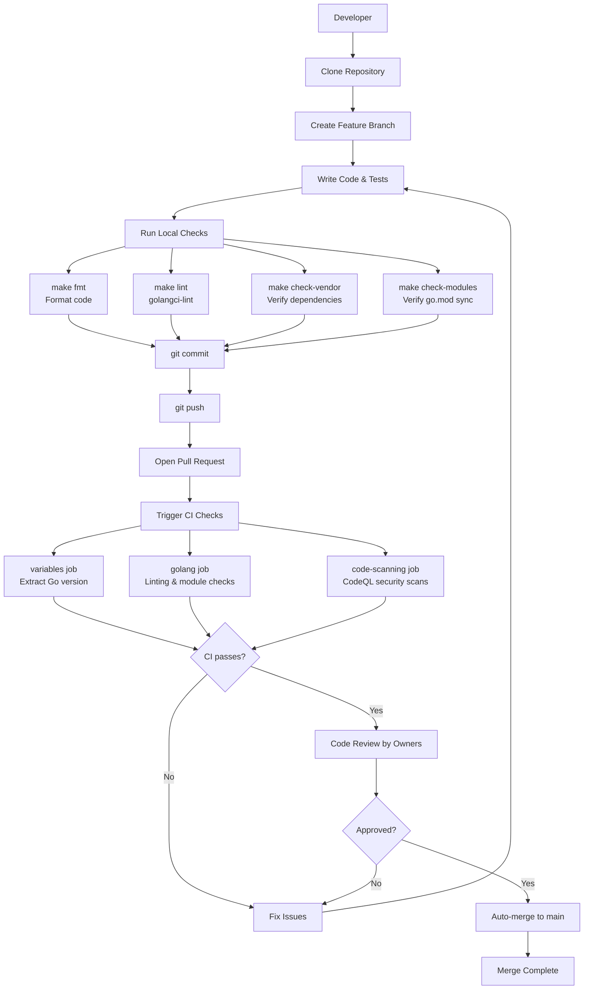
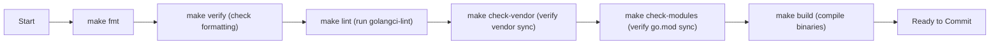
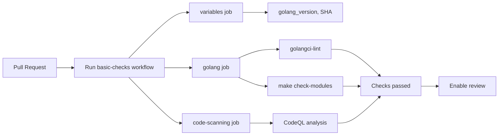
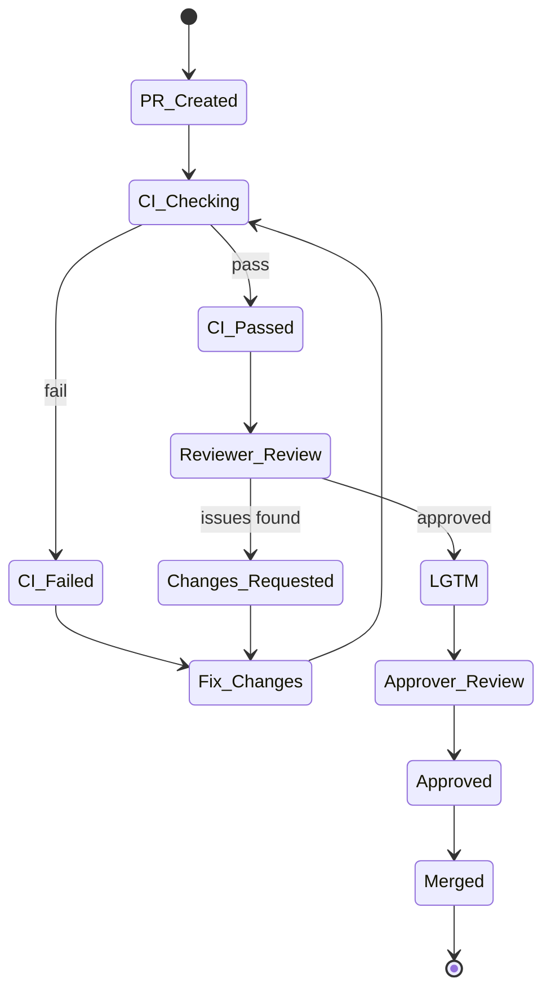

<!-- source: DeepWiki mcp.deepwiki.com · repo NVIDIA/k8s-test-infra · page 12 Contributing to k8s-test-infra · fetched 2026-10-26 -->

# Contributing to k8s-test-infra

<details>
<summary>Relevant source files</summary>

The following files were used as context for generating this wiki page:

- [.editorconfig](.editorconfig)
- [.github/CODEOWNERS](.github/CODEOWNERS)
- [.github/PULL_REQUEST_TEMPLATE.md](.github/PULL_REQUEST_TEMPLATE.md)
- [CONTRIBUTING.md](CONTRIBUTING.md)
- [OWNERS](OWNERS)
- [enhancements/README.md](enhancements/README.md)
- [enhancements/template.md](enhancements/template.md)

</details>


## Purpose and Scope

This page provides a high-level guide for contributors to the **k8s-test-infra** project. It outlines the essential workflows, quality requirements, and governance mechanisms designed to maintain code quality and efficient project collaboration.

To keep this overview focused, detailed technical guidelines and governance descriptions are provided in child pages:

- For complete rules on linting, formatting, module management, and enhancement proposals, see [Code Quality Standards](#12.1).
- For explanations of the OWNERS file, code review roles, PR approval workflows, and automation bots, see [Ownership and Review Process](#12.2).

## Contribution Workflow Overview

Contributions follow a typical GitHub pull request workflow enhanced with automated checks and a formal review process. The cycle begins with a developer working locally, proceeds through automated local and CI checks, followed by code review and culminates in automated merge upon approvals and passing tests.



This diagram emphasizes the integration of automated format, lint, and module verification checks both locally and in the CI pipeline. Passing these checks is mandatory before maintainers review and approve a change.

**Sources:** [CONTRIBUTING.md:1-130](), [OWNERS:1-9](), [.github/CODEOWNERS:1-18]()

---

## Local Development Environment and Pre-Commit Requirements

To streamline contributions and reduce failures upstream, contributors should ensure their local environment meets the required tool versions and their changes pass automated quality checks before pushing.

| Tool | Purpose | Version or Notes |
|-------|----------|------------------|
| Go | Build & test code | See current Go version management in `deployments/devel/Dockerfile` and `hack/golang-version.sh` |
| `golangci-lint` | Static analysis and linting | Latest recommended version |
| `gofmt` | Go code formatting checker and fixer | Comes standard with Go |
| `git` | Source control | Any recent version |

### Pre-Commit Quality Checks

Run the following Make targets locally to validate your code before committing:



- `make fmt` formats your Go code automatically.
- `make verify` ensures your code is formatted correctly without making changes.
- `make lint` runs the project's configured Go linter to check code quality.
- `make check-vendor` verifies `go.mod`, `go.sum`, and `vendor/` are in sync.
- `make check-modules` verifies all modules' dependency files are synchronized.
- `make build` compiles needed binaries to ensure code compiles cleanly.

### Managing Dependencies

This project uses vendored Go modules for reproducible builds:

- After modifying dependencies, run `make vendor` to tidy and vendor dependencies.
- Always verify synchronization with `make check-vendor`.
- When working with multiple Go modules, run `make modules` to tidy, vendor, and verify all modules.

Failing to synchronize dependencies properly will cause CI to fail.

**Sources:** [Makefile:27-80](), [CONTRIBUTING.md:30-48]()

---

## Automated CI Checks

Every pull request triggers automated CI workflows, validating formatting, linting, module sync, and security scans.



This ensures consistent quality standards across all contributions:

- Linting and formatting are verified in the `golang` job.
- Dependency files are validated for consistency.
- CodeQL static analysis guards against security issues.

All checks must pass before merging is allowed.

**Sources:** [.github/workflows/basic-checks.yaml (implied)](), [Makefile:75-79](), [CONTRIBUTING.md:75-79]()

---

## Code Review and Project Governance

The project enforces a structured review process governed by `OWNERS` and `CODEOWNERS` files.

### Maintainers and Roles

- Maintainers serve as both reviewers and approvers.
- Current maintainers include:
  - `ArangoGutierrez`
  - `elezar`
  - (Plus contributors with review access listed in OWNERS)

### Review Workflow



- Pull requests must pass all CI checks before review.
- Reviewers examine code changes and either request changes or approve (LGTM).
- Approvers have authority to merge after approvals.
- The project also employs the `copy-pr-bot` for CLA and license compliance automation.

For full detail on reviewer roles, approval requirements, and automation, see [Ownership and Review Process](#12.2).

**Sources:** [OWNERS:1-9](), [.github/CODEOWNERS:1-18]()

---

## Relationship of Topics in Contribution Process

```mermaid
graph TD
    Code_Quality_Standards["Code Quality Standards<br/>(Linting, Format, Modules)"] --> Contribution_Workflow["Contribution Workflow"]
    Ownership_Process["Ownership and Review Process"] --> Contribution_Workflow
    Contribution_Workflow --> Local_Dev_Environment["Local Development Setup & Pre-Commit Checks"]
    Contribution_Workflow --> CI_Automation["Automated CI Checks"]
    CI_Automation --> Code_Review_Process["Code Review and Approval"]
    Code_Review_Process --> Merge["Merge to main"]

    Local_Dev_Environment -. improves -.> CI_Automation
    Code_Quality_Standards -. enforced by .-> CI_Automation
    Ownership_Process -. governs .-> Code_Review_Process
```

This diagram illustrates how:

- Code quality standards underpin all automated checks.
- The ownership and review process govern human approvals.
- Local developer tools and scripts help ensure compliance before pushing.
- The overall contribution workflow connects these elements into a consistent path from writing code to merging it.

---

# Summary

Contributing to **k8s-test-infra** requires adherence to a rigorous process designed to ensure code stability and maintainability:

- Follow prescribed code quality standards for linting, formatting, and dependency management.
- Use provided Makefile targets for local code validation.
- Submit pull requests that trigger automated CI pipelines validating correctness and security.
- Collaborate with maintainers for code reviews and approvals using the defined OWNERs governance.
- Consult child pages [Code Quality Standards](#12.1) and [Ownership and Review Process](#12.2) for in-depth policies.

By reliably following this process, contributors help maintain the project’s integrity and accelerate integration of their improvements.

---

**Sources:**

- [CONTRIBUTING.md:1-130]()
- [OWNERS:1-9]()
- [.github/CODEOWNERS:1-18]()
- [Makefile:27-80]()
- [enhancements/template.md:1-124]() (for context on enhancement proposals referenced in child pages)

---

