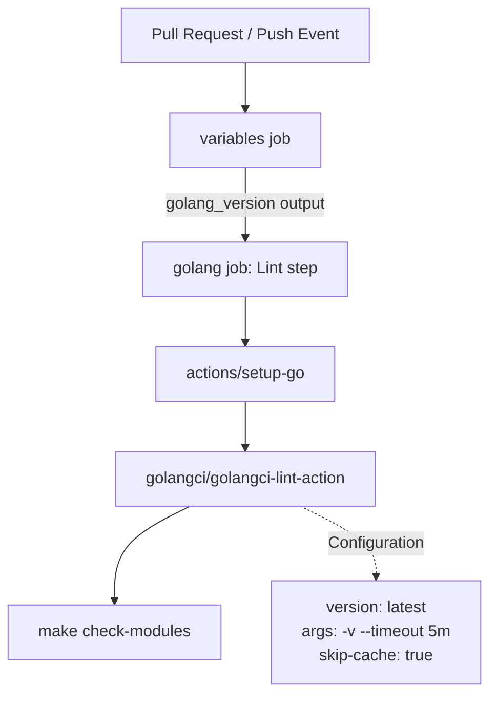
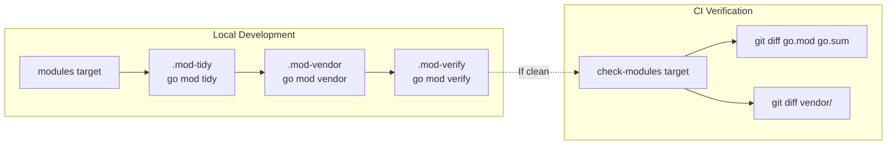
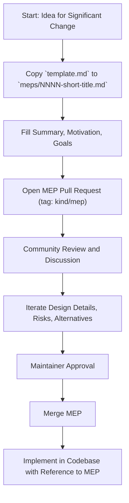
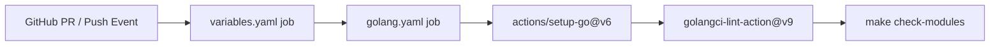
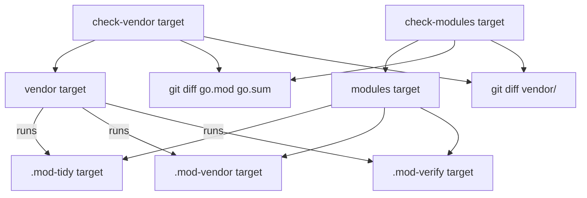

<!-- source: DeepWiki mcp.deepwiki.com · repo NVIDIA/k8s-test-infra · page 12.1 Code Quality Standards · fetched 2026-10-26 -->

# Code Quality Standards

<details>
<summary>Relevant source files</summary>

The following files were used as context for generating this wiki page:

- [.golangci.yml](.golangci.yml)
- [CONTRIBUTING.md](CONTRIBUTING.md)
- [enhancements/README.md](enhancements/README.md)
- [enhancements/template.md](enhancements/template.md)
- [tests/e2e/go/report_skips_test.go](tests/e2e/go/report_skips_test.go)

</details>


## Purpose and Scope

This document defines the code quality standards enforced in the `k8s-test-infra` repository. It details the linting rules, formatting requirements, module management practices, and describes the enhancement proposal (MEP) process used for introducing substantive changes to the codebase.

For contributor guidelines on review processes and ownership, see [Ownership and Review Process](#12.2). For CI/CD pipeline integration of code quality checks, refer to [CI/CD Pipeline](#4).

---

## Code Formatting Standards

The project enforces consistent Go code formatting using the standard Go tool `gofmt`. Every `.go` file committed to the repository must be formatted accordingly.

### Formatting Targets

Formatting automation is provided through the Makefile with two key targets:

| Target          | Description                           | Behavior                                     |
|-----------------|-----------------------------------|----------------------------------------------|
| `make fmt`      | Format Go source files              | Automatically runs `gofmt -w -l` on all `.go` files excluding `vendor/` |
| `make verify`   | Verify formatting                   | Checks for formatting issues without modifying files; exits with error if issues found |

The `fmt` target is implemented as:

```makefile
fmt:
	@$(GO_FMT) -w -l $$(find . -name '*.go')
```

and the `verify` target as:

```makefile
verify:
	@out=`$(GO_FMT) -w -l -d $$(find . -name '*.go')`; \
	if [ -n "$$out" ]; then \
	    echo "$$out"; \
	    exit 1; \
	fi
```

Implementation details:

- `GO_FMT` defaults to `gofmt`
- The command uses `find` to recursively select `.go` files excluding the `vendor/` directory ([Makefile:14-15,31-39]())

Enforcing `gofmt` maintains uniform syntax and style consistency across the codebase, facilitating easier code comprehension and reducing trivial diffs.

**Sources:** [Makefile:14-15](), [Makefile:31-39]()

---

## Linting with golangci-lint

To ensure higher code quality, the repository employs `golangci-lint`, a unified linter aggregator for Go.

### Local Linting

Developers can run:

```bash
make lint
```

which triggers:

```makefile
lint:
	golangci-lint run ./...
```

This runs all enabled linters on all Go packages within the repository recursively ([Makefile:41-42]()).

### Linting Configuration and Rules

The linting behavior is driven by `.golangci.yml` configuration:

- Includes build tags `e2e` and `integration` to lint test-only code guarded by those tags.
- Enables nearly all `staticcheck` checks except stylistic ones (`ST1000`, `ST1003`, and the entire `QF*` category).
- Provides explicit exclusions for known false positives in Ginkgo test helper files to allow dot-imports (`ST1001` exemption specifically for test suite files) ([.golangci.yml:15-61]()).

### CI Integration for Linting

Linting is enforced within the CI pipeline on every Pull Request and push. The process includes:



- The workflow installs the Go version extracted from the `deployments/devel/Dockerfile` via `hack/golang-version.sh`.
- Executes `golangci-lint-action` with verbose output and a 5-minute timeout.
- Runs `make check-modules` after lint to verify module consistency.
([.github/workflows/golang.yaml:17-45]())

### Summary of Linting Parameters

| Parameter    | Value           | Description                    |
|--------------|-----------------|------------------------------|
| version      | `latest`        | Always runs latest golangci-lint |
| args         | `-v --timeout 5m` | Verbose and 5-minute timeout  |
| skip-cache   | `true`          | Disables caching to ensure fresh analysis |

**Sources:** [.golangci.yml:15-61](), [Makefile:41-42](), [.github/workflows/golang.yaml:17-45]()

---

## Module Management

To ensure dependency consistency and reproducible builds, the project applies strict module management workflows involving go modules and vendoring.

### Module Management Workflow Overview



### Makefile Module Targets

#### `vendor` target

Executes a full module refresh:

```makefile
vendor:
	go mod tidy
	go mod vendor
	go mod verify
```

- Runs `go mod tidy` to add missing and remove unused dependencies
- Runs `go mod vendor` to vendor dependencies into `vendor/`
- Runs `go mod verify` to verify checksum integrity ([Makefile:44-47]())

#### `modules` target

Manages multi-module scenarios by processing all `go.mod` files under the repo excluding testdata and third_party folders. It aggregates three sub-tasks:

- `.mod-tidy`: Tidies all relevant modules
- `.mod-vendor`: Vendors dependencies
- `.mod-verify`: Verifies module integrity

([Makefile:52-73]())

#### `check-vendor` target

Verifies the vendored dependencies are up-to-date with declared modules:

```makefile
check-vendor: vendor
	git diff --quiet HEAD -- go.mod go.sum vendor
```

- If any differences occur, it exits with an error, requiring sync ([Makefile:49-50]())

#### `check-modules` target

Performs comprehensive verification that modules and vendored dependencies are synchronized:

```makefile
check-modules: modules
	@echo "- Checking if go.mod and go.sum are in sync..."
	@git diff --exit-code -- $$(find . -name go.mod -name go.sum)
	@echo "- Checking if the go mod vendor dir is in sync..."
	@git diff --exit-code -- $$(find . -name vendor)
```

- Runs the full `modules` pipeline
- Checks for uncommitted changes in go.mod/go.sum and vendor folders ([Makefile:75-79]())

### CI Enforcement of Module Consistency

The GitHub Actions golang workflow runs:

```yaml
- name: Check golang modules
  run: |
    make check-modules
```

Ensuring guaranteed module and vendoring consistency on every run ([.github/workflows/golang.yaml:43-45]()).

**Sources:** [Makefile:44-79](), [.github/workflows/golang.yaml:43-45]()

---

## Enhancement Proposal (MEP) Process

Substantial changes in architecture, features, or public APIs must follow the "MEP" (Mokka Enhancement Proposal) process. This formalized approach ensures informed design decisions and consensus before implementation.

### MEP Overview

- Adapted from Kubernetes KEP process
- Applies to major cross-cutting refactors, new top-level components, API changes, or adding new dependencies/platform targets.
- Small fixes or incremental features do not require MEPs; contributors open issues or PRs directly.

### MEP Workflow



- MEP files reside under `enhancements/meps/`
- The canonical template is at `enhancements/template.md`
- Superseded or withdrawn MEPs remain in history with status updated ([enhancements/README.md]())

### Expectations

- MEPs document motivation, goals, design details, risks, and alternatives.
- MEP number (`NNNN`) is assigned consecutively.
- MEPs provide a record of intent; PRs for implementation link to the MEP.

**Sources:** [enhancements/template.md](), [enhancements/README.md]()

---

## Summary Table: Code Quality Enforcement

| Standard            | Local Command         | CI Enforcement                        | Configuration/Notes              |
|---------------------|-----------------------|-------------------------------------|-----------------------------|
| Code Formatting     | `make fmt` / `make verify` | Not directly enforced, failure on upstream | `gofmt` defaults           |
| Linting            | `make lint`            | `.github/workflows/golang.yaml`     | `golangci-lint` with `.golangci.yml` |
| Module Management   | `make vendor` / `make check-modules` | `.github/workflows/golang.yaml`     | `go.mod`, `go.sum`, `vendor/`  |
| Enhancement Proposals| N/A                    | N/A                                | MEPs in `enhancements/meps/`     |

---

## Diagrams Associating Code Entities to Concepts

### Diagram 1: Linting Pipeline Entities



Shows the CI step sequence triggered for linting and module verification using GitHub workflow files.

### Diagram 2: Module Targets in Makefile and Their Relations



Shows the key module management targets in Makefile controlling vendoring and verification.

---

# End of Document

**Sources:**  
[Makefile:14-15,31-50,52-79](), [.golangci.yml:15-61](), [.github/workflows/golang.yaml:17-45](), [enhancements/template.md](), [enhancements/README.md](), [Makefile:41-42]()

---

