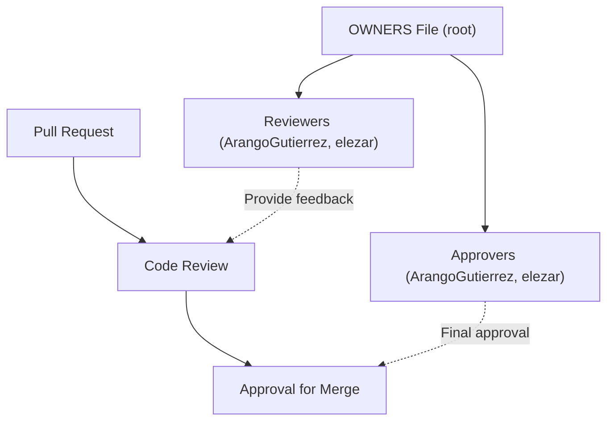
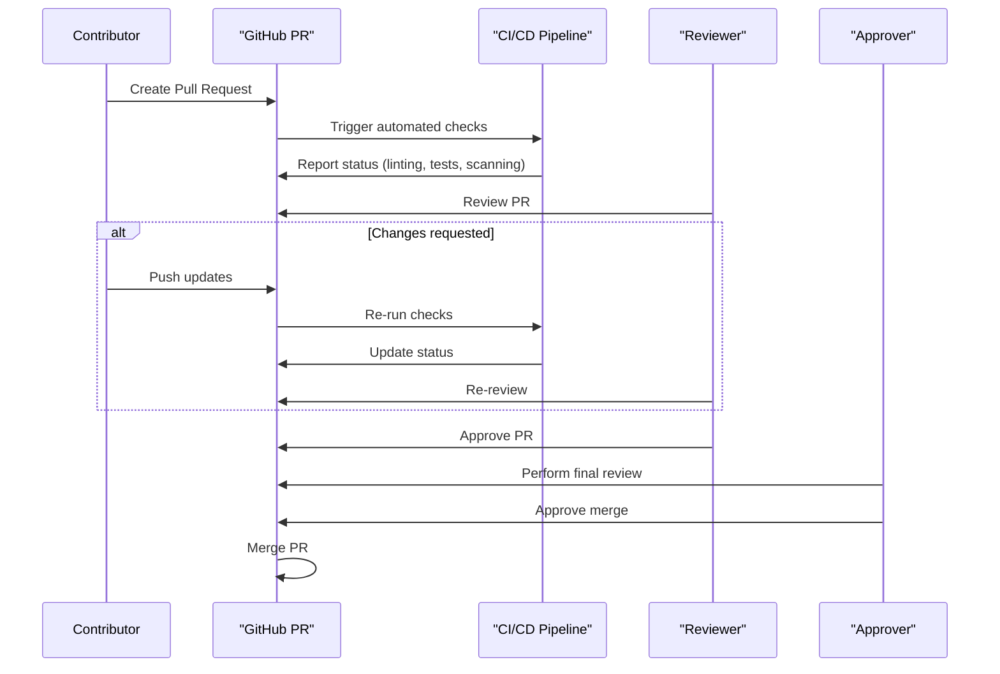
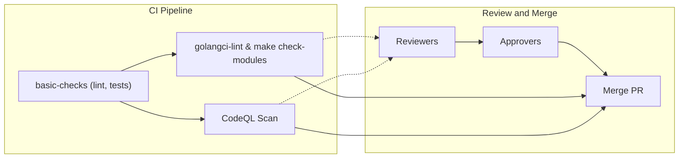
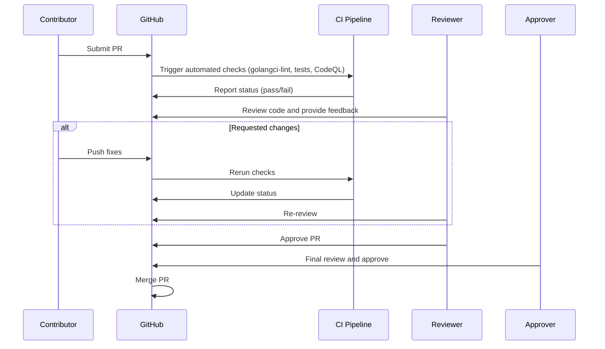

<!-- source: DeepWiki mcp.deepwiki.com · repo NVIDIA/k8s-test-infra · page 12.2 Ownership and Review Process · fetched 2026-10-26 -->

# Ownership and Review Process

<details>
<summary>Relevant source files</summary>

The following files were used as context for generating this wiki page:

- [.editorconfig](.editorconfig)
- [.github/CODEOWNERS](.github/CODEOWNERS)
- [.github/PULL_REQUEST_TEMPLATE.md](.github/PULL_REQUEST_TEMPLATE.md)
- [.github/copy-pr-bot.yaml](.github/copy-pr-bot.yaml)
- [OWNERS](OWNERS)

</details>


## Purpose and Scope

This document details the ownership and code review process within the **k8s-test-infra** repository. It explains the role and structure of the `OWNERS` file, how it relates to GitHub's `CODEOWNERS` configuration, the delineation of reviewer and approver roles, the pull request (PR) approval workflow, and the usage of the `copy-pr-bot` for PR management.

The aim is to clarify responsibilities and the flow of code review and merging to ensure quality and consistency.

---

## OWNERS File Overview

The `OWNERS` file is located at the root of the repository and follows the Kubernetes community's OWNERS format as documented at https://go.k8s.io/owners. It specifies the sets of project members who have permission to:

- **Review**: Provide comments and approve code changes
- **Approve**: Provide final approval to merge pull requests

### Current OWNERS File Content

```yaml
# See the OWNERS docs at https://go.k8s.io/owners

reviewers:
  - ArangoGutierrez
  - elezar
approvers:
  - ArangoGutierrez
  - elezar
```

This configuration reflects that two individuals, `ArangoGutierrez` and `elezar`, are both reviewers and approvers, enabling them to review code and grant final merge approval [OWNERS:1-9]().

---

## CODEOWNERS File Overview

The repository also includes a `.github/CODEOWNERS` file which is used by GitHub to automatically assign reviewers on pull requests based on the files modified. It defines ownership mappings covering the whole repository, with the default owner assigned as `@ArangoGutierrez`.

### CODEOWNERS Highlights

```
# Default owners for everything
* @ArangoGutierrez

# Mock NVML library
/pkg/gpu/mocknvml/ @ArangoGutierrez

# Helm chart
/deployments/nvml-mock/ @ArangoGutierrez

# CI workflows
/.github/workflows/ @ArangoGutierrez

# E2E tests
/tests/e2e/ @ArangoGutierrez
```

The CODEOWNERS file enables GitHub's auto-assignment of reviewers, improving PR triaging efficiency by suggesting appropriate owners based on the changed files [/.github/CODEOWNERS:1-18]().

---

## Ownership Model and Roles

The ownership model distinguishes **reviewers** and **approvers** as defined in the `OWNERS` file:

| Role      | Responsibilities                                                                                         |
|-----------|---------------------------------------------------------------------------------------------------------|
| Reviewer  | Review and critique code changes, ensuring adherence to quality standards, testing, and documentation  |
| Approver  | Review and approve changes for merge, with authority to make final merge decisions                     |

Reviewers help maintain code quality, while approvers have the additional authority to merge PRs. In this repository, all current approvers are also reviewers.

### Ownership and Review Flow



**Diagram: Mapping `OWNERS` file roles to the review process**

This shows how the `OWNERS` file defines the role sets that participate in PR review and approval [OWNERS:3-9]().

---

## Pull Request Review and Approval Workflow

The review workflow for PRs involves several steps, including automated checks and human interactions:



**Diagram: Pull request lifecycle with automated and manual validation**

The workflow contains an iterative review loop until reviewers are satisfied. Approvers conduct the final merge decision. Automated CI jobs ensure basic quality before human approval proceeds [OWNERS:3-10]().

---

## Code Review Process

### Review Checklist

Reviewers assess PRs against these key criteria:

| Aspect          | Description                                             |
|-----------------|---------------------------------------------------------|
| Build           | Code compiles successfully (`make build`)               |
| Tests           | All tests pass and new features are covered             |
| Lint            | `golangci-lint` reports no errors                        |
| Formatting      | Code formatted per `gofmt`                               |
| Modules         | Dependency checks and `go.mod` / `go.sum` synced        |
| Documentation   | Public APIs and complex logic properly documented        |
| Security        | CodeQL and security analyses show no issues              |

### Reviewer Interactions

Reviewers use GitHub’s PR UI to interact:

- **Comment**: Suggest improvements or clarifications without blocking merge
- **Request Changes**: Block merging pending fixes
- **Approve**: Indicate readiness for merge consideration

Reviewers may iterate comments and change requests until the PR meets standards.

**Sources:** [OWNERS:3-10]().

---

## Integration with CI/CD Pipeline

Automatic verification runs in the CI pipeline (GitHub Actions) before reviews:



Automated checks must pass before human review proceeds. Both reviewers and approvers must ultimately approve for merge to occur [OWNERS:3-10]().

---

## copy-pr-bot Configuration

The repository uses the `copy-pr-bot` GitHub app configured via `.github/copy-pr-bot.yaml`:

```yaml
enabled: true
```

This enables automated PR interactions such as cloning PRs across branches to reduce manual copy/paste errors in multi-branch workflows. The simple enablement configuration indicates it's active repository-wide [/.github/copy-pr-bot.yaml:1-4]().

---

## Summary

The ownership and review process for **k8s-test-infra** is driven by Kubernetes-style `OWNERS` file permissions, augmented with GitHub `CODEOWNERS` for automated reviewer assignment. Pull requests undergo an integrated process of automated checks and manual review:

- The `OWNERS` file defines project reviewers and approvers
- The `CODEOWNERS` file supports GitHub's automatic reviewer assignment by file paths
- PRs trigger CI verification of linting, testing, and code scanning
- Reviewers provide feedback and can request changes
- Approvers grant final merge approval
- The `copy-pr-bot` app assists with PR management automation

This process ensures high code quality, consistency, and effective project governance.

---

# Appendix: Key Relevant Files

| File Path                 | Description                           |
|---------------------------|-------------------------------------|
| `OWNERS`                  | Defines reviewers and approvers     |
| `.github/CODEOWNERS`      | Maps files/directories to owners for auto-review-assignment |
| `.github/copy-pr-bot.yaml`| Configuration for the copy-pr-bot automation app |

---

# Diagrams Relating Natural Language Concepts to Code Entities

```mermaid
graph LR
    OWNERS_FILE["`OWNERS` file<br/>(root)"]
    REVIEWERS_LIST["reviewers:<br/>- ArangoGutierrez<br/>- elezar"]
    APPROVERS_LIST["approvers:<br/>- ArangoGutierrez<br/>- elezar"]
    PR["Pull Request"]
    REVIEW["Review Phase<br/>(GitHub UI)"]
    APPROVAL["Approval Phase<br/>(GitHub UI)"]
    CI["CI/CD Pipeline<br/>(GitHub Actions)"]

    OWNERS_FILE --> REVIEWERS_LIST
    OWNERS_FILE --> APPROVERS_LIST
    PR --> CI
    PR --> REVIEW
    REVIEWERS_LIST -.->|performs| REVIEW
    REVIEW --> APPROVAL
    APPROVERS_LIST -.->|performs| APPROVAL
```

**Diagram: Mapping `OWNERS` file role definitions to PR and CI processes**



**Diagram: Detailed sequence of a pull request lifecycle**

---

**Sources:**

- [OWNERS:1-9]()
- [.github/CODEOWNERS:1-18]()
- [.github/copy-pr-bot.yaml:1-4]()

---

