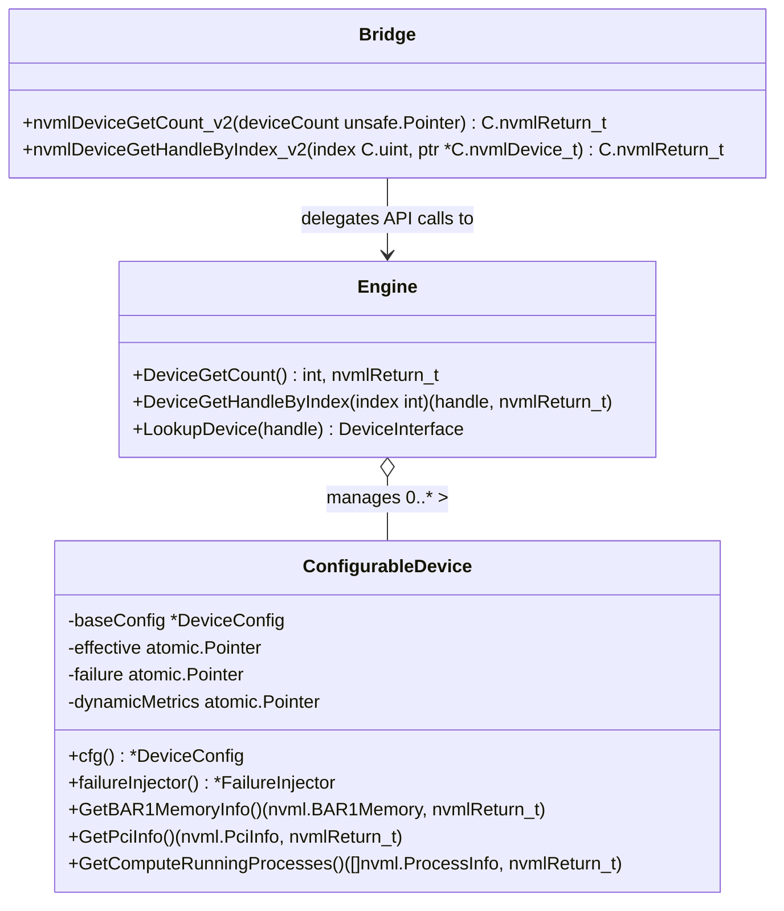

<!-- source: DeepWiki mcp.deepwiki.com · repo NVIDIA/k8s-test-infra · page 13 Glossary · fetched 2026-10-26 -->

# Glossary

<details>
<summary>Relevant source files</summary>

The following files were used as context for generating this wiki page:

- [CHANGELOG.md](CHANGELOG.md)
- [cmd/fake-imex/ctl/main.go](cmd/fake-imex/ctl/main.go)
- [cmd/fake-imex/daemon/main.go](cmd/fake-imex/daemon/main.go)
- [cmd/fake-imex/integration_test.go](cmd/fake-imex/integration_test.go)
- [deployments/nvml-mock/Dockerfile.compute-domain-daemon](deployments/nvml-mock/Dockerfile.compute-domain-daemon)
- [deployments/nvml-mock/helm/nvml-mock/README.md](deployments/nvml-mock/helm/nvml-mock/README.md)
- [deployments/nvml-mock/helm/nvml-mock/templates/daemonset.yaml](deployments/nvml-mock/helm/nvml-mock/templates/daemonset.yaml)
- [deployments/nvml-mock/helm/nvml-mock/tests/__snapshot__/daemonset_test.yaml.snap](deployments/nvml-mock/helm/nvml-mock/tests/__snapshot__/daemonset_test.yaml.snap)
- [deployments/nvml-mock/helm/nvml-mock/tests/daemonset_test.yaml](deployments/nvml-mock/helm/nvml-mock/tests/daemonset_test.yaml)
- [deployments/nvml-mock/helm/nvml-mock/values.schema.json](deployments/nvml-mock/helm/nvml-mock/values.schema.json)
- [deployments/nvml-mock/helm/nvml-mock/values.yaml](deployments/nvml-mock/helm/nvml-mock/values.yaml)
- [deployments/nvml-mock/scripts/cleanup.sh](deployments/nvml-mock/scripts/cleanup.sh)
- [deployments/nvml-mock/scripts/setup.sh](deployments/nvml-mock/scripts/setup.sh)
- [docs/README.md](docs/README.md)
- [docs/architecture.md](docs/architecture.md)
- [docs/configuration.md](docs/configuration.md)
- [docs/demo/compute-domain/README.md](docs/demo/compute-domain/README.md)
- [docs/demo/compute-domain/run.sh](docs/demo/compute-domain/run.sh)
- [docs/demo/kind.yaml](docs/demo/kind.yaml)
- [docs/demo/with-fgo/README.md](docs/demo/with-fgo/README.md)
- [docs/examples.md](docs/examples.md)
- [docs/integrations/fake-gpu-operator.md](docs/integrations/fake-gpu-operator.md)
- [docs/quickstart.md](docs/quickstart.md)
- [pkg/gpu/mocknvml/bridge/device.go](pkg/gpu/mocknvml/bridge/device.go)
- [pkg/gpu/mocknvml/bridge/helpers.go](pkg/gpu/mocknvml/bridge/helpers.go)
- [pkg/gpu/mocknvml/bridge/nvml_types.h](pkg/gpu/mocknvml/bridge/nvml_types.h)
- [pkg/gpu/mocknvml/bridge/stubs_generated.go](pkg/gpu/mocknvml/bridge/stubs_generated.go)
- [pkg/gpu/mocknvml/engine/config.go](pkg/gpu/mocknvml/engine/config.go)
- [pkg/gpu/mocknvml/engine/config_types.go](pkg/gpu/mocknvml/engine/config_types.go)
- [pkg/gpu/mocknvml/engine/device.go](pkg/gpu/mocknvml/engine/device.go)
- [pkg/gpu/mocknvml/engine/device_test.go](pkg/gpu/mocknvml/engine/device_test.go)
- [pkg/gpu/mocknvml/engine/nvlink_error_injection_test.go](pkg/gpu/mocknvml/engine/nvlink_error_injection_test.go)
- [pkg/gpu/mocknvml/engine/nvlink_fields.go](pkg/gpu/mocknvml/engine/nvlink_fields.go)
- [pkg/gpu/mocknvml/engine/version.go](pkg/gpu/mocknvml/engine/version.go)
- [pkg/gpu/mocknvml/engine/version_test.go](pkg/gpu/mocknvml/engine/version_test.go)
- [pkg/imexcoord/coord.go](pkg/imexcoord/coord.go)
- [tests/e2e/device-plugin-mock.yaml](tests/e2e/device-plugin-mock.yaml)
- [tests/e2e/kind-compute-domain-config.yaml](tests/e2e/kind-compute-domain-config.yaml)
- [tests/e2e/kind-dra-config.yaml](tests/e2e/kind-dra-config.yaml)

</details>


This glossary defines key terms, jargon, abbreviations, and domain concepts specific to the `k8s-test-infra` codebase, with a primary focus on the `nvml-mock` GPU simulation system, Kubernetes integration, testing subsystems, and Helm deployment aspects. Each entry references relevant code locations for deeper inspection and understanding. This page is designed to help an onboarding engineer quickly grasp the technical vocabulary and architecture unique to this repository.

---

## NVML (NVIDIA Management Library) Mock

The core GPU simulation subsystem that implements a mock NVML shared library (`libnvidia-ml.so`) using CGo to simulate NVIDIA GPU behavior on nodes without physical GPUs.

- **Role:** Provides a complete, versioned NVIDIA GPU driver interface that reports detailed GPU properties and telemetry based on YAML-configured profiles.
- **Implementation:** The mock NVML library is implemented with bridge files exporting NVML functions (`pkg/gpu/mocknvml/bridge/device.go`) which delegate to the Go-based engine backend (`pkg/gpu/mocknvml/engine/device.go`).
- **Engine:** The simulation engine manages GPU device state, configurations, metrics sampling, and failure injections.
- **Dynamic metrics:** Support opt-in time-varying GPU telemetry (temperature, power, utilization).
- **Failure Injection:** Supports simulating GPU failure modes such as lost device or ECC errors.
- **Profiles:** YAML-based GPU profiles (e.g., a100, h100, b200, gb200, t4) define the GPU capabilities and topology.
- **Runtime control:** Uses `nvml-mock-ctl` CLI for live device state overrides.
- **Relevant files:**  
  - Engine and device simulation: `pkg/gpu/mocknvml/engine/device.go` [pkg/gpu/mocknvml/engine/device.go:1-178]()  
  - Bridge implementations exporting NVML API: `pkg/gpu/mocknvml/bridge/device.go` [pkg/gpu/mocknvml/bridge/device.go:14-194]()  
  - Configuration details in YAML and engine config overlays.  

---

## ConfigurableDevice

A key abstraction in the mock NVML engine representing a single simulative GPU device. This type wraps a base DGX A100 mock device and overlays YAML-configured parameters for detailed simulation.

- **Responsibilities:**  
  - Holds static device data (name, UUID, PCI info), dynamic metrics, failure injection, and topology info (NVLink, PCIe).  
  - Manages atomic application of runtime configuration overrides for safe concurrent access.  
  - Provides simulated responses to NVML queries such as memory info, clock rates, performance states, and process lists.
- **Lifecycle:** Created per GPU index on engine startup and is initialized with base mock device parameters plus any YAML overrides.
- **Concurrency:** Uses mutex locking and atomic pointers to manage refreshes of config overrides, failure injectors, and dynamic metrics simulators.
- **References:**  
  - `ConfigurableDevice` struct and methods: [pkg/gpu/mocknvml/engine/device.go:43-178]()  
  - Unit tests detailing expected behavior and concurrency: [pkg/gpu/mocknvml/engine/device_test.go:24-182]()  
- **Data flow snippet:**  
  - On NVML API call → fetch `ConfigurableDevice` by handle → call `cfg()` to get runtime config (refresh if needed) → respond with configured or computed data → apply failure injection if enabled.  

---

## Engine Singleton

The core singleton holding global NVML mock state, device lists, and configuration.

- **Responsibilities:**  
  - Initialization and shutdown of mock devices.  
  - Lookup device handles by index, UUID, or PCI bus ID.  
  - Manage global config, device overrides, and topology overlays.  
  - Serve NVML API calls at the bridge layer.
- **Flow:**  
  - The C exported NVML functions delegate to `engine.GetEngine()` which routes to devices or global state.
- **Implementation files:**  
  - Engine construction and retrieval: `pkg/gpu/mocknvml/engine/device.go` (not fully shown in excerpts but central to device management).  
  - Usage in bridge layer: `pkg/gpu/mocknvml/bridge/device.go` [pkg/gpu/mocknvml/bridge/device.go:115-197]().  

---

## Helm Chart `nvml-mock`

A Helm chart deployment system to install the mock NVML infrastructure into Kubernetes clusters.

- **Components deployed:**  
  - DaemonSet that runs an `nvml-mock` container on every node.  
  - ConfigMap with GPU profile YAML config (e.g., `/etc/nvml-mock/config.yaml`).  
  - Volume mounts for device nodes, config overlays, and fake PCI/IB sysfs trees.  
  - Node labels such as `nvidia.com/gpu.present=true` set directly by setup scripts, plus NFD feature files enabling PCI vendor presence labels.  
  - Optional containerd NRI plugin for automatic LD_PRELOAD injection into all containers on the node.
- **Configuration parameters (from `values.yaml`):**  
  - `gpu.profile` (e.g. "a100", "h100") to select GPU profile.  
  - `gpu.count` to override the number of GPUs exposed.  
  - `dynamicMetrics.enabled` to enable simulated telemetry.  
  - `failureInjection.enabled` to enable GPU fault simulation.  
  - `nri.enabled` to toggle the node-wide containerd NRI plugin.  
- **Workflow:**  
  - Helm installs DaemonSet → pods run `setup.sh` to create mock driver root + device nodes + CDI spec → pods expose mock NVML -> release config changes roll out with annotation checksum patch for reload.  
- **Relevant files:**  
  - Chart README with detailed usage: `deployments/nvml-mock/helm/nvml-mock/README.md` [deployments/nvml-mock/helm/nvml-mock/README.md:1-229]()  
  - Default values and configuration schema: `deployments/nvml-mock/helm/nvml-mock/values.yaml` [deployments/nvml-mock/helm/nvml-mock/values.yaml:1-138]()  
  - DaemonSet template YAML: `deployments/nvml-mock/helm/nvml-mock/templates/daemonset.yaml` [deployments/nvml-mock/helm/nvml-mock/templates/daemonset.yaml:1-147]()  
  - Setup script run as container entrypoint: `deployments/nvml-mock/scripts/setup.sh` [deployments/nvml-mock/scripts/setup.sh:1-240]()  

---

## Node Feature Discovery (NFD) Integration

- **Concept:** The mock installs a feature file (`nvml-mock.features`) into an NFD-observed directory (usually `/etc/kubernetes/node-feature-discovery/features.d`) to cause NFD to label nodes with GPU presence features.
- **Labeling:** The key provided is `feature.node.kubernetes.io/pci-10de.present=true`, indicating NVIDIA PCI vendor presence.
- **Direct labeling:** Additionally, the DaemonSet writes label `nvidia.com/gpu.present=true` directly via `kubectl label` command in the setup script.
- **Gate control:** NFD feature file presence is gated by the environment variable `MOCK_NFD_PCI_LABEL`, toggled `on` or `off`.
- **Relevant files:**  
  - NFD feature file setup in Helm DaemonSet environment: [deployments/nvml-mock/helm/nvml-mock/templates/daemonset.yaml:72-83]()  
  - Setup script logic for NFD file and labels: [deployments/nvml-mock/scripts/setup.sh:160-200]()  
  - Explanation in Helm Chart README section on Node labels: [deployments/nvml-mock/helm/nvml-mock/README.md:10-20]()  

---

## Dynamic Metrics Simulator

A subcomponent of the mock NVML engine that generates time-varying statistics such as GPU utilization, temperature, and power draw.

- **Purpose:** Enables realistic telemetry over time rather than static fixed values for metrics.
- **Usage:** Enabled on a per-device basis via YAML configuration entries under `dynamicMetrics`.
- **Implementation:** Atomic swap held pointers to metric simulators updated on config refreshes.
- **Effect:** Mock NVML API calls querying metrics read from the dynamic simulator to produce evolving values.
- **References:**  
  - `ConfigurableDevice` dynamic metrics stored in `atomic.Pointer[dynamicMetricsSimulator]` field [pkg/gpu/mocknvml/engine/device.go:65-69]()  
  - Enabled at device creation if config `DynamicMetrics` present [pkg/gpu/mocknvml/engine/device.go:136-139]()  

---

## Failure Injector

A mechanism within each `ConfigurableDevice` to simulate GPU failure scenarios as instructed by config overrides.

- **Failure modes include:** lost device, fallen off bus, uncorrectable ECC errors, and Xid critical events.
- **Interaction:** Injects faults probabilistically or deterministically on guarded NVML calls.
- **Hotpath optimization:** The injector pointer is checked atomically; when nil, no failure is injected.
- **Configurable at runtime:** Overrides processed at config refresh to enable/disable fault injections dynamically.
- **Reference:**  
  - failure pointer and reconcile methods on `ConfigurableDevice` [pkg/gpu/mocknvml/engine/device.go:70-73,179-207]()  
  - Failure injection config documented in Helm `values.yaml` under `failureInjection` [deployments/nvml-mock/helm/nvml-mock/values.yaml:41-56]()  

---

## Container Device Interface (CDI)

- **Role:** Generates device specifications allowing container runtimes (like containerd and Docker) to inject the mock NVML libraries and device nodes into user containers automatically.
- **Generated by:** The DaemonSet setup script `setup.sh` writes `nvidia.yaml` into `/var/run/cdi` directory on the host.
- **Content:** Includes device nodes (`/dev/nvidia*`), the mock `libnvidia-ml.so` library, and config directory mount with mock profiles and overrides.
- **Effect:** Enables workloads without GPUs to transparently run tools like `nvidia-smi` by hooking into container runtime mechanisms.
- **Reference:**  
  - CDI spec generation snippet in `setup.sh`: [deployments/nvml-mock/scripts/setup.sh:68-170]()  
  - Mentioned in Helm Chart README and deployment instructions: [deployments/nvml-mock/helm/nvml-mock/README.md:24-34]()  

---

## NRI Plugin (`nvml-mock-nri`)

The Node Resource Interface (NRI) plugin mechanism to ambiently inject the nvml-mock overlays into every container without requiring pod spec modification.

- **Opt-in:** Disabled by default; enabled by setting `nri.enabled=true` in the Helm values.
- **How it works:** The plugin mounts the host mock overlay into container filesystems under `/opt/nvml-mock` and configures environment variables/LD_PRELOAD to activate the mock library inside containers transparently.
- **Annotations:** Pods can explicitly opt out or opt into device-node mounts via special annotations.
- **Usage requirement:** Kubernetes cluster node containerd runtime must have NRI enabled.
- **Health and readiness:** The plugin manages health probes on a separate port (`healthPort`) to allow kubelet liveness/readiness checks.
- **References:**  
  - Helm values under `nri`: [deployments/nvml-mock/helm/nvml-mock/values.yaml:112-150]()  
  - Overview in Helm Chart README: [deployments/nvml-mock/helm/nvml-mock/README.md:29-35]()  

---

## Device Topology and PCIe/NVLink Simulation

- **Fabric and topology:** The mock config supports node-level fabric topology through shared `NodeFabric` used by `ConfigurableDevice` instances.
- **NVLink:** Simulated NVLink links per GPU, with ability to override states such as active/inactive, error injection on NVLink errors.
- **PCI Sysfs Overlay:** A fake PCI topology is rendered under `/var/lib/nvml-mock/sys/bus/pci/devices`, making topology-aware consumers such as NVIDIA DRA and schedulers detect appropriate PCI root complexes.
- **Relevant files/classes:**  
  - Device topology fields and NVLink simulation in `ConfigurableDevice` [pkg/gpu/mocknvml/engine/device.go:45]()  
  - PCI sysfs rendering tool and sysfs fake layers described in documentation, deployed at known paths by setup scripts and in the daemonset's mount points.  
- **Mermaid Diagram: GPU Simulation and Topology Context**

```mermaid
flowchart TB
  NL["Natural Language: GPU Device"] --> CD[ConfigurableDevice struct]
  CD -->|Holds| DGX[Base dgxa100.Device]
  CD -->|References| FAB[NodeFabric (shared topology)]
  CD --> DM[dynamicMetricsSimulator (atomic ptr)]
  CD --> FI[failureInjector (atomic ptr)]

  subgraph NVML_API
    DP[nvmlDeviceGetHandleByIndex_v2] -.-> CD
    DP -.-> Eng[Engine Singleton]
    DP -.->> CD : Forwards calls
  end

  Engine -->|Manages multiple| CD
  SetupSh["setup.sh script"] -->|Creates| CD
  SetupSh -->|Populates| PCI_Sysfs["Fake PCI Sysfs @ /var/lib/nvml-mock/sys"]

  FAB -->|Provides NVLink, PCIe topology| CD
```

---

## Kubernetes Node Labeling & Features

- `nvidia.com/gpu.present`: Direct node label indicating presence of GPUs (mocked) on the node. Set/removed by setup.sh/cleanup.sh.
- `feature.node.kubernetes.io/pci-10de.present`: Node Feature Discovery (NFD) derived label signaling NVIDIA PCI vendor presence. Created by NFD by reading feature files generated by the mock.
- These labels enable GPU-aware scheduling and device plugin operations reliant on node feature identification.
- Helm values provide control for whether the mock writes the PCI vendor presence feature file (`nodeLabels.pciVendorPresent`) and where the NFD features directory is (`nodeLabels.featuresDir`).
- Relevant files:  
  - Label handling in Helm DaemonSet env vars and mounts: [deployments/nvml-mock/helm/nvml-mock/templates/daemonset.yaml:75-94]()  
  - Feature file setup in `setup.sh`: [deployments/nvml-mock/scripts/setup.sh:150-175]()  
  - Value flags in `values.yaml`: [deployments/nvml-mock/helm/nvml-mock/values.yaml:79-101]()  

---

## YAMLConfig and Override System

- The GPU configuration is defined primarily in a YAML file at `/etc/nvml-mock/config.yaml`.
- The YAML config contains system-level info (`SystemConfig`), per-device overrides (`DeviceOverride`), topology blocks, dynamic metric parameters, and failure injection specifications.
- At runtime, config overrides can be applied dynamically via the `ConfigOverridePathFor()` file mechanism (default `/var/lib/nvml-mock/driver/config/overrides.yaml`).
- The `ConfigurableDevice` merges base YAML config with per-device overrides atomically on each refresh, ensuring concurrent safety.
- Override document generations are tracked and checked with atomic generations to avoid races.
- This layered design allows simulation parameters to be adapted live without restarting pods.
- Relevant implementations:  
  - `ConfigurableDevice` refresh/merge logic in [pkg/gpu/mocknvml/engine/device.go:179-207]()  
  - Helm values controlling custom config and override path: [deployments/nvml-mock/helm/nvml-mock/values.yaml:3-12]()  

---

## Key Abbreviations and Terms

| Term           | Definition                                                                                             | Code Reference                                    |
|----------------|-----------------------------------------------------------------------------------------------------|--------------------------------------------------|
| NVML           | NVIDIA Management Library - GPU runtime monitoring API simulated here.                              | Bridge files [pkg/gpu/mocknvml/bridge/device.go] |
| ConfigurableDevice | Go struct wrapping a simulated GPU device with config overlays and runtime state.               | [pkg/gpu/mocknvml/engine/device.go]               |
| Engine Singleton | Central mock state manager for devices and global configuration.                                  | [pkg/gpu/mocknvml/engine/device.go], bridge files |
| CDI            | Container Device Interface - Device injection spec generated by setup.sh.                           | setup.sh [deployments/nvml-mock/scripts/setup.sh]|
| NFD            | Node Feature Discovery - Kubernetes addon recognizing mock GPU features from feature files.        | Helm DaemonSet env, setup.sh                      |
| DRA            | Dynamic Resource Allocation - Kubernetes device management technology integrated with the mock.    | Mentioned in Helm README and cluster config docs |
| NRI            | Node Resource Interface - containerd plugin for ambient injection of mock NVML environment.        | Helm chart values, README                          |
| Dynamic Metrics | Optional simulation of time-based GPU telemetry (temp, power, utilization).                         | device.go ConfigurableDevice dynamicMetrics field |
| Failure Injection | Simulated GPU fault modes injected probabilistically or deterministically in device APIs.        | device.go failure atomic pointer and logic       |
| BAR1 Memory    | GPU Base Address Register 1 space simulated for memory aperture info.                              | device.go cached bar1Memory nvml.BAR1Memory       |
| PCI Sysfs      | Fake sysfs overlay describing PCI topology, required by DRA and device-aware schedulers.           | Created by `render-pci-sysfs` tool and mounted    |

---

## Bridging Deployment and Code: NVML Mock in Kubernetes

```mermaid
flowchart TB
  subgraph Kubernetes Cluster
    DS[DaemonSet: nvml-mock pod]
    DS --> Setup["setup.sh" script]
    DS --> NVMLPod["Pod with mock NVML library"]
    DS --> NFDFile["/etc/kubernetes/node-feature-discovery/features.d/nvml-mock.features"]
    NFDFile -.-> NFD["Node Feature Discovery (NFD) adds label"]
    NFD --> NodeLabel["feature.node.kubernetes.io/pci-10de.present=true"]
    Setup --> CDI_YAML["/var/run/cdi/nvidia.yaml"]
    Setup --> DeviceNodes["/var/lib/nvml-mock/driver/dev/nvidia*"]
    DeviceNodes --> NVMLPod
    CDI_YAML --> NVMLPod
    NVMLPod -->|Mock library loads from| ConfigFile["/etc/nvml-mock/config.yaml"]

    subgraph Container Runtime (containerd)
      NRIPlugin["nvml-mock-nri plugin (if enabled)"]
      NRIPlugin --> NVMLPod
    end
  end

  subgraph Code (Mock NVML Library)
    NVML_API["Exports NVML API via CGo"] --> Bridge["pkg/gpu/mocknvml/bridge/device.go"]
    Bridge --> Engine["Engine Singleton"]
    Engine --> ConfigDevices["ConfigurableDevice instances"]
    ConfigDevices --> DynamicMetrics
    ConfigDevices --> FailureInjector
  end

  NVMLPod -- Calls --> NVML_API
```

This diagram illustrates how the nvml-mock system integrates within a Kubernetes cluster, deployed as a DaemonSet, interacting with NFD for labeling, CDI for device injection, and optionally an NRI plugin for container runtime injection. The nvml-mock library exports NVML API calls backed by Go engine and device structures.

---

## Bridging Natural Language Terms to Code Entities: Core Structs and Functions



This class diagram bridges common system names (Engine, ConfigurableDevice, Bridge) to their key methods and relationships. The Engine singleton manages multiple ConfigurableDevices. The NVML API Bridge routes calls to Engine methods. The ConfigurableDevice provides detailed simulation behavior.

---

# Summary

This glossary covers the essential terminology and their concrete code or deployment correlations in the `k8s-test-infra` repository. The core concept is the **nvml-mock system**, a Kubernetes-deployed software stack that simulates NVIDIA GPUs using a mock NVML shared library backed by an extensible Go engine. ConfigurableDevice instances embody each simulated GPU, supporting dynamic metrics and failure injection. The entire setup is deployable via Helm, tightly integrated with Kubernetes features like Node Feature Discovery (NFD), Container Device Interface (CDI), and Node Resource Interface (NRI) plugins to provide seamless GPU simulation without hardware.

---

## Sources:

- `pkg/gpu/mocknvml/engine/device.go:1-178`  
- `pkg/gpu/mocknvml/engine/device_test.go:24-182`  
- `pkg/gpu/mocknvml/bridge/device.go:14-194`  
- `deployments/nvml-mock/helm/nvml-mock/README.md:1-229`  
- `deployments/nvml-mock/helm/nvml-mock/values.yaml:1-138`  
- `deployments/nvml-mock/helm/nvml-mock/templates/daemonset.yaml:1-147`  
- `deployments/nvml-mock/scripts/setup.sh:1-240`