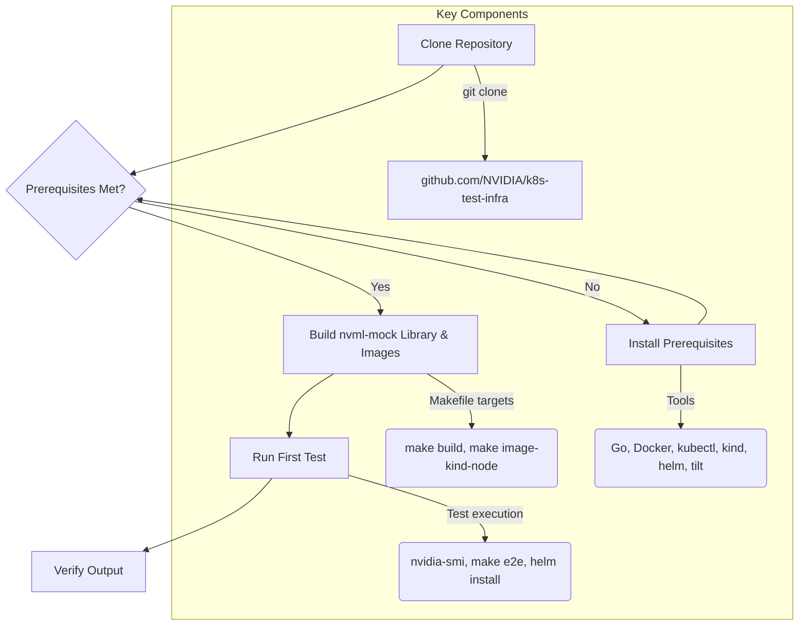

<!-- source: DeepWiki mcp.deepwiki.com · repo NVIDIA/k8s-test-infra · page 2 Getting Started · fetched 2026-10-26 -->

# Getting Started

<details>
<summary>Relevant source files</summary>

The following files were used as context for generating this wiki page:

- [.github/workflows/nvml-mock-e2e-go.yaml](.github/workflows/nvml-mock-e2e-go.yaml)
- [Makefile](Makefile)
- [README.md](README.md)
- [docs/README.md](docs/README.md)
- [docs/architecture.md](docs/architecture.md)
- [docs/demo/kind.yaml](docs/demo/kind.yaml)
- [docs/demo/with-fgo/README.md](docs/demo/with-fgo/README.md)
- [docs/examples.md](docs/examples.md)
- [docs/integrations/fake-gpu-operator.md](docs/integrations/fake-gpu-operator.md)
- [docs/quickstart.md](docs/quickstart.md)
- [tests/e2e/README.md](tests/e2e/README.md)
- [tests/e2e/go/e2e_suite_test.go](tests/e2e/go/e2e_suite_test.go)
- [tests/e2e/go/framework/config/config.go](tests/e2e/go/framework/config/config.go)
- [tests/e2e/go/framework/harness/harness.go](tests/e2e/go/framework/harness/harness.go)
- [tests/e2e/go/suite_cluster.go](tests/e2e/go/suite_cluster.go)
- [tests/e2e/go/suite_helm.go](tests/e2e/go/suite_helm.go)

</details>


This document provides a quick-start guide for developers who want to set up, build, and run tests in the k8s-test-infra repository. It covers initial environment setup, building the `nvml-mock` shared library and container images, and executing your first test suite.

For detailed information on specific topics, see:
- Prerequisites and tooling setup: [Prerequisites and Environment Setup](#2.1)
- Detailed build process and Makefile targets: [Building from Source](#2.2)
- Test execution and output interpretation: [Running Your First Test](#2.3)
- Comprehensive testing framework documentation: [Testing with Ginkgo](#5)

---

## Quick Start Workflow

The following diagram shows the high-level workflow for getting started with k8s-test-infra:



**Sources:** [README.md:16-20](), [README.md:28-36](), [Makefile:141-156](), [Makefile:166-170]()

---

## Prerequisites

Before building or testing k8s-test-infra, ensure your environment has the following tools installed:

| Tool | Purpose | Verification Command |
|------|---------|---------------------|
| Go | Compilation and test execution | `go version` |
| Docker | Container image builds | `docker --version` |
| kubectl | Kubernetes cluster interaction | `kubectl version --client` |
| kind | Local Kubernetes cluster creation | `kind version` |
| helm | Kubernetes package manager | `helm version` |
| tilt | Local development environment | `tilt version` |

The required Go version is specified in the CI workflows, for example, `GO_VERSION: ${{ inputs.golang_version }}` in [`.github/workflows/nvml-mock-e2e-go.yaml:60`]().

For details on installing these tools and configuring your environment, see [Prerequisites and Environment Setup](#2.1).

**Sources:** [tests/e2e/README.md:29-35](), [Makefile:16-17](), [Makefile:166-167](), [`.github/workflows/nvml-mock-e2e-go.yaml:60-66`]()

---

## Cloning the Repository

Clone the repository to your local machine:

```bash
git clone https://github.com/NVIDIA/k8s-test-infra.git
cd k8s-test-infra
```

The repository uses vendored dependencies, meaning all external Go modules are stored in the `vendor/` directory for reproducible builds.

**Sources:** [Makefile:44-47]()

---

## Building from Source

The k8s-test-infra project involves building several components: the `nvml-mock` shared library, container images, and Go binaries.

### Build Targets Overview

The `Makefile` provides targets for building various components:

| Target | Description |
|--------|-------------|
| `build` | Builds the `nv-ci-bot` Go binary. |
| `generate` | Runs `go generate` for code generation, specifically for the `nvml-mock` CGo bridge. |
| `image-kind-node` | Builds the custom `kind-node-nv:latest` Docker image, which includes `nvidia-container-toolkit`. |

For a detailed guide on building all components, including local builds, Docker cross-platform builds, and the `generate-bridge` tool, see [Building from Source](#2.2).

**Sources:** [Makefile:30-32](), [Makefile:90-92](), [Makefile:132]()

---

## Running Your First Test

The `k8s-test-infra` repository provides various ways to run tests, from local `nvidia-smi` usage with the mock library to full end-to-end Kubernetes cluster deployments.

### Local `nvidia-smi` with `nvml-mock`

You can test the `nvml-mock` shared library directly with `nvidia-smi` to simulate GPU environments without a Kubernetes cluster.

1.  Build the `nvml-mock` library:
    ```bash
    make -C pkg/gpu/mocknvml
    ```
2.  Run `nvidia-smi` using the mock library:
    ```bash
    LD_LIBRARY_PATH=$(pwd)/pkg/gpu/mocknvml nvidia-smi
    ```
    This will show a default configuration of 8x A100 GPUs. You can specify a different profile using the `MOCK_NVML_CONFIG` environment variable:
    ```bash
    LD_LIBRARY_PATH=$(pwd)/pkg/gpu/mocknvml MOCK_NVML_CONFIG=pkg/gpu/mocknvml/configs/mock-nvml-config-gb200.yaml nvidia-smi
    ```

**Sources:** [docs/examples.md:9-13](), [docs/examples.md:22-25]()

### End-to-End Tests with `make e2e`

The project includes a comprehensive end-to-end (E2E) test suite that deploys `nvml-mock` on a Kind cluster and validates its functionality.

To run the default E2E suite (which uses the `gb200` GPU profile):

```bash
make e2e
```

This command performs the following steps:
1.  Builds the `nvml-mock` Docker image (unless `E2E_SKIP_BUILD=true` is set).
2.  Creates a multi-node Kind cluster.
3.  Loads the `nvml-mock` image into Kind.
4.  Installs `nvml-mock` via Helm into the `mokka` namespace.
5.  Runs standalone demo checks for the selected GPU profile.
6.  Collects diagnostics on failure.

You can specify different GPU profiles or filter tests using environment variables:

```bash
# Run a single explicit profile
make e2e E2E_PROFILES=a100

# Run multiple profiles on the same cluster
make e2e E2E_PROFILES="a100 h100"

# Run only selected use cases with Ginkgo labels
make e2e E2E_GINKGO_FLAGS='--label-filter="nvidia-smi || nvlink"'
```

For a detailed walkthrough of executing test suites, interpreting output, and quick-start Helm deployments, see [Running Your First Test](#2.3).

**Sources:** [tests/e2e/README.md:14-23](), [tests/e2e/README.md:40-50](), [Makefile:141-156]()

---

## Next Steps

Now that you have built the project and run your first test, explore these topics:

- **[Prerequisites and Environment Setup](#2.1)** - Detailed tool installation and Kubernetes cluster setup.
- **[Building from Source](#2.2)** - Deep dive into build process, vendoring, and image creation.
- **[Running Your First Test](#2.3)** - Execute specific test suites and interpret output.
- **[Architecture](#3)** - Understand the overall system design and component interactions.
- **[Testing with Ginkgo](#5)** - Learn the BDD testing framework and patterns used in this project.

**Sources:** [README.md:75-84]()

---

