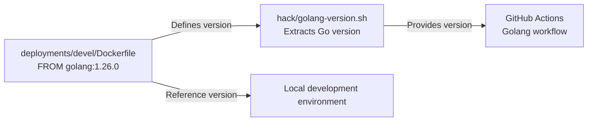
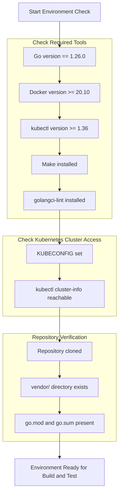

<!-- source: DeepWiki mcp.deepwiki.com · repo NVIDIA/k8s-test-infra · page 2.1 Prerequisites and Environment Setup · fetched 2026-10-26 -->

# Prerequisites and Environment Setup

<details>
<summary>Relevant source files</summary>

The following files were used as context for generating this wiki page:

- [.github/workflows/code_scanning.yaml](.github/workflows/code_scanning.yaml)
- [.github/workflows/golang.yaml](.github/workflows/golang.yaml)
- [.github/workflows/helm-publish.yaml](.github/workflows/helm-publish.yaml)
- [.github/workflows/helm.yaml](.github/workflows/helm.yaml)
- [.github/workflows/nvml-mock-publish.yaml](.github/workflows/nvml-mock-publish.yaml)
- [.github/workflows/scorecard.yaml](.github/workflows/scorecard.yaml)
- [.github/workflows/variables.yaml](.github/workflows/variables.yaml)
- [deployments/devel/Dockerfile](deployments/devel/Dockerfile)
- [deployments/nvml-mock/Dockerfile](deployments/nvml-mock/Dockerfile)
- [go.mod](go.mod)
- [go.sum](go.sum)
- [pkg/gpu/mockcuda/Makefile](pkg/gpu/mockcuda/Makefile)
- [pkg/gpu/mocknvml/Dockerfile](pkg/gpu/mocknvml/Dockerfile)
- [pkg/gpu/mocknvml/Makefile](pkg/gpu/mocknvml/Makefile)
- [tests/e2e/spike-nvidia-smi.sh](tests/e2e/spike-nvidia-smi.sh)
- [tests/mocknvml/Dockerfile](tests/mocknvml/Dockerfile)
- [tests/poc-validation/setup-kind-cluster.sh](tests/poc-validation/setup-kind-cluster.sh)
- [vendor/github.com/onsi/ginkgo/v2/CHANGELOG.md](vendor/github.com/onsi/ginkgo/v2/CHANGELOG.md)
- [vendor/github.com/onsi/ginkgo/v2/reporters/default_reporter.go](vendor/github.com/onsi/ginkgo/v2/reporters/default_reporter.go)
- [vendor/github.com/onsi/ginkgo/v2/types/version.go](vendor/github.com/onsi/ginkgo/v2/types/version.go)
- [vendor/k8s.io/apimachinery/pkg/api/validation/objectmeta.go](vendor/k8s.io/apimachinery/pkg/api/validation/objectmeta.go)
- [vendor/modules.txt](vendor/modules.txt)

</details>


## Purpose and Scope

This document details the required tools, their versions, and environment configuration needed for both local development and CI build/test workflows in the `k8s-test-infra` project. The focus is on setting up a consistent environment for building the core components (including the nvml-mock GPU simulation system), running end-to-end tests, and contributing to the codebase.

This page covers installation and verification of:

- Go programming language and module management
- Docker container tooling
- Kubernetes CLI (`kubectl`)
- `kind` (Kubernetes in Docker) for local clusters
- `tilt` for local development workflow orchestration
- Additional tools for linting, building, and testing

For building the project artifacts, see [Building from Source](#2.2). For the Go version management strategy used consistently throughout the repo and CI, see [Go Version Management Strategy](#8.3).

---

## Required Tools Overview

The project requires a range of tools for compilation, image building, Kubernetes interaction, test execution, and local dev environment orchestration.

```mermaid
graph TB
    subgraph "Local Development / CI Environment"
        Go["Go 1.26.0<br/>Compiler & Runtime"]
        Docker["Docker<br/>Container Builds & Images"]
        Kubectl["kubectl<br/>Kubernetes CLI"]
        Kind["kind<br/>Local Kubernetes Cluster"]
        Tilt["Tilt<br/>Dev Workflow Orchestration"]
        Make["Make<br/>Build Orchestration"]
        Golint["golangci-lint<br/>Code Quality"]
    end

    subgraph "Core Artifacts"
        NvmlMockLib["libnvidia-ml.so<br/>Mock NVML Shared Library"]
        Binaries["Go Binaries<br/>(nvml-mock-nri, mock-ib, etc)"]
        HelmChart["nvml-mock Helm Chart<br/>For Cluster Deployment"]
    end

    subgraph "Test and Cluster"
        K8sCluster["Kubernetes Cluster<br/>Test Target (kind, remote)"]
        TestSuites["Ginkgo/Gomega Test Suites<br/>E2E and Unit Tests"]
    end

    Go -->|Builds| Binaries
    Go -->|Builds (c-shared library)| NvmlMockLib
    Make -->|Orchestrates| Go
    Make -->|Runs| Golint
    Docker -->|Builds| NvmlMockLib
    Docker -->|Builds| Binaries
    Docker -->|Builds| HelmChart
    Kubectl -->|Cluster interaction| K8sCluster
    Kind -->|Provides| K8sCluster
    Tilt -->|Local dev orchestration| K8sCluster
    TestSuites -->|Use| Kubectl
    TestSuites -->|Use| K8sCluster
```

- The Go compiler produces various Go binaries and the nvml-mock shared library (`libnvidia-ml.so`).
- Docker builds container images for the mock system, test binaries, and Helm charts.
- `kubectl` and `kind` provide Kubernetes cluster interaction and lifecycle for tests.
- `tilt` is a helper for local multi-component development.
- Make orchestrates builds and linting.

Sources: [go.mod:3-3](), [deployments/devel/Dockerfile:15-18](), [deployments/nvml-mock/Dockerfile:15-49](), [.github/workflows/golang.yaml:27-71]()

---

## Go Programming Language

### Version Requirement

- **Go version 1.26.0** is mandated for consistent builds.
- This exact version is declared in the development Dockerfile (`deployments/devel/Dockerfile`) which acts as the single source of truth.
- The project uses Go modules (`go.mod`) with vendoring enforced, including the `vendor/` directory checked into source control.

| Requirement      | Value      | Source                           |
|------------------|------------|---------------------------------|
| Go version       | 1.26.0     | [deployments/devel/Dockerfile:17]() |
| Module support   | Enabled    | `go.mod`                        |
| Vendoring        | Required   | `vendor/` directory             |

### Version Management Flow



The `hack/golang-version.sh` script parses the Dockerfile to propagate the Go version consistently in CI workflows and local development environments.

### Installation & Verification

Install Go 1.26.0 from the official binaries or package manager according to your platform. Verify the version using:

```bash
go version
# Expected output: go version go1.26.0 linux/amd64 (platform dependent)
```

Sources: [deployments/devel/Dockerfile:15-18](), [.github/workflows/golang.yaml:28-70]()

---

## Docker

### Purpose and Usage

Docker is essential for:

- Building container images for deployment (`nvml-mock`, `nvml-mock-nri`, etc.)
- Running local Kubernetes clusters with `kind` (which uses Docker containers)
- CI workflows to package and publish images (e.g., [nvml-mock-publish.yaml]())

### Version Requirements

| Tool            | Minimum Version | Recommended      |
|-----------------|-----------------|------------------|
| Docker Engine   | 20.10+          | Latest stable    |
| Docker Buildx   | Latest          | For multi-arch   |

### Installation & Verification

Install Docker according to your OS using official instructions. Verify with:

```bash
docker version
docker run --rm hello-world
```

Ensure Docker daemon runs without requiring root (add your user to `docker` group on Linux).

Sources: [deployments/devel/Dockerfile:1-18](), [.github/workflows/nvml-mock-publish.yaml:36-75]()

---

## kubectl (Kubernetes CLI)

### Purpose

`kubectl` is used to interact with the Kubernetes cluster:

- Creating and querying test resources (e.g. Custom Resources, pods)
- Debugging cluster state during development
- Used implicitly by tests and deployments

### Version Requirements

| Component | Version    | Notes                              |
|-----------|------------|----------------------------------|
| kubectl   | 1.36.1+    | Matches cluster version ±1 minor |
| Kubernetes Cluster | 1.36+ | Enables latest APIs (DRA, NFD)   |

The nvml-mock image build installs `kubectl` version 1.36.1 by default.

### Installation & Verification

Download the appropriate binary for your platform or install via package manager.

Example Linux AMD64 install snippet:

```bash
curl -LO https://dl.k8s.io/release/v1.36.1/bin/linux/amd64/kubectl
chmod +x kubectl
sudo mv kubectl /usr/local/bin/
kubectl version --client
```

### Dockerfile Kubernetes CLI Installation Details

In the `deployments/nvml-mock/Dockerfile`, `kubectl` is downloaded and verified as part of the image build (lines 38-82) ensuring tests use a consistent client version.

Sources: [deployments/nvml-mock/Dockerfile:38-82](), [deployments/devel/Dockerfile:1-18]()

---

## kind (Kubernetes IN Docker)

### Purpose

- Provides lightweight Kubernetes clusters running inside Docker containers
- Used extensively for local development and CI test clusters
- Supports multi-node and multi-architecture cluster profiles for GPU simulation

### Installation

Install `kind` via Go:

```bash
go install sigs.k8s.io/kind@v0.20.0
```

or download binaries from the kind GitHub releases page.

Confirm installation:

```bash
kind version
```

### Usage Notes

Tests and E2E harnesses use kind cluster profiles, created and deleted via Makefile targets and bash scripts (`tests/poc-validation/setup-kind-cluster.sh`).

Sources: Context from E2E harness and test cluster lifecycle orchestration

---

## Tilt (Local Development Workflow)

### Purpose

- Provides orchestration for local development environments with live reload of container images, manifests, and code
- Supports lengthy multi-component builds and Kubernetes cluster interactions
- Simplifies testing overlay configuration and demo scenarios locally

### Installation

Download and install Tilt from https://tilt.dev/ or via package managers.

Confirm version:

```bash
tilt version
```

### Configuration

The repository contains a `Tiltfile` script (not detailed here) that sets up clusters with selected GPU profiles, GPU Operator integration, DRA, and ComputeDomain simulation.

Tilt flags include `--gpu-profile`, `--gpu-operator`, and others for demo scenario selection supported by multiple subcommands in the harness.

Sources: Context from section 11, Tilt workflow, and development practices

---

## Make

### Purpose

Make is used as the primary build orchestrator:

- `make build` compiles Go binaries and libraries
- `make lint` runs code quality linting with `golangci-lint`
- `make vendor` manages vendored dependencies
- `make check*` verifies module and vendor consistency
- Other targets create/destroy test clusters and run tests

### Installation & Verification

Make is commonly pre-installed; otherwise install using OS package manager.

Verify:

```bash
make --version
```

Sources: Context from CI workflows and build orchestration

---

## golangci-lint

### Purpose

- Enforces code quality, style, security, and static analysis checks in the CI workflow and locally
- Runs multiple linters concurrently for efficiency

### Installation & Version

Use latest stable:

```bash
curl -sSfL https://raw.githubusercontent.com/golangci/golangci-lint/master/install.sh | sh -s -- -b $(go env GOPATH)/bin
golangci-lint --version
```

The CI runs use the latest version `golangci-lint` (see the `.github/workflows/golang.yaml`).

Sources: [.github/workflows/golang.yaml:40-42]()

---

## Environment Configuration

### Kubernetes Cluster Access

Your `KUBECONFIG` environment variable must point to a Kubernetes cluster credential file, either local kind cluster or remote.

Example setup:

```bash
export KUBECONFIG=$HOME/.kube/config
kubectl get nodes # verify access
```

### Go Environment Variables

For Go module and binary behavior:

```bash
export GO111MODULE=on
export GOPATH=$HOME/go
export PATH=$PATH:$(go env GOPATH)/bin
export GOPRIVATE=github.com/NVIDIA/k8s-test-infra
```

### Repository Setup

Clone repository and verify vendoring:

```bash
git clone https://github.com/NVIDIA/k8s-test-infra.git
cd k8s-test-infra
ls vendor/
ls go.mod go.sum
```

Sources: [deployments/devel/Dockerfile:1-18]()

---

## Complete Verification Flow

Below is the summarized verification sequence of the core environment:



Additionally, ensure `kind` and optionally `tilt` tools are installed for local testing and dev workflow.

---

## Troubleshooting & Version Enforcement

- The Go version is tightly controlled to avoid vendor mismatches, controlled by the Dockerfile and CI parsing script.
- Common errors stem from incorrect Go version, missing `kubectl`, or lack of cluster access.
- Docker permission issues may require adding your user to the `docker` group.

---

## Next Steps

After verifying prerequisites, proceed to:

1. Build binaries and container images (see [2.2 Building from Source])
2. Run initial tests and demo scenarios (see [2.3 Running Your First Test])
3. Explore local development with Tilt (see section 11)

The CI workflows automate these checks and builds, enforcing this environment in GitHub Actions.

---

# Summary Table of Required Tools and Versions

| Tool            | Required Version      | Purpose                          | Source File(s)                   |
|-----------------|-----------------------|---------------------------------|---------------------------------|
| Go              | 1.26.0                | Compile Go code & mock library  | deployments/devel/Dockerfile     |
| Docker          | 20.10+                | Build container images          | workflows/nvml-mock-publish.yaml |
| kubectl         | 1.36.1+               | Kubernetes CLI client           | deployments/nvml-mock/Dockerfile |
| kind            | 0.20.0+ (recommended) | Local Kubernetes cluster        | tests/poc-validation/setup-kind-cluster.sh (context) |
| Make            | Any recent             | Build orchestration             | CI workflows                    |
| golangci-lint   | Latest stable          | Linting & code quality          | .github/workflows/golang.yaml   |
| tilt            | Latest recommended     | Local development orchestration | Context from local dev pages    |

---

Sources:  
[go.mod:3-3](), [deployments/devel/Dockerfile:15-18](), [deployments/nvml-mock/Dockerfile:15-82](), [.github/workflows/golang.yaml:27-71](), [.github/workflows/nvml-mock-publish.yaml:36-75](), [tests/poc-validation/setup-kind-cluster.sh:1-35]()

---

