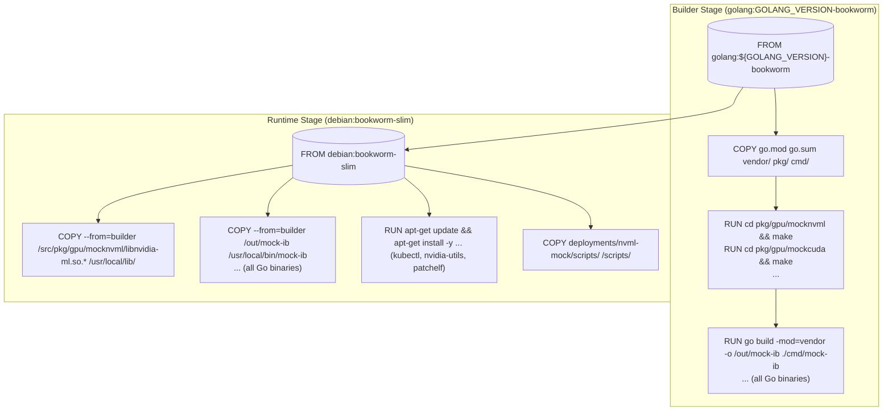
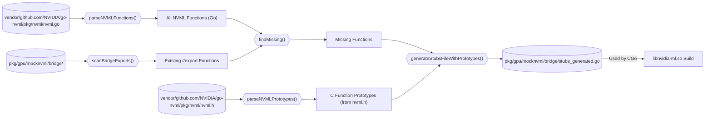

<!-- source: DeepWiki mcp.deepwiki.com · repo NVIDIA/k8s-test-infra · page 2.2 Building from Source · fetched 2026-10-26 -->

# Building from Source

<details>
<summary>Relevant source files</summary>

The following files were used as context for generating this wiki page:

- [cmd/generate-bridge/main.go](cmd/generate-bridge/main.go)
- [cmd/generate-bridge/main_test.go](cmd/generate-bridge/main_test.go)
- [cmd/generate-bridge/parser.go](cmd/generate-bridge/parser.go)
- [deployments/nvml-mock/Dockerfile](deployments/nvml-mock/Dockerfile)
- [pkg/gpu/mockcuda/Makefile](pkg/gpu/mockcuda/Makefile)
- [pkg/gpu/mocknvml/Dockerfile](pkg/gpu/mocknvml/Dockerfile)
- [pkg/gpu/mocknvml/Makefile](pkg/gpu/mocknvml/Makefile)
- [pkg/gpu/mocknvml/README.md](pkg/gpu/mocknvml/README.md)
- [pkg/gpu/mocknvml/bridge/cgo_types.go](pkg/gpu/mocknvml/bridge/cgo_types.go)
- [pkg/gpu/mocknvml/bridge/init.go](pkg/gpu/mocknvml/bridge/init.go)
- [pkg/gpu/mocknvml/bridge/internal.go](pkg/gpu/mocknvml/bridge/internal.go)
- [pkg/gpu/mocknvml/bridge/padding.go](pkg/gpu/mocknvml/bridge/padding.go)
- [pkg/gpu/mocknvml/bridge/system.go](pkg/gpu/mocknvml/bridge/system.go)
- [tests/e2e/spike-nvidia-smi.sh](tests/e2e/spike-nvidia-smi.sh)
- [tests/mocknvml/Dockerfile](tests/mocknvml/Dockerfile)
- [tests/poc-validation/setup-kind-cluster.sh](tests/poc-validation/setup-kind-cluster.sh)

</details>


## Purpose and Scope

This page explains how to build the `nvml-mock` shared library, various container images, and Go binaries within the `k8s-test-infra` repository. It covers local builds, Docker cross-platform builds, and the `generate-bridge` code generation tool. For information about setting up your development environment and installing prerequisites, see [Prerequisites and Environment Setup](#2.1). For details on the Docker images and containerization, see [Docker Images](#8.2).

---

## Build System Overview

The `k8s-test-infra` repository uses a Makefile-based build system to compile the `nvml-mock` shared library, various Go binaries, and manage container image creation. The build system enforces code quality through integrated linting, formatting checks, and dependency verification.

### Build Architecture

```mermaid
graph TD
    subgraph "Source Files"
        GO_MOD["go.mod & go.sum"]
        VENDOR["vendor/ directory"]
        NVML_GO["pkg/gpu/mocknvml/bridge/*.go"]
        NVML_CGO["pkg/gpu/mocknvml/bridge/bridge.go"]
        NVML_MAKEFILE["pkg/gpu/mocknvml/Makefile"]
        CUDA_MAKEFILE["pkg/gpu/mockcuda/Makefile"]
        MOCKIB_MAKEFILE["pkg/network/mockib/Makefile"]
        MOCKPCISYSFS_MAKEFILE["pkg/system/mockpcisysfs/Makefile"]
        GEN_BRIDGE_MAIN["cmd/generate-bridge/main.go"]
        NVML_H["vendor/github.com/NVIDIA/go-nvml/pkg/nvml/nvml.h"]
        NVML_GO_WRAPPER["vendor/github.com/NVIDIA/go-nvml/pkg/nvml/nvml.go"]
        DEPLOY_DOCKERFILE["deployments/nvml-mock/Dockerfile"]
        TEST_MOCKNVML_DOCKERFILE["tests/mocknvml/Dockerfile"]
        GO_BINARIES_SRC["cmd/.../*.go"]
    end

    subgraph "Build Tools"
        MAKE["make"]
        GO_BUILD["go build"]
        DOCKER_BUILD["docker build"]
        GEN_BRIDGE_TOOL["generate-bridge"]
    end

    subgraph "Artifacts"
        LIB_NVML["libnvidia-ml.so*"]
        LIB_CUDA["libcuda.so*"]
        LIB_IB["libibmocksys.so*"]
        LIB_PCISYSFS["libpcimocksys.so*"]
        NVML_MOCK_NRI_BIN["nvml-mock-nri"]
        NVML_MOCK_CTL_BIN["nvml-mock-ctl"]
        RENDER_PCI_SYSFS_BIN["render-pci-sysfs"]
        MOCK_IB_BIN["mock-ib"]
        FAKE_IMEX_BIN["nvidia-imex"]
        FAKE_FABRICMANAGER_BIN["nv-fabricmanager"]
        CHECK_FABRIC_BIN["check-fabric"]
        NVML_MOCK_IMAGE["nvml-mock:latest"]
        TEST_MOCKNVML_IMAGE["mocknvml-test:latest"]
        STUBS_GENERATED["pkg/gpu/mocknvml/bridge/stubs_generated.go"]
    end

    NVML_MAKEFILE -- "make" --> LIB_NVML
    CUDA_MAKEFILE -- "make" --> LIB_CUDA
    MOCKIB_MAKEFILE -- "make" --> LIB_IB
    MOCKPCISYSFS_MAKEFILE -- "make" --> LIB_PCISYSFS

    NVML_GO_WRAPPER -- "Input" --> GEN_BRIDGE_TOOL
    NVML_H -- "Header" --> GEN_BRIDGE_TOOL
    NVML_CGO -- "Bridge Dir" --> GEN_BRIDGE_TOOL
    GEN_BRIDGE_MAIN -- "Runs" --> GEN_BRIDGE_TOOL
    GEN_BRIDGE_TOOL -- "Generates" --> STUBS_GENERATED

    NVML_CGO -- "Uses" --> STUBS_GENERATED
    NVML_CGO -- "Compiles with CGo" --> LIB_NVML

    DEPLOY_DOCKERFILE -- "Builds" --> NVML_MOCK_IMAGE
    DEPLOY_DOCKERFILE -- "Copies from builder" --> LIB_NVML
    DEPLOY_DOCKERFILE -- "Copies from builder" --> LIB_CUDA
    DEPLOY_DOCKERFILE -- "Copies from builder" --> LIB_IB
    DEPLOY_DOCKERFILE -- "Copies from builder" --> LIB_PCISYSFS
    DEPLOY_DOCKERFILE -- "Copies from builder" --> NVML_MOCK_NRI_BIN
    DEPLOY_DOCKERFILE -- "Copies from builder" --> NVML_MOCK_CTL_BIN
    DEPLOY_DOCKERFILE -- "Copies from builder" --> RENDER_PCI_SYSFS_BIN
    DEPLOY_DOCKERFILE -- "Copies from builder" --> MOCK_IB_BIN
    DEPLOY_DOCKERFILE -- "Copies from builder" --> FAKE_IMEX_BIN
    DEPLOY_DOCKERFILE -- "Copies from builder" --> FAKE_FABRICMANAGER_BIN
    DEPLOY_DOCKERFILE -- "Copies from builder" --> CHECK_FABRIC_BIN

    TEST_MOCKNVML_DOCKERFILE -- "Builds" --> TEST_MOCKNVML_IMAGE
    TEST_MOCKNVML_DOCKERFILE -- "Copies from lib-builder" --> LIB_NVML

    GO_BINARIES_SRC -- "go build" --> NVML_MOCK_NRI_BIN
    GO_BINARIES_SRC -- "go build" --> NVML_MOCK_CTL_BIN
    GO_BINARIES_SRC -- "go build" --> RENDER_PCI_SYSFS_BIN
    GO_BINARIES_SRC -- "go build" --> MOCK_IB_BIN
    GO_BINARIES_SRC -- "go build" --> FAKE_IMEX_BIN
    GO_BINARIES_SRC -- "go build" --> FAKE_FABRICMANAGER_BIN
    GO_BINARIES_SRC -- "go build" --> CHECK_FABRIC_BIN

    NVML_MAKEFILE -- "docker-build" --> DOCKER_BUILD
    DOCKER_BUILD -- "Builds lib in container" --> LIB_NVML
```



**Sources:**
* [deployments/nvml-mock/Dockerfile:1-113]()
* [pkg/gpu/mocknvml/Makefile:1-145]()
* [pkg/gpu/mockcuda/Makefile:1-40]()
* [cmd/generate-bridge/main.go:1-136]()
* [tests/mocknvml/Dockerfile:1-75]()

The build system components include:

| Component | Purpose | Key Files |
|-----------|---------|-----------|
| **Mock NVML Library** | Core GPU simulation library | [pkg/gpu/mocknvml/Makefile:1-145](), [pkg/gpu/mocknvml/bridge/]() |
| **Mock CUDA Library** | Mock CUDA runtime library | [pkg/gpu/mockcuda/Makefile:1-40](), [pkg/gpu/mockcuda/bridge/]() |
| **Mock IB/PCI Sysfs Libraries** | Mock InfiniBand and PCI sysfs libraries | [pkg/network/mockib/Makefile:1-39](), [pkg/system/mockpcisysfs/Makefile:1-39]() |
| **Go Binaries** | Various tools and daemons | [deployments/nvml-mock/Dockerfile:26-35](), [cmd/]() |
| **Container Images** | Packaging of libraries and binaries | [deployments/nvml-mock/Dockerfile:1-113](), [tests/mocknvml/Dockerfile:1-75]() |
| **Code Generation** | Automates CGo bridge stub creation | [cmd/generate-bridge/main.go:1-136]() |

---

## Building the `nvml-mock` Shared Library

The `nvml-mock` shared library (`libnvidia-ml.so`) is the core component for GPU simulation. It's built using CGo.

### Local Build (Linux with Go and GCC)

To build the `libnvidia-ml.so` locally:

```bash
cd pkg/gpu/mocknvml
make
```
This command compiles the `libnvidia-ml.so.<version>`, `libnvidia-ml.so.1` (symlink), and `libnvidia-ml.so` (symlink) files in the current directory.
**Sources:** [pkg/gpu/mocknvml/Makefile:29-33]()

The `Makefile` handles the CGo compilation and symlink creation. It also includes logic for library-size padding to mimic the size of a real `libnvidia-ml.so`.
**Sources:** [pkg/gpu/mocknvml/Makefile:88-112]()

#### Library-size Padding

The `nvml-mock` library includes a padding mechanism to make its on-disk size similar to a real `libnvidia-ml.so` (approximately 14 MiB for driver 550.x). This helps satisfy tools that perform weak authenticity checks based on file size.
**Sources:** [pkg/gpu/mocknvml/README.md:69-72](), [pkg/gpu/mocknvml/bridge/padding.go:16-22]()

- **Default**: A two-pass build automatically pads the library to `TARGET_LIB_SIZE` (default `14680064` bytes).
  ```bash
  make
  make size # Reports final size
  ```
  **Sources:** [pkg/gpu/mocknvml/Makefile:39](), [pkg/gpu/mocknvml/Makefile:96-112]()
- **Explicit Padding**: Override `TARGET_LIB_SIZE` or set `PADDING_BYTES` for a specific size.
  ```bash
  make PADDING_BYTES=10485760 # 10 MiB padding
  ```
  **Sources:** [pkg/gpu/mocknvml/Makefile:40](), [pkg/gpu/mocknvml/README.md:83]()
- **Disable Padding**: Use `NO_PADDING=1` or `BUILD_TAGS=nopadding` to create a smaller library.
  ```bash
  make NO_PADDING=1
  # or
  make BUILD_TAGS=nopadding
  ```
  **Sources:** [pkg/gpu/mocknvml/Makefile:41](), [pkg/gpu/mocknvml/README.md:86-88]()

The padding is implemented in [pkg/gpu/mocknvml/bridge/padding.go]() using a C `__attribute__((used, section(".data.nvml_mock_padding")))` to ensure the blob is included in the `.data` section and not optimized away.
**Sources:** [pkg/gpu/mocknvml/bridge/padding.go:58-60]()

### Docker Cross-platform Build

To build the `nvml-mock` library inside a Docker container, producing Linux-compatible binaries even on macOS:

```bash
cd pkg/gpu/mocknvml
make docker-build
```
**Sources:** [pkg/gpu/mocknvml/README.md:43-46]()

This command uses the `Dockerfile` at [pkg/gpu/mocknvml/Dockerfile:1-26]() to create a builder image and then runs `make` inside it.
**Sources:** [pkg/gpu/mocknvml/Makefile:133-145]()

### Build Variables

The `pkg/gpu/mocknvml/Makefile` supports several variables:

| Variable | Description | Default |
|----------|-------------|---------|
| `LIB_VERSION` | Library version (appears in filename) | `550.163.01` |
| `GOLANG_VERSION` | Go version for Docker builds | `1.26.5` |
| `TARGET_LIB_SIZE` | Target on-disk size in bytes (two-pass auto-pads to this) | `14680064` (≈14 MiB) |
| `PADDING_BYTES` | Explicit padding size in bytes (overrides `TARGET_LIB_SIZE`) | _(unset → auto)_ |
| `NO_PADDING` | Set to `1` to disable padding (small library) | _(unset)_ |
| `BUILD_TAGS` | Extra Go build tags (include `nopadding` to disable padding) | _(unset)_ |

**Sources:** [pkg/gpu/mocknvml/README.md:51-59]()

---

## Building Other Shared Libraries

Similar to `nvml-mock`, other mock shared libraries are built using their respective Makefiles.

### Mock CUDA Library

The `libcuda.so` mock library is built from [pkg/gpu/mockcuda/Makefile:1-40]().
```bash
cd pkg/gpu/mockcuda
make
```
This generates `libcuda.so.<version>`, `libcuda.so.1`, and `libcuda.so`.
**Sources:** [pkg/gpu/mockcuda/Makefile:29-33]()

### Mock InfiniBand and PCI Sysfs Libraries

The `libibmocksys.so` and `libpcimocksys.so` libraries are built from their respective directories:
```bash
cd pkg/network/mockib
make
cd pkg/system/mockpcisysfs
make
```
These are included in the `deployments/nvml-mock/Dockerfile` build process.
**Sources:** [deployments/nvml-mock/Dockerfile:23-25]()

---

## Building Go Binaries

Several Go binaries are part of the `k8s-test-infra` project, including `nvml-mock-nri`, `nvml-mock-ctl`, `render-pci-sysfs`, `mock-ib`, `nvidia-imex`, `nv-fabricmanager`, and `check-fabric`.

These binaries are typically built as part of the Docker image creation process. The `deployments/nvml-mock/Dockerfile` contains a `builder` stage that compiles all necessary Go binaries.
**Sources:** [deployments/nvml-mock/Dockerfile:16-35]()

For example, `nvml-mock-nri` is built with:
```dockerfile
go build -mod=vendor -o /out/nvml-mock-nri ./cmd/nvml-mock-nri
```
**Sources:** [deployments/nvml-mock/Dockerfile:28]()

This uses `go build -mod=vendor` to ensure that vendored dependencies are used, promoting reproducible builds.

---

## Building Container Images

The project includes several Docker images for deployment and testing.

### `nvml-mock` Image

The main `nvml-mock` container image is defined in [deployments/nvml-mock/Dockerfile:1-113](). This is a multi-stage build:



**Sources:** [deployments/nvml-mock/Dockerfile:1-113]()

To build this image:
```bash
docker build -t nvml-mock:latest -f deployments/nvml-mock/Dockerfile .
```
**Sources:** [tests/poc-validation/setup-kind-cluster.sh:75-77]()

Key aspects of this Dockerfile:
- **`builder` stage**: Compiles all CGo shared libraries (NVML, CUDA, IB, PCI Sysfs) and Go binaries.
  **Sources:** [deployments/nvml-mock/Dockerfile:16-35]()
- **`debian:bookworm-slim` base**: A minimal base image for the runtime.
  **Sources:** [deployments/nvml-mock/Dockerfile:37]()
- **Copying artifacts**: Shared libraries are copied to `/usr/local/lib/` and binaries to `/usr/local/bin/` or `/usr/bin/`.
  **Sources:** [deployments/nvml-mock/Dockerfile:40-66]()
- **`nvidia-smi` inclusion**: The real `nvidia-smi` binary is extracted from `nvidia-utils` package and included, with `RPATH` adjusted for portability.
  **Sources:** [deployments/nvml-mock/Dockerfile:88-106]()
- **`kubectl` inclusion**: `kubectl` is downloaded and installed.
  **Sources:** [deployments/nvml-mock/Dockerfile:77-84]()

### `mocknvml-test` Image

This image is used for integration testing of the `nvml-mock` library. It's defined in [tests/mocknvml/Dockerfile:1-75]().

```mermaid
graph TD
    subgraph "lib-builder Stage (golang:GOLANG_VERSION)"
        LB[("FROM golang:${GOLANG_VERSION}")]
        LB --> LB_COPY_SRC["COPY go.mod go.sum vendor/ pkg/ cmd/"]
        LB --> LB_BUILD_LIB["RUN go build -buildmode=c-shared -o libnvidia-ml.so.550.54.15 ./bridge"]
    end

    subgraph "test-builder Stage (golang:GOLANG_VERSION)"
        TB[("FROM golang:${GOLANG_VERSION}")]
        TB --> TB_COPY_TEST_SRC["COPY tests/mocknvml/*.go tests/mocknvml/go.mod tests/mocknvml/go.sum*"]
        TB --> TB_BUILD_TEST_BIN["RUN CGO_ENABLED=1 go build -o mocknvml-test ."]
    end

    subgraph "Runtime Stage (debian:bookworm-slim)"
        R[("FROM debian:bookworm-slim")]
        R --> R_INSTALL_DEPS["RUN apt-get update && apt-get install -y ca-certificates"]
        R --> R_COPY_TEST_BIN["COPY --from=test-builder /build/mocknvml-test /app/"]
        R --> R_COPY_CONFIG["COPY tests/mocknvml/util-test-config.yaml /app/util-test-config.yaml"]
        R --> R_COPY_LIB["COPY --from=lib-builder /build/pkg/gpu/mocknvml/libnvidia-ml.so* /usr/local/lib/"]
        R --> R_LDCONFIG["RUN ldconfig"]
        R --> R_ENV_VARS["ENV LD_LIBRARY_PATH=/usr/local/lib<br/>ENV MOCK_NVML_NUM_DEVICES=4<br/>ENV MOCK_NVML_DRIVER_VERSION=550.54.15"]
        R --> R_CMD["CMD [\"/app/mocknvml-test\"]"]
    end

    LB --> R
    TB --> R
```

**Sources:** [tests/mocknvml/Dockerfile:1-75]()

This image:
- Builds `libnvidia-ml.so` in the `lib-builder` stage.
  **Sources:** [tests/mocknvml/Dockerfile:15-30]()
- Builds the `mocknvml-test` Go binary in the `test-builder` stage.
  **Sources:** [tests/mocknvml/Dockerfile:31-42]()
- Combines these artifacts in the runtime stage, sets `LD_LIBRARY_PATH`, and configures mock NVML environment variables.
  **Sources:** [tests/mocknvml/Dockerfile:43-74]()

### Spike `nvidia-smi` Image

The `spike-nvidia-smi.sh` script builds a temporary `nvml-mock` image and runs `nvidia-smi` against it for quick verification.
**Sources:** [tests/e2e/spike-nvidia-smi.sh:1-62]()

```bash
docker build --platform "$PLATFORM" -t "$IMAGE" \
  --build-arg GOLANG_VERSION="$GOLANG_VERSION" \
  -f deployments/nvml-mock/Dockerfile .
```
**Sources:** [tests/e2e/spike-nvidia-smi.sh:26-28]()

This script demonstrates how to build the `nvml-mock` image for a specific platform (e.g., `linux/amd64` for `nvidia-smi` compatibility) and then execute `nvidia-smi` with mock NVML debug logging enabled.
**Sources:** [tests/e2e/spike-nvidia-smi.sh:31-34]()

---

## `generate-bridge` Code Generation Tool

The `cmd/generate-bridge` tool automates the creation of CGo stubs for the `nvml-mock` library. This ensures comprehensive coverage of the NVML API and simplifies maintenance.
**Sources:** [cmd/generate-bridge/main.go:14-28]()

### Purpose

The tool scans the `go-nvml` wrapper for all exported NVML functions and compares them against existing `//export` implementations in the `pkg/gpu/mocknvml/bridge` directory. It then generates stubs for any missing functions, using `nvml.h` to extract correct C function prototypes for ABI compatibility.
**Sources:** [cmd/generate-bridge/main.go:14-28]()

### Usage

```bash
go run ./cmd/generate-bridge \
    -input vendor/github.com/NVIDIA/go-nvml/pkg/nvml/nvml.go \
    -header vendor/github.com/NVIDIA/go-nvml/pkg/nvml/nvml.h \
    -bridge pkg/gpu/mocknvml/bridge \
    -output pkg/gpu/mocknvml/bridge/stubs_generated.go
```
**Sources:** [cmd/generate-bridge/main.go:23-28]()

### Data Flow



**Sources:**
* [cmd/generate-bridge/main.go:91-136]()
* [cmd/generate-bridge/main.go:138-156]() (`parseNVMLFunctions`)
* [cmd/generate-bridge/parser.go:37-85]() (`parseNVMLPrototypes`)
* [cmd/generate-bridge/main.go:159-211]() (`scanBridgeExports`)
* [cmd/generate-bridge/main.go:213-220]() (`findMissing`)
* [cmd/generate-bridge/main.go:241-250]() (`generateStubWithSignature`)

### Key Functions

- `parseNVMLFunctions(filename string)`: Extracts all `nvml` prefixed function names from the `go-nvml` wrapper.
  **Sources:** [cmd/generate-bridge/main.go:138-156]()
- `parseNVMLPrototypes(r io.Reader)`: Parses `nvml.h` to extract C function prototypes, handling multi-line declarations and `DEPRECATED()` macros.
  **Sources:** [cmd/generate-bridge/parser.go:37-85]()
- `scanBridgeExports(bridgeDir string)`: Scans `.go` files in the bridge directory for `//export` comments to identify already implemented functions.
  **Sources:** [cmd/generate-bridge/main.go:159-211]()
- `findMissing(allFunctions []string, existingFunctions map[string]bool)`: Determines which functions from `go-nvml` are not yet implemented in the bridge.
  **Sources:** [cmd/generate-bridge/main.go:213-220]()
- `generateStubWithSignature(proto FuncProto)`: Generates a single CGo stub function with the correct C-compatible Go signature.
  **Sources:** [cmd/generate-bridge/parser.go:241-250]()

The `generate-bridge` tool ensures that the mock NVML library remains up-to-date with the `go-nvml` API, reducing manual effort and potential errors.

---

## Go Version Management

The repository enforces a consistent Go version across all environments using a single-source-of-truth approach. For comprehensive details on this strategy, see [Go Version Management Strategy](#8.3).

### Version Definition

The Go version is defined in [deployments/nvml-mock/Dockerfile:15]() and [tests/mocknvml/Dockerfile:14]():

```dockerfile
ARG GOLANG_VERSION=1.26.5
FROM golang:${GOLANG_VERSION}-bookworm AS builder
```
**Sources:** [deployments/nvml-mock/Dockerfile:15-16]()

This `GOLANG_VERSION` argument is used consistently across Dockerfiles to ensure the same Go compiler is used for all builds.

---

## Verifying the Build

After building, you can verify the artifacts:

- **Shared Libraries**: Check for `.so` files in `pkg/gpu/mocknvml/`, `pkg/gpu/mockcuda/`, etc.
  ```bash
  ls -lh pkg/gpu/mocknvml/libnvidia-ml.so*
  ```
- **Go Binaries**: If built locally, check `bin/` directory. If built via Docker, inspect the image.
  ```bash
  docker run --rm nvml-mock:latest ls -lh /usr/local/bin/nvml-mock-nri
  ```
- **`nvidia-smi` with mock NVML**: Use the `spike-nvidia-smi.sh` script to run `nvidia-smi` against the mock library in a container.
  ```bash
  ./tests/e2e/spike-nvidia-smi.sh
  ```
  **Sources:** [tests/e2e/spike-nvidia-smi.sh:1-62]()

---

## Next Steps

- **Run Tests**: After building successfully, proceed to [Running Your First Test](#2.3) to execute the test suite.
- **Understand Build Automation**: Learn more about the CI/CD pipeline in [GitHub Actions Workflows](#4.1).
- **Explore Make Targets**: For a comprehensive reference of all build targets, see [Makefile Reference](#8.1).
- **Configure Development Environment**: Return to [Prerequisites and Environment Setup](#2.1) if you encounter missing dependencies.

---

