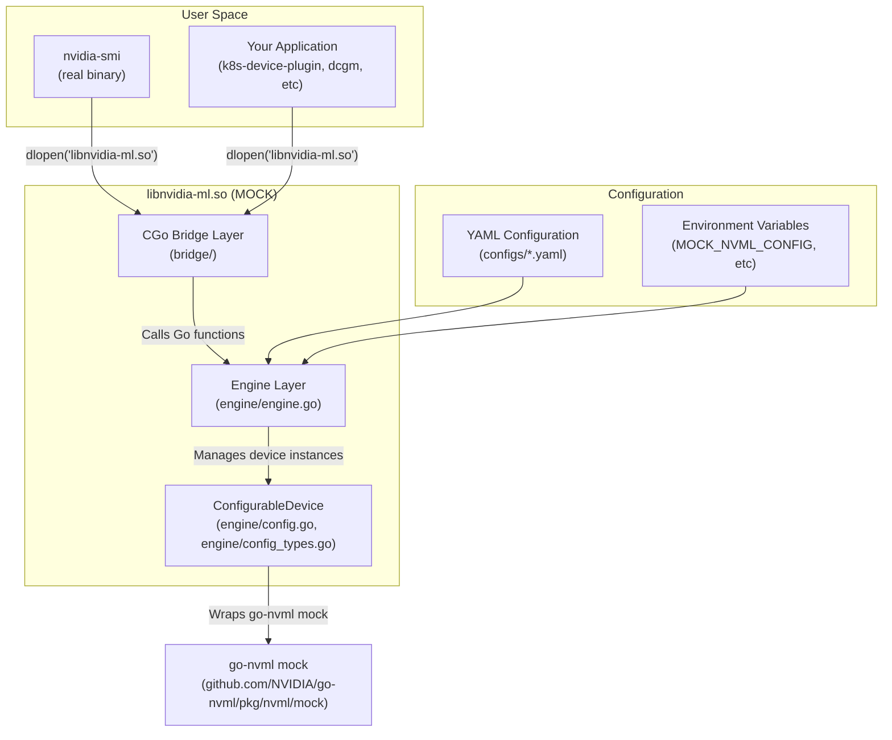
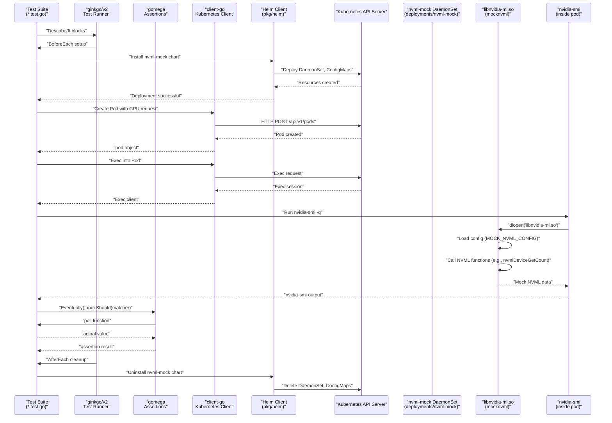
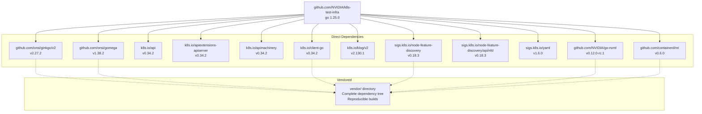
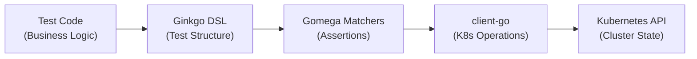

<!-- source: DeepWiki mcp.deepwiki.com · repo NVIDIA/k8s-test-infra · page 3 Architecture · fetched 2026-10-26 -->

# Architecture

Relevant source files

The following files were used as context for generating this wiki page:

- [docs/README.md](docs/README.md)
- [docs/architecture.md](docs/architecture.md)
- [docs/demo/kind.yaml](docs/demo/kind.yaml)
- [docs/demo/with-fgo/README.md](docs/demo/with-fgo/README.md)
- [docs/examples.md](docs/examples.md)
- [docs/integrations/fake-gpu-operator.md](docs/integrations/fake-gpu-operator.md)
- [docs/quickstart.md](docs/quickstart.md)
- [pkg/gpu/mocknvml/README.md](pkg/gpu/mocknvml/README.md)
- [pkg/gpu/mocknvml/bridge/padding.go](pkg/gpu/mocknvml/bridge/padding.go)

## Purpose and Scope

This document provides a high-level overview of the `k8s-test-infra` repository architecture, explaining how its components are organized and interact to provide Kubernetes testing infrastructure, with a primary focus on the `nvml-mock` GPU simulation system, Node Feature Discovery (NFD), and Dynamic Resource Allocation (DRA) testing.

For detailed information about specific architectural layers:
- **Module dependencies and vendoring strategy**: See [Module Dependencies](#3.1)
- **Kubernetes API integration patterns**: See [Kubernetes Integration Layer](#3.2)
- **Testing framework design and patterns**: See [Testing Infrastructure Design](#3.3)

For build system details, CI/CD workflows, and development practices, refer to sections [CI/CD Pipeline](#4), [Build System](#8), and [nvml-mock System](#9).

Sources: [docs/README.md:1-4](), [go.mod:1-16]()

---

## System Overview

The `k8s-test-infra` repository provides testing infrastructure for Kubernetes environments, with specialized support for hardware feature discovery (NFD) and dynamic device resource allocation (DRA). A core component is the `nvml-mock` library, which simulates NVIDIA GPUs without physical hardware. The system is structured as a single Go module that builds various tools and provides comprehensive test utilities for validating Kubernetes cluster behavior.

The repository serves three primary functions:

1.  **Mock NVML Library**: A configurable mock implementation of NVIDIA's NVML (NVIDIA Management Library) for testing GPU-dependent software without physical NVIDIA hardware [pkg/gpu/mocknvml/README.md:1-4]().
2.  **Kubernetes Integration**: Provides tools and patterns for integrating the mock NVML environment with Kubernetes, including DaemonSet deployments, CDI injection, and NRI plugins.
3.  **Testing Infrastructure**: Offers a BDD-style testing framework built on Ginkgo v2 and Gomega for writing and executing Kubernetes integration tests, particularly for NFD and DRA.

Sources: [pkg/gpu/mocknvml/README.md:1-4](), [go.mod:1-16](), [vendor/modules.txt:1-550]()

---

## Architectural Layers

The system follows a layered architecture where each layer provides abstractions and services to the layers above it. This design promotes separation of concerns and makes the codebase maintainable and testable.

### Mock NVML Stack Layers

The `nvml-mock` library itself is structured into several layers, from the CGo bridge to the configurable device logic.

#### Mock NVML Internal Architecture

**Layer Responsibilities:**

| Layer | Purpose | Key Components |
|---|---|---|
| **CGo Bridge Layer** | Exposes NVML C functions as dynamically loadable symbols, handles C ↔ Go type conversions. | `bridge/cgo_types.go`, `bridge/helpers.go`, `bridge/init.go`, `bridge/device.go`, `bridge/system.go`, `bridge/stubs_generated.go` |
| **Engine Layer** | Central coordinator for `nvml-mock` lifecycle, configuration loading, and mapping C pointers to Go objects. | `engine/engine.go`, `engine/handles.go` |
| **ConfigurableDevice** | Implements NVML methods with YAML-driven property values, wraps `go-nvml` mock. | `engine/config.go`, `engine/config_types.go` |
| **Configuration** | Defines GPU profiles, system properties, and device-specific overrides. | `configs/*.yaml`, `MOCK_NVML_CONFIG`, `MOCK_NVML_NUM_DEVICES` environment variables |

For details on the `nvml-mock` library internals, see [Mock NVML Library Internals](#9.1).

Sources: [docs/architecture.md:7-45](), [pkg/gpu/mocknvml/README.md:1-4](), [pkg/gpu/mocknvml/bridge/cgo_types.go:1-10](), [pkg/gpu/mocknvml/bridge/helpers.go:1-10](), [pkg/gpu/mocknvml/bridge/init.go:1-10](), [pkg/gpu/mocknvml/bridge/device.go:1-10](), [pkg/gpu/mocknvml/bridge/system.go:1-10](), [pkg/gpu/mocknvml/bridge/stubs_generated.go:1-10](), [pkg/gpu/mocknvml/engine/engine.go:1-10](), [pkg/gpu/mocknvml/engine/handles.go:1-10](), [pkg/gpu/mocknvml/engine/config.go:1-10](), [pkg/gpu/mocknvml/engine/config_types.go:1-10](), [pkg/gpu/mocknvml/configs/mock-nvml-config-a100.yaml:1-10]()

---

## Component Interactions

The following diagram illustrates how the major components interact during typical test execution, mapping architectural concepts to concrete code entities.

### Test Execution Flow

**Key Interaction Patterns:**

1.  **BDD Test Organization**: Tests use `github.com/onsi/ginkgo/v2` DSL (`Describe`, `Context`, `It`, `BeforeEach`, `AfterEach`) to structure test logic.
2.  **Asynchronous Assertions**: `github.com/onsi/gomega` `Eventually()` and `Consistently()` matchers handle asynchronous Kubernetes operations.
3.  **Kubernetes CRUD Operations**: `k8s.io/client-go/kubernetes` clientset provides typed access to all Kubernetes resources.
4.  **Helm Deployment**: The `pkg/helm` client is used to deploy and manage the `nvml-mock` DaemonSet and related resources.
5.  **Mock NVML Injection**: The `nvml-mock` DaemonSet injects `libnvidia-ml.so` into pods via `LD_LIBRARY_PATH`, allowing tools like `nvidia-smi` to interact with the mock library [pkg/gpu/mocknvml/README.md:28-30]().
6.  **Configuration**: The mock library's behavior is configured via YAML files, often passed through `MOCK_NVML_CONFIG` environment variables [pkg/gpu/mocknvml/README.md:102-122]().

Sources: [pkg/gpu/mocknvml/README.md:28-30,102-122](), [docs/examples.md:16-19](), [vendor/modules.txt:75-98](), [vendor/modules.txt:364-497]()

---

## Module Organization

The repository is organized as a single Go module (`github.com/NVIDIA/k8s-test-infra`) with all dependencies vendored for reproducible builds.

### Module Dependency Structure

**Module Characteristics:**

| Aspect | Details |
|---|---|
| **Module Path** | `github.com/NVIDIA/k8s-test-infra` |
| **Go Version** | `1.25.0` (defined in [go.mod:3]()) |
| **Vendoring** | All dependencies stored in `vendor/` directory |
| **Kubernetes Version** | v0.34.2 (api, client-go, apimachinery) |
| **Testing Framework** | Ginkgo v2.27.2, Gomega v1.38.2 |
| **NFD Version** | v0.18.3 |
| **NVML Go Bindings** | `github.com/NVIDIA/go-nvml v0.12.0-rc.1` |
| **Containerd NRI** | `github.com/containerd/nri v0.6.0` |

**Dependency Categories:**

1.  **Testing Dependencies** ([go.mod:6-7]()):
    -   `github.com/onsi/ginkgo/v2 v2.27.2` - BDD test framework
    -   `github.com/onsi/gomega v1.38.2` - Assertion library

2.  **Kubernetes Client Stack** ([go.mod:8-11]()):
    -   `k8s.io/api` - Resource type definitions
    -   `k8s.io/apimachinery` - Core machinery (meta, runtime, schema)
    -   `k8s.io/client-go` - Client library
    -   `k8s.io/apiextensions-apiserver` - CRD support

3.  **Specialized APIs** ([go.mod:13-14]()):
    -   `sigs.k8s.io/node-feature-discovery` - NFD client
    -   `sigs.k8s.io/node-feature-discovery/api/nfd` - NFD CRD types

4.  **GPU Simulation & Runtime** ([go.mod:16-17]()):
    -   `github.com/NVIDIA/go-nvml` - Go bindings for NVML, used by `nvml-mock`
    -   `github.com/containerd/nri` - Containerd Node Runtime Interface, used for `nvml-mock-nri` plugin

5.  **Utilities** ([go.mod:12,15]()):
    -   `k8s.io/klog/v2` - Structured logging
    -   `sigs.k8s.io/yaml` - YAML/JSON conversion

For a detailed breakdown of Go module structure and external dependencies, see [Module Dependencies](#3.1).

Sources: [go.mod:1-17](), [go.sum:1-180](), [vendor/modules.txt:1-550]()

---

## Design Principles

The architecture embodies several key design principles that guide implementation decisions:

### 1. Single Module with Vendoring

The repository uses a single Go module with vendored dependencies (`vendor/` directory) rather than a multi-module workspace. This ensures:

-   **Reproducible Builds**: Exact dependency versions are committed to the repository.
-   **Offline Development**: All dependencies available without network access.
-   **Consistent Testing**: CI and local builds use identical dependencies.

The `Makefile` enforces vendor synchronization via `check-vendor` and `check-modules` targets.

### 2. Kubernetes Native

The system is deeply integrated with Kubernetes through `k8s.io/client-go` and follows Kubernetes conventions:

-   **API Versioning**: Uses stable Kubernetes APIs (v0.34.2).
-   **Resource Watching**: Leverages watch APIs for observing cluster state changes.
-   **Server-Side Apply**: Uses modern server-side apply patterns for resource management.
-   **Custom Resources**: Extends Kubernetes with NFD CRDs through `k8s.io/apiextensions-apiserver` and integrates with DRA APIs.

For more on Kubernetes integration, see [Kubernetes Integration Layer](#3.2).

### 3. BDD Testing Approach

Tests follow Behavior-Driven Development patterns using Ginkgo v2:

-   **Readable Specs**: `Describe`/`Context`/`It` blocks create self-documenting test cases.
-   **Table-Driven Tests**: `DescribeTable`/`Entry` enable parameterized testing.
-   **Setup/Teardown Hooks**: `BeforeEach`/`AfterEach` manage test lifecycle.
-   **Asynchronous Matchers**: `Eventually()`/`Consistently()` handle Kubernetes eventual consistency.

For a comprehensive guide to the testing infrastructure, see [Testing Infrastructure Design](#3.3).

### 4. Layered Abstraction

Each architectural layer provides well-defined abstractions:

This separation allows:
-   Tests to focus on behavior rather than implementation.
-   Easy mocking and stubbing of Kubernetes operations.
-   Independent evolution of each layer.

### 5. Hardware-Aware Testing with Mock NVML

The architecture specializes in testing hardware feature discovery and allocation using the `nvml-mock` library:

-   **NVML Simulation**: `libnvidia-ml.so` provides a configurable mock NVML implementation [pkg/gpu/mocknvml/README.md:1-4]().
-   **NFD Integration**: Tests can validate `NodeFeature`, `NodeFeatureRule`, and `NodeFeatureGroup` CRDs, with `nvml-mock` generating feature files for node labeling.
-   **DRA Support**: Validates `ResourceSlice`, `ResourceClaim`, and `DeviceClass` for dynamic device allocation, integrating with the DRA driver.
-   **CDI Injection**: Supports Container Device Interface (CDI) specifications for GPU Operator integration [docs/README.md:14]().
-   **NRI Plugin**: The `nvml-mock-nri` plugin integrates with containerd for node-wide device injection [pkg/gpu/mocknvml/README.md:218-220]().

Sources: [go.mod:1-16](), [vendor/modules.txt:75-549](), [pkg/gpu/mocknvml/README.md:1-4,218-220](), [docs/README.md:14]()

---

## Cross-Cutting Concerns

Several utilities provide services across all layers:

### Certificate Generation

The `k8s.io/client-go/util/cert` package provides self-signed certificate generation for testing secure Kubernetes components:

-   **Function**: `GenerateSelfSignedCertKey(host string, alternateIPs []net.IP, alternateDNS []string) ([]byte, []byte, error)` [vendor/k8s.io/client-go/util/cert/cert.go:120-126]()
-   **Usage**: Creates CA and server certificates with configurable SANs.
-   **Validity**: Generates certificates valid for 1 year by default (configurable via `SelfSignedCertKeyOptions.MaxAge`).

### YAML/JSON Manifest Processing

The `k8s.io/apimachinery/pkg/util/yaml` package handles manifest loading:

-   **Type**: `YAMLOrJSONDecoder` [vendor/k8s.io/apimachinery/pkg/util/yaml/decoder.go:240-358]()
-   **Function**: `NewYAMLOrJSONDecoder(r io.Reader, bufferSize int) *YAMLOrJSONDecoder` [vendor/k8s.io/apimachinery/pkg/util/yaml/decoder.go:279-290]()
-   **Capability**: Automatically detects and decodes both JSON and multi-document YAML streams.
-   **Usage Pattern**: Tests load Kubernetes manifests from files and decode them into typed objects.

### Structured Logging

The `k8s.io/klog/v2` package provides structured logging:

-   **Version**: v2.130.1 [go.mod:12]()
-   **Integration**: Compatible with `go-logr` and standard library `log/slog`.
-   **Features**: Verbosity levels, key-value pairs, context integration.

Sources: [go.mod:12,15](), [vendor/k8s.io/client-go/util/cert/cert.go:1-277](), [vendor/k8s.io/apimachinery/pkg/util/yaml/decoder.go:1-486]()

---

## Summary

The `k8s-test-infra` architecture is a layered system designed for testing Kubernetes environments with specialized support for hardware feature discovery (NFD) and dynamic resource allocation (DRA), primarily driven by the `nvml-mock` GPU simulation system. Its single-module design with vendored dependencies ensures reproducibility, while the BDD testing approach with Ginkgo/Gomega provides readable, maintainable test specifications. The deep integration with `k8s.io/client-go` and support for NFD/DRA APIs, coupled with the `nvml-mock` library, makes it particularly suitable for testing hardware-aware Kubernetes workloads without physical GPUs.

For implementation details of each layer, see:
-   [Module Dependencies](#3.1) for dependency management and vendoring.
-   [Kubernetes Integration Layer](#3.2) for client-go patterns and API interactions.
-   [Testing Infrastructure Design](#3.3) for Ginkgo/Gomega test organization.

Sources: [go.mod:1-17](), [vendor/modules.txt:1-550](), [pkg/gpu/mocknvml/README.md:1-4]()

---

