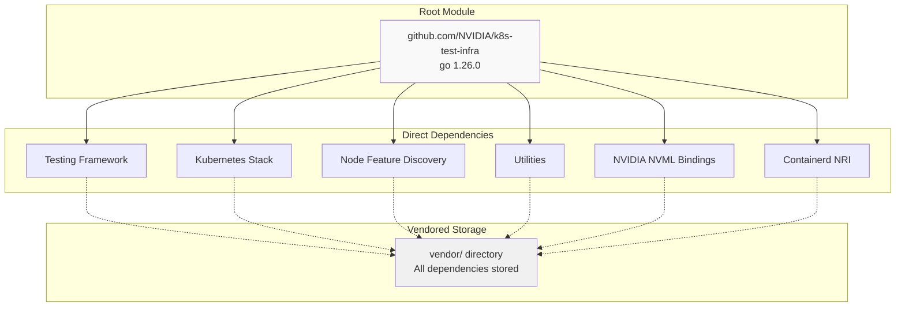
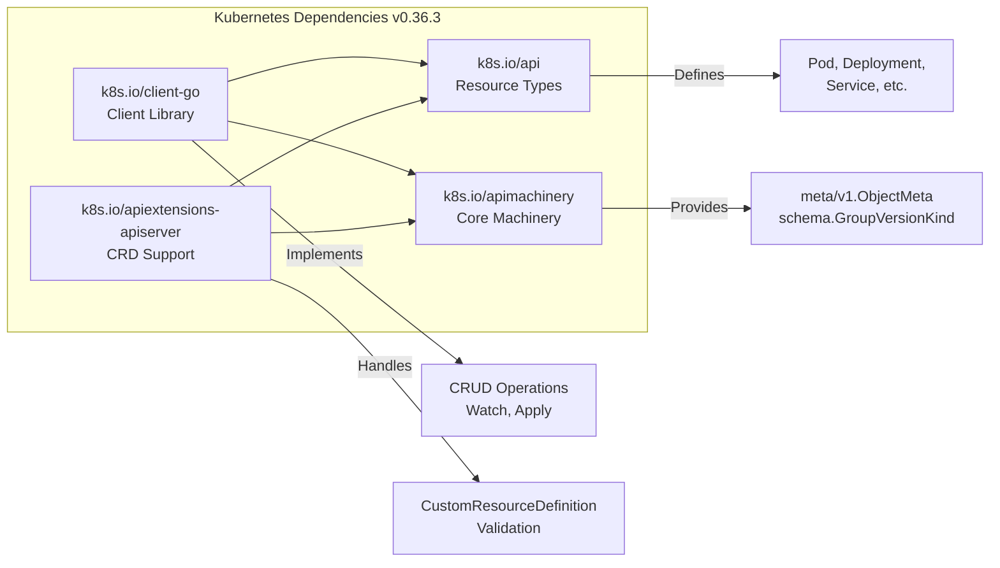
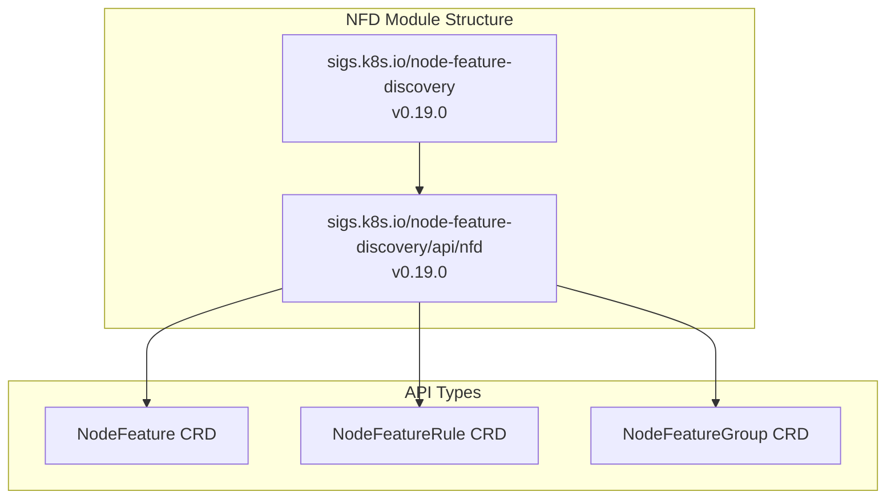
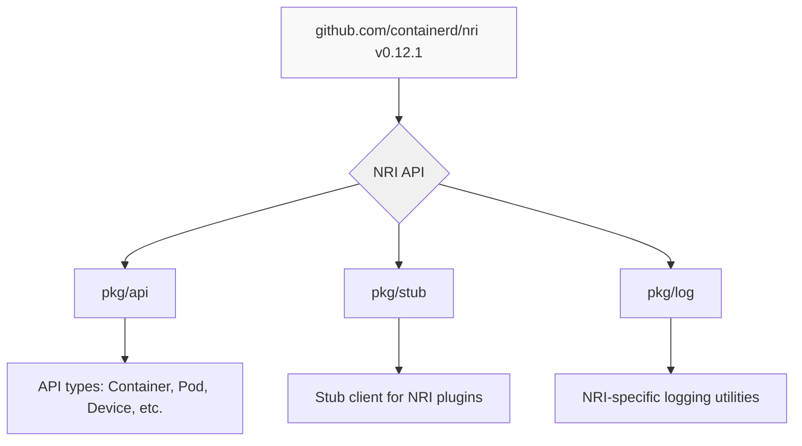
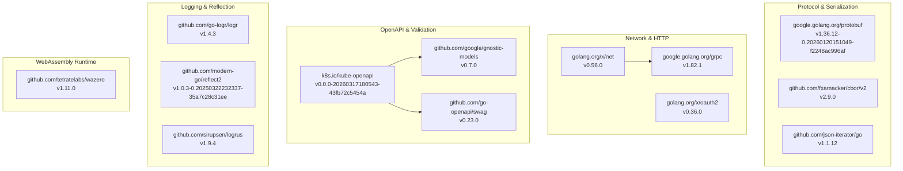
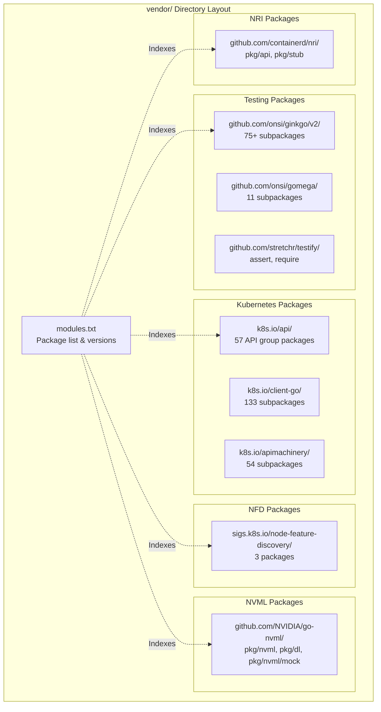
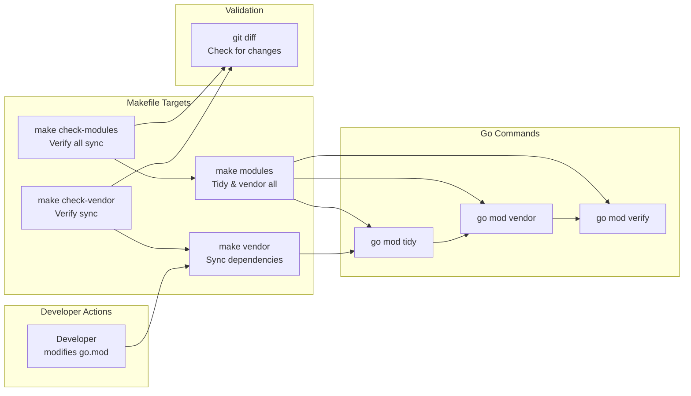

<!-- source: DeepWiki mcp.deepwiki.com · repo NVIDIA/k8s-test-infra · page 3.1 Module Dependencies · fetched 2026-10-26 -->

# Module Dependencies

<details>
<summary>Relevant source files</summary>

The following files were used as context for generating this wiki page:

- [go.mod](go.mod)
- [go.sum](go.sum)
- [vendor/github.com/NVIDIA/go-nvml/pkg/dl/dl.go](vendor/github.com/NVIDIA/go-nvml/pkg/dl/dl.go)
- [vendor/github.com/NVIDIA/go-nvml/pkg/dl/dl_linux.go](vendor/github.com/NVIDIA/go-nvml/pkg/dl/dl_linux.go)
- [vendor/github.com/NVIDIA/go-nvml/pkg/nvml/api.go](vendor/github.com/NVIDIA/go-nvml/pkg/nvml/api.go)
- [vendor/github.com/NVIDIA/go-nvml/pkg/nvml/cgo_helpers_static.go](vendor/github.com/NVIDIA/go-nvml/pkg/nvml/cgo_helpers_static.go)
- [vendor/github.com/NVIDIA/go-nvml/pkg/nvml/const.go](vendor/github.com/NVIDIA/go-nvml/pkg/nvml/const.go)
- [vendor/github.com/NVIDIA/go-nvml/pkg/nvml/device.go](vendor/github.com/NVIDIA/go-nvml/pkg/nvml/device.go)
- [vendor/github.com/NVIDIA/go-nvml/pkg/nvml/mock/device.go](vendor/github.com/NVIDIA/go-nvml/pkg/nvml/mock/device.go)
- [vendor/github.com/NVIDIA/go-nvml/pkg/nvml/mock/interface.go](vendor/github.com/NVIDIA/go-nvml/pkg/nvml/mock/interface.go)
- [vendor/github.com/NVIDIA/go-nvml/pkg/nvml/nvml.go](vendor/github.com/NVIDIA/go-nvml/pkg/nvml/nvml.go)
- [vendor/github.com/NVIDIA/go-nvml/pkg/nvml/nvml.h](vendor/github.com/NVIDIA/go-nvml/pkg/nvml/nvml.h)
- [vendor/github.com/NVIDIA/go-nvml/pkg/nvml/types_gen.go](vendor/github.com/NVIDIA/go-nvml/pkg/nvml/types_gen.go)
- [vendor/github.com/NVIDIA/go-nvml/pkg/nvml/zz_generated.api.go](vendor/github.com/NVIDIA/go-nvml/pkg/nvml/zz_generated.api.go)
- [vendor/github.com/onsi/ginkgo/v2/CHANGELOG.md](vendor/github.com/onsi/ginkgo/v2/CHANGELOG.md)
- [vendor/github.com/onsi/ginkgo/v2/reporters/default_reporter.go](vendor/github.com/onsi/ginkgo/v2/reporters/default_reporter.go)
- [vendor/github.com/onsi/ginkgo/v2/types/version.go](vendor/github.com/onsi/ginkgo/v2/types/version.go)
- [vendor/k8s.io/apimachinery/pkg/api/validation/objectmeta.go](vendor/k8s.io/apimachinery/pkg/api/validation/objectmeta.go)
- [vendor/modules.txt](vendor/modules.txt)

</details>


This page documents the Go module structure, dependency management strategy, and vendoring approach for the k8s-test-infra repository. It covers the direct and indirect dependencies, their purposes, and how they are managed to ensure reproducible builds.

For information about how these dependencies are used in the testing framework, see [Testing Infrastructure Design](#3.3). For Kubernetes API usage patterns, see [Kubernetes Integration Layer](#3.2). For build and verification processes, see [Makefile Reference](#8.1).

---

## Module Structure Overview

The repository is defined as a single Go module `github.com/NVIDIA/k8s-test-infra` with Go version 1.26.0. All dependencies are vendored into the `vendor/` directory for reproducible builds.

**Sources:** [go.mod:1-3]()



**Sources:** [go.mod:1-20](), [vendor/modules.txt:1-550]()

---

## Direct Dependencies

### Testing Framework Dependencies

The repository uses Ginkgo v2 for BDD-style testing and Gomega for assertions. These are the most frequently updated dependencies and form the foundation of the test infrastructure.

| Package | Version | Purpose |
|---------|---------|---------|
| `github.com/onsi/ginkgo/v2` | v2.32.0 | BDD test runner with spec organization |
| `github.com/onsi/gomega` | v1.42.1 | Matcher library for assertions |
| `github.com/stretchr/testify` | v1.11.1 | General testing utilities and assertions |

**Sources:** [go.mod:8-10](), [vendor/modules.txt:96-132](), [vendor/github.com/onsi/ginkgo/v2/types/version.go:3](), [vendor/github.com/onsi/ginkgo/v2/CHANGELOG.md:1-3]()

### Kubernetes Client Stack

The Kubernetes dependencies provide full programmatic control over Kubernetes clusters, including API definitions, client operations, and CRD support.



**Sources:** [go.mod:12-15](), [vendor/k8s.io/apimachinery/pkg/api/validation/objectmeta.go:141-148]()

| Package | Version | Key Exports |
|---------|---------|-------------|
| `k8s.io/api` | v0.36.3 | Core resource types (v1.Pod, apps/v1.Deployment) |
| `k8s.io/apimachinery` | v0.36.3 | Runtime machinery (schema, conversion, validation) |
| `k8s.io/client-go` | v0.36.3 | Client operations, REST, Watch, Apply |
| `k8s.io/apiextensions-apiserver` | v0.36.3 | CRD clientsets and types |

**Sources:** [go.mod:12-15]()

### Node Feature Discovery Dependencies

NFD dependencies enable hardware feature discovery and node customization based on detected capabilities.



**Sources:** [go.mod:17-18]()

### NVIDIA NVML Bindings

The `go-nvml` library provides Go bindings for the NVIDIA Management Library (NVML), allowing interaction with NVIDIA GPUs.

```mermaid
graph TD
    A[github.com/NVIDIA/go-nvml v0.13.3-1] --> B{NVML Interface}
    B --> C[nvml.Interface]
    B --> D[nvml.Device]
    B --> E[nvml.GpuInstance]
    C --> F[DeviceGetCount()]
    C --> G[DeviceGetHandleByIndex(index int)]
    D --> H[GetName()]
    D --> I[GetIndex()]
    D --> J[GetMemoryInfo()]
    D --> K[GetUtilization()]
    D --> L[GetPciInfo()]
    D --> M[GetUUID()]
    D --> N[GetTopologyCommonAncestor(device Device)]
    
    subgraph "Core NVML Types"
        nvmlDevice["nvmlDevice (internal C struct)"]
        nvmlGpuInstance["nvmlGpuInstance (internal C struct)"]
        PciInfo["nvml.PciInfo"]
        Memory["nvml.Memory"]
        Utilization["nvml.Utilization"]
        UUID["nvml.UUID"]
    end
    
    C -- "Wraps" --> nvmlDevice
    D -- "Wraps" --> nvmlDevice
    E -- "Wraps" --> nvmlGpuInstance
    
    style A fill:#f9f9f9
    style B fill:#f0f0f0
```

The `go-nvml` module includes generated code for the NVML API, such as `zz_generated.api.go` which maps C functions to Go, and `types_gen.go` for CGo-generated types. It also provides mock implementations for testing, like `mock/device.go` and `mock/interface.go`.

**Sources:** [go.mod:6](), [vendor/github.com/NVIDIA/go-nvml/pkg/nvml/zz_generated.api.go:21-60](), [vendor/github.com/NVIDIA/go-nvml/pkg/nvml/types_gen.go:8-10](), [vendor/github.com/NVIDIA/go-nvml/pkg/nvml/device.go:28-59](), [vendor/github.com/NVIDIA/go-nvml/pkg/nvml/mock/device.go:11-14](), [vendor/github.com/NVIDIA/go-nvml/pkg/nvml/mock/interface.go:11-14]()

### Containerd NRI

The `containerd/nri` module provides the Node Resource Interface (NRI) for container runtimes, enabling plugins to manage and allocate resources for containers.



**Sources:** [go.mod:7](), [vendor/modules.txt:16-22]()

### Utility Dependencies

| Package | Version | Purpose |
|---------|---------|---------|
| `k8s.io/klog/v2` | v2.140.0 | Structured logging with verbosity levels |
| `sigs.k8s.io/yaml` | v1.6.0 | YAML/JSON conversion for manifests |
| `golang.org/x/sys` | v0.47.0 | Low-level system calls and OS primitives |

**Sources:** [go.mod:11,16,19]()

---

## Indirect Dependencies

The module declares numerous indirect dependencies that support the direct dependencies. These are automatically managed by Go modules.

### Key Indirect Dependencies



**Sources:** [go.mod:23-71](), [vendor/modules.txt:1-227]()

### Categories of Indirect Dependencies

| Category | Packages | Purpose |
|----------|----------|---------|
| **Protocol Buffers** | `google.golang.org/protobuf`, `google.golang.org/genproto/googleapis/rpc` | Kubernetes API serialization, gRPC communication |
| **JSON/YAML** | `github.com/json-iterator/go`, `gopkg.in/yaml.v3`, `sigs.k8s.io/json` | Manifest parsing and serialization |
| **OpenAPI** | `k8s.io/kube-openapi`, `github.com/google/gnostic-models`, `github.com/go-openapi/swag` | API schema validation |
| **Logging** | `github.com/go-logr/logr`, `github.com/sirupsen/logrus` | Structured logging interface |
| **Network** | `golang.org/x/net`, `golang.org/x/oauth2`, `google.golang.org/grpc` | HTTP/2 and authentication, gRPC client/server |
| **Utilities** | `golang.org/x/tools`, `golang.org/x/mod`, `github.com/google/uuid` | Go tooling support, UUID generation |
| **WebAssembly** | `github.com/tetratelabs/wazero` | WebAssembly runtime for plugins (e.g., NRI) |

**Sources:** [go.mod:23-71](), [vendor/modules.txt:1-227]()

---

## Vendoring Strategy

All dependencies are stored in the `vendor/` directory to ensure reproducible builds. The vendored packages are committed to the repository and tracked by Git.

### Vendor Directory Structure



**Sources:** [vendor/modules.txt:1-550]()

### Modules Metadata

The `vendor/modules.txt` file tracks all vendored packages with their versions and Go version requirements:

```
# github.com/onsi/ginkgo/v2 v2.32.0
## explicit; go 1.25.0
github.com/onsi/ginkgo/v2
github.com/onsi/ginkgo/v2/config
github.com/onsi/ginkgo/v2/formatter
...
```

**Sources:** [vendor/modules.txt:96-119]()

---

## Dependency Management Workflow

The Makefile provides targets for managing dependencies and ensuring they remain synchronized.

### Management Targets



**Sources:** [Makefile:44-79]()

### Vendor Target

The `vendor` target synchronizes the vendor directory with `go.mod` and `go.sum`:

```makefile
vendor:
	go mod tidy
	go mod vendor
	go mod verify
```

**Sources:** [Makefile:44-47]()

### Check-Vendor Target

The `check-vendor` target ensures the vendor directory is synchronized:

```makefile
check-vendor: vendor
	git diff --quiet HEAD -- go.mod go.sum vendor
```

This fails if there are uncommitted changes after running `vendor`, ensuring CI catches any desynchronization.

**Sources:** [Makefile:49-50]()

### Modules Target

The `modules` target handles multi-module repositories by tidying and vendoring each module:

**Sources:** [Makefile:52-79]()

---

## Version Pinning

### Kubernetes Version Consistency

All Kubernetes dependencies use version v0.36.3, ensuring API compatibility across the stack:

```
k8s.io/api v0.36.3
k8s.io/apiextensions-apiserver v0.36.3
k8s.io/apimachinery v0.36.3
k8s.io/client-go v0.36.3
k8s.io/klog/v2 v2.140.0
k8s.io/kube-openapi v0.0.0-20260317180543-43fb72c5454a
k8s.io/utils v0.0.0-20260210185600-b8788abfbbc2
```

**Sources:** [go.mod:12-16,66-67]()

### NFD Version Consistency

Node Feature Discovery packages use v0.19.0 consistently:

```
sigs.k8s.io/node-feature-discovery v0.19.0
sigs.k8s.io/node-feature-discovery/api/nfd v0.19.0
```

**Sources:** [go.mod:17-18]()

---

## Dependency Update Strategy

Dependencies are automatically updated via Dependabot, which monitors for new versions on different schedules:

| Ecosystem | Schedule | Configuration |
|-----------|----------|---------------|
| `gomod` | Weekly | Monday 12:00 UTC |
| `docker` | Daily | Base image updates |
| `github-actions` | Daily | Workflow action updates |

For more details on automated dependency updates, see [Dependency Updates with Dependabot](#4.4).

**Sources:** Based on CI/CD infrastructure described in high-level diagrams

---

## Key Vendored Packages Reference

### Testing Packages Location

| Package | Vendor Path |
|---------|-------------|
| Ginkgo v2 core | `vendor/github.com/onsi/ginkgo/v2/` |
| Gomega matchers | `vendor/github.com/onsi/gomega/matchers/` |
| Testify assertions | `vendor/github.com/stretchr/testify/assert/` |
| Test reporters | `vendor/github.com/onsi/ginkgo/v2/reporters/` |

**Sources:** [vendor/modules.txt:96-132](), [vendor/github.com/onsi/ginkgo/v2/reporters/default_reporter.go:8-20]()

### Kubernetes Client Location

| Component | Vendor Path |
|-----------|-------------|
| Core API types | `vendor/k8s.io/api/core/v1/` |
| Clientsets | `vendor/k8s.io/client-go/kubernetes/` |
| REST client | `vendor/k8s.io/client-go/rest/` |
| Certificate utilities | `vendor/k8s.io/client-go/util/cert/` |
| YAML decoder | `vendor/k8s.io/apimachinery/pkg/util/yaml/` |

**Sources:** [go.mod:12-15](), [vendor/k8s.io/apimachinery/pkg/api/validation/objectmeta.go:141-148]()

### NFD API Location

| Component | Vendor Path |
|-----------|-------------|
| NFD v1alpha1 types | `vendor/sigs.k8s.io/node-feature-discovery/api/nfd/v1alpha1/` |
| Generated clientset | `vendor/sigs.k8s.io/node-feature-discovery/api/generated/clientset/versioned/` |

**Sources:** [go.mod:17-18]()

### NVML Bindings Location

| Component | Vendor Path |
|-----------|-------------|
| NVML Go API | `vendor/github.com/NVIDIA/go-nvml/pkg/nvml/` |
| NVML CGo helpers | `vendor/github.com/NVIDIA/go-nvml/pkg/nvml/cgo_helpers_static.go` |
| NVML types | `vendor/github.com/NVIDIA/go-nvml/pkg/nvml/types_gen.go` |
| NVML mock interface | `vendor/github.com/NVIDIA/go-nvml/pkg/nvml/mock/interface.go` |
| NVML mock device | `vendor/github.com/NVIDIA/go-nvml/pkg/nvml/mock/device.go` |

**Sources:** [go.mod:6](), [vendor/github.com/NVIDIA/go-nvml/pkg/nvml/types_gen.go:4-6](), [vendor/github.com/NVIDIA/go-nvml/pkg/nvml/mock/interface.go:4-6](), [vendor/github.com/NVIDIA/go-nvml/pkg/nvml/mock/device.go:4-6]()

### Containerd NRI Location

| Component | Vendor Path |
|-----------|-------------|
| NRI API types | `vendor/github.com/containerd/nri/pkg/api/` |
| NRI stub client | `vendor/github.com/containerd/nri/pkg/stub/` |

**Sources:** [go.mod:7](), [vendor/modules.txt:16-22]()

---

## Build Verification

The CI pipeline verifies dependency synchronization using the `check-modules` target during the `golang` job. This ensures:

1. `go.mod` and `go.sum` are synchronized
2. The `vendor/` directory contains all required packages
3. No unexpected modifications exist

Any desynchronization causes the build to fail, preventing merges with inconsistent dependencies.

**Sources:** [Makefile:75-79]()

---

