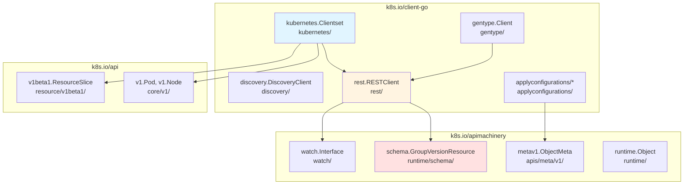
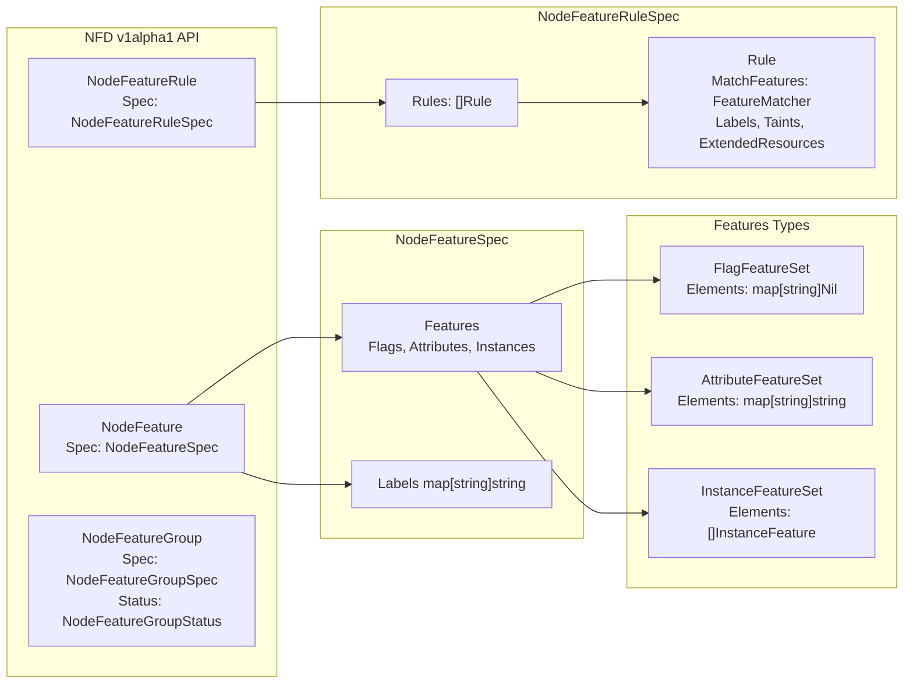
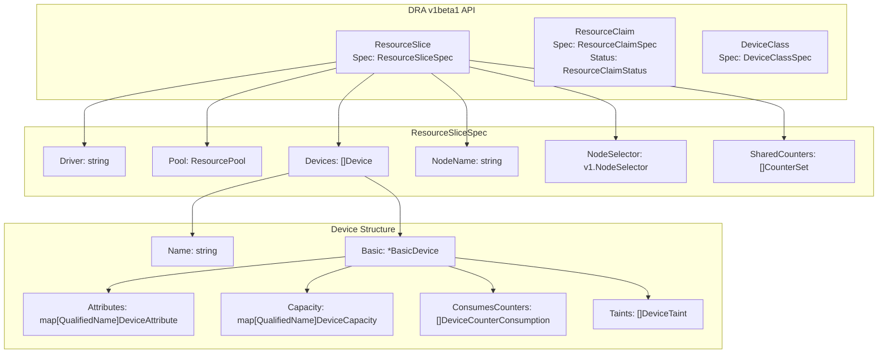
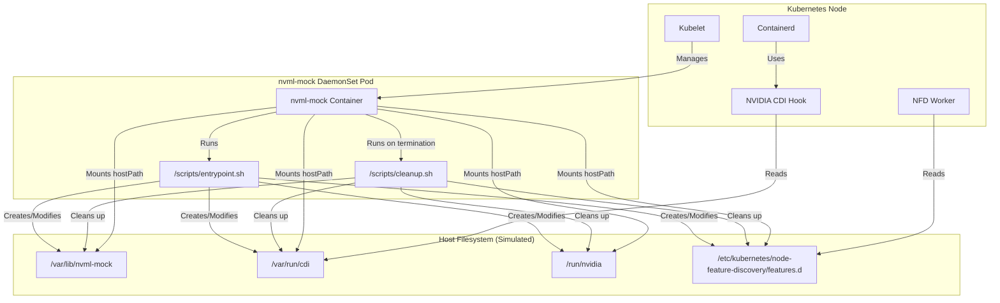
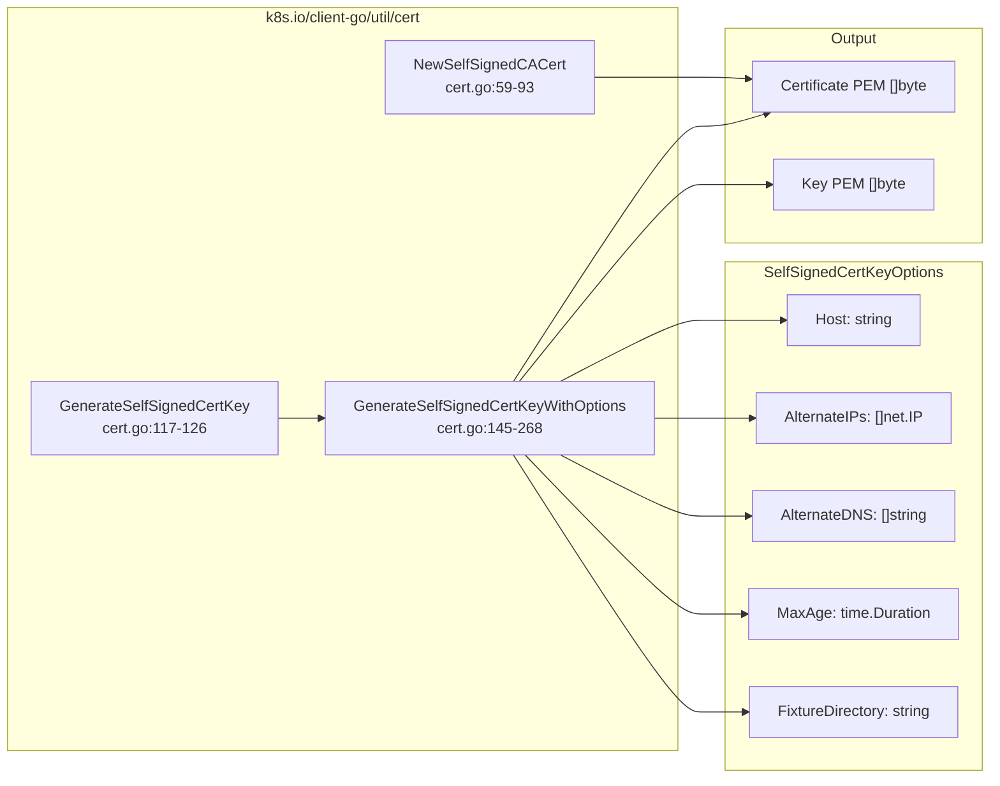
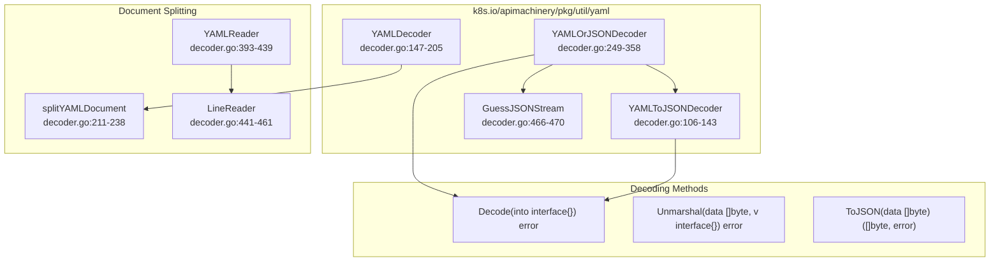
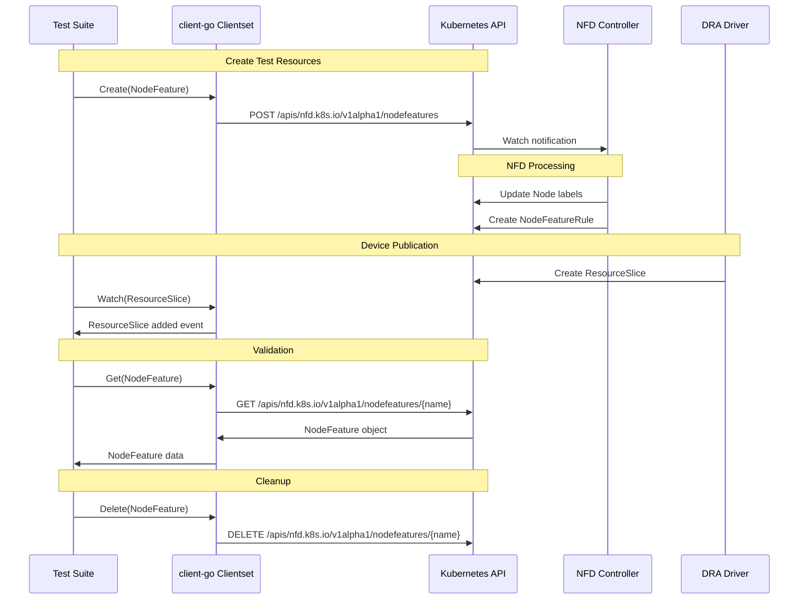

<!-- source: DeepWiki mcp.deepwiki.com · repo NVIDIA/k8s-test-infra · page 3.2 Kubernetes Integration Layer · fetched 2026-10-26 -->

# Kubernetes Integration Layer

<details>
<summary>Relevant source files</summary>

The following files were used as context for generating this wiki page:

- [CHANGELOG.md](CHANGELOG.md)
- [deployments/nvml-mock/helm/nvml-mock/tests/__snapshot__/daemonset_test.yaml.snap](deployments/nvml-mock/helm/nvml-mock/tests/__snapshot__/daemonset_test.yaml.snap)
- [deployments/nvml-mock/helm/nvml-mock/tests/daemonset_test.yaml](deployments/nvml-mock/helm/nvml-mock/tests/daemonset_test.yaml)
- [pkg/diagnostics/collector.go](pkg/diagnostics/collector.go)
- [pkg/diagnostics/extensions.go](pkg/diagnostics/extensions.go)
- [pkg/diagnostics/kubernetes.go](pkg/diagnostics/kubernetes.go)
- [pkg/diagnostics/options.go](pkg/diagnostics/options.go)
- [pkg/kubernetes/kubernetes.go](pkg/kubernetes/kubernetes.go)
- [vendor/k8s.io/api/resource/v1alpha3/generated.proto](vendor/k8s.io/api/resource/v1alpha3/generated.proto)
- [vendor/k8s.io/api/resource/v1alpha3/types.go](vendor/k8s.io/api/resource/v1alpha3/types.go)
- [vendor/k8s.io/api/resource/v1alpha3/types_swagger_doc_generated.go](vendor/k8s.io/api/resource/v1alpha3/types_swagger_doc_generated.go)
- [vendor/k8s.io/api/resource/v1beta1/generated.proto](vendor/k8s.io/api/resource/v1beta1/generated.proto)
- [vendor/k8s.io/api/resource/v1beta1/types.go](vendor/k8s.io/api/resource/v1beta1/types.go)
- [vendor/k8s.io/api/resource/v1beta1/types_swagger_doc_generated.go](vendor/k8s.io/api/resource/v1beta1/types_swagger_doc_generated.go)

</details>


## Purpose and Scope

This document describes how k8s-test-infra integrates with Kubernetes clusters and specialized APIs for hardware feature detection and dynamic resource allocation. It covers the client-go library usage for cluster operations, Node Feature Discovery (NFD) Custom Resource Definitions, Dynamic Resource Allocation (DRA) API resources, and supporting utilities for certificate generation and manifest processing. For information about how these integrations are tested, see [Testing Infrastructure Design](#3.3). For dependency management details, see [Module Dependencies](#3.1).

## Client-Go Integration Architecture

The system relies on k8s.io/client-go v0.34.2 as the foundation for all Kubernetes cluster interactions. This library provides typed clients, discovery mechanisms, and server-side apply functionality.

### Core Dependencies

| Package | Version | Purpose |
|---------|---------|---------|
| `k8s.io/client-go` | v0.34.2 | Kubernetes API client library |
| `k8s.io/api` | v0.34.2 | Kubernetes API type definitions |
| `k8s.io/apimachinery` | v0.34.2 | Core API machinery (serialization, metadata, watches) |
| `k8s.io/apiextensions-apiserver` | v0.34.2 | Custom Resource Definition support |

**Sources:** [go.mod:1-16](), [vendor/modules.txt:239-497]()

### Client-Go Package Structure



**Client-Go Component Architecture**

**Sources:** [vendor/modules.txt:364-497](), [go.mod:8-11]()

### Kubernetes API Operations

The system uses client-go for standard CRUD operations and specialized patterns:

| Operation Pattern | Implementation | Use Case |
|-------------------|----------------|----------|
| Create | `client.Create(ctx, obj)` | Creating test resources |
| Get | `client.Get(ctx, name, namespace)` | Retrieving resource state |
| Update | `client.Update(ctx, obj)` | Modifying existing resources |
| Delete | `client.Delete(ctx, name, namespace)` | Cleanup operations |
| Watch | `client.Watch(ctx, opts)` | Observing resource changes |
| List | `client.List(ctx, opts)` | Enumerating resources |
| Server-Side Apply | `client.Apply(ctx, applyConfig)` | Declarative updates |

**Sources:** [vendor/modules.txt:418-497](), [vendor/k8s.io/apimachinery/pkg/util/yaml/decoder.go:240-358]()

## Node Feature Discovery API

The NFD API enables hardware feature detection and node customization based on discovered features. The system uses sigs.k8s.io/node-feature-discovery v0.18.3 and its API package v0.18.3.

### NFD Custom Resource Definitions



**NFD CRD Structure**

**Sources:** [vendor/sigs.k8s.io/node-feature-discovery/api/nfd/v1alpha1/types.go:1-395]()

### NodeFeature Resource

The `NodeFeature` CRD holds discovered features for a single node:

```go
// Key types from vendor/sigs.k8s.io/node-feature-discovery/api/nfd/v1alpha1/types.go
type NodeFeature struct {
    metav1.TypeMeta
    metav1.ObjectMeta
    Spec NodeFeatureSpec
}

type NodeFeatureSpec struct {
    Features Features           // Raw feature data
    Labels   map[string]string  // Requested node labels
}

type Features struct {
    Flags      map[string]FlagFeatureSet      // Boolean features
    Attributes map[string]AttributeFeatureSet // String-valued features
    Instances  map[string]InstanceFeatureSet  // Multi-attribute features
}
```

**Sources:** [vendor/sigs.k8s.io/node-feature-discovery/api/nfd/v1alpha1/types.go:36-93]()

### NodeFeatureRule Resource

The `NodeFeatureRule` CRD defines feature-based node customization:

```go
type NodeFeatureRule struct {
    metav1.TypeMeta
    metav1.ObjectMeta
    Spec NodeFeatureRuleSpec
}

type NodeFeatureRuleSpec struct {
    Rules []Rule  // List of customization rules
}

type Rule struct {
    Name              string
    Labels            map[string]string
    Annotations       map[string]string
    Taints            []corev1.Taint
    ExtendedResources map[string]string
    MatchFeatures     FeatureMatcher
}
```

**Sources:** [vendor/sigs.k8s.io/node-feature-discovery/api/nfd/v1alpha1/types.go:99-253]()

### FeatureMatcher Pattern

The `FeatureMatcher` enables complex feature matching with operators:

| Operator | Description | Example Usage |
|----------|-------------|---------------|
| `MatchIn` | Value in set | CPU model in ["Xeon", "EPYC"] |
| `MatchNotIn` | Value not in set | GPU model not in ["Legacy"] |
| `MatchInRegexp` | Regex match | Model matches "^NVIDIA.*" |
| `MatchExists` | Feature present | GPU exists |
| `MatchGt`/`MatchLt` | Numeric comparison | Memory > 32GB |
| `MatchGtLt` | Range check | Cores between [8, 64] |

**Sources:** [vendor/sigs.k8s.io/node-feature-discovery/api/nfd/v1alpha1/types.go:261-381]()

### NodeFeatureGroup Resource

The `NodeFeatureGroup` CRD groups nodes by feature sets:

```go
type NodeFeatureGroup struct {
    metav1.TypeMeta
    metav1.ObjectMeta
    Spec   NodeFeatureGroupSpec
    Status NodeFeatureGroupStatus
}

type NodeFeatureGroupSpec struct {
    Rules []GroupRule  // Feature grouping rules
}

type NodeFeatureGroupStatus struct {
    Nodes []FeatureGroupNode  // Nodes matching the rules
}
```

**Sources:** [vendor/sigs.k8s.io/node-feature-discovery/api/nfd/v1alpha1/types.go:132-179]()

## Dynamic Resource Allocation API

The DRA API provides a framework for managing specialized hardware devices. The system uses k8s.io/api/resource/v1beta1 and v1alpha3 for device allocation.

### DRA Resource Types



**DRA Resource Architecture**

**Sources:** [vendor/k8s.io/api/resource/v1beta1/types.go:1-277]()

### ResourceSlice Specification

The `ResourceSlice` resource publishes available devices from a driver:

```go
type ResourceSlice struct {
    metav1.TypeMeta
    metav1.ObjectMeta
    Spec ResourceSliceSpec
}

type ResourceSliceSpec struct {
    Driver             string            // DRA driver name (DNS subdomain)
    Pool               ResourcePool      // Pool identification
    NodeName           string            // Node-local resources
    NodeSelector       *v1.NodeSelector  // Multi-node resources
    AllNodes           bool              // Cluster-wide resources
    Devices            []Device          // Device definitions (max 128)
    PerDeviceNodeSelection *bool         // Per-device node selection
    SharedCounters     []CounterSet      // Shared counter definitions
}

type ResourcePool struct {
    Name               string  // Pool identifier
    Generation         int64   // Change tracking
    ResourceSliceCount int64   // Total slices in pool
}
```

**Sources:** [vendor/k8s.io/api/resource/v1beta1/types.go:52-253]()

### Device Definition Structure

Each device in a `ResourceSlice` has attributes and capacities:

```go
type Device struct {
    Name  string        // Unique device name (DNS label)
    Basic *BasicDevice  // Device properties
}

type BasicDevice struct {
    Attributes       map[QualifiedName]DeviceAttribute  // Device attributes
    Capacity         map[QualifiedName]DeviceCapacity   // Device capacities
    ConsumesCounters []DeviceCounterConsumption         // Counter consumption
    NodeName         *string                            // Device location
    NodeSelector     *v1.NodeSelector                   // Device availability
    AllNodes         *bool                              // Cluster-wide device
    Taints           []DeviceTaint                      // Device taints
    BindsToNode      *bool                              // Node binding requirement
    BindingConditions      []string                     // Pre-binding conditions
    BindingFailureConditions []string                   // Binding failure indicators
    AllowMultipleAllocations *bool                      // Multi-allocation support
}

type DeviceAttribute struct {
    IntValue     *int64   // Integer attribute
    BoolValue    *bool    // Boolean attribute
    StringValue  *string  // String attribute (max 64 chars)
    VersionValue *string  // Semantic version (max 64 chars)
}

type DeviceCapacity struct {
    Value         resource.Quantity      // Total capacity
    RequestPolicy *CapacityRequestPolicy // Consumption policy
}
```

**Sources:** [vendor/k8s.io/api/resource/v1beta1/types.go:261-365]()

### Device Selection with CEL

DRA supports CEL expressions for device selection:

```go
type DeviceSelector struct {
    CEL *CELDeviceSelector  // CEL-based selection
}

type CELDeviceSelector struct {
    Expression string  // CEL expression (max 10 Ki, cost limit 1,000,000)
}
```

**CEL Expression Context:**
- `device.driver`: Driver name (string)
- `device.attributes["domain.com"]`: Grouped attributes (object)
- `device.capacity["domain.com"]`: Grouped capacities (object)
- `device.allowMultipleAllocations`: Multi-allocation flag (bool)

**Sources:** [vendor/k8s.io/api/resource/v1beta1/types.go:1-365](), [vendor/k8s.io/api/resource/v1alpha3/types.go:23-116]()

### Device Taints and Tolerations

DRA supports device-level taints for fine-grained scheduling:

```go
type DeviceTaint struct {
    Key       string            // Taint key (label name)
    Value     string            // Taint value (label value)
    Effect    DeviceTaintEffect // NoSchedule or NoExecute
    TimeAdded *metav1.Time      // Taint creation time
}

type DeviceTaintEffect string
const (
    DeviceTaintEffectNoSchedule DeviceTaintEffect = "NoSchedule"
    DeviceTaintEffectNoExecute  DeviceTaintEffect = "NoExecute"
)
```

**Sources:** [vendor/k8s.io/api/resource/v1alpha3/types.go:120-172]()

### DeviceTaintRule Resource

The `DeviceTaintRule` CRD applies taints to matching devices:

```go
type DeviceTaintRule struct {
    metav1.TypeMeta
    metav1.ObjectMeta
    Spec DeviceTaintRuleSpec
}

type DeviceTaintRuleSpec struct {
    DeviceSelector *DeviceTaintSelector  // Device matching criteria
    Taint          DeviceTaint           // Taint to apply
}

type DeviceTaintSelector struct {
    DeviceClassName *string          // Filter by device class
    Driver          *string          // Filter by driver
    Pool            *string          // Filter by pool
    Device          *string          // Filter by device name
    Selectors       []DeviceSelector // CEL-based filtering
}
```

**Sources:** [vendor/k8s.io/api/resource/v1alpha3/types.go:174-262]()

### Shared Counters and Partitionable Devices

DRA supports shared counters for tracking device usage across allocations:

```go
type CounterSet struct {
    Name     string              // Counter set name (DNS label)
    Counters map[string]Counter  // Named counters (max 32)
}

type Counter struct {
    Value resource.Quantity  // Available counter amount
}

type DeviceCounterConsumption struct {
    CounterSetName string                        // Reference to CounterSet
    Counters       map[string]resource.Quantity  // Consumed amounts
}
```

**Sources:** [vendor/k8s.io/api/resource/v1beta1/types.go:182-213]()

## DaemonSet Deployment and Host-Path Simulation

The `nvml-mock` component is deployed as a Kubernetes DaemonSet, ensuring that a mock NVML instance runs on every selected node. This deployment model is crucial for simulating GPU presence and behavior across the cluster.

### DaemonSet Configuration

The `nvml-mock` DaemonSet is defined via a Helm chart, allowing for flexible configuration. Key aspects include:

- **Node Selection**: The DaemonSet targets nodes based on specific labels, such as `nvidia.com/gpu.present: "true"`. This allows for selective deployment on nodes designated for GPU simulation.
- **Privileged Container**: The `nvml-mock` container runs in privileged mode (`securityContext.privileged: true`) [deployments/nvml-mock/helm/nvml-mock/tests/daemonset_test.yaml:110-114](). This is necessary to allow the mock library to interact with the host filesystem and simulate device files.
- **Entrypoint and Cleanup Scripts**: The container executes an `entrypoint.sh` script on startup and a `cleanup.sh` script on preStop [deployments/nvml-mock/helm/nvml-mock/tests/daemonset_test.yaml:117-127](). These scripts are responsible for setting up and tearing down the host environment for NVML mocking.
- **Environment Variables**: Numerous environment variables configure the mock behavior, including `GPU_COUNT`, `DRIVER_VERSION`, `MOCK_NFD_PCI_LABEL`, `MOCK_NVML_CONFIG`, and `LD_PRELOAD` [deployments/nvml-mock/helm/nvml-mock/tests/__snapshot__/daemonset_test.yaml.snap:32-70](). These variables control the number of simulated GPUs, driver version, NFD integration, mock NVML configuration, and library preloading for interception.

### Host-Path Simulation

A core aspect of `nvml-mock`'s integration is its use of `hostPath` volumes to simulate the presence of GPU-related files and directories on the host filesystem. This allows other components, such as the NVIDIA Container Toolkit or Node Feature Discovery, to interact with the mock environment as if real GPUs were present.



**DaemonSet and Host-Path Simulation Architecture**

**Key `hostPath` Volumes:**

- `/var/lib/nvml-mock`: This directory serves as the root for various mock-related files, including the mock NVML library itself, configuration files, and state directories for fabric simulation [deployments/nvml-mock/helm/nvml-mock/tests/__snapshot__/daemonset_test.yaml.snap:98-101, 121-124]().
- `/var/run/cdi`: This path is used for NVIDIA Container Device Interface (CDI) files. The `nvml-mock` container creates CDI specification files here, which are then consumed by the NVIDIA CDI hook to inject mock devices into containers [deployments/nvml-mock/helm/nvml-mock/tests/__snapshot__/daemonset_test.yaml.snap:104-105, 128-131]().
- `/run/nvidia`: This directory is typically where NVIDIA driver components and device files reside. `nvml-mock` uses this to simulate the presence of NVIDIA-specific runtime files [deployments/nvml-mock/helm/nvml-mock/tests/__snapshot__/daemonset_test.yaml.snap:106-107, 132-135]().
- `/etc/kubernetes/node-feature-discovery/features.d`: This is where NFD expects feature files. The `entrypoint.sh` script writes a `pci-10de.feature` file here, which NFD then processes to add `nvidia.com/gpu` labels to the node [deployments/nvml-mock/helm/nvml-mock/tests/__snapshot__/daemonset_test.yaml.snap:108-109, 136-139](). The `MOCK_NFD_PCI_LABEL` environment variable controls whether this feature file is created [deployments/nvml-mock/helm/nvml-mock/tests/__snapshot__/daemonset_test.yaml.snap:40-41]().

The `DirectoryOrCreate` type for `hostPath` volumes ensures that these directories are created on the host if they do not already exist, facilitating a clean setup for the mock environment [deployments/nvml-mock/helm/nvml-mock/tests/__snapshot__/daemonset_test.yaml.snap:121-143]().

**Sources:**
- [deployments/nvml-mock/helm/nvml-mock/tests/__snapshot__/daemonset_test.yaml.snap:3-147]()
- [deployments/nvml-mock/helm/nvml-mock/tests/daemonset_test.yaml:110-114]()
- [deployments/nvml-mock/helm/nvml-mock/tests/daemonset_test.yaml:117-127]()
- [deployments/nvml-mock/helm/nvml-mock/tests/__snapshot__/daemonset_test.yaml.snap:32-70]()
- [deployments/nvml-mock/helm/nvml-mock/tests/__snapshot__/daemonset_test.yaml.snap:98-101]()
- [deployments/nvml-mock/helm/nvml-mock/tests/__snapshot__/daemonset_test.yaml.snap:121-124]()
- [deployments/nvml-mock/helm/nvml-mock/tests/__snapshot__/daemonset_test.yaml.snap:104-105]()
- [deployments/nvml-mock/helm/nvml-mock/tests/__snapshot__/daemonset_test.yaml.snap:128-131]()
- [deployments/nvml-mock/helm/nvml-mock/tests/__snapshot__/daemonset_test.yaml.snap:106-107]()
- [deployments/nvml-mock/helm/nvml-mock/tests/__snapshot__/daemonset_test.yaml.snap:132-135]()
- [deployments/nvml-mock/helm/nvml-mock/tests/__snapshot__/daemonset_test.yaml.snap:108-109]()
- [deployments/nvml-mock/helm/nvml-mock/tests/__snapshot__/daemonset_test.yaml.snap:136-139]()
- [deployments/nvml-mock/helm/nvml-mock/tests/__snapshot__/daemonset_test.yaml.snap:40-41]()
- [deployments/nvml-mock/helm/nvml-mock/tests/__snapshot__/daemonset_test.yaml.snap:121-143]()

## Supporting Utilities

### Certificate Generation

The system includes utilities for generating self-signed certificates for testing secure Kubernetes components:



**Certificate Generation Utilities**

**Key Functions:**

| Function | Signature | Purpose |
|----------|-----------|---------|
| `GenerateSelfSignedCertKey` | `(host string, alternateIPs []net.IP, alternateDNS []string) ([]byte, []byte, error)` | Generate cert/key pair with defaults |
| `GenerateSelfSignedCertKeyWithOptions` | `(opts SelfSignedCertKeyOptions) ([]byte, []byte, error)` | Generate cert/key with custom options |
| `NewSelfSignedCACert` | `(cfg Config, key crypto.Signer) (*x509.Certificate, error)` | Create CA certificate |

**Default Behavior:**
- Validity period: 365 days (1 year)
- Valid from: 1 hour before generation (clock skew tolerance)
- Certificate type: RSA 2048-bit
- Extensions: SubjectAltNames for IPs and DNS names

**Sources:** [vendor/k8s.io/client-go/util/cert/cert.go:117-276]()

### YAML and JSON Manifest Processing

The system provides utilities for loading and decoding Kubernetes manifests from YAML or JSON:



**YAML/JSON Decoding Architecture**

**Key Types:**

```go
// YAMLOrJSONDecoder attempts to decode YAML or JSON from a stream
type YAMLOrJSONDecoder struct {
    json         *json.Decoder
    jsonConsumed int64
    yaml         *YAMLToJSONDecoder
    yamlConsumed int64
    stream       *StreamReader
    count        int
}

// NewYAMLOrJSONDecoder creates a decoder that handles both formats
func NewYAMLOrJSONDecoder(r io.Reader, bufferSize int) *YAMLOrJSONDecoder

// Decode unmarshals the next object from the stream
func (d *YAMLOrJSONDecoder) Decode(into interface{}) error
```

**Decoding Strategy:**
1. Detect format by looking for JSON opening brace `{`
2. Try JSON decoding first if detected
3. Fall back to YAML if JSON fails and count ≤ 1
4. Use YAML exclusively after first successful YAML decode

**Document Separation:**
- YAML documents separated by `---` on a line
- JSON documents separated by whitespace between objects
- Buffers content to handle incomplete reads

**Sources:** [vendor/k8s.io/apimachinery/pkg/util/yaml/decoder.go:1-486]()

### Utility Functions

| Function | Purpose | Location |
|----------|---------|----------|
| `Unmarshal` | Unmarshal YAML/JSON with number preservation | [decoder.go:38-62]() |
| `UnmarshalStrict` | Strict unmarshaling (error on duplicates) | [decoder.go:64-90]() |
| `ToJSON` | Convert YAML document to JSON | [decoder.go:92-101]() |
| `IsJSONBuffer` | Check if buffer starts with `{` | [decoder.go:474-476]() |
| `NewDocumentDecoder` | Split multi-document YAML stream | [decoder.go:158-169]() |

**Sources:** [vendor/k8s.io/apimachinery/pkg/util/yaml/decoder.go:35-486]()

## Integration Patterns

### Resource Lifecycle Management



**Resource Lifecycle in Tests**

**Sources:** [go.mod:5-16](), [vendor/modules.txt:239-549]()

### Watch Pattern for Asynchronous Updates

The system uses watches to observe resource changes asynchronously:

```go
// Watch pattern for NFD resources
watcher, err := client.Watch(ctx, metav1.ListOptions{
    FieldSelector: "metadata.name=" + name,
})
defer watcher.Stop()

for event := range watcher.ResultChan() {
    switch event.Type {
    case watch.Added:
        // Handle resource creation
    case watch.Modified:
        // Handle resource update
    case watch.Deleted:
        // Handle resource deletion
    }
}
```

**Sources:** [vendor/k8s.io/apimachinery/pkg/util/yaml/decoder.go:1-486](), [vendor/modules.txt:361-362]()

## Version Compatibility

| Component | Version | API Stability |
|-----------|---------|---------------|
| client-go | v0.34.2 | Stable |
| NFD API | v0.18.3 | v1alpha1 (Alpha) |
| DRA API | - | v1beta1 (Beta), v1alpha3 (Alpha) |
| Kubernetes API | v0.34.2 | Mixed (varies by resource) |

**Alpha/Beta Considerations:**
- v1alpha1 APIs may change without notice
- v1beta1 APIs are more stable but may still evolve
- Test code must handle API evolution
- Feature gates control access to alpha features (e.g., `DRAPartitionableDevices`, `DRADeviceTaints`)

**Sources:** [go.mod:1-16](), [vendor/k8s.io/api/resource/v1beta1/types.go:1-100]()

---

