<!-- source: DeepWiki mcp.deepwiki.com · repo NVIDIA/k8s-test-infra · page 3.3 Testing Infrastructure Design · fetched 2026-10-26 -->

# Testing Infrastructure Design

<details>
<summary>Relevant source files</summary>

The following files were used as context for generating this wiki page:

- [.github/workflows/nvml-mock-e2e-go.yaml](.github/workflows/nvml-mock-e2e-go.yaml)
- [Makefile](Makefile)
- [README.md](README.md)
- [go.mod](go.mod)
- [go.sum](go.sum)
- [tests/e2e/README.md](tests/e2e/README.md)
- [tests/e2e/VERSION-MATRIX.md](tests/e2e/VERSION-MATRIX.md)
- [tests/e2e/go/assertions/resources.go](tests/e2e/go/assertions/resources.go)
- [tests/e2e/go/e2e_suite_test.go](tests/e2e/go/e2e_suite_test.go)
- [tests/e2e/go/framework/config/config.go](tests/e2e/go/framework/config/config.go)
- [tests/e2e/go/framework/harness/harness.go](tests/e2e/go/framework/harness/harness.go)
- [tests/e2e/go/framework/helm/helm.go](tests/e2e/go/framework/helm/helm.go)
- [tests/e2e/go/framework/helm/helm_test.go](tests/e2e/go/framework/helm/helm_test.go)
- [tests/e2e/go/framework/kube/kube.go](tests/e2e/go/framework/kube/kube.go)
- [tests/e2e/go/suite_cluster.go](tests/e2e/go/suite_cluster.go)
- [tests/e2e/go/suite_helm.go](tests/e2e/go/suite_helm.go)
- [vendor/github.com/onsi/ginkgo/v2/CHANGELOG.md](vendor/github.com/onsi/ginkgo/v2/CHANGELOG.md)
- [vendor/github.com/onsi/ginkgo/v2/reporters/default_reporter.go](vendor/github.com/onsi/ginkgo/v2/reporters/default_reporter.go)
- [vendor/github.com/onsi/ginkgo/v2/types/version.go](vendor/github.com/onsi/ginkgo/v2/types/version.go)
- [vendor/k8s.io/apimachinery/pkg/api/validation/objectmeta.go](vendor/k8s.io/apimachinery/pkg/api/validation/objectmeta.go)
- [vendor/modules.txt](vendor/modules.txt)

</details>


## Purpose and Scope

This document describes the testing infrastructure design used in the k8s-test-infra repository. It covers the BDD (Behavior-Driven Development) testing approach using Ginkgo and Gomega, test organization patterns, execution models, and reporting mechanisms. The focus is on the framework-level design decisions and how tests are structured and executed.

For information about specific Ginkgo features and usage patterns, see [Testing with Ginkgo](#5). For details about Kubernetes client operations used in tests, see [Kubernetes Integration Layer](#3.2). Build system integration with testing is covered in [Build System](#8).

---

## Core Testing Framework

The repository uses **Ginkgo v2.32.0** as the primary testing framework with **Gomega v1.42.1** for assertions. This combination provides a BDD-style testing experience with expressive matchers and comprehensive reporting capabilities.

### Framework Components

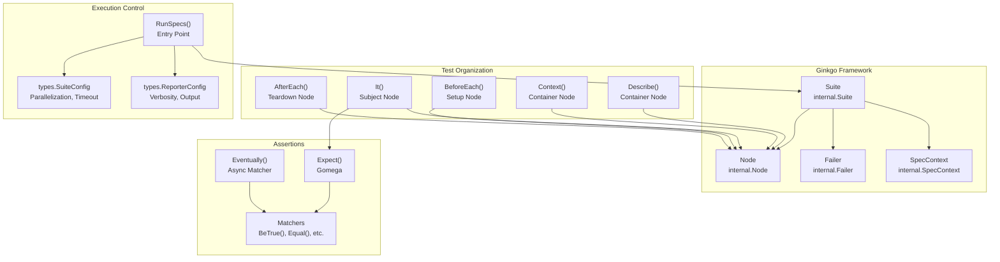

Sources:
- [go.mod:8-9]()
- [vendor/github.com/onsi/ginkgo/v2/internal/suite.go:25-71]()
- [vendor/github.com/onsi/ginkgo/v2/internal/node.go:27-70]()
- [vendor/github.com/onsi/ginkgo/v2/core_dsl.go:260-331]()

### Key Framework Types

| Type | Location | Purpose |
|------|----------|---------|
| `internal.Suite` | [vendor/github.com/onsi/ginkgo/v2/internal/suite.go:25]() | Manages test tree, execution lifecycle, and reporting |
| `internal.Node` | [vendor/github.com/onsi/ginkgo/v2/internal/node.go:27]() | Represents a single node in the test tree (container or subject) |
| `types.SpecReport` | [vendor/github.com/onsi/ginkgo/v2/types/types.go:100]() | Contains detailed information about a spec execution |
| `types.Report` | [vendor/github.com/onsi/ginkgo/v2/types/types.go:20]() | Aggregated report for entire suite |
| `SpecContext` | [vendor/github.com/onsi/ginkgo/v2/dsl/core_dsl.go:101]() | Context passed to interruptible nodes |

Sources:
- [vendor/github.com/onsi/ginkgo/v2/internal/suite.go:25-96]()
- [vendor/github.com/onsi/ginkgo/v2/internal/node.go:27-70]()
- [vendor/github.com/onsi/ginkgo/v2/types/types.go:20-200]()

---

## Test Organization Patterns

### BDD Structure with Describe/Context/It

Ginkgo organizes tests in a hierarchical tree structure using BDD-style blocks:

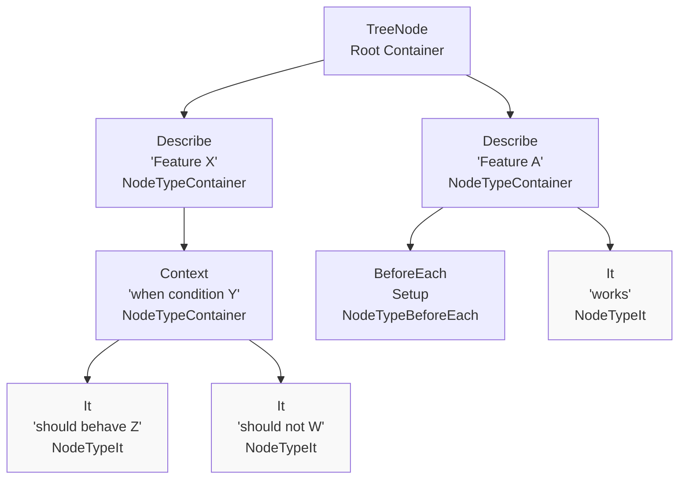

Sources:
- [vendor/github.com/onsi/ginkgo/v2/internal/suite.go:98-228]()
- [vendor/github.com/onsi/ginkgo/v2/internal/node.go:214-228]()

### Node Types and Decorators

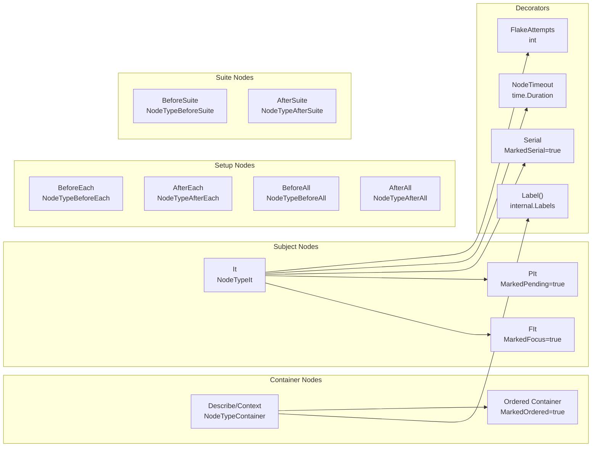

**Node Type Constants:**
- `NodeTypeContainer`: Describe/Context blocks
- `NodeTypeIt`: Individual test specs
- `NodeTypeBeforeEach`/`NodeTypeAfterEach`: Per-spec setup/teardown
- `NodeTypeBeforeAll`/`NodeTypeAfterAll`: Per-ordered-container setup/teardown
- `NodeTypeBeforeSuite`/`NodeTypeAfterSuite`: Suite-level setup/teardown

Sources:
- [vendor/github.com/onsi/ginkgo/v2/internal/node.go:27-70]()
- [vendor/github.com/onsi/ginkgo/v2/internal/node.go:72-98]()
- [vendor/github.com/onsi/ginkgo/v2/internal/node.go:214-499]()

### Table-Driven Tests

Ginkgo provides `DescribeTable` for generating multiple specs from tabular data:

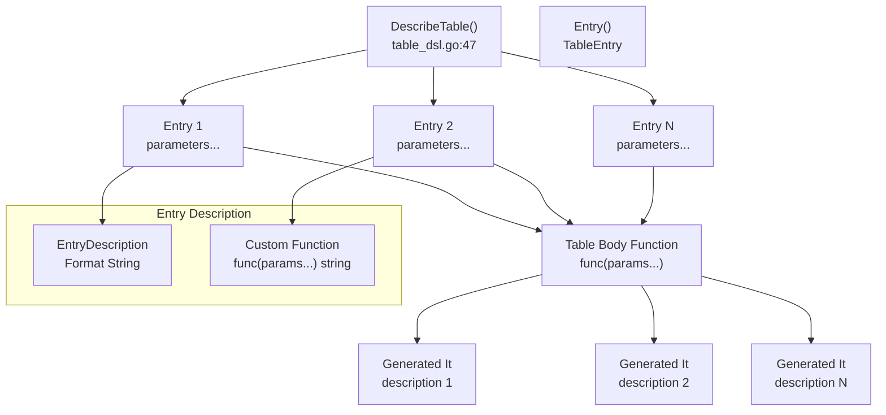

**Key Functions:**
- `DescribeTable(description string, args ...any)`: Defines a table test
- `Entry(description any, args ...any)`: Single table entry
- `FEntry()`: Focused entry
- `PEntry()`: Pending entry
- `DescribeTableSubtree()`: Generates container nodes instead of It nodes

Sources:
- [vendor/github.com/onsi/ginkgo/v2/dsl/table_dsl.go:47-76]()
- [vendor/github.com/onsi/ginkgo/v2/dsl/table_dsl.go:112-141]()
- [vendor/github.com/onsi/ginkgo/v2/dsl/table_dsl.go:164-194]()
- [vendor/github.com/onsi/ginkgo/v2/dsl/table_dsl.go:199-317]()

---

## Test Execution Model

### Suite Lifecycle

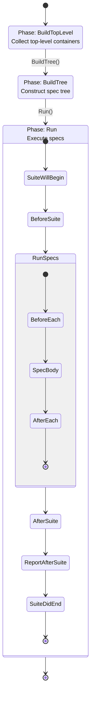

**Phase Enum:**
```go
const (
    PhaseBuildTopLevel Phase = iota
    PhaseBuildTree
    PhaseRun
)
```

Sources:
- [vendor/github.com/onsi/ginkgo/v2/internal/suite.go:15-21]()
- [vendor/github.com/onsi/ginkgo/v2/internal/suite.go:98-109]()
- [vendor/github.com/onsi/ginkgo/v2/internal/suite.go:111-141]()

### Configuration Types

| Type | Purpose | Key Fields |
|------|---------|-----------|
| `types.SuiteConfig` | Controls suite execution behavior | `RandomSeed`, `ParallelTotal`, `ParallelProcess`, `Timeout`, `LabelFilter` |
| `types.ReporterConfig` | Controls output and reporting | `Verbosity`, `NoColor`, `JSONReport`, `JUnitReport`, `FullTrace` |

**Configuration Access:**
- `GinkgoConfiguration()`: Returns current `(SuiteConfig, ReporterConfig)`
- `RunSpecs(t, description, suiteConfig, reporterConfig)`: Accepts custom configuration

Sources:
- [vendor/github.com/onsi/ginkgo/v2/dsl/core_dsl.go:39-41]()
- [vendor/github.com/onsi/ginkgo/v2/dsl/core_dsl.go:139-141]()
- [vendor/github.com/onsi/ginkgo/v2/dsl/core_dsl.go:260-331]()

### Parallel Execution

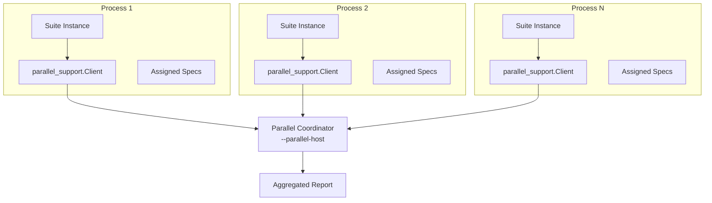

**Parallel Configuration:**
- `suiteConfig.ParallelTotal`: Total number of parallel processes
- `suiteConfig.ParallelProcess`: Current process number (1-indexed)
- `suiteConfig.ParallelHost`: Coordinator host address

Sources:
- [vendor/github.com/onsi/ginkgo/v2/dsl/core_dsl.go:156-164]()
- [vendor/github.com/onsi/ginkgo/v2/dsl/core_dsl.go:274-294]()
- [vendor/github.com/onsi/ginkgo/v2/internal/suite.go:70-71]()

---

## Reporting Infrastructure

### Reporter Architecture

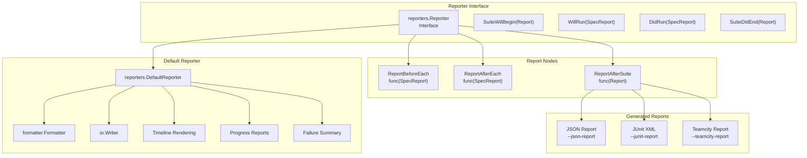

Sources:
- [vendor/github.com/onsi/ginkgo/v2/reporters/default_reporter.go:22-65]()
- [vendor/github.com/onsi/ginkgo/v2/dsl/reporting_dsl.go:118-208]()
- [vendor/github.com/onsi/ginkgo/v2/dsl/reporting_dsl.go:210-259]()

### Report Types

**SpecReport Structure:**
```go
type SpecReport struct {
    ContainerHierarchyTexts   []string
    LeafNodeText              string
    State                     SpecState
    RunTime                   time.Duration
    Failure                   Failure
    CapturedGinkgoWriterOutput string
    ReportEntries             []ReportEntry
    NumAttempts               int
    MaxFlakeAttempts          int
    // ... more fields
}
```

**Report Structure:**
```go
type Report struct {
    SuiteDescription          string
    SuiteSucceeded            bool
    SpecReports               SpecReports
    PreRunStats               PreRunStats
    RunTime                   time.Duration
    SuiteConfig               SuiteConfig
    // ... more fields
}
```

Sources:
- [vendor/github.com/onsi/ginkgo/v2/types/types.go:100-199]()
- [vendor/github.com/onsi/ginkgo/v2/types/types.go:20-98]()

### Timeline and Progress Reporting

The `DefaultReporter` generates a timeline view showing the chronological flow of a spec:

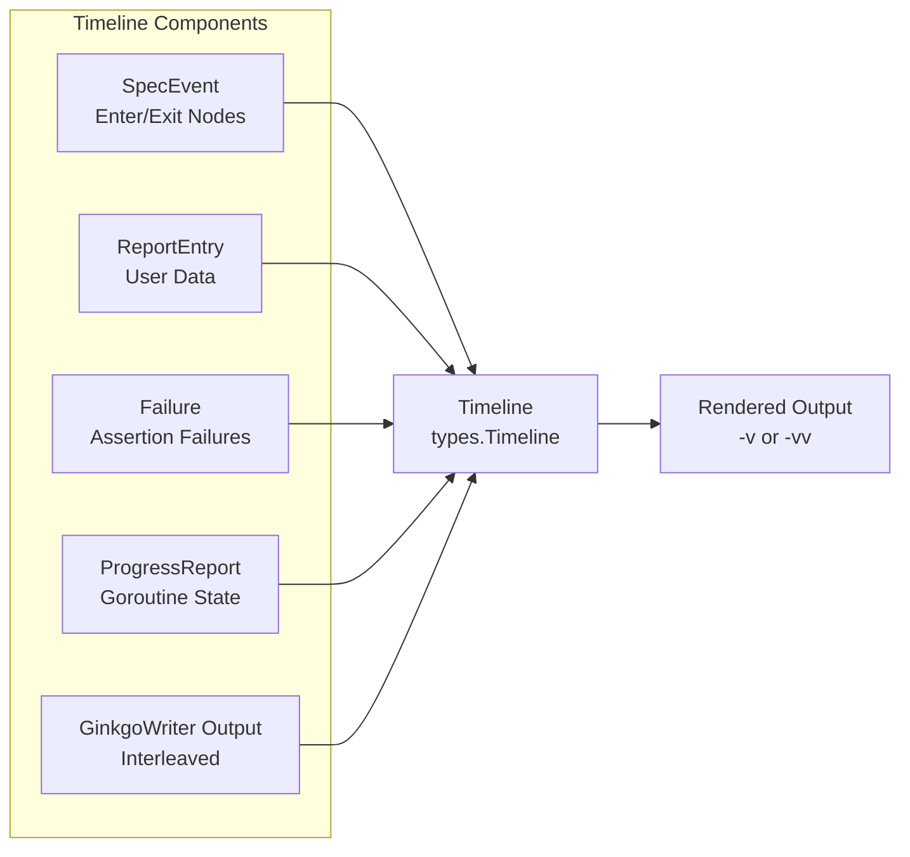

**Timeline Location:**
Each timeline entry has a `TimelineLocation`:
- `Offset`: Position in `GinkgoWriter` output
- `Order`: Sequential ordering
- `Time`: Timestamp

Sources:
- [vendor/github.com/onsi/ginkgo/v2/reporters/default_reporter.go:378-426]()
- [vendor/github.com/onsi/ginkgo/v2/internal/suite.go:284-294]()

### Report Entries

Custom data can be attached to specs using `AddReportEntry()`:

```go
AddReportEntry(name string, args ...any)
```

**Visibility Levels:**
- `ReportEntryVisibilityAlways`: Always shown
- `ReportEntryVisibilityFailureOrVerbose`: Shown on failure or with `-v`
- `ReportEntryVisibilityNever`: Only in machine-readable reports

Sources:
- [vendor/github.com/onsi/ginkgo/v2/dsl/reporting_dsl.go:66-100]()

---

## E2E Harness Architecture

The End-to-End (E2E) testing harness, located under `tests/e2e/go/`, is responsible for managing the entire lifecycle of the test environment, from cluster creation to diagnostics collection. It uses Ginkgo for test orchestration and Gomega for assertions.

### Harness Overview

The `harness.Harness` struct [tests/e2e/go/framework/harness/harness.go]() encapsulates the necessary clients and configurations for interacting with the Kubernetes cluster and external tools.

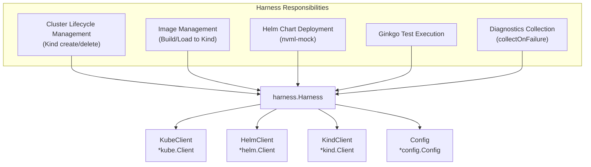

Sources:
- [tests/e2e/go/framework/harness/harness.go]()
- [tests/e2e/README.md:14-23]()

### Cluster Lifecycle Management

The E2E harness uses `kind` (Kubernetes in Docker) to provision and manage test clusters.

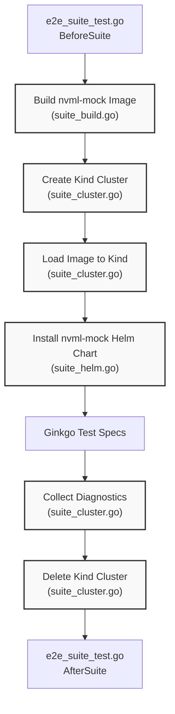

**Key Steps:**
1.  **Image Build**: The `suite_build.go` logic handles building the `nvml-mock` Docker image. This step can be skipped if `E2E_SKIP_BUILD=true` and `E2E_IMAGE` is provided, which is common in CI workflows where the image is pre-built and pushed to an ephemeral registry like `ttl.sh`. [tests/e2e/go/suite_build.go]()
2.  **Cluster Creation**: `make cluster-create` (invoked by the harness) creates a Kind cluster using a custom node image (`kind-node-nv:latest`) that includes the `nvidia-container-toolkit`. The cluster configuration is defined in `local/kind/*.kind.yaml`. [Makefile:136-137]()
3.  **Image Loading**: The built `nvml-mock` image is loaded into the Kind cluster nodes.
4.  **Helm Deployment**: The `nvml-mock` Helm chart is installed or upgraded using `h.Helm.UpgradeInstall()` [tests/e2e/go/suite_helm.go:44](). This deploys the mock NVML DaemonSet and related components.
5.  **Diagnostics**: On test failure, `collectOnFailure` (implemented in `suite_cluster.go`) gathers logs and other artifacts from the cluster for debugging. [tests/e2e/go/suite_cluster.go]()
6.  **Teardown**: By default, the Kind cluster is kept for post-test debugging. It can be explicitly deleted by setting `E2E_KEEP_CLUSTER=false` or by running `make cluster-delete`. [tests/e2e/README.md:56-57]()

Sources:
- [tests/e2e/go/e2e_suite_test.go]()
- [tests/e2e/go/suite_build.go]()
- [tests/e2e/go/suite_cluster.go]()
- [tests/e2e/go/suite_helm.go]()
- [tests/e2e/README.md:14-23]()
- [Makefile:136-137]()
- [.github/workflows/nvml-mock-e2e-go.yaml:72-73]()

### Parallel Test Execution

The E2E tests leverage Ginkgo's parallel execution capabilities. In CI, different GPU profiles are often run in parallel jobs.

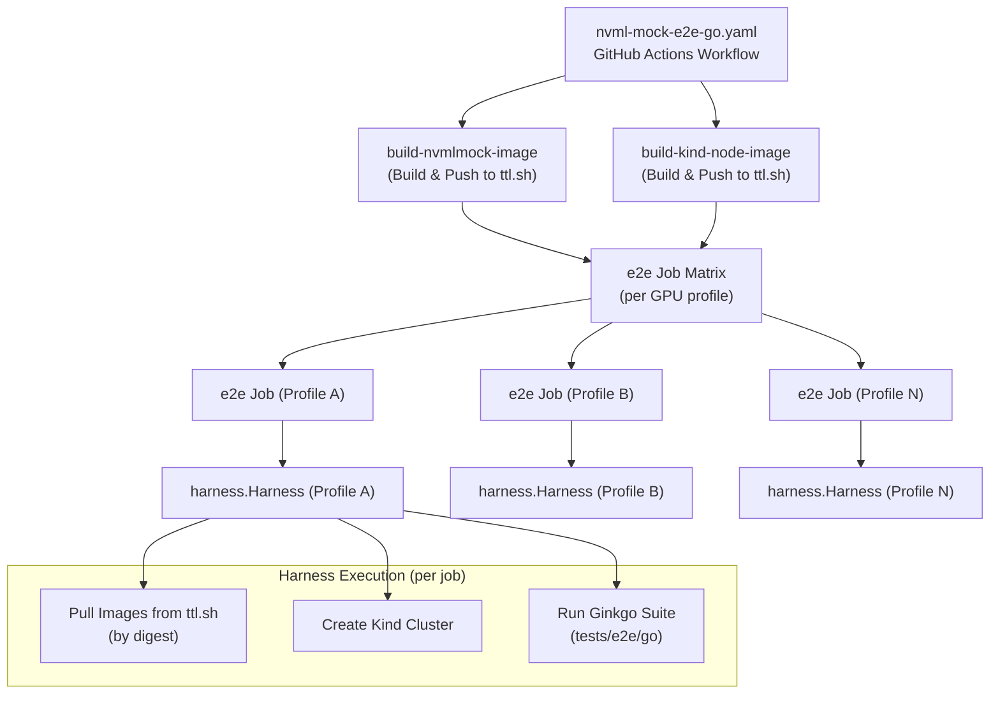

**CI Workflow (`.github/workflows/nvml-mock-e2e-go.yaml`):**
-   A `build-nvmlmock-image` job builds the `nvml-mock` Docker image once and pushes it to `ttl.sh`. The digest of this image is then passed to subsequent jobs. [tests/e2e/README.md:16-17]()
-   Similarly, a `build-kind-node-image` job builds the custom Kind node image and pushes it to `ttl.sh`.
-   The `e2e` job uses a matrix strategy to run tests for different GPU profiles (e.g., `a100`, `h100`, `gb200`) in parallel. [tests/e2e/README.md:76-79]()
-   Each parallel `e2e` job pulls the pre-built `nvml-mock` and `kind-node` images by digest from `ttl.sh`, tags them locally, and then proceeds with cluster creation and test execution. This avoids redundant image builds and ensures consistency across parallel runs. [tests/e2e/README.md:52-54]()

**Local Parallel Execution:**
-   Ginkgo supports local parallel execution using the `-p` flag (e.g., `ginkgo -p 4`).
-   The `Makefile` targets for E2E tests (`make e2e`, `make e2e-dra`, etc.) can be configured with `E2E_GINKGO_FLAGS` to pass parallelization options to Ginkgo. [Makefile:147-167]()

Sources:
- [.github/workflows/nvml-mock-e2e-go.yaml:76-146]()
- [tests/e2e/README.md:16-17]()
- [tests/e2e/README.md:52-54]()
- [tests/e2e/README.md:76-79]()
- [Makefile:147-167]()

---

## Kubernetes Test Utilities

### Certificate Generation Utilities

The framework provides utilities for generating self-signed certificates needed for testing secure Kubernetes components:

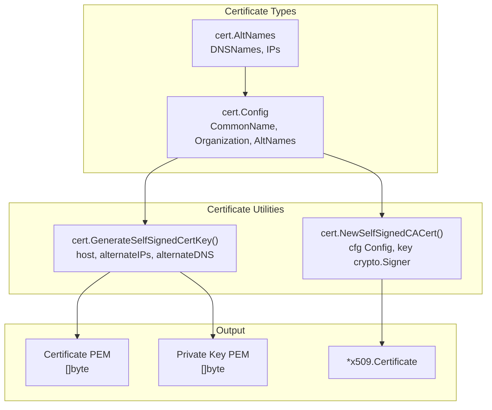

**Key Functions:**
- `GenerateSelfSignedCertKey(host string, alternateIPs []net.IP, alternateDNS []string)`: Creates self-signed cert and key
- `NewSelfSignedCACert(cfg Config, key crypto.Signer)`: Creates a CA certificate
- `GenerateSelfSignedCertKeyWithOptions(opts SelfSignedCertKeyOptions)`: Advanced options including fixtures

Sources:
- [vendor/k8s.io/client-go/util/cert/cert.go:42-93]()
- [vendor/k8s.io/client-go/util/cert/cert.go:117-268]()

### YAML and JSON Manifest Processing

The framework provides decoders for processing Kubernetes manifests:

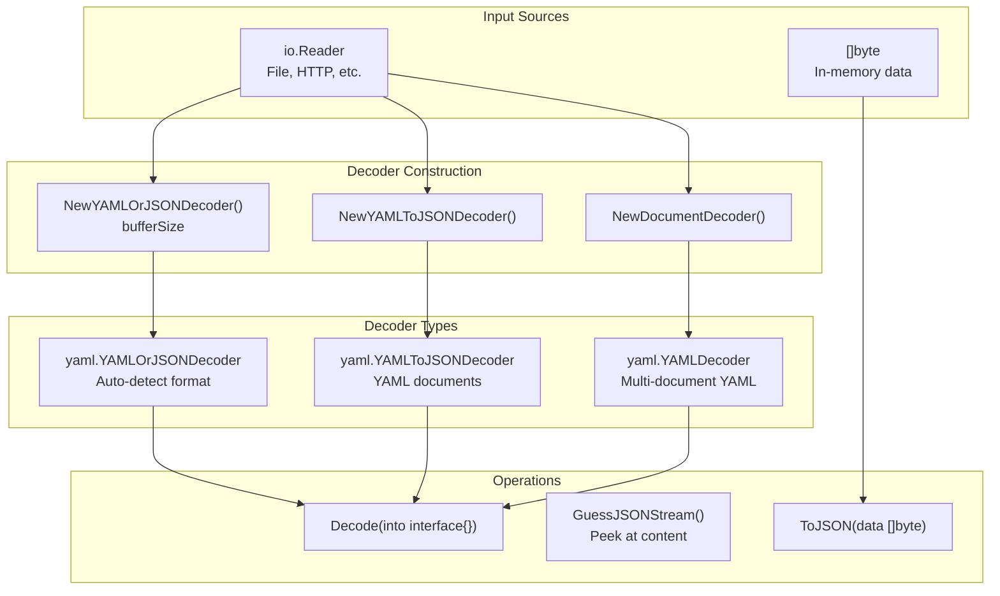

**Primary Decoder: YAMLOrJSONDecoder**

This decoder automatically detects whether input is JSON or YAML and handles both:
- Tries JSON first (faster)
- Falls back to YAML if JSON fails
- Handles multi-document streams with `---` separators

**Usage Pattern:**
```go
decoder := yaml.NewYAMLOrJSONDecoder(reader, bufferSize)
for {
    var obj unstructured.Unstructured
    if err := decoder.Decode(&obj); err != nil {
        if err == io.EOF {
            break
        }
        // handle error
    }
    // process obj
}
```

Sources:
- [vendor/k8s.io/apimachinery/pkg/util/yaml/decoder.go:240-358]()
- [vendor/k8s.io/apimachinery/pkg/util/yaml/decoder.go:106-139]()
- [vendor/k8s.io/apimachinery/pkg/util/yaml/decoder.go:158-205]()
- [vendor/k8s.io/apimachinery/pkg/util/yaml/decoder.go:92-101]()

---

## Integration Points

### GinkgoT Interface

`GinkgoT()` provides a `testing.TB`-compatible interface for third-party libraries:

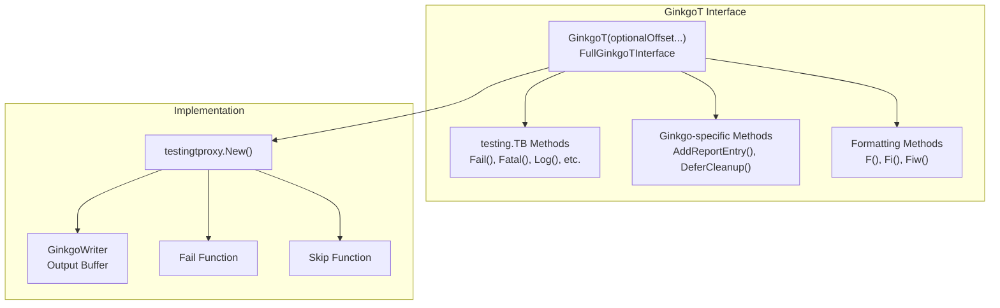

**Key Methods:**
- Standard `testing.TB`: `Fail()`, `FailNow()`, `Fatal()`, `Log()`, `Skip()`, etc.
- Ginkgo-specific: `AddReportEntry()`, `DeferCleanup()`, `RenderTimeline()`
- Formatting: `F()`, `Fi()` (with indentation), `Fiw()` (with word wrap)

Sources:
- [vendor/github.com/onsi/ginkgo/v2/dsl/ginkgo_t_dsl.go:27-108]()
- [vendor/github.com/onsi/ginkgo/v2/dsl/ginkgo_t_dsl.go:120-199]()

### Context and Timeouts

Interruptible nodes receive a `SpecContext`:

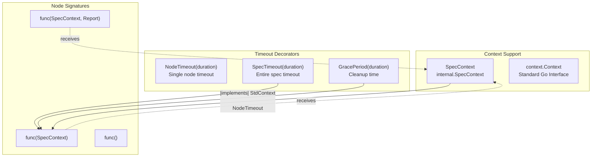

**Context Cancellation:**
- Ginkgo cancels `SpecContext` on timeout or interrupt
- Use `<-ctx.Done()` to detect cancellation
- Check `ctx.Err()` for cancellation reason

Sources:
- [vendor/github.com/onsi/ginkgo/v2/dsl/core_dsl.go:95-100]()
- [vendor/github.com/onsi/ginkgo/v2/internal/node.go:63-68]()
- [vendor/github.com/onsi/ginkgo/v2/internal/node.go:316-330]()

### Writer and Output Interception

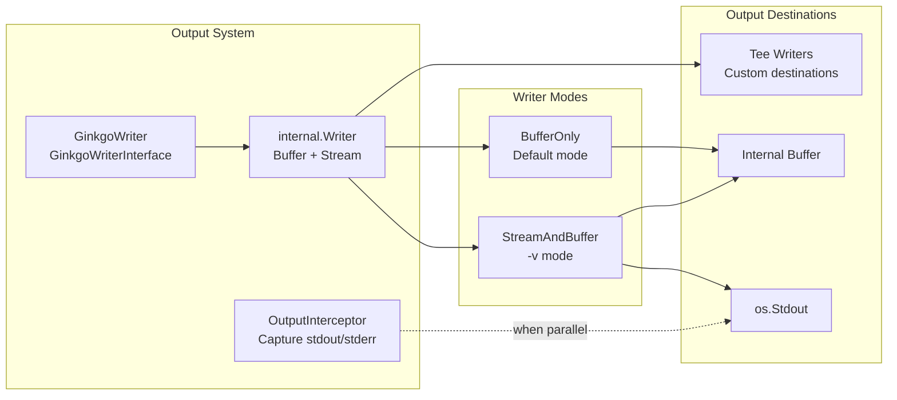

**Output Control:**
- `GinkgoWriter.Print()`, `Printf()`, `Println()`: Write to Ginkgo output
- `GinkgoWriter.TeeTo(writer)`: Add custom writer
- `PauseOutputInterception()` / `ResumeOutputInterception()`: Control interception

Sources:
- [vendor/github.com/onsi/ginkgo/v2/dsl/core_dsl.go:82-115]()
- [vendor/github.com/onsi/ginkgo/v2/dsl/core_dsl.go:217-230]()
- [vendor/github.com/onsi/ginkgo/v2/dsl/core_dsl.go:296-301]()

---

## Summary

The testing infrastructure is built on three pillars:

1.  **Ginkgo v2.32.0 Framework**: Provides BDD organization (`Describe`/`It`), lifecycle management (`BeforeEach`/`AfterEach`), and execution control (parallel support, timeouts)
2.  **Gomega v1.42.1 Assertion Library**: Supplies expressive matchers and asynchronous assertion capabilities (`Eventually`, `Consistently`)
3.  **E2E Harness**: Manages the full lifecycle of Kubernetes test clusters (Kind), image builds, Helm deployments, and diagnostics collection.
4.  **Kubernetes Test Utilities**: Offers specialized tooling for certificate generation and manifest processing via `k8s.io/client-go` utilities

The design emphasizes:
-   **Expressiveness**: BDD structure with clear test intent
-   **Flexibility**: Table-driven tests, decorators, custom reporters
-   **Integration**: Seamless interaction with Kubernetes APIs and third-party libraries
-   **Observability**: Rich reporting with timelines, progress tracking, and custom entries

Sources:
- [go.mod:1-16]()
- [vendor/github.com/onsi/ginkgo/v2/types/version.go:1-4]()
- [vendor/github.com/onsi/ginkgo/v2/internal/suite.go:1-96]()
- [vendor/github.com/onsi/ginkgo/v2/dsl/core_dsl.go:1-52]()
- [tests/e2e/go/framework/harness/harness.go]()

---

