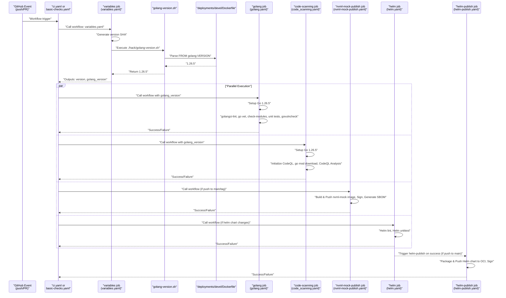
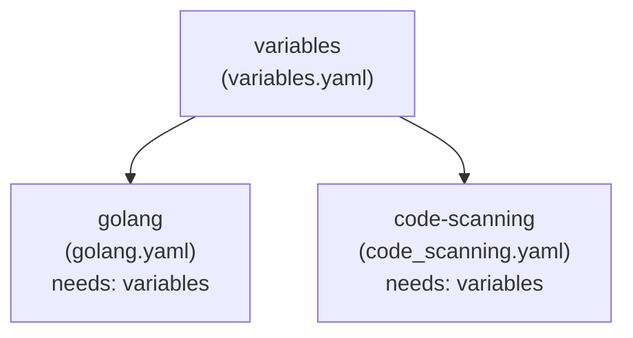

<!-- source: DeepWiki mcp.deepwiki.com · repo NVIDIA/k8s-test-infra · page 4 CI/CD Pipeline · fetched 2026-10-26 -->

# CI/CD Pipeline

<details>
<summary>Relevant source files</summary>

The following files were used as context for generating this wiki page:

- [.github/dependabot.yml](.github/dependabot.yml)
- [.github/workflows/basic-checks.yaml](.github/workflows/basic-checks.yaml)
- [.github/workflows/ci.yaml](.github/workflows/ci.yaml)
- [.github/workflows/code_scanning.yaml](.github/workflows/code_scanning.yaml)
- [.github/workflows/golang.yaml](.github/workflows/golang.yaml)
- [.github/workflows/helm-publish.yaml](.github/workflows/helm-publish.yaml)
- [.github/workflows/helm.yaml](.github/workflows/helm.yaml)
- [.github/workflows/nvml-mock-publish.yaml](.github/workflows/nvml-mock-publish.yaml)
- [.github/workflows/scorecard.yaml](.github/workflows/scorecard.yaml)
- [.github/workflows/variables.yaml](.github/workflows/variables.yaml)
- [deployments/devel/Dockerfile](deployments/devel/Dockerfile)

</details>


## Purpose and Scope

This document describes the automated Continuous Integration and Continuous Deployment (CI/CD) pipeline for the k8s-test-infra repository. The pipeline automates code quality checks, security scanning, and version management using GitHub Actions workflows. It employs a reusable workflow architecture where a central coordination job extracts build variables that are consumed by parallel execution jobs.

For detailed information on specific aspects of the pipeline:
- GitHub Actions workflow structure and job dependencies: see [GitHub Actions Workflows](#4.1)
- Automated testing and code quality enforcement: see [Automated Testing and Code Quality](#4.2)
- Go version management strategy: see [Version Management](#4.3)
- Automated dependency updates: see [Dependency Updates with Dependabot](#4.4)

---

## Pipeline Architecture

The CI/CD pipeline is organized as a hierarchy of reusable GitHub Actions workflows. The top-level workflows (`ci.yaml` and `basic-checks.yaml`) orchestrate execution by calling specialized workflows that perform specific tasks. This modular design allows workflows to be reused across different trigger conditions while maintaining consistent behavior.

### Workflow Hierarchy

```mermaid
graph TB
    subgraph "Entry Points"
        CI["ci.yaml<br/>Workflow<br/>(push events)"]
        BASIC["basic-checks.yaml<br/>Workflow<br/>(PR events)"]
    end
    
    subgraph "Coordination Layer"
        VARS["variables.yaml<br/>Job: variables<br/>Outputs: version, golang_version"]
    end
    
    subgraph "Execution Layer"
        GOLANG["golang.yaml<br/>Job: check<br/>Actions: lint, check-modules, unit-tests, govulncheck"]
        SCAN["code_scanning.yaml<br/>Job: analyze<br/>Actions: CodeQL"]
        SCORECARD["scorecard.yaml<br/>Job: analysis<br/>Actions: OpenSSF Scorecard"]
        NVML_MOCK_PUBLISH["nvml-mock-publish.yaml<br/>Job: publish<br/>Actions: Build & Push nvml-mock image"]
        HELM_CI["helm.yaml<br/>Job: lint, unittest<br/>Actions: Helm lint & unittest"]
        HELM_PUBLISH["helm-publish.yaml<br/>Job: publish<br/>Actions: Push Helm chart to OCI"]
    end
    
    subgraph "External Resources"
        DOCKERFILE["deployments/devel/Dockerfile<br/>FROM golang:1.26.5"]
        SCRIPT["hack/golang-version.sh<br/>Extract version from Dockerfile"]
    end
    
    CI --> BASIC
    BASIC --> VARS
    VARS --> GOLANG
    VARS --> SCAN
    VARS --> NVML_MOCK_PUBLISH
    VARS --> HELM_CI
    HELM_CI --on success--> HELM_PUBLISH
    
    VARS -.->|"Executes"| SCRIPT
    SCRIPT -.->|"Reads"| DOCKERFILE
    
    VARS -.->|"golang_version input"| GOLANG
    VARS -.->|"golang_version input"| SCAN
    
    style SCORECARD fill:#fff,stroke:#333,stroke-width:2px,stroke-dasharray: 5 5
    SCORECARD -.->|"Scheduled/Push to main"| SCORECARD
```

**Sources:** [.github/workflows/ci.yaml:1-26](), [.github/workflows/basic-checks.yaml:1-50](), [.github/workflows/variables.yaml:1-45](), [.github/workflows/golang.yaml:1-87](), [.github/workflows/code_scanning.yaml:1-54](), [.github/workflows/scorecard.yaml:1-39](), [.github/workflows/nvml-mock-publish.yaml:1-100](), [.github/workflows/helm.yaml:1-59](), [.github/workflows/helm-publish.yaml:1-95](), [deployments/devel/Dockerfile:1-18]()

---

## Reusable Workflow Pattern

The pipeline implements GitHub Actions' `workflow_call` pattern, which allows workflows to be invoked as reusable components. This pattern provides type-safe parameter passing and output propagation between workflows.

### Variables Workflow

The `variables` job serves as the coordination point for the entire pipeline. It computes two critical outputs that are consumed by downstream jobs:

| Output | Description | Source | Usage |
|--------|-------------|--------|-------|
| `version` | 8-character Git commit SHA | `GITHUB_SHA` environment variable | Version tagging for artifacts |
| `golang_version` | Go toolchain version | [deployments/devel/Dockerfile:17]() via [hack/golang-version.sh]() | CI environment configuration |

The workflow definition declares these outputs using the `workflow_call.outputs` section:

[.github/workflows/variables.yaml:21-28]()

The `variables` job implementation extracts these values:

[.github/workflows/variables.yaml:31-49]()

The `golang-version.sh` script parses the Dockerfile to extract the Go version:

[hack/golang-version.sh:16-22]()

This script uses `grep` to find the `FROM golang:` directive and extract the version number using regular expressions. The single source of truth for the Go version is maintained in [deployments/devel/Dockerfile:17](), which defines `FROM golang:1.26.5`.

**Sources:** [.github/workflows/variables.yaml:1-49](), [hack/golang-version.sh:1-23](), [deployments/devel/Dockerfile:1-18]()

---

## Pipeline Entry Points

The pipeline has two entry points that trigger on different GitHub events:

### CI Pipeline Workflow

The `ci.yaml` workflow triggers on push events to specific branches:

[.github/workflows/ci.yaml:23-28]()

This workflow immediately delegates to `basic-checks.yaml`:

[.github/workflows/ci.yaml:30-32]()

### Basic Checks Workflow

The `basic-checks.yaml` workflow serves as both:
1. A direct entry point triggered by pull request events
2. A reusable workflow called by `ci.yaml`

[.github/workflows/basic-checks.yaml:16-38]()

The workflow supports `workflow_call` to allow invocation by other workflows while also responding to pull request events directly:

[.github/workflows/basic-checks.yaml:23-30]()

**Sources:** [.github/workflows/ci.yaml:1-37](), [.github/workflows/basic-checks.yaml:1-50]()

---

## Job Execution Flow

The pipeline executes jobs in a coordinated sequence with explicit dependencies. The `variables` job must complete before parallel execution jobs can begin, ensuring all jobs use consistent build parameters.



**Sources:** [.github/workflows/basic-checks.yaml:33-49](), [.github/workflows/variables.yaml:25-49](), [.github/workflows/golang.yaml:24-87](), [.github/workflows/code_scanning.yaml:23-52](), [.github/workflows/nvml-mock-publish.yaml:1-100](), [.github/workflows/helm.yaml:1-59](), [.github/workflows/helm-publish.yaml:1-95]()

---

## Workflow Trigger Conditions

The pipeline responds to different GitHub events depending on the workflow entry point:

| Workflow | Trigger Events | Branch Filters | Description |
|----------|---------------|----------------|-------------|
| `ci.yaml` | `push` | `main`, `release-*`, `pull-request/[0-9]+` | Runs on pushes to main, release branches, and PR merge branches |
| `basic-checks.yaml` (direct) | `pull_request` (`opened`, `synchronize`) | `main`, `release-*` | Runs when PRs are opened or updated against main or release branches |
| `basic-checks.yaml` (called) | `workflow_call` | N/A | Invoked by `ci.yaml` or other workflows |
| `nvml-mock-publish.yaml` | `push`, `workflow_dispatch` | `main`, `v*` tags | Publishes `nvml-mock` image on pushes to main, version tags, or manual trigger |
| `helm.yaml` | `pull_request`, `push` | `main` (paths: `deployments/nvml-mock/helm/**`) | Runs Helm lint/unittest on PRs/pushes affecting Helm chart |
| `helm-publish.yaml` | `workflow_run` (`helm.yaml` completed) | `main` | Publishes Helm chart to OCI registry after successful `helm.yaml` run on `main` |
| `scorecard.yaml` | `schedule`, `push`, `workflow_dispatch` | `main` | Runs OpenSSF Scorecard weekly, on pushes to main, or manual trigger |

The `pull-request/[0-9]+` branch pattern in `ci.yaml` matches GitHub's merge queue branches, allowing the pipeline to run on proposed merge commits before they reach the main branch.

**Sources:** [.github/workflows/ci.yaml:16-28](), [.github/workflows/basic-checks.yaml:16-38](), [.github/workflows/nvml-mock-publish.yaml:1-19](), [.github/workflows/helm.yaml:1-13](), [.github/workflows/helm-publish.yaml:1-12](), [.github/workflows/scorecard.yaml:1-13]()

---

## Golang Workflow Execution

The `golang.yaml` workflow performs code quality checks using the Go toolchain. It receives the `golang_version` as an input parameter:

[.github/workflows/golang.yaml:24-26]()

The workflow executes several primary checks:

### 1. Environment Setup

[.github/workflows/golang.yaml:29-37]()

The workflow checks out the repository and installs Go using the version extracted by the `variables` job.

### 2. Linting

[.github/workflows/golang.yaml:39-44]()

The linting step uses `golangci-lint-action@v9` with the following configuration:
- `version: latest` - Always uses the most recent golangci-lint version
- `args: -v --timeout 5m` - Verbose output with 5-minute timeout
- `skip-cache: true` - Disables caching for reproducible results

### 3. Go Vet

[.github/workflows/golang.yaml:46-62]()

A bare `go vet ./...` command is run to catch issues that `golangci-lint` might suppress or under-report. This ensures strict enforcement of Go's static analysis.

### 4. Module Verification

[.github/workflows/golang.yaml:64-67]()

The `make check-modules` target verifies that Go module files (`go.mod`, `go.sum`) are consistent with the vendored dependencies. This ensures reproducible builds.

### 5. Unit Tests

[.github/workflows/golang.yaml:69-72]()

Unit tests are executed with `go test -v -race -coverprofile=coverage.out -covermode=atomic $(go list ./... | grep -v vendor)`. This includes race detection and coverage reporting.

### 6. Mockpcisysfs Integration Tests

[.github/workflows/golang.yaml:74-81]()

Specific integration tests for the `mockpcisysfs` shim are run with the `integration` build tag after building the shim.

### 7. Go Vulnerability Check

[.github/workflows/golang.yaml:83-87]()

The `govulncheck` tool is installed and run across the entire codebase to identify known vulnerabilities in Go modules.

**Sources:** [.github/workflows/golang.yaml:1-87]()

---

## CodeQL Security Scanning

The `code_scanning.yaml` workflow performs security analysis using GitHub's CodeQL engine. It runs in parallel with the `golang` job:

[.github/workflows/code_scanning.yaml:20-24]()

### Analysis Configuration

The workflow has elevated permissions to write security events:

[.github/workflows/code_scanning.yaml:29-31]()

### Execution Steps

The CodeQL analysis follows this sequence:

[.github/workflows/code_scanning.yaml:33-52]()

Key steps:
1. **Repository checkout** - Retrieves source code
2. **Go installation** - Uses the extracted `golang_version`
3. **CodeQL initialization** - Configures for Go language analysis
4. **Dependency fetch** - Downloads Go modules with `go mod download`
5. **CodeQL analysis** - Performs static analysis and uploads results

The `category: "/language:go"` parameter categorizes results in GitHub's Security tab for filtering and organization.

**Sources:** [.github/workflows/code_scanning.yaml:1-54]()

---

## OpenSSF Scorecard

The `scorecard.yaml` workflow runs the OpenSSF Scorecard tool to assess the project's security health.

[.github/workflows/scorecard.yaml:1-39]()

### Trigger Conditions

This workflow is triggered weekly on Monday, on pushes to the `main` branch, or manually via `workflow_dispatch`:

[.github/workflows/scorecard.yaml:6-11]()

### Execution Steps

The workflow checks out the repository and runs the Scorecard action:

[.github/workflows/scorecard.yaml:23-33]()

The results are saved as a SARIF file and then uploaded to GitHub Security tab for review:

[.github/workflows/scorecard.yaml:35-39]()

**Sources:** [.github/workflows/scorecard.yaml:1-39]()

---

## nvml-mock Image Publishing

The `nvml-mock-publish.yaml` workflow is responsible for building and publishing the `nvml-mock` Docker image to `ghcr.io`.

[.github/workflows/nvml-mock-publish.yaml:1-100]()

### Trigger Conditions

This workflow triggers on pushes to the `main` branch, on `v*` tags, or manually via `workflow_dispatch`:

[.github/workflows/nvml-mock-publish.yaml:13-19]()

### Publishing Steps

The `publish` job performs the following:
1. **Checkout code**
2. **Set up QEMU and Buildx** for multi-platform builds
3. **Log in to GHCR**
4. **Extract metadata** to generate image tags (e.g., `latest`, `v0.1.0`, `sha-xxxxxxx`)
5. **Build and push** the image from [deployments/nvml-mock/Dockerfile]() for `linux/amd64` and `linux/arm64` platforms
6. **Sign the container image** using Cosign
7. **Generate and attach SBOM** (Software Bill of Materials) to the image

**Sources:** [.github/workflows/nvml-mock-publish.yaml:1-100]()

---

## Helm Chart CI/CD

The Helm chart for `nvml-mock` has its own dedicated CI/CD workflows: `helm.yaml` for CI and `helm-publish.yaml` for CD.

### Helm CI (`helm.yaml`)

This workflow performs linting and unit testing for the Helm chart.

[.github/workflows/helm.yaml:1-59]()

#### Trigger Conditions

It triggers on pull requests and pushes to `main` only when changes are detected within the `deployments/nvml-mock/helm/**` path:

[.github/workflows/helm.yaml:5-13]()

#### Checks

The `lint` job uses `chart-testing-action` to lint the Helm chart:

[.github/workflows/helm.yaml:26-42]()

The `unittest` job installs `helm-unittest` plugin and runs unit tests defined for the chart:

[.github/workflows/helm.yaml:44-59]()

### Helm Publish (`helm-publish.yaml`)

This workflow publishes the Helm chart to the OCI registry on `ghcr.io`.

[.github/workflows/helm-publish.yaml:1-95]()

#### Trigger Conditions

This workflow is triggered only after the `helm.yaml` workflow completes successfully on the `main` branch:

[.github/workflows/helm-publish.yaml:8-12]()

#### Publishing Steps

The `publish` job performs:
1. **Checkout repository** at the specific SHA of the triggering workflow run
2. **Set up Helm**
3. **Read chart version** from `Chart.yaml`
4. **Log in to GHCR**
5. **Package the chart**
6. **Push the chart to OCI registry** with retry logic for intermittent failures
7. **Install Cosign**
8. **Log in to GHCR for Cosign** (separate login required for Cosign)
9. **Sign the OCI artifact**

**Sources:** [.github/workflows/helm.yaml:1-59](), [.github/workflows/helm-publish.yaml:1-95]()

---

## Job Dependencies

The `basic-checks.yaml` workflow explicitly declares job dependencies using the `needs` keyword:

[.github/workflows/basic-checks.yaml:40-50]()

This configuration creates the following dependency graph:



The `needs` declarations ensure:
1. The `variables` job completes before `golang` or `code-scanning` begin
2. Outputs from `variables` are available to dependent jobs via `needs.variables.outputs.golang_version`
3. If `variables` fails, dependent jobs are skipped

**Sources:** [.github/workflows/basic-checks.yaml:40-50]()

---

## Integration with Copy-PR Bot

The repository enables NVIDIA's copy-PR bot, which automatically creates internal mirrors of pull requests:

[.github/copy-pr-bot.yaml:1-3]()

This bot runs separately from the CI/CD pipeline but coordinates with it by monitoring PR status checks. The bot configuration is minimal, with the `enabled: true` flag activating automatic PR mirroring.

**Sources:** [.github/copy-pr-bot.yaml:1-3]()

---

## Pipeline Outputs

The pipeline produces the following outputs that can be consumed by dependent workflows:

| Output | Source Job | Description | Access Pattern |
|--------|-----------|-------------|----------------|
| `version` | `variables` | 8-character commit SHA | `${{ jobs.variables.outputs.version }}` |
| `golang_version` | `variables` | Go toolchain version | `${{ jobs.variables.outputs.golang_version }}` |

These outputs are declared at the workflow level in `basic-checks.yaml`:

[.github/workflows/basic-checks.yaml:23-30]()

This allows external workflows to call `basic-checks.yaml` and access these values for use in subsequent build or deployment steps.

**Sources:** [.github/workflows/basic-checks.yaml:23-30](), [.github/workflows/variables.yaml:21-28]()

---

