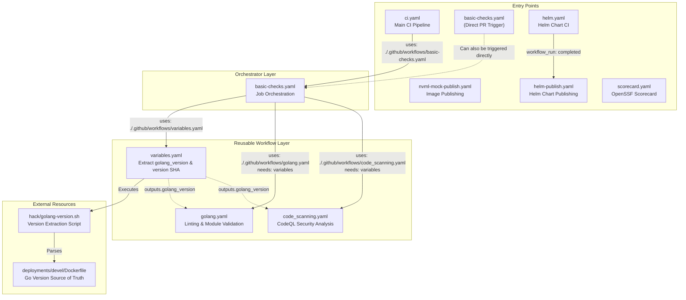
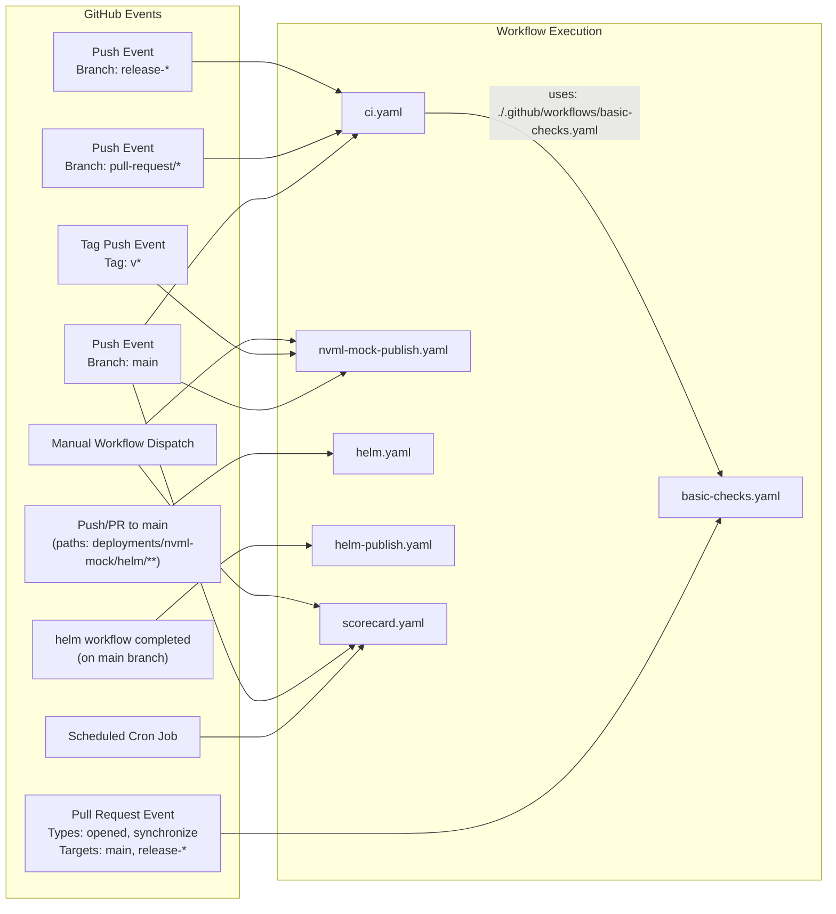
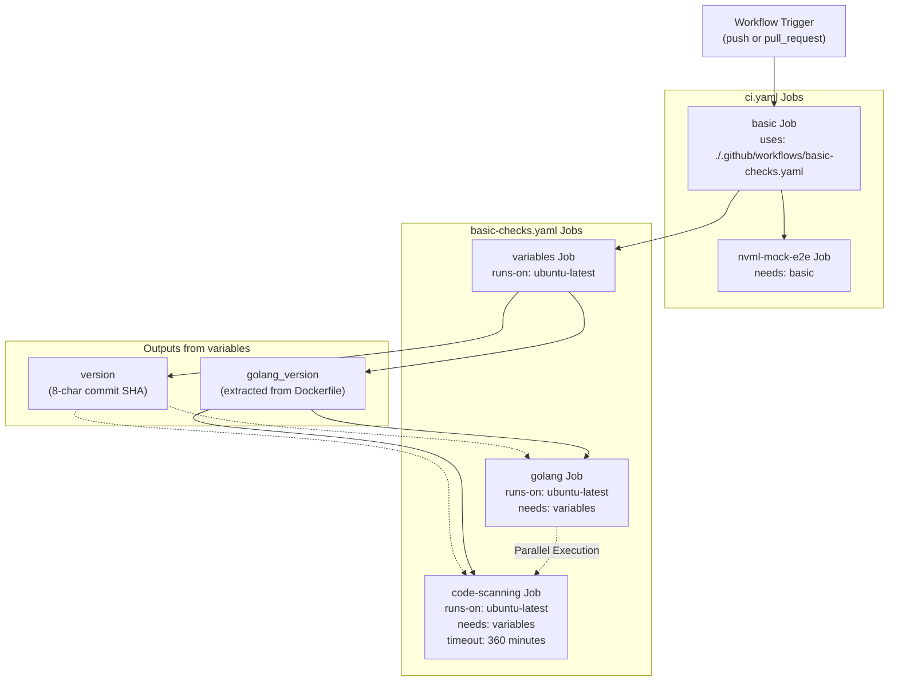
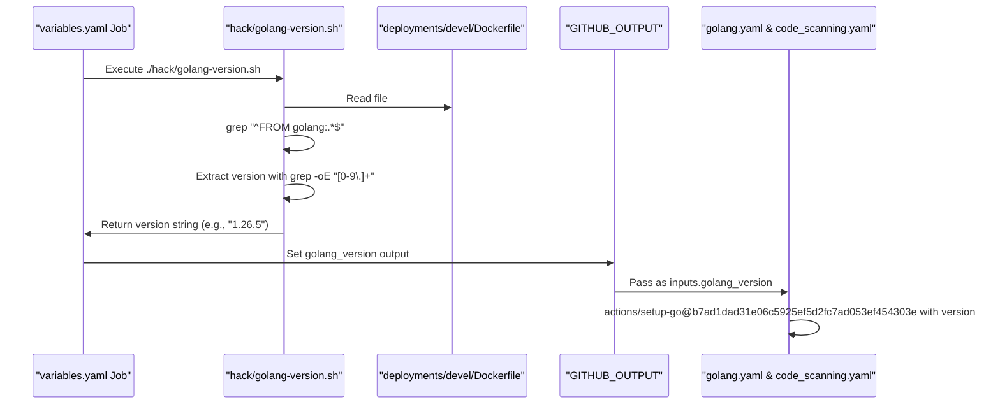
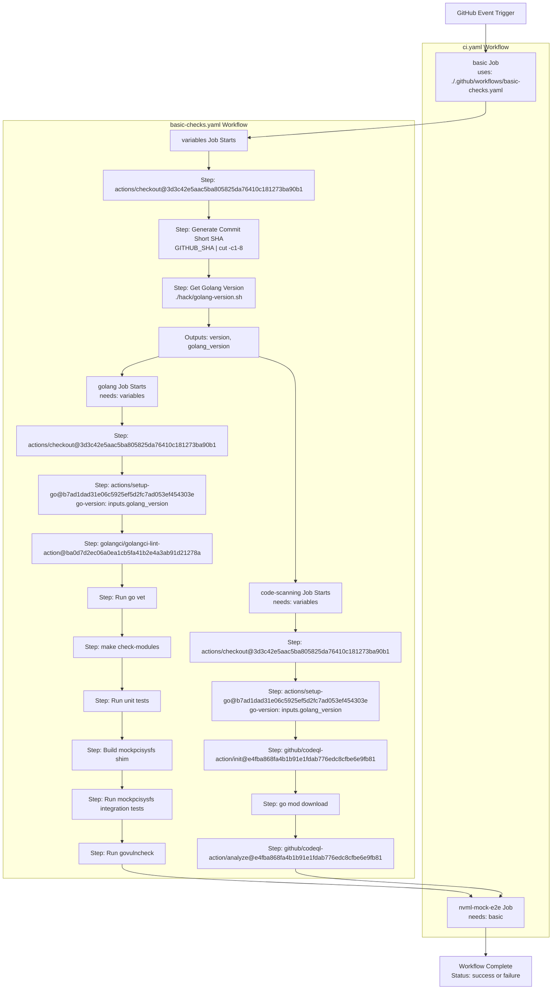

<!-- source: DeepWiki mcp.deepwiki.com · repo NVIDIA/k8s-test-infra · page 4.1 GitHub Actions Workflows · fetched 2026-10-26 -->

# GitHub Actions Workflows

<details>
<summary>Relevant source files</summary>

The following files were used as context for generating this wiki page:

- [.github/ISSUE_TEMPLATE/bug_report.yml](.github/ISSUE_TEMPLATE/bug_report.yml)
- [.github/ISSUE_TEMPLATE/config.yml](.github/ISSUE_TEMPLATE/config.yml)
- [.github/ISSUE_TEMPLATE/documentation.yml](.github/ISSUE_TEMPLATE/documentation.yml)
- [.github/ISSUE_TEMPLATE/feature_request.yml](.github/ISSUE_TEMPLATE/feature_request.yml)
- [.github/dependabot.yml](.github/dependabot.yml)
- [.github/workflows/basic-checks.yaml](.github/workflows/basic-checks.yaml)
- [.github/workflows/ci.yaml](.github/workflows/ci.yaml)
- [.github/workflows/code_scanning.yaml](.github/workflows/code_scanning.yaml)
- [.github/workflows/golang.yaml](.github/workflows/golang.yaml)
- [.github/workflows/helm-publish.yaml](.github/workflows/helm-publish.yaml)
- [.github/workflows/helm.yaml](.github/workflows/helm.yaml)
- [.github/workflows/nvml-mock-publish.yaml](.github/workflows/nvml-mock-publish.yaml)
- [.github/workflows/scorecard.yaml](.github/workflows/scorecard.yaml)
- [.github/workflows/stale.yaml](.github/workflows/stale.yaml)
- [.github/workflows/variables.yaml](.github/workflows/variables.yaml)
- [deployments/devel/Dockerfile](deployments/devel/Dockerfile)

</details>


## Purpose and Scope

This document describes the GitHub Actions CI/CD workflows that automate code quality checks, linting, security scanning, and version management for the k8s-test-infra repository. The workflows use a modular, reusable pattern where a main orchestrator workflow calls specialized sub-workflows to perform distinct tasks.

For information about automated testing execution within CI, see [Automated Testing and Code Quality](#4.2). For details on how Go version consistency is maintained, see [Version Management](#4.3). For dependency update automation, see [Dependency Updates with Dependabot](#4.4).

---

## Workflow Architecture

The repository uses a **hierarchical workflow composition pattern** with three layers:

| Layer | Purpose | Workflow Files |
|-------|---------|----------------|
| **Entry Point** | Triggered by repository events (push, PR) | `ci.yaml`, `nvml-mock-publish.yaml`, `helm.yaml`, `helm-publish.yaml`, `scorecard.yaml` |
| **Orchestrator** | Coordinates multiple parallel jobs | `basic-checks.yaml` |
| **Reusable Jobs** | Performs specific tasks, called by orchestrators | `variables.yaml`, `golang.yaml`, `code_scanning.yaml` |

This pattern promotes **workflow reusability** and **separation of concerns**. Each reusable workflow accepts inputs and produces outputs, enabling them to be called from multiple parent workflows.

**Workflow Composition Diagram**



**Sources:** [.github/workflows/ci.yaml:1-26](), [.github/workflows/basic-checks.yaml:1-50](), [.github/workflows/variables.yaml:1-45](), [.github/workflows/golang.yaml:1-46](), [.github/workflows/code_scanning.yaml:1-52](), [.github/workflows/nvml-mock-publish.yaml:1-19](), [.github/workflows/helm.yaml:1-13](), [.github/workflows/helm-publish.yaml:1-11](), [.github/workflows/scorecard.yaml:1-12]()

---

## Trigger Conditions

The workflows respond to different GitHub events based on their role:

### ci.yaml (Main CI Pipeline)

Triggers on **push events** to specific branches:

- `pull-request/[0-9]+` - Pull request branches created by the copy-pr-bot
- `main` - Main development branch
- `release-*` - Release branches

[.github/workflows/ci.yaml:23-28]()

### basic-checks.yaml (Direct PR Trigger)

Can be triggered in two ways:

1. **Called by ci.yaml** via `workflow_call` (from push events)
2. **Direct PR events** - `opened` and `synchronize` types on `main` and `release-*` branches

[.github/workflows/basic-checks.yaml:23-38]()

This dual-trigger design ensures that:
- Pull requests get immediate feedback on code quality checks
- Push events to protected branches run the same validation

### nvml-mock-publish.yaml (Image Publishing)

Triggers on:
- **Push to `main` branch**
- **Tag pushes** matching `v*` (e.g., `v0.1.0`)
- **Manual `workflow_dispatch`** for re-running at any ref.

[.github/workflows/nvml-mock-publish.yaml:12-19]()
Note that `paths` filters are intentionally omitted for tag pushes to avoid silently suppressing runs.

### helm.yaml (Helm Chart CI)

Triggers on:
- **Pull requests** to `main` branch, specifically when changes occur in `deployments/nvml-mock/helm/**`
- **Pushes** to `main` branch, specifically when changes occur in `deployments/nvml-mock/helm/**`

[.github/workflows/helm.yaml:5-13]()

### helm-publish.yaml (Helm Chart Publishing)

Triggers on `workflow_run` event:
- When the `helm` workflow completes successfully (`conclusion == 'success'`)
- On the `main` branch (`head_branch == 'main'`)

[.github/workflows/helm-publish.yaml:8-11](), [.github/workflows/helm-publish.yaml:21]()

### scorecard.yaml (OpenSSF Scorecard)

Triggers on:
- **Scheduled cron job**: Every Monday at 06:00 UTC
- **Push to `main` branch**
- **Manual `workflow_dispatch`**

[.github/workflows/scorecard.yaml:7-12]()

**Trigger Flow Diagram**



**Sources:** [.github/workflows/ci.yaml:23-28](), [.github/workflows/basic-checks.yaml:23-38](), [.github/workflows/nvml-mock-publish.yaml:12-19](), [.github/workflows/helm.yaml:5-13](), [.github/workflows/helm-publish.yaml:8-11](), [.github/workflows/helm-publish.yaml:21](), [.github/workflows/scorecard.yaml:7-12]()

---

## Job Orchestration and Dependencies

The `basic-checks.yaml` orchestrator defines three jobs with explicit dependency relationships:

| Job Name | Dependencies | Purpose |
|----------|-------------|---------|
| `variables` | None | Extract `golang_version` and `version` SHA |
| `golang` | `variables` | Run linting and module validation with correct Go version |
| `code-scanning` | `variables` | Run CodeQL security analysis with correct Go version |

The `needs` keyword creates a **dependency graph** that ensures:
1. `variables` job completes first
2. `golang` and `code-scanning` run in parallel after `variables` succeeds
3. Both dependent jobs receive outputs from `variables` job

The `ci.yaml` workflow also orchestrates the `nvml-mock-e2e` job, which depends on the `basic` job.

**Job Dependency Graph**



**Sources:** [.github/workflows/basic-checks.yaml:39-50](), [.github/workflows/ci.yaml:30-37]()

---

## Reusable Workflows

The repository uses GitHub Actions' `workflow_call` trigger to create reusable workflows. This pattern allows workflows to be called as if they were actions, promoting code reuse and maintainability.

### Pattern Structure

Each reusable workflow follows this structure:

```yaml
on:
  workflow_call:
    inputs:
      input_name:
        required: true
        type: string
    outputs:
      output_name:
        description: "Output description"
        value: ${{ jobs.job_name.outputs.output_name }}
```

### Calling Reusable Workflows

Parent workflows call reusable workflows using the `uses` keyword:

```yaml
jobs:
  job-name:
    uses: ./.github/workflows/reusable-workflow.yaml
    with:
      input_name: ${{ needs.other-job.outputs.value }}
```

[.github/workflows/basic-checks.yaml:40-49]()

### Benefits of This Pattern

| Benefit | Description |
|---------|-------------|
| **Single Responsibility** | Each workflow performs one focused task |
| **Testability** | Reusable workflows can be tested independently |
| **Maintainability** | Changes to a task only require updating one workflow |
| **Composability** | Different orchestrators can combine workflows as needed |

**Sources:** [.github/workflows/variables.yaml:20-29](), [.github/workflows/golang.yaml:21-27](), [.github/workflows/code_scanning.yaml:20-26]()

---

## Workflow Details

### variables.yaml - Variable Extraction

**Purpose:** Extract project metadata for use in subsequent jobs.

**Inputs:** None (uses `workflow_call` trigger)

**Outputs:**
- `version` - 8-character short SHA from `$GITHUB_SHA`
- `golang_version` - Go version extracted from Dockerfile

**Job Steps:**

| Step | Action | Purpose |
|------|--------|---------|
| 1. Check out code | `actions/checkout@3d3c42e5aac5ba805825da76410c181273ba90b1` | Clone repository to runner |
| 2. Generate Commit Short SHA | Shell command | Extract first 8 chars of commit SHA |
| 3. Get Golang Version | `./hack/golang-version.sh` | Parse Go version from Dockerfile |

**Implementation Details:**

The version extraction uses shell command substitution:
```bash
echo "version=$(echo $GITHUB_SHA | cut -c1-8)" >> "$GITHUB_OUTPUT"
```
[.github/workflows/variables.yaml:40-41]()

The Go version extraction delegates to a bash script that parses the Dockerfile:
```bash
GOLANG_VERSION=$(./hack/golang-version.sh)
echo "Detected $GOLANG_VERSION"
echo "golang_version=${GOLANG_VERSION}" >> $GITHUB_OUTPUT
```
[.github/workflows/variables.yaml:44-47]()

**Sources:** [.github/workflows/variables.yaml:1-50]()

---

### golang.yaml - Go Linting and Module Validation

**Purpose:** Enforce code quality standards through linting and verify module consistency.

**Inputs:**
- `golang_version` (required, string) - Go version to use for checks

**Outputs:** None

**Job Steps:**

| Step | Action | Configuration |
|------|--------|---------------|
| 1. Checkout code | `actions/checkout@3d3c42e5aac5ba805825da76410c181273ba90b1` | Standard checkout |
| 2. Install Go | `actions/setup-go@b7ad1dad31e06c5925ef5d2fc7ad053ef454303e` | Version from `inputs.golang_version` |
| 3. Lint | `golangci/golangci-lint-action@ba0d7d2ec06a0ea1cb5fa41b2e4a3ab91d21278a` | Latest version, 5-minute timeout, no cache |
| 4. Run go vet | `go vet ./...` | Comprehensive static analysis, not suppressed by `//nolint` |
| 5. Check golang modules | `make check-modules` | Verifies module consistency |
| 6. Run unit tests | `go test -v -race -coverprofile=coverage.out -covermode=atomic $(go list ./... | grep -v vendor)` | Executes all unit tests |
| 7. Build mockpcisysfs shim | `make -C pkg/system/mockpcisysfs` | Builds the `libpcimocksys.so` shim |
| 8. Run mockpcisysfs integration tests | `go test -tags integration -v ./pkg/system/mockpcisysfs/...` | Runs integration tests for the shim |
| 9. Run govulncheck | `go install golang.org/x/vuln/cmd/govulncheck@latest; govulncheck ./...` | Checks for known vulnerabilities |

**Linting Configuration:**

The workflow uses `golangci-lint` with these parameters:
- `version: latest` - Always use the most recent linter version
- `args: -v --timeout 5m` - Verbose output with 5-minute timeout
- `skip-cache: true` - Disable caching for consistent results

[.github/workflows/golang.yaml:41-43]()

**`go vet` Details:**
The `go vet ./...` step is explicitly included to catch issues that `golangci-lint` might miss or suppress. It runs `govet` across all packages without exclusions, ensuring a strict check for common programming errors.
[.github/workflows/golang.yaml:47-63]()

**Module Validation:**

The `make check-modules` target ensures that:
- `go.mod` and `go.sum` are up to date
- No untracked module changes exist

[.github/workflows/golang.yaml:65-67]()

**Sources:** [.github/workflows/golang.yaml:1-88]()

---

### code_scanning.yaml - CodeQL Security Analysis

**Purpose:** Perform static security analysis using GitHub CodeQL.

**Inputs:**
- `golang_version` (required, string) - Go version for dependency resolution

**Outputs:** None (results uploaded to GitHub Security tab)

**Permissions Required:**

```yaml
permissions:
  security-events: write # Upload CodeQL results
  packages: read         # Access private packages if needed
```
[.github/workflows/code_scanning.yaml:30-33]()

**Job Configuration:**

- `runs-on: ubuntu-latest`
- `timeout-minutes: 360` (6-hour timeout for large codebases)

**Job Steps:**

| Step | Action | Purpose |
|------|--------|---------|
| 1. Checkout repository | `actions/checkout@3d3c42e5aac5ba805825da76410c181273ba90b1` | Clone code for analysis |
| 2. Install Go | `actions/setup-go@b7ad1dad31e06c5925ef5d2fc7ad053ef454303e` | Set up Go environment |
| 3. Initialize CodeQL | `github/codeql-action/init@e4fba868fa4b1b91e1fdab776edc8cfbe6e9fb81` | Configure CodeQL for Go language |
| 4. Fetch Dependencies | `go mod download` | Download modules for analysis |
| 5. Perform CodeQL Analysis | `github/codeql-action/analyze@e4fba868fa4b1b91e1fdab776edc8cfbe6e9fb81` | Run security queries |

**CodeQL Configuration:**

The analysis targets the Go language specifically:
- `languages: go` - Analyze Go source code
- `category: "/language:go"` - Categorize results

[.github/workflows/code_scanning.yaml:45-51]()

Results are automatically uploaded to the GitHub Security tab and can trigger security alerts.

**Sources:** [.github/workflows/code_scanning.yaml:1-52]()

---

### nvml-mock-publish.yaml - nvml-mock Image Publishing

**Purpose:** Build and publish multi-architecture Docker images for `nvml-mock` to `ghcr.io`.

**Inputs:** None

**Outputs:** None

**Permissions Required:**

```yaml
permissions:
  contents: read
  packages: write
  id-token: write # needed for keyless cosign signing
```
[.github/workflows/nvml-mock-publish.yaml:28-30]()

**Environment Variables:**
- `REGISTRY`: `ghcr.io`
- `IMAGE_NAME`: `nvidia/nvml-mock`

[.github/workflows/nvml-mock-publish.yaml:20-21]()

**Job Steps:**

| Step | Action | Purpose |
|------|--------|---------|
| 1. Checkout | `actions/checkout@3d3c42e5aac5ba805825da76410c181273ba90b1` | Clone repository |
| 2. Set up QEMU | `docker/setup-qemu-action@96fe6ef7f33517b61c61be40b68a1882f3264fb8` | Enable multi-architecture builds |
| 3. Set up Docker Buildx | `docker/setup-buildx-action@bb05f3f5519dd87d3ba754cc423b652a5edd6d2c` | Configure Docker Buildx |
| 4. Log in to GHCR | `docker/login-action@abd2ef45e78c5afb21d64d4ca52ee8550d9572c7` | Authenticate to GitHub Container Registry |
| 5. Extract metadata | `docker/metadata-action@dc802804100637a589fabce1cb79ff13a1411302` | Generate image tags (latest, semver, SHA) |
| 6. Build and push | `docker/build-push-action@53b7df96c91f9c12dcc8a07bcb9ccacbed38856a` | Build and push `deployments/nvml-mock/Dockerfile` for `linux/amd64`, `linux/arm64` |
| 7. Install cosign | `sigstore/cosign-installer@6f9f17788090df1f26f669e9d70d6ae9567deba6` | Install Cosign for image signing |
| 8. Sign container image | Shell command | Sign the pushed image using Cosign |
| 9. Generate SBOM | `anchore/sbom-action@e22c389904149dbc22b58101806040fa8d37a610` | Generate Software Bill of Materials |
| 10. Attach SBOM to image | Shell command | Attest the SBOM to the signed image |

**Tagging Strategy:**
- `latest` for `main` branch pushes.
- Semantic version tags (e.g., `v0.1.0`, `0.1`) for tag pushes.
- Short SHA tag for traceability.

[.github/workflows/nvml-mock-publish.yaml:55-61]()

**Cosign Signing:**
The workflow uses Cosign for keyless signing of container images, leveraging OIDC for identity verification.
[.github/workflows/nvml-mock-publish.yaml:80-84]()

**SBOM Generation:**
An SBOM in SPDX-JSON format is generated and attached to the image as an attestation.
[.github/workflows/nvml-mock-publish.yaml:86-100]()

**Sources:** [.github/workflows/nvml-mock-publish.yaml:1-100]()

---

### helm.yaml - Helm Chart CI

**Purpose:** Lint and unit test the `nvml-mock` Helm chart.

**Inputs:** None

**Outputs:** None

**Environment Variables:**
- `CHART_NAME`: `nvml-mock`
- `CHART_DIR`: `deployments/nvml-mock/helm`

[.github/workflows/helm.yaml:21-22]()

**Job Steps:**

| Job | Step | Action | Purpose |
|-----|------|--------|---------|
| `lint` | 1. Checkout repository | `actions/checkout@3d3c42e5aac5ba805825da76410c181273ba90b1` | Clone repository |
|     | 2. Set up chart-testing | `helm/chart-testing-action@6ec842c01de15ebb84c8627d2744a0c2f2755c9f` | Install `chart-testing` tool |
|     | 3. Run chart-testing (lint) | `ct lint` | Lint the Helm chart |
| `unittest` | 1. Checkout repository | `actions/checkout@3d3c42e5aac5ba805825da76410c181273ba90b1` | Clone repository |
|     | 2. Set up Helm | `azure/setup-helm@9bc31f4ebc9c6b171d7bfbaa5d006ae7abdb4310` | Install Helm |
|     | 3. Install helm-unittest plugin | Shell command | Install `helm-unittest` plugin |
|     | 4. Run helm unittest | `helm unittest` | Execute Helm chart unit tests |

**Concurrency:**
The workflow uses `concurrency` to ensure only one `helm` workflow runs at a time for a given `ref`, cancelling in-progress runs.
[.github/workflows/helm.yaml:15-17]()

**Sources:** [.github/workflows/helm.yaml:1-59]()

---

### helm-publish.yaml - Helm Chart Publishing

**Purpose:** Package, push, and sign the `nvml-mock` Helm chart to `ghcr.io`.

**Inputs:** None

**Outputs:** None

**Permissions Required:**

```yaml
permissions:
  contents: read
  packages: write
  id-token: write # needed for keyless cosign signing
```
[.github/workflows/helm-publish.yaml:26-28]()

**Environment Variables:**
- `CHART_NAME`: `nvml-mock`
- `CHART_DIR`: `deployments/nvml-mock/helm`

[.github/workflows/helm-publish.yaml:18-19]()

**Job Steps:**

| Step | Action | Purpose |
|------|--------|---------|
| 1. Checkout repository | `actions/checkout@3d3c42e5aac5ba805825da76410c181273ba90b1` | Clone repository at the `workflow_run`'s `head_sha` |
| 2. Set up Helm | `azure/setup-helm@9bc31f4ebc9c6b171d7bfbaa5d006ae7abdb4310` | Install Helm |
| 3. Read chart version | Shell command | Extract chart version from `Chart.yaml` |
| 4. Log in to GHCR | Shell command | Authenticate to GHCR for Helm OCI push |
| 5. Package chart | `helm package` | Create `.tgz` archive of the chart |
| 6. Push chart to OCI registry | Shell command | Push the chart to `oci://ghcr.io/nvidia/k8s-test-infra/chart` with retry logic |
| 7. Install cosign | `sigstore/cosign-installer@6f9f17788090df1f26f669e9d70d6ae9567deba6` | Install Cosign |
| 8. Log in to GHCR for cosign | `docker/login-action@abd2ef45e78c5afb21d64d4ca52ee8550d9572c7` | Authenticate to GHCR for Cosign signing |
| 9. Sign OCI artifact | Shell command | Sign the pushed Helm chart artifact |

**Retry Logic for Push:**
The `Push chart to OCI registry` step includes a retry mechanism for `helm push` to handle intermittent `404 not found` errors from GHCR during tag operations.
[.github/workflows/helm-publish.yaml:58-76]()

**Sources:** [.github/workflows/helm-publish.yaml:1-95]()

---

### scorecard.yaml - OpenSSF Scorecard Analysis

**Purpose:** Run OpenSSF Scorecard to assess supply chain security posture.

**Inputs:** None

**Outputs:** None (results uploaded to GitHub Security tab)

**Permissions Required:**

```yaml
permissions: read-all
```
[.github/workflows/scorecard.yaml:13]()
The `analysis` job requires `security-events: write` and `id-token: write`.
[.github/workflows/scorecard.yaml:19-20]()

**Job Steps:**

| Step | Action | Purpose |
|------|--------|---------|
| 1. Checkout | `actions/checkout@3d3c42e5aac5ba805825da76410c181273ba90b1` | Clone repository |
| 2. Run Scorecard | `ossf/scorecard-action@2d1146689b8cda280b9bc96326124645441f03bc` | Execute Scorecard analysis |
| 3. Upload SARIF | `github/codeql-action/upload-sarif@e4fba868fa4b1b91e1fdab776edc8cfbe6e9fb81` | Upload results in SARIF format to GitHub Security tab |

**Sources:** [.github/workflows/scorecard.yaml:1-39]()

---

### stale.yaml - Stale Issue/PR Management

**Purpose:** Automatically mark and close stale issues and pull requests based on inactivity.

**Inputs:** None

**Outputs:** None

**Permissions Required:**

```yaml
permissions:
  issues: write
  pull-requests: write
```
[.github/workflows/stale.yaml:14-15]()

**Trigger:**
- **Scheduled cron job**: Daily at 01:30 UTC
- **Manual `workflow_dispatch`**

[.github/workflows/stale.yaml:9-11]()

**Job Steps:**

| Step | Action | Purpose |
|------|--------|---------|
| 1. Run stale action | `actions/stale@v10` | Apply stale logic based on configuration |

**Configuration Details:**
- `days-before-issue-stale`: 90 days
- `days-before-issue-close`: 30 days (after being marked stale)
- `days-before-pr-stale`: 90 days
- `days-before-pr-close`: 30 days
- `stale-issue-label`: `lifecycle/stale`
- `exempt-issue-labels`: `lifecycle/frozen`
- Custom messages for stale and close events.
- `remove-stale-when-updated`: `true`

[.github/workflows/stale.yaml:23-52]()

**Sources:** [.github/workflows/stale.yaml:1-53]()

---

## Variable Extraction Mechanism

The Go version extraction demonstrates the **single source of truth** principle. The version is defined once in `deployments/devel/Dockerfile` and extracted programmatically everywhere else.

**Version Extraction Flow Diagram**



**Sources:** [.github/workflows/variables.yaml:44-47](), [hack/golang-version.sh:1-23](), [deployments/devel/Dockerfile:17]()

### hack/golang-version.sh Implementation

The extraction script uses standard Unix text processing:

**Script Location:** `hack/golang-version.sh`

**Key Operations:**

1. **Locate Dockerfile:**
   ```bash
   DOCKERFILE_ROOT=${SCRIPTS_DIR}/../deployments/devel
   ```
   [hack/golang-version.sh:18]()

2. **Extract Version:**
   ```bash
   GOLANG_VERSION=$(grep -E "^FROM golang:.*$" ${DOCKERFILE_ROOT}/Dockerfile | grep -oE "[0-9\.]+")
   ```
   [hack/golang-version.sh:20]()

3. **Output Version:**
   ```bash
   echo $GOLANG_VERSION
   ```
   [hack/golang-version.sh:22]()

The regex `^FROM golang:.*$` matches the Dockerfile FROM instruction, and `[0-9\.]+` extracts the numeric version string.

**Sources:** [hack/golang-version.sh:1-23]()

### Dockerfile as Version Source

The `deployments/devel/Dockerfile` serves as the authoritative source:

```dockerfile
# This Dockerfile is also used to define the golang version used in this project
# This allows dependabot to manage this version in addition to other images.
FROM golang:1.26.5
```
[deployments/devel/Dockerfile:15-17]()

The comment explicitly states that this Dockerfile defines the project's Go version, enabling Dependabot to detect and propose updates automatically.

**Sources:** [deployments/devel/Dockerfile:1-18]()

---

## Workflow Execution Lifecycle

The following diagram illustrates the complete execution flow from trigger to completion:

**Complete Workflow Execution Flow**



**Sources:** [.github/workflows/ci.yaml:1-37](), [.github/workflows/basic-checks.yaml:1-50](), [.github/workflows/variables.yaml:1-50](), [.github/workflows/golang.yaml:1-88](), [.github/workflows/code_scanning.yaml:1-52]()

---

## Workflow File Reference

### Complete File Listing

| File Path | Purpose | Trigger Type |
|-----------|---------|--------------|
| `.github/workflows/ci.yaml` | Main CI pipeline entry point | `push` |
| `.github/workflows/basic-checks.yaml` | Orchestrates parallel checks | `workflow_call`, `pull_request` |
| `.github/workflows/variables.yaml` | Extracts version metadata | `workflow_call` |
| `.github/workflows/golang.yaml` | Runs Go linting and module checks | `workflow_call` |
| `.github/workflows/code_scanning.yaml` | Performs CodeQL security analysis | `workflow_call` |
| `.github/workflows/nvml-mock-publish.yaml` | Builds and publishes `nvml-mock` Docker images | `push`, `workflow_dispatch` |
| `.github/workflows/helm.yaml` | Lints and unit tests Helm charts | `pull_request`, `push` (path-filtered) |
| `.github/workflows/helm-publish.yaml` | Packages, pushes, and signs Helm charts | `workflow_run` |
| `.github/workflows/scorecard.yaml` | Runs OpenSSF Scorecard analysis | `schedule`, `push`, `workflow_dispatch` |
| `.github/workflows/stale.yaml` | Manages stale issues and PRs | `schedule`, `workflow_dispatch` |
| `hack/golang-version.sh` | Shell script to extract Go version | N/A (utility script) |
| `deployments/devel/Dockerfile` | Defines Go version source of truth | N/A (config file) |

**Sources:** [.github/workflows/ci.yaml:1-37](), [.github/workflows/basic-checks.yaml:1-50](), [.github/workflows/variables.yaml:1-50](), [.github/workflows/golang.yaml:1-88](), [.github/workflows/code_scanning.yaml:1-52](), [.github/workflows/nvml-mock-publish.yaml:1-100](), [.github/workflows/helm.yaml:1-59](), [.github/workflows/helm-publish.yaml:1-95](), [.github/workflows/scorecard.yaml:1-39](), [.github/workflows/stale.yaml:1-53](), [hack/golang-version.sh:1-23](), [deployments/devel/Dockerfile:1-18]()

---

## GitHub Actions Versions

The workflows use pinned versions of GitHub Actions to ensure stability:

| Action | Version | Purpose |
|--------|---------|---------|
| `actions/checkout` | `3d3c42e5aac5ba805825da76410c181273ba90b1` (`v7.0.1`) | Repository checkout |
| `actions/setup-go` | `b7ad1dad31e06c5925ef5d2fc7ad053ef454303e` (`v7.0.0`) | Go environment setup |
| `golangci/golangci-lint-action` | `ba0d7d2ec06a0ea1cb5fa41b2e4a3ab91d21278a` (`v9`) | Go linting |
| `github/codeql-action/init` | `e4fba868fa4b1b91e1fdab776edc8cfbe6e9fb81` (`v4.37.3`) | CodeQL initialization |
| `github/codeql-action/analyze` | `e4fba868fa4b1b91e1fdab776edc8cfbe6e9fb81` (`v4.37.3`) | CodeQL analysis execution |
| `docker/setup-qemu-action` | `96fe6ef7f33517b61c61be40b68a1882f3264fb8` (`v4`) | QEMU setup for multi-arch builds |
| `docker/setup-buildx-action` | `bb05f3f5519dd87d3ba754cc423b652a5edd6d2c` (`v4`) | Docker Buildx setup |
| `docker/login-action` | `abd2ef45e78c5afb21d64d4ca52ee8550d9572c7` (`v4`) | Docker registry login |
| `docker/metadata-action` | `dc802804100637a589fabce1cb79ff13a1411302` (`v6`) | Docker image metadata extraction |
| `docker/build-push-action` | `53b7df96c91f9c12dcc8a07bcb9ccacbed38856a` (`v7`) | Docker image build and push |
| `sigstore/cosign-installer` | `6f9f17788090df1f26f669e9d70d6ae9567deba6` (`v4.1.2`) | Cosign installer |
| `anchore/sbom-action` | `e22c389904149dbc22b58101806040fa8d37a610` (`v0.24.0`) | SBOM generation |
| `azure/setup-helm` | `9bc31f4ebc9c6b171d7bfbaa5d006ae7abdb4310` (`v5`) | Helm setup |
| `helm/chart-testing-action` | `6ec842c01de15ebb84c8627d2744a0c2f2755c9f` (`v2.8.0`) | Helm chart testing setup |
| `ossf/scorecard-action` | `2d1146689b8cda280b9bc96326124645441f03bc` (`v2.4.4`) | OpenSSF Scorecard |
| `actions/stale` | `v10` | Stale issue/PR management |

These versions are managed by Dependabot (see [Dependency Updates with Dependabot](#4.4)) to ensure security patches are applied promptly.

**Sources:** [.github/workflows/variables.yaml:38](), [.github/workflows/golang.yaml:31-35](), [.github/workflows/code_scanning.yaml:36-49](), [.github/workflows/nvml-mock-publish.yaml:31-41](), [.github/workflows/nvml-mock-publish.yaml:49-52](), [.github/workflows/nvml-mock-publish.yaml:65-68](), [.github/workflows/nvml-mock-publish.yaml:77-78](), [.github/workflows/helm.yaml:30-33](), [.github/workflows/helm.yaml:49-50](), [.github/workflows/helm-publish.yaml:32-33](), [.github/workflows/helm-publish.yaml:77-78](), [.github/workflows/helm-publish.yaml:85-86](), [.github/workflows/scorecard.yaml:24-29](), [.github/workflows/scorecard.yaml:36-37](), [.github/workflows/stale.yaml:21-22]()

---

## Summary

The GitHub Actions workflow architecture in k8s-test-infra demonstrates several best practices:

1.  **Modular Design**: Reusable workflows promote code reuse and maintainability.
2.  **Explicit Dependencies**: The `needs` keyword creates clear job execution order.
3.  **Single Source of Truth**: Go version is defined once in the Dockerfile.
4.  **Parallel Execution**: Independent jobs run concurrently for faster feedback.
5.  **Security Focus**: CodeQL scanning runs on every change with appropriate permissions, and OpenSSF Scorecard provides supply chain security insights.
6.  **Dual Trigger Support**: Workflows respond to both push and pull request events.
7.  **Automated Publishing**: Container images and Helm charts are automatically built, pushed, and signed.
8.  **Lifecycle Management**: Stale issues and PRs are automatically managed to keep the repository clean.

This architecture ensures consistent, automated validation of code quality and security across all contributions to the repository, and streamlines the release process for `nvml-mock` artifacts.

**Sources:** [.github/workflows/ci.yaml:1-37](), [.github/workflows/basic-checks.yaml:1-50](), [.github/workflows/variables.yaml:1-50](), [.github/workflows/golang.yaml:1-88](), [.github/workflows/code_scanning.yaml:1-52](), [.github/workflows/nvml-mock-publish.yaml:1-100](), [.github/workflows/helm.yaml:1-59](), [.github/workflows/helm-publish.yaml:1-95](), [.github/workflows/scorecard.yaml:1-39](), [.github/workflows/stale.yaml:1-53](), [hack/golang-version.sh:1-23](), [deployments/devel/Dockerfile:1-18]()

---

