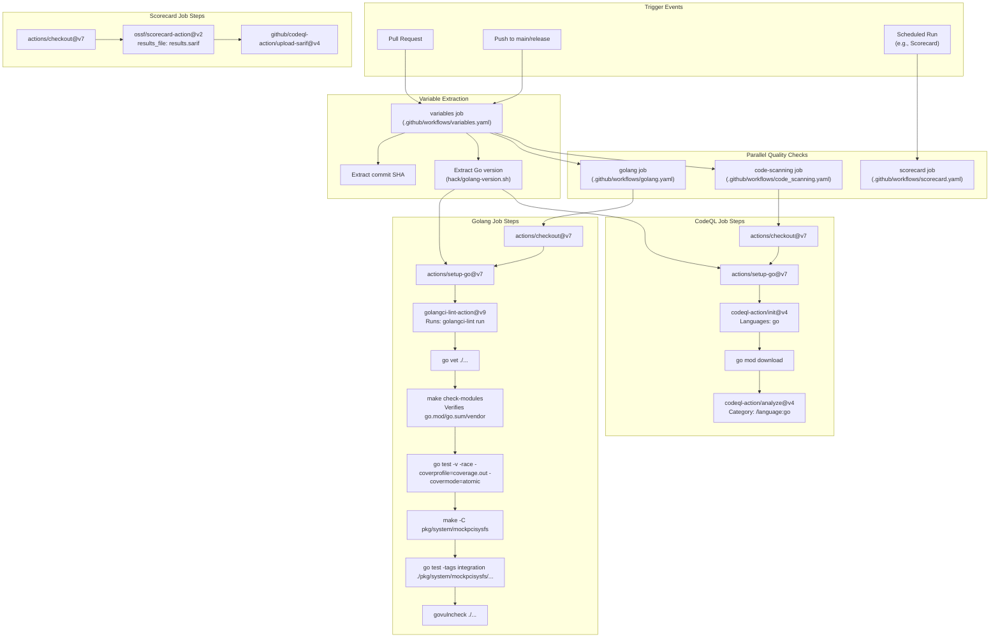
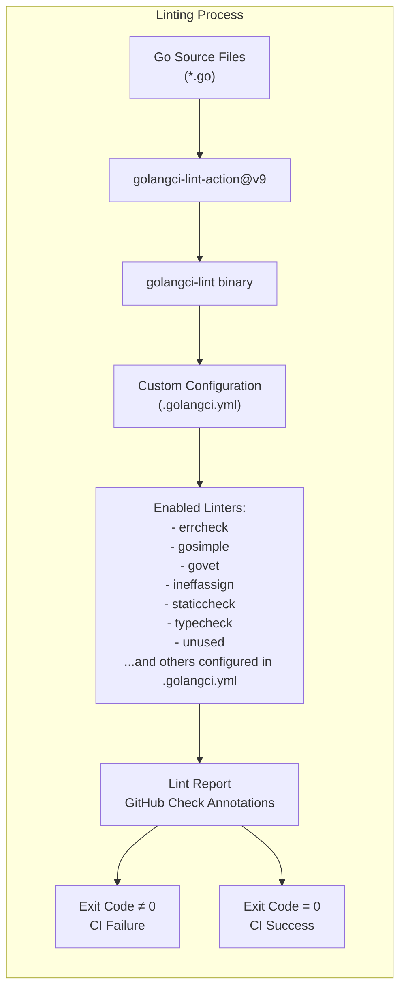
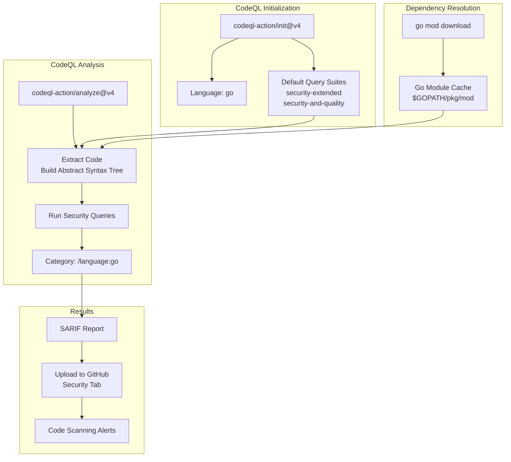
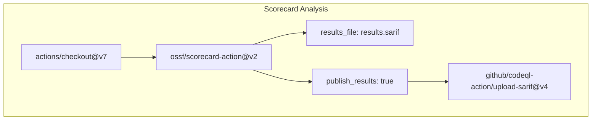
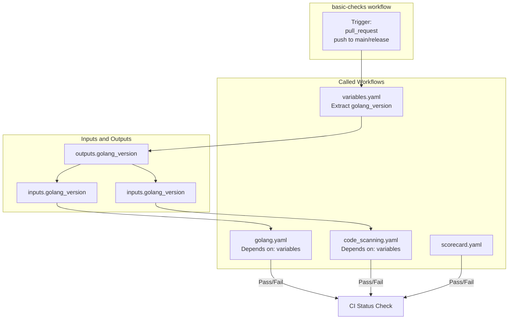

<!-- source: DeepWiki mcp.deepwiki.com · repo NVIDIA/k8s-test-infra · page 4.2 Automated Testing and Code Quality · fetched 2026-10-26 -->

# Automated Testing and Code Quality

<details>
<summary>Relevant source files</summary>

The following files were used as context for generating this wiki page:

- [.github/workflows/code_scanning.yaml](.github/workflows/code_scanning.yaml)
- [.github/workflows/golang.yaml](.github/workflows/golang.yaml)
- [.github/workflows/helm-publish.yaml](.github/workflows/helm-publish.yaml)
- [.github/workflows/helm.yaml](.github/workflows/helm.yaml)
- [.github/workflows/nvml-mock-publish.yaml](.github/workflows/nvml-mock-publish.yaml)
- [.github/workflows/scorecard.yaml](.github/workflows/scorecard.yaml)
- [.github/workflows/variables.yaml](.github/workflows/variables.yaml)
- [.golangci.yml](.golangci.yml)
- [deployments/devel/Dockerfile](deployments/devel/Dockerfile)
- [tests/e2e/go/report_skips_test.go](tests/e2e/go/report_skips_test.go)

</details>


This document details the automated testing and code quality enforcement mechanisms that run as part of the CI/CD pipeline. It covers linting with golangci-lint, security scanning with CodeQL, module consistency verification, and vulnerability scanning with `govulncheck`.

For information about the overall GitHub Actions workflow structure and job orchestration, see [GitHub Actions Workflows](#4.1). For details about the Ginkgo test framework and test execution, see [Testing with Ginkgo](#5). For dependency update automation, see [Dependency Updates with Dependabot](#4.4).

---

## Overview of Automated Quality Checks

The repository enforces code quality through several automated mechanisms, all integrated into the CI pipeline:

| Check Type | Tool | Purpose | Workflow File |
|------------|------|---------|---------------|
| **Linting** | golangci-lint | Enforce Go code style, detect common issues, verify code patterns | [.github/workflows/golang.yaml]() |
| **Security Scanning** | CodeQL | Static analysis for security vulnerabilities and code quality issues | [.github/workflows/code_scanning.yaml]() |
| **Vulnerability Scanning** | govulncheck | Detect known vulnerabilities in Go modules | [.github/workflows/golang.yaml]() |
| **Module Verification** | go mod | Ensure dependency consistency between go.mod, go.sum, and vendor directory | [.github/workflows/golang.yaml]() |
| **OpenSSF Scorecard** | Scorecard | Assess security health of the project | [.github/workflows/scorecard.yaml]() |

These checks run automatically on pull requests and pushes to protected branches, preventing code that violates quality standards from being merged.

**Sources:** [.github/workflows/golang.yaml](), [.github/workflows/code_scanning.yaml](), [.github/workflows/scorecard.yaml]()

---

## Quality Check Execution Flow



**Sources:** [.github/workflows/golang.yaml](), [.github/workflows/code_scanning.yaml](), [.github/workflows/variables.yaml](), [.github/workflows/scorecard.yaml]()

---

## Linting with golangci-lint

### Configuration

The linting process uses `golangci-lint`, a fast, parallel Go linter aggregator that runs multiple linters in a single pass. The workflow invokes it via the `golangci-lint-action@v9` GitHub Action.

Key configuration parameters from [.github/workflows/golang.yaml:36-41]():

| Parameter | Value | Purpose |
|-----------|-------|---------|
| `version` | `latest` | Always use the newest golangci-lint release |
| `args` | `-v --timeout 5m` | Verbose output with 5-minute timeout |
| `skip-cache` | `true` | Disable caching to ensure fresh analysis |

The `.golangci.yml` configuration file [`.golangci.yml:15-27`]() specifies a `timeout` of `5m` and `build-tags` for `e2e` and `integration` to ensure all relevant code, including test-only files, is linted.

### Linting Workflow Step



The `.golangci.yml` file [`.golangci.yml`]() defines specific settings for linters and exclusions. For example, `staticcheck` is configured to exclude certain checks like `ST1000`, `ST1003`, and `QF*` [`.golangci.yml:30-36`](). It also includes an exclusion rule for `ST1001` in `tests/e2e/go/` files to accommodate Ginkgo's dot-import convention in test-only code [`.golangci.yml:38-52`](). The `max-same-issues` is set to `0` to report every occurrence of an issue, preventing under-reporting [`.golangci.yml:55-60`]().

**Sources:** [.github/workflows/golang.yaml:36-41](), [`.golangci.yml`]()

### Local Linting Execution

Developers can run the same linting checks locally using the Makefile target:

```bash
make lint
```

This executes the command defined at [Makefile:41-42]():

```bash
golangci-lint run ./...
```

The `./...` pattern recursively analyzes all Go packages in the repository, excluding the vendor directory automatically.

**Sources:** [Makefile:41-42]()

---

## Automated Test Execution

The `golang.yaml` workflow also orchestrates the execution of automated tests.

### Go Vet

The `go vet` tool is run explicitly to catch common errors. This step is not redundant with the `govet` linter within `golangci-lint` because `go vet` has no suppression mechanism, ensuring all findings are reported, and `golangci-lint` caps repeats of the same finding [`.github/workflows/golang.yaml:47-62`]().

```yaml
- name: Run go vet
  run: go vet ./...
```

**Sources:** [.github/workflows/golang.yaml:47-62]()

### Unit Tests

Standard Go unit tests are executed with race detection and coverage reporting.

```yaml
- name: Run unit tests
  run: |
    go test -v -race -coverprofile=coverage.out -covermode=atomic $(go list ./... | grep -v vendor)
```

**Sources:** [.github/workflows/golang.yaml:68-70]()

### Integration Tests for `mockpcisysfs`

The `mockpcisysfs` LD_PRELOAD shim has dedicated integration tests that are run explicitly. These tests are tagged with `integration` and are skipped by the untagged unit test run [`.github/workflows/golang.yaml:72-82`]().

```yaml
- name: Build mockpcisysfs shim
  run: make -C pkg/system/mockpcisysfs

- name: Run mockpcisysfs integration tests
  run: go test -tags integration -v ./pkg/system/mockpcisysfs/...
```

**Sources:** [.github/workflows/golang.yaml:72-82]()

### Skipped Specs Summary in E2E Tests

For E2E tests, a `ReportAfterSuite` hook is used to print a consolidated summary of all skipped specs and their reasons. This helps in quickly identifying what was skipped and why, especially in verbose multi-profile logs [tests/e2e/go/report_skips_test.go:20-57](). The `emptySkipReason` function provides a cause-neutral marker for specs skipped without a specific message, hinting at configured filters [tests/e2e/go/report_skips_test.go:61-78]().

**Sources:** [tests/e2e/go/report_skips_test.go:20-78]()

---

## Security Scanning with CodeQL

### CodeQL Analysis Workflow

CodeQL is GitHub's semantic code analysis engine that treats code as data, enabling queries to find security vulnerabilities and code quality issues. The `code_scanning.yaml` workflow performs static analysis on Go code.



**Sources:** [.github/workflows/code_scanning.yaml]()

### Workflow Configuration

The CodeQL workflow at [.github/workflows/code_scanning.yaml:24-51]() runs with the following configuration:

| Setting | Value | Purpose |
|---------|-------|---------|
| `timeout-minutes` | `360` | Allow up to 6 hours for analysis (generous for large codebases) |
| `permissions.security-events` | `write` | Required to upload SARIF results |
| `permissions.packages` | `read` | Access private dependencies if needed |
| `languages` | `go` | Analyze Go code only |
| `category` | `/language:go` | Categorize results by language |

The workflow requires the `golang_version` input from the `variables` job (see [Version Management](#4.3)), ensuring consistency between analysis and build environments.

### Analysis Steps

The CodeQL analysis executes three key steps:

1. **Initialize CodeQL** [.github/workflows/code_scanning.yaml:40-43]()
   - Sets up the CodeQL tools
   - Configures language detection for Go
   - Prepares the analysis environment

2. **Fetch Dependencies** [.github/workflows/code_scanning.yaml:45-46]()
   - Downloads Go modules via `go mod download`
   - Ensures all dependencies are available for analysis
   - Populates the module cache

3. **Perform Analysis** [.github/workflows/code_scanning.yaml:48-51]()
   - Extracts code structure into CodeQL database
   - Runs security and quality queries
   - Uploads results to GitHub Security tab

Results appear in the repository's "Security" → "Code scanning" tab, where they can be reviewed, triaged, and dismissed.

**Sources:** [.github/workflows/code_scanning.yaml:40-51]()

---

## Vulnerability Scanning with `govulncheck`

The `golang.yaml` workflow includes a step to run `govulncheck`, a tool that finds known vulnerabilities in Go modules.

```yaml
- name: Run govulncheck
  run: |
    go install golang.org/x/vuln/cmd/govulncheck@latest
    govulncheck ./...
```

This step first installs the `govulncheck` tool and then runs it across all Go modules in the repository [`.github/workflows/golang.yaml:83-87`](). This helps identify and mitigate security risks introduced by third-party dependencies.

**Sources:** [.github/workflows/golang.yaml:83-87]()

---

## OpenSSF Scorecard

The OpenSSF Scorecard is an automated tool that assesses the security health of open source projects. The `scorecard.yaml` workflow runs this check.

### Workflow Configuration

The Scorecard workflow at [.github/workflows/scorecard.yaml:1-39]() is triggered on a weekly schedule (Monday at 06:00 UTC), on pushes to the `main` branch, and manually via `workflow_dispatch`.

| Setting | Value | Purpose |
|---------|-------|---------|
| `schedule` | `cron: "0 6 * * 1"` | Run every Monday at 06:00 UTC |
| `push` | `branches: [main]` | Run on pushes to the main branch |
| `workflow_dispatch` | | Allow manual triggering |
| `permissions.security-events` | `write` | Required to upload SARIF results |
| `permissions.id-token` | `write` | Required for keyless cosign signing (if used by Scorecard) |

### Scorecard Analysis Steps



The workflow performs the following steps:
1. **Checkout Code** [`.github/workflows/scorecard.yaml:24-27`]: Checks out the repository code.
2. **Run Scorecard** [`.github/workflows/scorecard.yaml:29-33`]: Executes the `ossf/scorecard-action` to analyze the project. It outputs results to `results.sarif` and publishes them.
3. **Upload SARIF** [`.github/workflows/scorecard.yaml:35-38`]: Uploads the generated SARIF file to GitHub, making the findings visible in the Security tab.

**Sources:** [.github/workflows/scorecard.yaml:1-39]()

---

## Module Consistency Verification

### Purpose and Requirements

Go module management requires synchronization between three key components:

| Component | Purpose | Managed By |
|-----------|---------|------------|
| `go.mod` | Declares direct dependencies and Go version | Developer + `go mod tidy` |
| `go.sum` | Cryptographic checksums for reproducible builds | `go` toolchain |
| `vendor/` | Local copy of dependencies for hermetic builds | `go mod vendor` |

The CI pipeline enforces that these three components remain synchronized, preventing issues where local builds succeed but CI fails (or vice versa).

**Sources:** [Makefile:52-79]()

### Module Verification Process

```mermaid
graph TB
    subgraph "Module Verification Steps"
        START["make check-modules"]
        
        subgraph "Tidy Phase (.mod-tidy)"
            TIDY["go mod tidy<br/>for each go.mod"]
            TIDY_CHECK["Check for changes"]
        end
        
        subgraph "Vendor Phase (.mod-vendor)"
            VENDOR["go mod vendor<br/>for each go.mod"]
            VENDOR_CHECK["Check for changes"]
        end
        
        subgraph "Verify Phase (.mod-verify)"
            VERIFY["go mod verify<br/>for each go.mod"]
            VERIFY_CHECK["Validate checksums"]
        end
        
        subgraph "Git Diff Checks"
            DIFF_MOD["git diff --exit-code<br/>go.mod go.sum"]
            DIFF_VENDOR["git diff --exit-code<br/>vendor/"]
        end
        
        START --> TIDY
        TIDY --> TIDY_CHECK
        TIDY_CHECK --> VENDOR
        VENDOR --> VENDOR_CHECK
        VENDOR_CHECK --> VERIFY
        VERIFY --> VERIFY_CHECK
        VERIFY_CHECK --> DIFF_MOD
        DIFF_MOD --> DIFF_VENDOR
        
        DIFF_VENDOR -->|No changes| SUCCESS["Exit 0<br/>CI Pass"]
        DIFF_VENDOR -->|Changes found| FAILURE["Exit 1<br/>CI Failure"]
    end
```



**Sources:** [Makefile:52-79]()

### Makefile Target Breakdown

The `check-modules` target at [Makefile:75-79]() orchestrates the verification process:

```bash
check-modules: modules
	@echo "- Checking if go.mod and go.sum are in sync..."
	@git diff --exit-code -- $$(find . -name go.mod -name go.sum)
	@echo "- Checking if the go mod vendor dir is in sync..."
	@git diff --exit-code -- $$(find . -name vendor)
```

It depends on the `modules` target [Makefile:53](), which executes three sub-targets:

1. **.mod-tidy** [Makefile:54-59]() - Runs `go mod tidy` for all modules
2. **.mod-vendor** [Makefile:61-66]() - Runs `go mod vendor` for all modules (excluding deployments)
3. **.mod-verify** [Makefile:68-73]() - Runs `go mod verify` to validate checksums

The workflow excludes certain directories from vendoring: `testdata`, `third_party`, and `deployments`.

**Sources:** [Makefile:52-79]()

### CI Workflow Integration

The golang workflow invokes this check at [.github/workflows/golang.yaml:64-66]():

```yaml
- name: Check golang modules
  run: |
    make check-modules
```

If any module files are out of sync, the CI job fails with a non-zero exit code, preventing the PR from being merged until the developer runs:

```bash
make vendor
git add go.mod go.sum vendor
git commit -m "Update vendored dependencies"
```

**Sources:** [.github/workflows/golang.yaml:64-66](), [Makefile:44-50]()

---

## Integration with CI Pipeline

### Workflow Dependencies

The quality checks integrate into the broader CI pipeline through workflow composition. The `basic-checks.yaml` workflow (referenced but not shown in provided files) calls these reusable workflows:



Both `golang.yaml` and `code_scanning.yaml` are reusable workflows (declared with `workflow_call`) that require the `golang_version` input. This input comes from the `variables.yaml` workflow, which extracts the Go version from the Dockerfile using `hack/golang-version.sh`. The `scorecard.yaml` workflow runs independently based on its own triggers.

**Sources:** [.github/workflows/golang.yaml:17-22](), [.github/workflows/code_scanning.yaml:17-21](), [.github/workflows/variables.yaml:15-44](), [.github/workflows/scorecard.yaml]()

### Required Status Checks

For protected branches, these workflows typically serve as required status checks that must pass before merging:

| Check Name | Blocks Merge | Provides |
|------------|--------------|----------|
| `check / golang` | Yes | Linting, automated tests, and module verification |
| `analyze / CodeQL` | Yes | Security vulnerability scanning |
| `analysis / Scorecard` | Yes | Project security health assessment |

The copy-pr-bot configuration at [.github/copy-pr-bot.yaml]() indicates the repository uses NVIDIA's internal tooling for PR management, which likely enforces these checks as well.

**Sources:** [.github/copy-pr-bot.yaml]()

---

## Running Checks Locally

### Pre-Commit Verification

Developers should run these checks locally before pushing commits to avoid CI failures:

```bash
# Run linting
make lint

# Verify module consistency
make check-modules

# Format code (auto-fix)
make fmt
```

The `verify` target at [Makefile:34-39]() checks if code formatting is correct without modifying files, useful for pre-commit hooks:

```bash
make verify
```

This differs from `make fmt`, which automatically formats code.

**Sources:** [Makefile:31-42]()

### Fixing Module Inconsistencies

If `make check-modules` fails, run:

```bash
make vendor
```

This target at [Makefile:44-47]() executes:
1. `go mod tidy` - Remove unused dependencies and add missing ones
2. `go mod vendor` - Synchronize the vendor directory
3. `go mod verify` - Validate checksums

After running this command, commit the updated files:

```bash
git add go.mod go.sum vendor
git commit -m "Sync Go module dependencies"
```

**Sources:** [Makefile:44-47]()

### Installing golangci-lint Locally

To run linting locally, install golangci-lint:

```bash
# macOS
brew install golangci-lint

# Linux
curl -sSfL https://raw.githubusercontent.com/golangci/golangci-lint/master/install.sh | sh -s -- -b $(go env GOPATH)/bin

# Verify installation
golangci-lint --version
```

The CI uses the latest version via [.github/workflows/golang.yaml:39](), so keeping the local installation up-to-date ensures consistency.

**Sources:** [.github/workflows/golang.yaml:39]()

---

## Summary

The automated testing and code quality infrastructure provides multiple layers of protection:

1. **golangci-lint** - Enforces Go best practices and catches common errors.
2. **Go Vet** - Catches common errors with no suppression mechanism.
3. **Unit and Integration Tests** - Verifies functionality and behavior.
4. **govulncheck** - Detects known vulnerabilities in Go modules.
5. **CodeQL** - Detects security vulnerabilities and complex code quality issues.
6. **OpenSSF Scorecard** - Assesses the overall security health of the project.
7. **Module verification** - Ensures reproducible builds through dependency consistency.

These checks run automatically on every pull request and are designed to catch issues early in the development cycle. Developers can run the same checks locally using the Makefile targets, enabling a fast feedback loop before pushing changes.

**Sources:** [.github/workflows/golang.yaml](), [.github/workflows/code_scanning.yaml](), [.github/workflows/scorecard.yaml](), [Makefile]()

---

