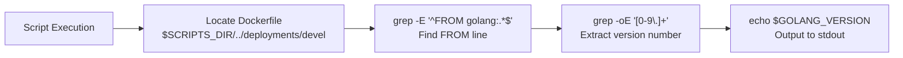

<!-- source: DeepWiki mcp.deepwiki.com · repo NVIDIA/k8s-test-infra · page 4.3 Version Management · fetched 2026-10-26 -->

# Version Management

<details>
<summary>Relevant source files</summary>

The following files were used as context for generating this wiki page:

- [.github/workflows/code_scanning.yaml](.github/workflows/code_scanning.yaml)
- [.github/workflows/golang.yaml](.github/workflows/golang.yaml)
- [.github/workflows/helm-publish.yaml](.github/workflows/helm-publish.yaml)
- [.github/workflows/helm.yaml](.github/workflows/helm.yaml)
- [.github/workflows/nvml-mock-publish.yaml](.github/workflows/nvml-mock-publish.yaml)
- [.github/workflows/scorecard.yaml](.github/workflows/scorecard.yaml)
- [.github/workflows/variables.yaml](.github/workflows/variables.yaml)
- [deployments/devel/Dockerfile](deployments/devel/Dockerfile)
- [deployments/nvml-mock/Dockerfile](deployments/nvml-mock/Dockerfile)
- [pkg/gpu/mockcuda/Makefile](pkg/gpu/mockcuda/Makefile)
- [pkg/gpu/mocknvml/Dockerfile](pkg/gpu/mocknvml/Dockerfile)
- [pkg/gpu/mocknvml/Makefile](pkg/gpu/mocknvml/Makefile)
- [tests/e2e/spike-nvidia-smi.sh](tests/e2e/spike-nvidia-smi.sh)
- [tests/mocknvml/Dockerfile](tests/mocknvml/Dockerfile)
- [tests/poc-validation/setup-kind-cluster.sh](tests/poc-validation/setup-kind-cluster.sh)

</details>


## Purpose and Scope

This document explains the version management strategy used in the k8s-test-infra repository, specifically focusing on how the Go language version is maintained and propagated throughout the system. The repository employs a **single-source-of-truth** pattern to ensure consistency across local development, CI/CD pipelines, and Docker images.

For information about dependency version management (Go modules, Docker base images, GitHub Actions), see [Dependency Updates with Dependabot](#4.4). For details about the build system that consumes these versions, see [Build System](#8).

---

## Single Source of Truth Pattern

The k8s-test-infra repository defines the Go version exactly once in [`deployments/devel/Dockerfile:17`](), using the `FROM` directive. This file serves as the canonical source for the Go version used across all environments:

```dockerfile
FROM golang:1.26.5
```

The comment at [`deployments/devel/Dockerfile:15-16`]() explicitly documents this design decision:

```dockerfile
# This Dockerfile is also used to define the golang version used in this project
# This allows dependabot to manage this version in addition to other images.
```

This approach provides several key benefits:
- **Consistency**: The same Go version is used in development containers, CI runners, and local builds
- **Single update point**: Version upgrades require changing only one file
- **Dependabot integration**: The Dockerfile format allows Dependabot to automatically detect and propose Go version updates
- **Traceability**: All version changes are tracked through git history of a single file

Sources: [`deployments/devel/Dockerfile:15-17`]()

---

## Version Flow Architecture

The following diagram illustrates how the Go version flows from its definition through extraction and propagation to all consuming systems:

```mermaid
graph TB
    subgraph "Source of Truth"
        DOCKERFILE["deployments/devel/Dockerfile<br/>FROM golang:1.26.5"]
    end
    
    subgraph "Extraction Layer"
        SCRIPT["hack/golang-version.sh<br/>grep and extract version"]
    end
    
    subgraph "CI/CD Coordination"
        VARIABLES["variables.yaml workflow<br/>outputs: golang_version"]
    end
    
    subgraph "Consuming Workflows"
        GOLANG["golang.yaml workflow<br/>inputs.golang_version"]
        SCANNING["code_scanning.yaml workflow<br/>inputs.golang_version"]
        # BASIC["basic-checks.yaml workflow<br/>orchestrates all checks"]
    end
    
    subgraph "Execution Environment"
        GOSETUP["actions/setup-go@v7<br/>go-version: $golang_version"]
        CONTAINER["Docker Image Build<br/>golang:1.26.5 base"]
    end
    
    DOCKERFILE -->|"defines version"| SCRIPT
    SCRIPT -->|"extracts GOLANG_VERSION"| VARIABLES
    VARIABLES -->|"outputs golang_version"| GOLANG
    VARIABLES -->|"outputs golang_version"| SCANNING
    GOLANG -->|"uses in"| GOSETUP
    SCANNING -->|"uses in"| GOSETUP
    DOCKERFILE -->|"used directly in"| CONTAINER
```

**Version Flow: From Definition to Execution**

Sources: [`deployments/devel/Dockerfile:17`](), [`hack/golang-version.sh:1-23`](), [`.github/workflows/variables.yaml:1-45`](), [`.github/workflows/golang.yaml:1-72`](), [`.github/workflows/code_scanning.yaml:1-54`]()

---

## Version Definition: The Dockerfile Approach

The [`deployments/devel/Dockerfile`]() serves a dual purpose:
1. **Primary**: Defines a development container for the project
2. **Secondary**: Acts as the authoritative source for the Go version

### Why Use a Dockerfile?

The choice to use a Dockerfile rather than a separate configuration file provides several advantages:

| Advantage | Description |
|-----------|-------------|
| **Dependabot compatibility** | Dependabot natively understands Dockerfiles and can detect base image version updates |
| **Enforcement through use** | The version defined here is actually used to build development containers |
| **Industry standard format** | Follows Docker's established base image specification syntax |
| **Git-trackable** | Version changes are visible in PR diffs and git history |

### File Structure

The Dockerfile is minimal, containing only the base image declaration:

```
Line 1-13:  Copyright and license header
Line 14:    (blank)
Line 15-16: Comment explaining the version management role
Line 17:    FROM golang:1.26.5
Line 18:    (blank, end of file)
```

The version string follows the format `golang:MAJOR.MINOR.PATCH` where the numeric version (currently `1.26.5`) is extracted by the parsing script.

Sources: [`deployments/devel/Dockerfile:1-18`]()

---

## Version Extraction: golang-version.sh

The [`hack/golang-version.sh`]() script extracts the Go version from the Dockerfile and outputs it to stdout for consumption by CI workflows.

### Script Implementation



**golang-version.sh Execution Flow**

### Key Implementation Details

The script uses a two-stage grep pipeline at [`hack/golang-version.sh:20`]():

```bash
GOLANG_VERSION=$(grep -E "^FROM golang:.*$" ${DOCKERFILE_ROOT}/Dockerfile | grep -oE "[0-9\.]+")
```

**Stage 1: Line Selection**
- Pattern: `^FROM golang:.*$`
- Matches: Lines starting with "FROM golang:"
- Example match: `FROM golang:1.26.5`

**Stage 2: Version Extraction**
- Pattern: `[0-9\.]+`
- Extracts: Sequences of digits and dots
- Result: `1.26.5`

### Directory Resolution

The script determines the Dockerfile location relative to its own path at [`hack/golang-version.sh:16-18`]():

```bash
SCRIPTS_DIR="$( cd "$( dirname "${BASH_SOURCE[0]}" )"/../hack && pwd )"
DOCKERFILE_ROOT=${SCRIPTS_DIR}/../deployments/devel
```

This makes the script location-independent—it can be executed from any working directory.

Sources: [`hack/golang-version.sh:16-22`]()

---

## Version Propagation in CI/CD

The Go version propagates through the GitHub Actions workflow system via a reusable workflow pattern. The `variables.yaml` workflow acts as a central distribution point.

### Workflow Architecture

```mermaid
graph TB
    subgraph "Entry Point Workflows"
        CI["golang.yaml<br/>on: workflow_call"]
        SCANNING_WF["code_scanning.yaml<br/>on: workflow_call"]
        # BASIC["basic-checks.yaml<br/>on: pull_request"]
    end
    
    subgraph "Variables Workflow"
        VARS_JOB["variables job<br/>runs-on: ubuntu-latest"]
        VERSION_STEP["version step<br/>Generate commit SHA"]
        GOLANG_STEP["golang_version step<br/>./hack/golang-version.sh"]
        OUTPUTS["outputs:<br/>- version<br/>- golang_version"]
    end
    
    subgraph "Consumer Workflows"
        GOLANG_WF["golang.yaml<br/>inputs.golang_version"]
        SCAN_WF["code_scanning.yaml<br/>inputs.golang_version"]
    end
    
    subgraph "Setup Actions"
        SETUP_GO_1["actions/setup-go@v7<br/>go-version: $golang_version"]
        SETUP_GO_2["actions/setup-go@v7<br/>go-version: $golang_version"]
    end
    
    VARS_JOB --> VERSION_STEP
    VARS_JOB --> GOLANG_STEP
    VERSION_STEP --> OUTPUTS
    GOLANG_STEP --> OUTPUTS
    
    OUTPUTS -->|"outputs.golang_version"| GOLANG_WF
    OUTPUTS -->|"outputs.golang_version"| SCAN_WF
    
    GOLANG_WF -->|"inputs.golang_version"| SETUP_GO_1
    SCAN_WF -->|"inputs.golang_version"| SETUP_GO_2
```

**GitHub Actions Workflow Dependency Chain**

### variables.yaml Workflow

The [`variables.yaml`]() workflow is designed as a reusable workflow (`workflow_call`) that extracts and exposes the Go version.

**Workflow Outputs** ([`.github/workflows/variables.yaml:22-23`]()):

| Output Name | Description | Source |
|-------------|-------------|--------|
| `version` | Short commit SHA (8 characters) | Git commit hash |
| `golang_version` | Go language version | `golang-version.sh` script |

**Job Structure** ([`.github/workflows/variables.yaml:31-35`]()):

```yaml
jobs:
  variables:
    runs-on: ubuntu-latest
    outputs:
      version: ${{ steps.version.outputs.version }}
      golang_version: ${{ steps.golang_version.outputs.golang_version }}
```

The `golang_version` step executes the extraction script:

```yaml
- name: Get Golang Version
  id: golang_version
  run: |
    GOLANG_VERSION=$(./hack/golang-version.sh)
    echo "Detected $GOLANG_VERSION"
    echo "golang_version=${GOLANG_VERSION}" >> $GITHUB_OUTPUT
```

The script output is captured in the `GOLANG_VERSION` shell variable, logged for debugging, and then written to `$GITHUB_OUTPUT` using the `key=value` format required by GitHub Actions.

Sources: [`.github/workflows/variables.yaml:39-49`]()

### Consumer Workflows

#### golang.yaml Workflow

The [`golang.yaml`]() workflow is a reusable workflow that performs linting and module checks. It declares `golang_version` as a required input:

```yaml
on:
  workflow_call:
    inputs:
      golang_version:
        required: true
        type: string
```

The input is consumed by the `actions/setup-go` action at [`.github/workflows/golang.yaml:35-37`]():

```yaml
    - name: Install Go
      uses: actions/setup-go@b7ad1dad31e06c5925ef5d2fc7ad053ef454303e # v7.0.0
      with:
        go-version: ${{ inputs.golang_version }}
```

Sources: [`.github/workflows/golang.yaml:21-26`](), [`.github/workflows/golang.yaml:35-37`]()

#### code_scanning.yaml Workflow

The [`code_scanning.yaml`]() workflow performs CodeQL security analysis. It follows the same pattern, accepting `golang_version` as input and using it in the Go setup step:

```yaml
      - name: Install Go
        uses: actions/setup-go@b7ad1dad31e06c5925ef5d2fc7ad053ef454303e # v7.0.0
        with:
          go-version: ${{ inputs.golang_version }}
```

Sources: [`.github/workflows/code_scanning.yaml:21-24`](), [`.github/workflows/code_scanning.yaml:37-40`]()

### Workflow Orchestration

The `golang.yaml` and `code_scanning.yaml` workflows are typically called by other workflows (e.g., a `basic-checks.yaml` or `ci.yaml` workflow, though not fully provided here) that first call `variables.yaml` to get the `golang_version` and then pass it as an input.

For example, a calling workflow would look like this:

```yaml
jobs:
  call-variables:
    uses: ./.github/workflows/variables.yaml
  call-golang:
    needs: call-variables
    uses: ./.github/workflows/golang.yaml
    with:
      golang_version: ${{ needs.call-variables.outputs.golang_version }}
  call-code-scanning:
    needs: call-variables
    uses: ./.github/workflows/code_scanning.yaml
    with:
      golang_version: ${{ needs.call-variables.outputs.golang_version }}
```

Sources: [`.github/workflows/golang.yaml:21-26`](), [`.github/workflows/code_scanning.yaml:21-24`]()

---

## Implementation Details

### Variable Naming Conventions

The system uses consistent naming across different contexts:

| Context | Variable Name | Format |
|---------|--------------|--------|
| Dockerfile | (implicit) | `golang:1.26.5` |
| Shell script | `GOLANG_VERSION` | `1.26.5` |
| Workflow output | `golang_version` | `1.26.5` |
| Workflow input | `golang_version` | `1.26.5` |
| GitHub Action parameter | `go-version` | `1.26.5` |

The naming follows each ecosystem's conventions: uppercase with underscores in shell scripts, lowercase with underscores in GitHub Actions, and kebab-case in action parameters.

### Error Handling

The `golang-version.sh` script has minimal error handling—it relies on:
1. **grep's behavior**: Returns empty string if no match found
2. **Shell variable**: `GOLANG_VERSION` will be empty if extraction fails
3. **Echo always succeeds**: Even if variable is empty

In practice, if the script fails to extract a version:
- The workflow step will output an empty string
- GitHub Actions will pass an empty string to consumer workflows
- The `actions/setup-go` action will fail with a clear error about invalid version

This fail-fast approach ensures version extraction problems are immediately visible in CI.

Sources: [`hack/golang-version.sh:20-22`]()

---

## Version Update Process

### Manual Updates

To update the Go version manually:

1. **Edit the Dockerfile** ([`deployments/devel/Dockerfile:17`]()):
   ```dockerfile
   FROM golang:1.26.5
   ```

2. **Verify extraction** (local testing):
   ```bash
   ./hack/golang-version.sh
   # Output: 1.26.5
   ```

3. **Commit and push**:
   ```bash
   git add deployments/devel/Dockerfile
   git commit -m "Update Go version to 1.26.5"
   git push
   ```

4. **Automatic propagation**: The CI workflows will automatically use the new version

### Dependabot Updates

Dependabot monitors the Dockerfile and automatically creates PRs when new Go versions are released. The `.github/dependabot.yml` configuration (not shown in provided files) specifies Docker base image monitoring.

When Dependabot detects `golang:1.26.5` is available, it will:
1. Create a PR updating [`deployments/devel/Dockerfile:17`]()
2. The PR's CI run will automatically use the new version via the extraction pipeline
3. Reviewers can verify the version change in the Dockerfile diff

Sources: [`deployments/devel/Dockerfile:15-17`]()

---

## Benefits and Design Rationale

### Single Point of Maintenance

**Problem**: Multiple files defining Go versions can become inconsistent.

**Solution**: One canonical definition eliminates synchronization issues.

**Example**: Without this pattern, the following files might each declare different versions:
- CI workflow files (`.github/workflows/*.yaml`)
- Makefile or build scripts
- Documentation
- Docker images

With the single-source-of-truth pattern, all these consumers reference the same extracted value.

### Dependabot Integration

**Problem**: Manual version updates are tedious and easy to forget.

**Solution**: Dependabot's native Dockerfile support enables automatic update PRs.

Dependabot can parse `FROM golang:X.Y.Z` directives and:
- Detect when new Go versions are published
- Create PRs with the version bump
- Include release notes and changelog links

This would not work if the version were in a custom YAML or JSON file.

### CI/CD Efficiency

**Problem**: Hardcoding versions in multiple workflows creates maintenance burden.

**Solution**: The `variables.yaml` workflow acts as a central distribution point.

**Workflow reusability**: The `golang.yaml` and `code_scanning.yaml` workflows accept `golang_version` as an input, making them reusable across different repositories or branches that might use different Go versions.

### Audit Trail

**Problem**: Understanding when and why version changes occurred.

**Solution**: Git history of the Dockerfile provides complete change tracking.

Example git log:
```
commit abc123: Update Go version to 1.26.5 (Dependabot)
commit def456: Update Go version to 1.26.4 (Dependabot)
commit ghi789: Update Go version to 1.26.3 (manual)
```

Each change includes:
- Who made the change (author)
- When it was made (commit date)
- Why it was made (commit message, linked issues/PRs)
- What else changed in that commit

Sources: [`deployments/devel/Dockerfile:15-17`](), [`.github/workflows/variables.yaml:39-49`]()

---

## Integration with Build System

The version management system integrates with the build system described in [Build System](#8). Specifically:

### Docker Image Builds

The `deployments/nvml-mock/Dockerfile` uses an `ARG GOLANG_VERSION` which defaults to `1.26.5` and is then used in its `FROM` instruction: `FROM golang:${GOLANG_VERSION}-bookworm AS builder` ([`deployments/nvml-mock/Dockerfile:15-16`]). This ensures that the `nvml-mock` image is built with the specified Go version. Similarly, `tests/mocknvml/Dockerfile` also uses `ARG GOLANG_VERSION` and `FROM golang:${GOLANG_VERSION}` ([`tests/mocknvml/Dockerfile:14-15`]).

### Local Development

Developers can extract the project's Go version for local setup:

```bash
# Get the project's Go version
GO_VERSION=$(./hack/golang-version.sh)

# Use it to install the correct Go version (example with version managers)
asdf install golang $GO_VERSION
# or
gvm install go$GO_VERSION
```

This ensures local development environments match CI.

### Makefile Integration

The `pkg/gpu/mocknvml/Makefile` defines `GOLANG_VERSION ?= 1.26.5` ([`pkg/gpu/mocknvml/Makefile:17`]). This variable is then passed as a build argument to Docker when building the `mock-nvml-builder` image ([`pkg/gpu/mocknvml/Makefile:129-130`]). This ensures that the mock NVML library is built with the correct Go version in a Dockerized environment.

Sources: [`deployments/devel/Dockerfile:17`](), [`hack/golang-version.sh:20-22`](), [`deployments/nvml-mock/Dockerfile:15-16`](), [`tests/mocknvml/Dockerfile:14-15`](), [`pkg/gpu/mocknvml/Makefile:17`](), [`pkg/gpu/mocknvml/Makefile:129-130`]()

---

## Related Pages

- **[Dependency Updates with Dependabot](#4.4)**: How Dependabot monitors and updates dependencies
- **[GitHub Actions Workflows](#4.1)**: Overall workflow structure and job dependencies
- **[Go Version Management Strategy](#8.3)**: Build system perspective on version management
- **[Docker Images](#8.2)**: How the Dockerfile is used to build images
- **[Makefile Reference](#8.1)**: Build targets that may use version information

---

