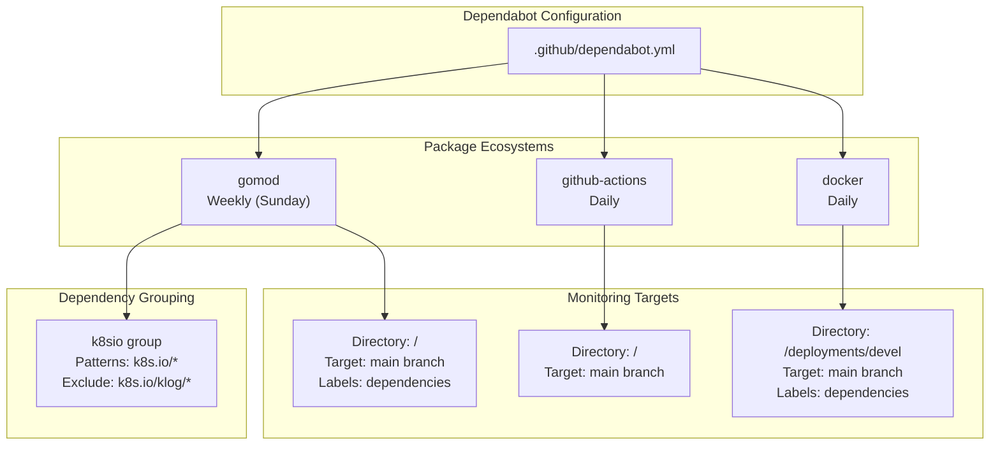
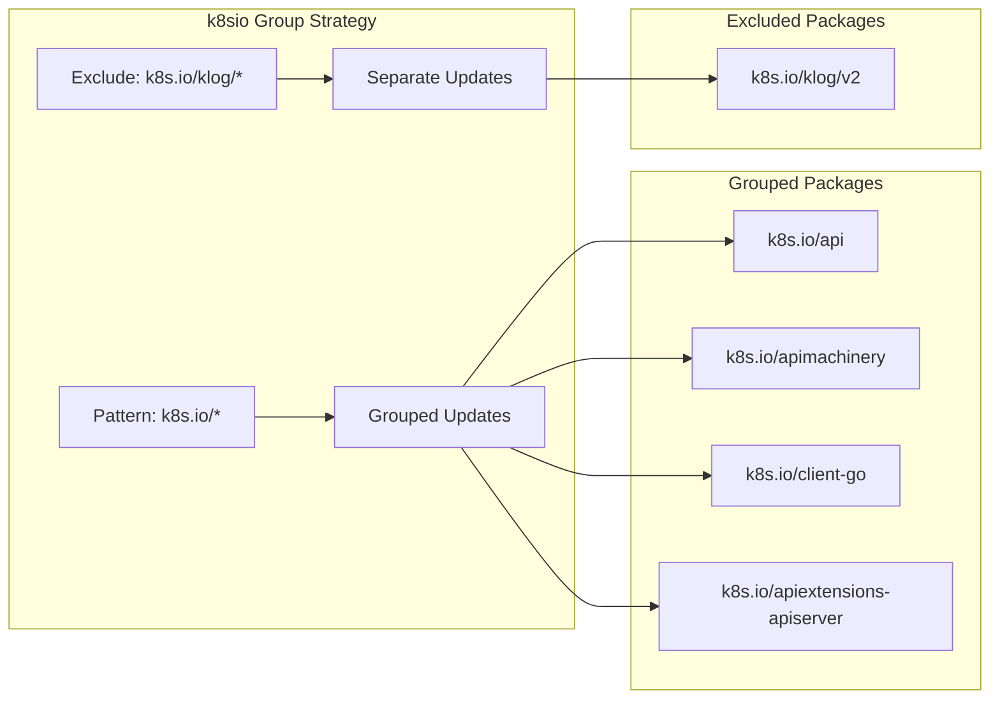
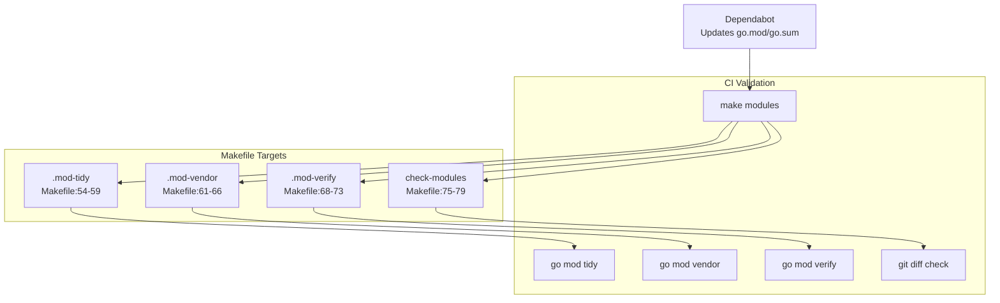
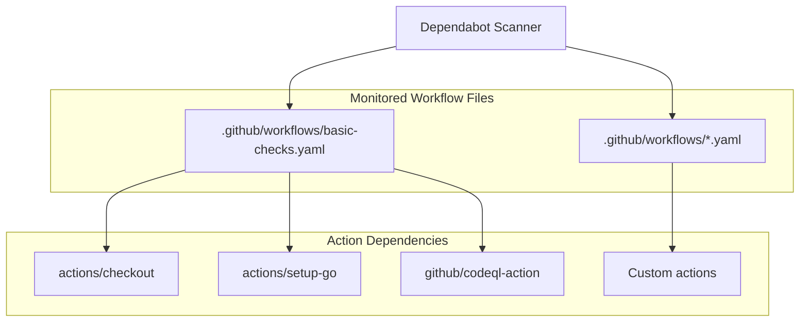
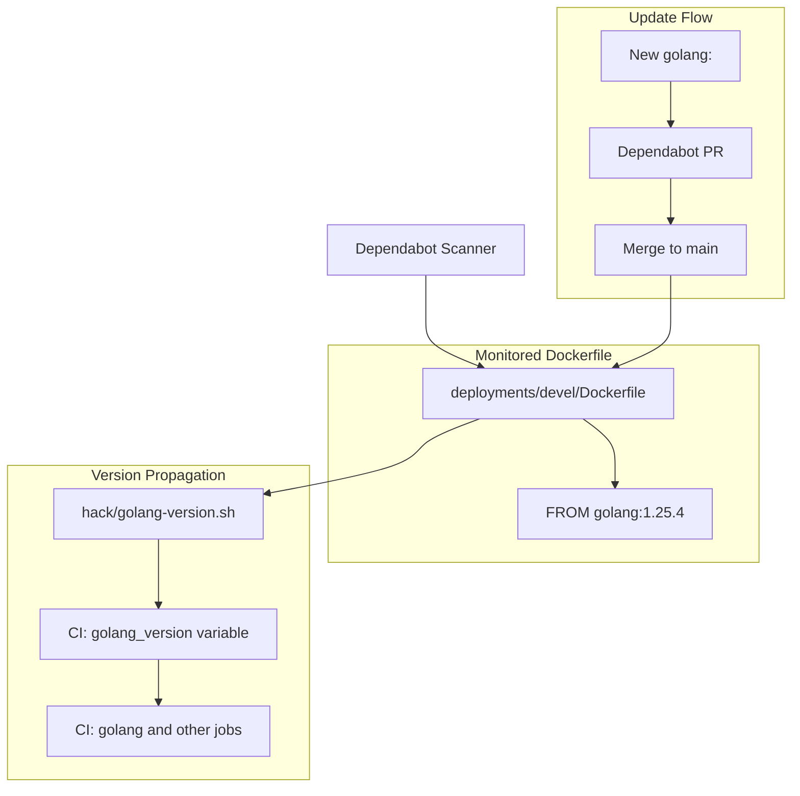
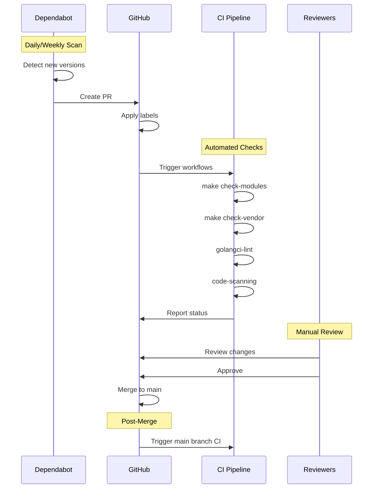
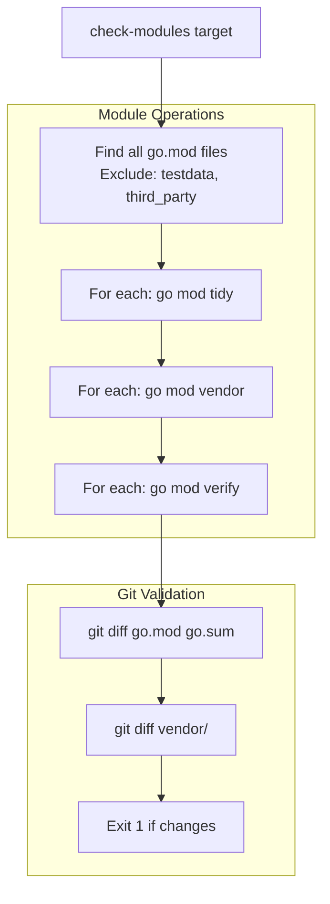

<!-- source: DeepWiki mcp.deepwiki.com · repo NVIDIA/k8s-test-infra · page 4.4 Dependency Updates with Dependabot · fetched 2026-10-26 -->

# Dependency Updates with Dependabot

Relevant source files

The following files were used as context for generating this wiki page:

- [.github/dependabot.yml](.github/dependabot.yml)
- [.github/workflows/basic-checks.yaml](.github/workflows/basic-checks.yaml)
- [.github/workflows/ci.yaml](.github/workflows/ci.yaml)

## Purpose and Scope

This document details the automated dependency update strategy used in k8s-test-infra through GitHub Dependabot. It covers how Go module dependencies, GitHub Actions workflow versions, and Docker base images are automatically monitored and updated.

For information about the overall CI/CD pipeline structure, see [CI/CD Pipeline](#4). For details about version management strategy, see [Version Management](#4.3).

---

## Dependabot Configuration Overview

The repository uses Dependabot to automate dependency updates across three package ecosystems, each with different update frequencies and strategies. The configuration file [.github/dependabot.yml:1-36]() defines all monitoring rules.

**Sources:** [.github/dependabot.yml:1-36]()

---

## Go Module Dependency Updates

### Update Schedule and Strategy

Go module dependencies are checked **weekly on Sundays** [.github/dependabot.yml:9-11](). This cadence balances staying current with dependencies against the overhead of reviewing and merging updates.

| Configuration | Value |
|---------------|-------|
| Package Ecosystem | `gomod` |
| Target Branch | `main` |
| Directory | `/` |
| Schedule | Weekly on Sunday |
| Labels | `dependencies` |

**Sources:** [.github/dependabot.yml:6-13]()

### Kubernetes Dependency Grouping

The repository implements a grouping strategy for Kubernetes-related dependencies to reduce the number of individual pull requests. All `k8s.io/*` packages (excluding `k8s.io/klog/*`) are grouped together under the `k8sio` group name [.github/dependabot.yml:14-19]().

This grouping approach means that when new versions of Kubernetes client libraries are released, Dependabot creates a single pull request updating all related packages together, rather than creating separate PRs for each package. The `k8s.io/klog` package is excluded from grouping because it follows an independent release cycle.

**Sources:** [.github/dependabot.yml:14-19]()

### Vendor Directory Synchronization

When Dependabot updates Go modules, the CI pipeline must verify that the vendor directory remains synchronized with `go.mod` and `go.sum`. The repository uses Go module vendoring for reproducible builds.

The `check-modules` target [Makefile:75-79]() validates that:
1. All `go.mod` files are tidied
2. All modules are vendored
3. No uncommitted changes exist in `go.mod`, `go.sum`, or `vendor/` directories

**Sources:** [Makefile:52-79]()

---

## GitHub Actions Workflow Updates

### Update Schedule

GitHub Actions workflow dependencies are checked **daily** [.github/dependabot.yml:24-25](). This frequent schedule ensures the repository uses the latest workflow action versions, which often include security fixes and bug patches.

| Configuration | Value |
|---------------|-------|
| Package Ecosystem | `github-actions` |
| Target Branch | `main` |
| Directory | `/` |
| Schedule | Daily |

Dependabot monitors all workflow files in `.github/workflows/` and creates pull requests when new versions of actions are available. This includes both GitHub-provided actions (like `actions/checkout`, `actions/setup-go`) and third-party actions.

**Sources:** [.github/dependabot.yml:21-25]()

---

## Docker Base Image Updates

### Update Schedule and Target

Docker base image updates are checked **daily** [.github/dependabot.yml:32-33](), focusing specifically on the Golang version used in the development container.

| Configuration | Value |
|---------------|-------|
| Package Ecosystem | `docker` |
| Target Branch | `main` |
| Directory | `/deployments/devel` |
| Schedule | Daily |
| Labels | `dependencies` |

The Docker configuration specifically monitors `/deployments/devel` [.github/dependabot.yml:31]() because this directory contains the `Dockerfile` that defines the canonical Go version for the project. The comment "Golang version" [.github/dependabot.yml:30]() indicates this is the single source of truth for Go version management.

When Dependabot detects a new Golang Docker image version, it creates a pull request updating the `FROM` line in the Dockerfile. This triggers the version extraction mechanism documented in [Version Management](#4.3), ensuring the new version propagates throughout the CI pipeline.

**Sources:** [.github/dependabot.yml:27-36]()

---

## Dependency Update Workflow

### Pull Request Creation and Validation

**Sources:** [.github/dependabot.yml:1-36](), [Makefile:49-79]()

### Validation Requirements

When Dependabot creates a pull request, the CI pipeline performs several validation checks:

| Check Type | Makefile Target | Purpose |
|------------|----------------|---------|
| Module Synchronization | `check-modules` [Makefile:75-79]() | Verifies `go.mod`, `go.sum`, and `vendor/` are in sync |
| Vendor Validation | `check-vendor` [Makefile:49-50]() | Ensures vendor directory matches module files |
| Code Linting | `lint` [Makefile:41-42]() | Runs golangci-lint on all code |
| Code Formatting | `verify` [Makefile:34-39]() | Checks gofmt compliance |

For **Go module updates**, the most critical validation is `check-modules`, which iterates through all `go.mod` files in the repository:

The validation ensures that when Dependabot updates dependencies, all derived artifacts (vendor directory, verified checksums) are also updated in the same commit.

**Sources:** [Makefile:52-79]()

---

## Labeling and Organization

Dependabot automatically applies labels to pull requests based on the configuration:

| Package Ecosystem | Applied Labels |
|-------------------|----------------|
| `gomod` | `dependencies` [.github/dependabot.yml:12-13]() |
| `github-actions` | *(none specified)* |
| `docker` | `dependencies` [.github/dependabot.yml:34-35]() |

These labels help maintainers filter and prioritize dependency updates. The `dependencies` label groups Go module and Docker updates together, while GitHub Actions updates remain unlabeled for separate tracking.

**Sources:** [.github/dependabot.yml:12-13,34-35]()

---

## Configuration File Structure

The complete Dependabot configuration follows this structure:

```mermaid
graph TB
    ROOT["dependabot.yml<br/>version: 2"]
    
    subgraph "updates array"
        GOMOD_BLOCK["gomod update block"]
        GHA_BLOCK["github-actions block"]
        DOCKER_BLOCK["docker update block"]
    end
    
    subgraph "gomod block fields"
        GOMOD_PKG["package-ecosystem: gomod"]
        GOMOD_DIR["directory: /"]
        GOMOD_BRANCH["target-branch: main"]
        GOMOD_SCHED["schedule: weekly (sunday)"]
        GOMOD_LABELS["labels: dependencies"]
        GOMOD_GROUPS["groups: k8sio"]
    end
    
    subgraph "github-actions block fields"
        GHA_PKG["package-ecosystem: github-actions"]
        GHA_DIR["directory: /"]
        GHA_BRANCH["target-branch: main"]
        GHA_SCHED["schedule: daily"]
    end
    
    subgraph "docker block fields"
        DOCKER_PKG["package-ecosystem: docker"]
        DOCKER_DIR["directories: /deployments/devel"]
        DOCKER_BRANCH["target-branch: main"]
        DOCKER_SCHED["schedule: daily"]
        DOCKER_LABELS["labels: dependencies"]
    end
    
    ROOT --> GOMOD_BLOCK
    ROOT --> GHA_BLOCK
    ROOT --> DOCKER_BLOCK
    
    GOMOD_BLOCK --> GOMOD_PKG
    GOMOD_BLOCK --> GOMOD_DIR
    GOMOD_BLOCK --> GOMOD_BRANCH
    GOMOD_BLOCK --> GOMOD_SCHED
    GOMOD_BLOCK --> GOMOD_LABELS
    GOMOD_BLOCK --> GOMOD_GROUPS
    
    GHA_BLOCK --> GHA_PKG
    GHA_BLOCK --> GHA_DIR
    GHA_BLOCK --> GHA_BRANCH
    GHA_BLOCK --> GHA_SCHED
    
    DOCKER_BLOCK --> DOCKER_PKG
    DOCKER_BLOCK --> DOCKER_DIR
    DOCKER_BLOCK --> DOCKER_BRANCH
    DOCKER_BLOCK --> DOCKER_SCHED
    DOCKER_BLOCK --> DOCKER_LABELS
```

Each update block in the `updates` array [.github/dependabot.yml:5]() defines a separate dependency monitoring configuration. The three blocks operate independently with their own schedules and rules.

**Sources:** [.github/dependabot.yml:1-36]()

---

## Best Practices and Rationale

### Update Frequency Strategy

The repository employs a tiered update frequency based on risk and change velocity:

| Frequency | Ecosystems | Rationale |
|-----------|-----------|-----------|
| Daily | `github-actions`, `docker` | Security-critical; low merge overhead |
| Weekly | `gomod` | Higher review effort; batching reduces noise |

**Daily updates** for GitHub Actions and Docker base images ensure rapid adoption of security patches with minimal merge conflicts, as these updates typically don't require code changes.

**Weekly updates** for Go modules provide time to batch multiple dependency updates together, especially when the `k8sio` group combines multiple Kubernetes library updates into a single PR.

### Vendoring and Reproducibility

The repository mandates vendoring for all Go dependencies [Makefile:44-47](). This strategy ensures:

1. **Build Reproducibility**: Builds use the exact dependency versions committed to the repository
2. **Offline Builds**: No external network access required during compilation
3. **Dependency Auditing**: All dependency source code is visible in the repository
4. **CI Validation**: The `check-modules` target [Makefile:75-79]() ensures vendor directory stays synchronized

When Dependabot updates Go modules, the CI pipeline automatically validates that the vendor directory is updated accordingly. This prevents situations where `go.mod` references new versions but `vendor/` contains stale code.

**Sources:** [Makefile:44-50](), [Makefile:52-79](), [.github/dependabot.yml:6-19]()

---

