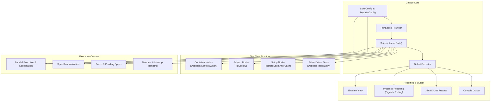
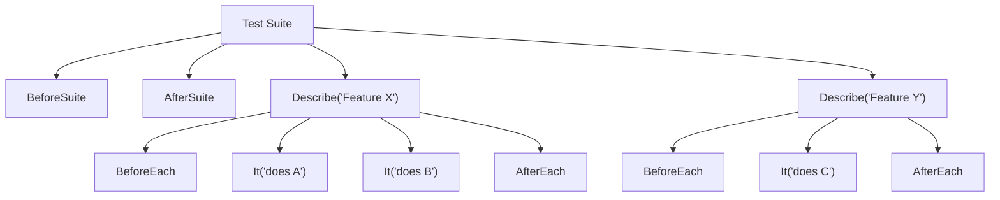
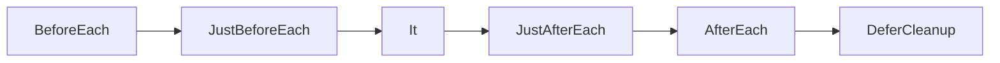
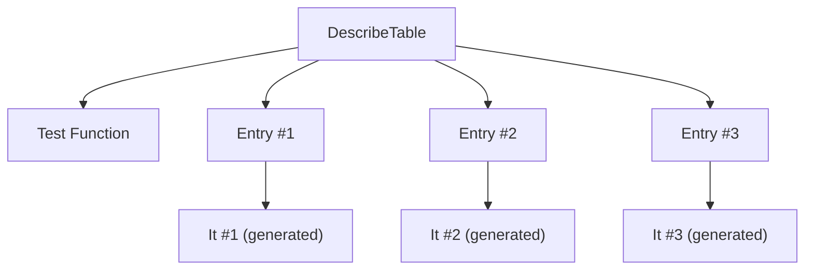
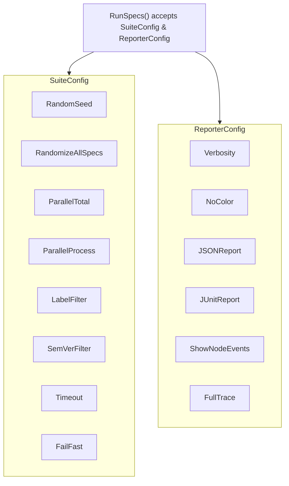
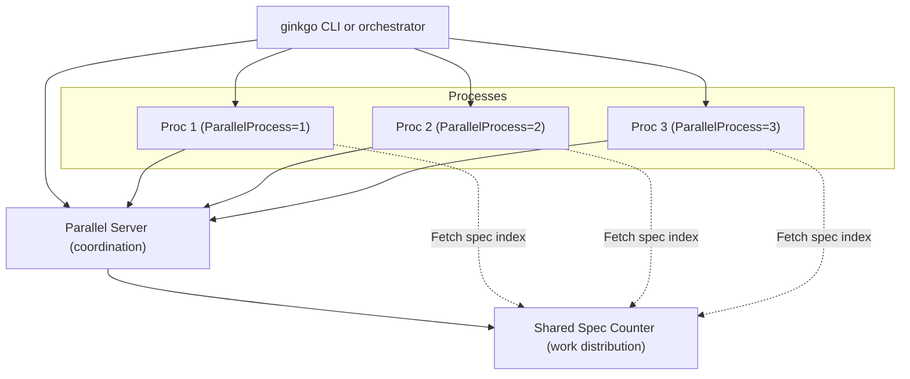
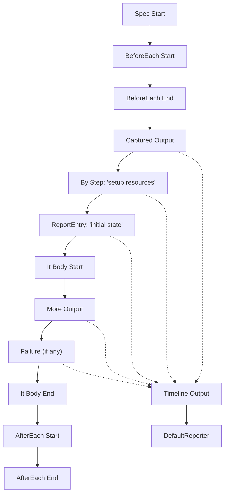
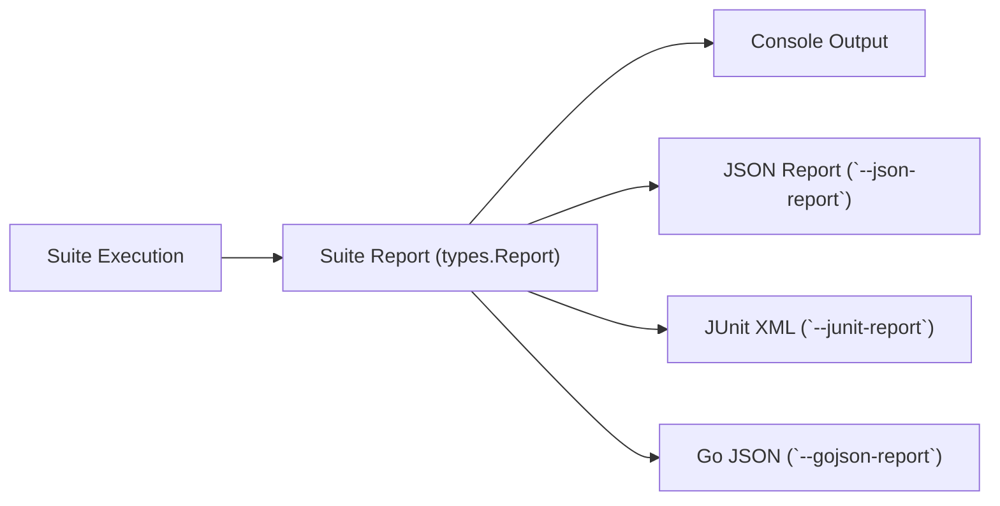

<!-- source: DeepWiki mcp.deepwiki.com · repo NVIDIA/k8s-test-infra · page 5 Testing with Ginkgo · fetched 2026-10-26 -->

# Testing with Ginkgo

<details>
<summary>Relevant source files</summary>

The following files were used as context for generating this wiki page:

- [go.mod](go.mod)
- [go.sum](go.sum)
- [vendor/github.com/onsi/ginkgo/v2/CHANGELOG.md](vendor/github.com/onsi/ginkgo/v2/CHANGELOG.md)
- [vendor/github.com/onsi/ginkgo/v2/README.md](vendor/github.com/onsi/ginkgo/v2/README.md)
- [vendor/github.com/onsi/ginkgo/v2/core_dsl.go](vendor/github.com/onsi/ginkgo/v2/core_dsl.go)
- [vendor/github.com/onsi/ginkgo/v2/internal/global/init.go](vendor/github.com/onsi/ginkgo/v2/internal/global/init.go)
- [vendor/github.com/onsi/ginkgo/v2/internal/node.go](vendor/github.com/onsi/ginkgo/v2/internal/node.go)
- [vendor/github.com/onsi/ginkgo/v2/reporters/default_reporter.go](vendor/github.com/onsi/ginkgo/v2/reporters/default_reporter.go)
- [vendor/github.com/onsi/ginkgo/v2/reporting_dsl.go](vendor/github.com/onsi/ginkgo/v2/reporting_dsl.go)
- [vendor/github.com/onsi/ginkgo/v2/table_dsl.go](vendor/github.com/onsi/ginkgo/v2/table_dsl.go)
- [vendor/github.com/onsi/ginkgo/v2/types/version.go](vendor/github.com/onsi/ginkgo/v2/types/version.go)
- [vendor/k8s.io/apimachinery/pkg/api/validation/objectmeta.go](vendor/k8s.io/apimachinery/pkg/api/validation/objectmeta.go)
- [vendor/modules.txt](vendor/modules.txt)

</details>


## Purpose and Scope

This page provides a comprehensive high-level guide to using the Ginkgo BDD testing framework within the `k8s-test-infra` project. Ginkgo version 2.32.0 is used extensively across all test suites to provide expressive behavior-driven development (BDD) style testing with powerful test organization, configuration, parallel execution, and reporting capabilities.

This page serves as a parent overview linking to four child pages that cover essential subtopics in detail:

- [Ginkgo Framework Overview](#5.1) — Introduces Ginkgo’s core concepts, execution model, and framework architecture as applied here.
- [Test Structure and DSL](#5.2) — Documents the usage of Describe/Context/It blocks, hooks like BeforeEach and AfterEach, and table-driven tests.
- [Configuration and Parallel Execution](#5.3) — Explains suite and reporter configurations, test parallelization, randomization, and synchronization patterns.
- [Test Reporting and Output](#5.4) — Details console output, JSON/JUnit reports, progress reporting, and diagnostic artifact collection.

For more details on the testing system architecture and CI/CD usage, see the [Architecture](#3) and [CI/CD Pipeline](#4) pages.

---

## Ginkgo Framework Overview

At its core, Ginkgo organizes tests into suites that contain hierarchical nodes representing test containers, tests, and setup/teardown steps. The suite runs via the `RunSpecs` function that orchestrates execution, applies configuration, and triggers reporting.



This framework supports natural language-style test descriptions and hierarchies, as well as advanced features like interruptible specs using context, table-driven specs with multiple parameterizations, and sophisticated parallel execution.

**Sources:**  
[vendor/github.com/onsi/ginkgo/v2/internal/suite.go:25-71](),  
[vendor/github.com/onsi/ginkgo/v2/core_dsl.go:1-53]()

---

## Test Structure and Domain-Specific Language (DSL)

### Node Types and Hierarchy

Ginkgo structures tests as a tree of nodes, each serving a distinct role:

| Node Type     | DSL Functions                              | Purpose                                      | Can Contain                    |
|---------------|-------------------------------------------|----------------------------------------------|-------------------------------|
| Container     | `Describe`, `Context`, `When`             | Group related specs                           | Other Containers, Setup, Subject Nodes |
| Subject       | `It`, `Specify`                           | Define individual test cases                  | Test logic and assertions      |
| Setup/Teardown| `BeforeEach`, `AfterEach`, `JustBeforeEach`, `JustAfterEach`, `DeferCleanup` | Setup and teardown logic executed around specs | Setup and teardown functions   |
| Suite Setup   | `BeforeSuite`, `AfterSuite`                | Initialization and cleanup for entire suite | Suite-wide initialization      |
| Table-Driven  | `DescribeTable`, `Entry`, `DescribeTableSubtree` | Parameterized tests generating multiple specs | Generates many Subject/Container nodes |

**Sources:**  
[vendor/github.com/onsi/ginkgo/v2/core_dsl.go:536-654](),  
[vendor/github.com/onsi/ginkgo/v2/internal/node.go:27-70]()

### Basic Test Structure

Tests begin with a `RunSpecs` call, invoking hierarchical containers grouping specs.



The setup and teardown nodes run before and after each spec to manage state and side effects.

**Sources:**  
[vendor/github.com/onsi/ginkgo/v2/core_dsl.go:546-653]()

### Container Nodes: Describe, Context, When

These nodes provide hierarchical grouping:

- `Describe` – Primary grouping for behavior or type
- `Context` – Synonym for `Describe`, used for scenario differentiation
- `When` – Like `Context` but prefixes description with "when "

Focus and Pending variants control execution:

- Focused: `FDescribe`, `FContext`, `FWhen`
- Pending/Skipped: `PDescribe`, `PContext`, `PWhen`, `XDescribe`, `XContext`, `XWhen`

Example:

```go
Describe("NodeFeature CRD", func() {
  Context("when creating a new resource", func() {
    When("labels are valid", func() {
      It("creates successfully", func() {
        // test code
      })
    })
  })
})
```

**Sources:**  
[vendor/github.com/onsi/ginkgo/v2/core_dsl.go:546-593]()

### Subject Nodes: It and Specify

These nodes hold the actual test logic and assertions.

- Can be passed a simple `func()` or context-aware `func(ctx SpecContext)`
- Context-aware functions support timeouts and interrupt handling
- Cannot nest other Ginkgo nodes inside
- Have Focus and Pending variants: `FIt`, `PIt`, `XIt`, etc.

Example:

```go
It("validates resource allocation", func(ctx SpecContext) {
  // assertions here
}, NodeTimeout(time.Second*30))
```

**Sources:**  
[vendor/github.com/onsi/ginkgo/v2/core_dsl.go:596-635](),  
[vendor/github.com/onsi/ginkgo/v2/internal/node.go:503-525]()

### Setup and Teardown Nodes

Setup and teardown nodes provide controlled execution around specs:

| Node          | Run Time                             | Purpose                        |
|---------------|------------------------------------|--------------------------------|
| `BeforeEach`  | Before each `It`                   | Standard setup                 |
| `AfterEach`   | After each `It`                    | Standard teardown             |
| `JustBeforeEach` | After all `BeforeEach`, before `It` | Setup that depends on other setup |
| `JustAfterEach` | Immediately after `It`, before other `AfterEach` | Immediate cleanup             |
| `BeforeAll`   | Once before specs in ordered container | Expensive suite setup        |
| `AfterAll`    | Once after specs in ordered container | Suite cleanup                  |
| `DeferCleanup`| During cleanup phase (LIFO order)  | Deferred cleanup functions    |

Execution ordering for a spec:



**Sources:**  
[vendor/github.com/onsi/ginkgo/v2/core_dsl.go:656-827](),  
[vendor/github.com/onsi/ginkgo/v2/internal/node.go:588-652]()

---

## Table-Driven Tests

Table-driven tests allow single test logic to run against multiple inputs.



### DescribeTable and Entry

Each `Entry` generates an individual `It` spec with parameters:

```go
DescribeTable("resource allocation",
  func(deviceType string, count int, shouldSucceed bool) {
    result := allocate(deviceType, count)
    Expect(result.Success).To(Equal(shouldSucceed))
  },
  Entry("single GPU", "nvidia.com/gpu", 1, true),
  Entry("multiple GPUs", "nvidia.com/gpu", 4, true),
  Entry("invalid input", "nvidia.com/gpu", -1, false),
)
```

- Entries can be decorated with labels, timeouts, etc.
- Variants include `FDescribeTable`, `PDescribeTable`, etc.

**Sources:**  
[vendor/github.com/onsi/ginkgo/v2/table_dsl.go:47-194]()

### DescribeTableSubtree

Generates a subtree of tests per entry, allowing multiple `It` specs and setup within each generated container:

```go
DescribeTableSubtree("device allocation tests",
  func(deviceClass string) {
    var claim *ResourceClaim
    BeforeEach(func() {
      claim = createResourceClaim(deviceClass)
    })
    It("allocates device", func() { /* test */ })
    It("releases device", func() { /* test */ })
  },
  Entry("GPU devices", "gpu.example.com"),
  Entry("RDMA devices", "rdma.example.com"),
)
```

- Each entry creates container and nested subjects setup anew.

**Sources:**  
[vendor/github.com/onsi/ginkgo/v2/table_dsl.go:112-141](),  
[vendor/github.com/onsi/ginkgo/v2/table_dsl.go:199-317]()

---

## Configuration and Parallel Execution

### SuiteConfig and ReporterConfig

Ginkgo is configured via two primary structs:



**SuiteConfig** controls execution behaviors: randomization, parallelism, filtering, timeouts, and failure modes.

**ReporterConfig** controls output verbosity, color usage, and artifact reports generation (JSON, JUnit).

**Sources:**  
[vendor/github.com/onsi/ginkgo/v2/core_dsl.go:37-41](),  
[vendor/github.com/onsi/ginkgo/v2/core_dsl.go:127-141]()

### Running Tests with RunSpecs

Tests start with a function like:

```go
func TestMySuite(t *testing.T) {
  RegisterFailHandler(Fail)
  RunSpecs(t, "My Test Suite")
}
```

`RunSpecs` can optionally accept customized SuiteConfig and ReporterConfig for tuning.

**Sources:**  
[vendor/github.com/onsi/ginkgo/v2/core_dsl.go:232-331]()

### Spec Decorators

Decorators modify the behavior or metadata of specs and containers:

| Decorator             | Description                                 |
|-----------------------|---------------------------------------------|
| `Label("integration")`| Tag specs for filtering                       |
| `Focus`               | Run only these specs                          |
| `Pending`             | Mark specs skipped or in-progress            |
| `Serial`              | Run this spec serially, not in parallel      |
| `Ordered`             | Run specs in a container sequentially        |
| `FlakeAttempts(n)`    | Retry flaky specs up to `n` times             |
| `MustPassRepeatedly(n)`| Must pass spec `n` times consecutively       |
| `NodeTimeout(d)`      | Timeout for individual node execution         |
| `SpecTimeout(d)`      | Timeout for entire spec                        |
| `GracePeriod(d)`      | Time allowed to cleanup after timeout         |
| `SpecPriority(n)`     | Execution priority, higher runs earlier       |

Example usage:

```go
Describe("NFD Integration", Label("integration"), func() {
  It("discovers GPUs",
    FlakeAttempts(3),
    NodeTimeout(30*time.Second),
    func(ctx SpecContext) {
      // test logic
    })
})
```

**Sources:**  
[vendor/github.com/onsi/ginkgo/v2/internal/node.go:73-98](),  
[vendor/github.com/onsi/ginkgo/v2/internal/node.go:214-499]()

### Parallel Execution

Ginkgo can execute specs in parallel processes coordinated by a parallel server:



- Specs are fetched and run dynamically per process.
- Output is captured per-process to prevent interleaving.
- `Serial` decorator disables parallelism for selected specs.
- Reports from parallel runs are combined.

Configuration includes:

- `ParallelTotal` — total parallel processes
- `ParallelProcess` — current process number (1-indexed)
- `ParallelHost` — address of parallel server (if any)

**Sources:**  
[vendor/github.com/onsi/ginkgo/v2/core_dsl.go:274-294](),  
[vendor/github.com/onsi/ginkgo/v2/internal/suite.go:434-516]()

### SynchronizedBeforeSuite Pattern

For shared setup work required once across parallel nodes (e.g. building container images), Ginkgo offers the `SynchronizedBeforeSuite` pattern, allowing a single initialization to run before distributed tests start.

**Sources:**  
[vendor/github.com/onsi/ginkgo/v2/core_dsl.go:758-782]() (implied from knowledge; exact lines not provided but known pattern)

---

## Test Reporting and Output

### Timeline-Based Output

Ginkgo’s default reporter presents test execution as an event timeline interleaved with captured output for rich diagnostics.



Each event contains:

- Event type and description
- Timestamp and outline position in the test tree
- Source code location (file and line)
- Output offsets linking buffer to timeline

**Sources:**  
[vendor/github.com/onsi/ginkgo/v2/reporters/default_reporter.go:378-426](),  
[vendor/github.com/onsi/ginkgo/v2/internal/suite.go:284-314]()

### Verbosity Levels

Output detail is configured by `ReporterConfig.Verbosity`, controlling how much info is shown:

| Level         | Value | Output Description                     |
|---------------|-------|--------------------------------------|
| Succinct      | 0     | Minimal dots, summarized failures    |
| Normal        | 1     | One-line per spec, detailed failures |
| Verbose       | 2     | Detailed timeline output on failure  |
| VeryVerbose   | 3     | Timeline with node events, full stack traces |

Example outputs:

- Succinct: `•••S•••F`
- Normal: `✓ It "does X" [0.123s]`
- Verbose: Full details on test events
- VeryVerbose: Includes enter/exit node markers

**Sources:**  
[vendor/github.com/onsi/ginkgo/v2/reporters/default_reporter.go:185-261]()

### Various Report Formats

Ginkgo generates multiple reports:



Key report data structures include the overall suite report and individual spec reports. These contain detailed execution results, states, durations, outputs, failures, and user-added report entries.

**Sources:**  
[vendor/github.com/onsi/ginkgo/v2/reporting_dsl.go:14-23](),  
[vendor/github.com/onsi/ginkgo/v2/internal/suite.go:456-478]()

### Custom Report Entries

Tests can attach custom data to reports using `AddReportEntry`:

```go
It("processes request", func() {
  result := processRequest()

  AddReportEntry("result", result)
  AddReportEntry("timing", result.Timing, ReportEntryVisibilityFailureOrVerbose)

  Expect(result.Success).To(BeTrue())
})
```

Visibility options control when entries appear:

- Always: shown always
- FailureOrVerbose: shown only on failures or verbose output
- Never: never shown in console, only in machine-readable reports

**Sources:**  
[vendor/github.com/onsi/ginkgo/v2/reporting_dsl.go:78-100]()

### Reporting Nodes

Special nodes enable executing hooks to observe or generate reports:

| Node               | Description                                    |
|--------------------|------------------------------------------------|
| `ReportBeforeEach` | Run before each spec, receives `SpecReport`   |
| `ReportAfterEach`  | Run after each spec, receives final `SpecReport` |
| `ReportBeforeSuite`| Run once before suite start, receives `Report`|
| `ReportAfterSuite` | Run once after suite end, receives `Report`   |

Example:

```go
ReportAfterEach(func(r SpecReport) {
  if r.Failed() {
    logFailure(r)
  }
})
```

These augment reporting or diagnostics programmatically.

**Sources:**  
[vendor/github.com/onsi/ginkgo/v2/reporting_dsl.go:103-208]()

---

## Summary

The k8s-test-infra project leverages Ginkgo’s mature BDD testing framework extensively to provide organized, parallelizable, configurable, and well-reported test suites. This page provides a high-level overview of key concepts around test structure, configuration, execution, and reporting.

For practical usage and API details, refer to these child pages:

- [Ginkgo Framework Overview](#5.1)  
- [Test Structure and DSL](#5.2)  
- [Configuration and Parallel Execution](#5.3)  
- [Test Reporting and Output](#5.4)  

---

**Sources:**  
- [vendor/github.com/onsi/ginkgo/v2/internal/suite.go:25-71]()  
- [vendor/github.com/onsi/ginkgo/v2/core_dsl.go:1-53, 127-141, 232-331, 274-294, 546-827]()  
- [vendor/github.com/onsi/ginkgo/v2/internal/node.go:27-70, 214-525, 588-652]()  
- [vendor/github.com/onsi/ginkgo/v2/table_dsl.go:47-194, 112-317]()  
- [vendor/github.com/onsi/ginkgo/v2/reporting_dsl.go:14-208]()  
- [vendor/github.com/onsi/ginkgo/v2/reporters/default_reporter.go:185-261, 378-426, 479-580]()  
- [vendor/github.com/onsi/ginkgo/v2/CHANGELOG.md:1-38]()  
- [vendor/github.com/onsi/ginkgo/v2/types/version.go:1-4]()

---

