<!-- source: DeepWiki mcp.deepwiki.com · repo NVIDIA/k8s-test-infra · page 5.1 Ginkgo Framework Overview · fetched 2026-10-26 -->

# Ginkgo Framework Overview

<details>
<summary>Relevant source files</summary>

The following files were used as context for generating this wiki page:

- [go.mod](go.mod)
- [go.sum](go.sum)
- [vendor/github.com/onsi/ginkgo/v2/.gitignore](vendor/github.com/onsi/ginkgo/v2/.gitignore)
- [vendor/github.com/onsi/ginkgo/v2/CHANGELOG.md](vendor/github.com/onsi/ginkgo/v2/CHANGELOG.md)
- [vendor/github.com/onsi/ginkgo/v2/README.md](vendor/github.com/onsi/ginkgo/v2/README.md)
- [vendor/github.com/onsi/ginkgo/v2/core_dsl.go](vendor/github.com/onsi/ginkgo/v2/core_dsl.go)
- [vendor/github.com/onsi/ginkgo/v2/ginkgo/outline/ginkgo.go](vendor/github.com/onsi/ginkgo/v2/ginkgo/outline/ginkgo.go)
- [vendor/github.com/onsi/ginkgo/v2/ginkgo/outline/outline.go](vendor/github.com/onsi/ginkgo/v2/ginkgo/outline/outline.go)
- [vendor/github.com/onsi/ginkgo/v2/helpergo_dsl.go](vendor/github.com/onsi/ginkgo/v2/helpergo_dsl.go)
- [vendor/github.com/onsi/ginkgo/v2/internal/global/init.go](vendor/github.com/onsi/ginkgo/v2/internal/global/init.go)
- [vendor/github.com/onsi/ginkgo/v2/internal/node.go](vendor/github.com/onsi/ginkgo/v2/internal/node.go)
- [vendor/github.com/onsi/ginkgo/v2/reporters/default_reporter.go](vendor/github.com/onsi/ginkgo/v2/reporters/default_reporter.go)
- [vendor/github.com/onsi/ginkgo/v2/reporting_dsl.go](vendor/github.com/onsi/ginkgo/v2/reporting_dsl.go)
- [vendor/github.com/onsi/ginkgo/v2/table_dsl.go](vendor/github.com/onsi/ginkgo/v2/table_dsl.go)
- [vendor/github.com/onsi/ginkgo/v2/types/version.go](vendor/github.com/onsi/ginkgo/v2/types/version.go)
- [vendor/k8s.io/apimachinery/pkg/api/validation/objectmeta.go](vendor/k8s.io/apimachinery/pkg/api/validation/objectmeta.go)
- [vendor/modules.txt](vendor/modules.txt)

</details>


## Purpose and Scope

This document introduces Ginkgo's Behavior-Driven Development (BDD) testing framework, focusing on its fundamental architecture, spec organization model, and execution lifecycle. It covers the core concepts needed to understand how Ginkgo organizes and runs tests.

For detailed information about specific DSL constructs (Describe, It, BeforeEach, etc.), see [Test Structure and DSL](#5.2). For configuration options and parallel execution, see [Configuration and Parallel Execution](#5.3). For reporting mechanisms, see [Test Reporting and Output](#5.4).

## Framework Version

This documentation describes Ginkgo v2.32.0, as specified in [vendor/github.com/onsi/ginkgo/v2/types/version.go:3]().

Sources: [vendor/github.com/onsi/ginkgo/v2/types/version.go:1-4]()

## BDD Testing Philosophy

Ginkgo implements a Behavior-Driven Development (BDD) framework for Go that emphasizes readable, hierarchical test organization. Tests are structured as **specs** (specifications) organized in a tree of **nodes**. This allows developers to:

- Group related behaviors using **Container nodes** (Describe, Context, When)
- Define individual test cases using **Subject nodes** (It, Specify)
- Share setup and teardown logic using **Setup nodes** (BeforeEach, AfterEach, etc.)
- Build a narrative flow that describes system behavior in natural language

The framework is designed to be used with Gomega for assertions, though it can work with any assertion library.

Sources: [vendor/github.com/onsi/ginkgo/v2/core_dsl.go:1-16]()

## Node Type System

### Core Node Types

Ginkgo organizes tests using a **Node** structure that represents different types of test constructs. Each node has a specific `NodeType` that determines its role in the test suite.

**Node Type Categories:**

| Category | Node Types | Purpose |
|----------|-----------|---------|
| **Container** | `NodeTypeContainer` | Groups specs (Describe, Context, When) |
| **Subject** | `NodeTypeIt` | Individual test specification |
| **Setup - Spec Level** | `NodeTypeBeforeEach`, `NodeTypeJustBeforeEach`, `NodeTypeAfterEach`, `NodeTypeJustAfterEach` | Run around each spec |
| **Setup - Ordered** | `NodeTypeBeforeAll`, `NodeTypeAfterAll` | Run once per ordered container |
| **Setup - Suite Level** | `NodeTypeBeforeSuite`, `NodeTypeAfterSuite`, `NodeTypeSynchronizedBeforeSuite`, `NodeTypeSynchronizedAfterSuite` | Run once per suite |
| **Reporting** | `NodeTypeReportBeforeEach`, `NodeTypeReportAfterEach`, `NodeTypeReportBeforeSuite`, `NodeTypeReportAfterSuite` | Generate programmatic reports |
| **Cleanup** | `NodeTypeCleanupAfterEach`, `NodeTypeCleanupAfterAll`, `NodeTypeCleanupAfterSuite` | Registered via DeferCleanup |

Sources: [vendor/github.com/onsi/ginkgo/v2/internal/node.go:27-70]()

### Node Structure

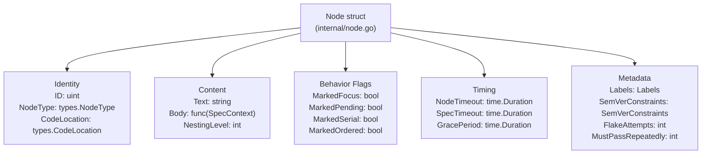

Sources: [vendor/github.com/onsi/ginkgo/v2/internal/node.go:27-70]()

## Hierarchical Spec Organization

### Tree Structure

Ginkgo organizes tests in a hierarchical tree where:
- **Container nodes** (Describe, Context, When) form the internal nodes
- **Subject nodes** (It) form the leaf nodes
- **Setup nodes** (BeforeEach, etc.) are attached at various levels

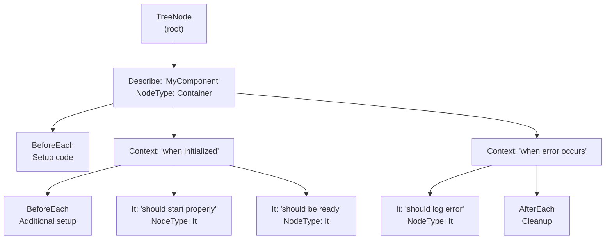

Sources: [vendor/github.com/onsi/ginkgo/v2/internal/suite.go:25-35]()

### Spec Generation from Tree

A **spec** is generated for each `It` node by traversing from the root to that leaf, collecting all relevant setup nodes along the path. This creates the execution plan for a single test.

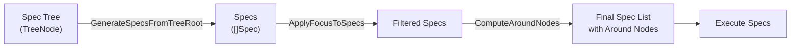

Sources: [vendor/github.com/onsi/ginkgo/v2/internal/suite.go:111-141]()

## Suite Lifecycle Phases

The `Suite` struct manages the entire test suite lifecycle through three distinct phases:

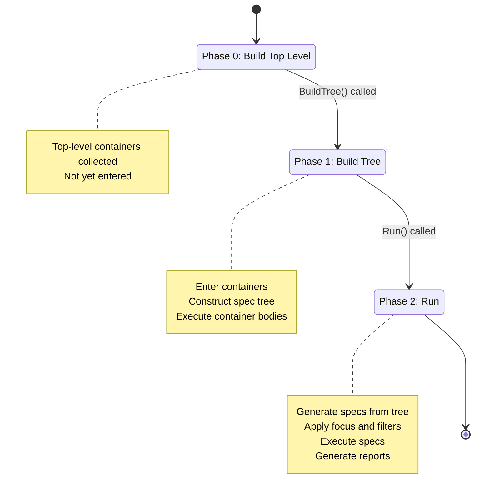

Sources: [vendor/github.com/onsi/ginkgo/v2/internal/suite.go:15-21](), [vendor/github.com/onsi/ginkgo/v2/internal/suite.go:98-141]()

### Phase Details

**Phase 0: PhaseBuildTopLevel**
- Top-level container nodes (Describe, Context) are collected but not entered
- Stored in `suite.topLevelContainers`
- Allows flag parsing and configuration before tree construction
- Purpose: Ensures `RunSpecs()` can configure the suite before building the test tree

**Phase 1: PhaseBuildTree**
- Top-level containers are entered and their closures executed
- The spec tree (`TreeNode`) is constructed
- Nested Describe/Context/It calls create the hierarchical structure
- Container bodies run during this phase to define the tree structure

**Phase 2: PhaseRun**
- Specs are generated from the completed tree
- Focus and filter rules are applied
- Specs are executed in order (with optional parallelization)
- Reports are generated

Sources: [vendor/github.com/onsi/ginkgo/v2/internal/suite.go:98-141](), [vendor/github.com/onsi/ginkgo/v2/internal/suite.go:186-228]()

## Suite Structure and Key Components

### Suite Struct

The `Suite` struct is the central orchestrator for test execution:

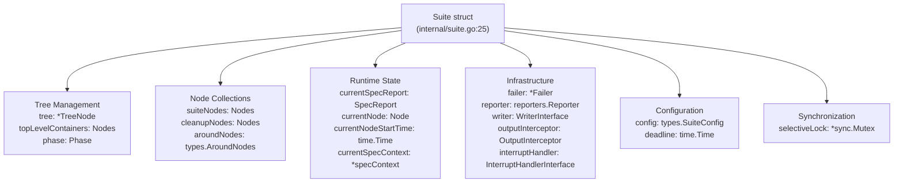

Sources: [vendor/github.com/onsi/ginkgo/v2/internal/suite.go:25-71]()

### Core Components Interaction

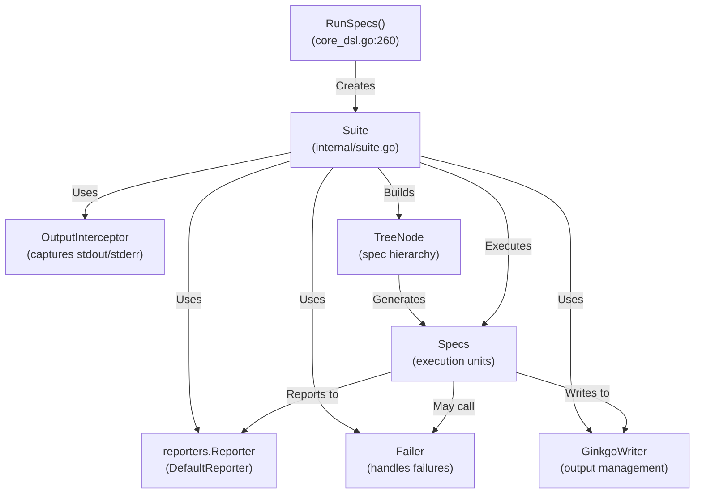

Sources: [vendor/github.com/onsi/ginkgo/v2/core_dsl.go:260-331](), [vendor/github.com/onsi/ginkgo/v2/internal/suite.go:111-141]()

## Spec Execution Model

### From Tree to Execution

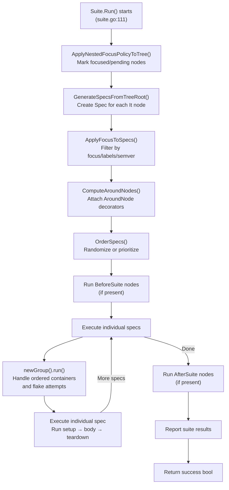

Sources: [vendor/github.com/onsi/ginkgo/v2/internal/suite.go:111-141](), [vendor/github.com/onsi/ginkgo/v2/internal/suite.go:456-552]()

### Node Execution Context

Each node can have an interruptible context for timeout and cancellation support:

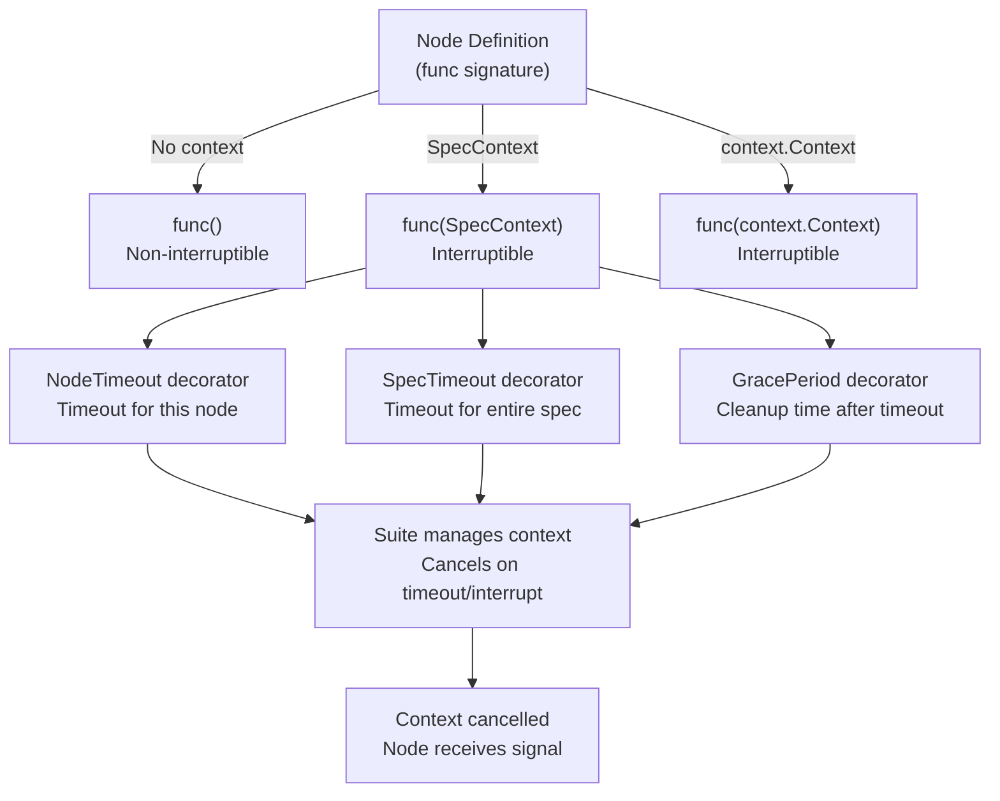

Sources: [vendor/github.com/onsi/ginkgo/v2/internal/node.go:211-213](), [vendor/github.com/onsi/ginkgo/v2/internal/node.go:503-525](), [vendor/github.com/onsi/ginkgo/v2/core_dsl.go:95-102]()

## Node Construction and Decoration

### Node Creation Flow

Nodes are created through DSL functions (Describe, It, BeforeEach, etc.) which go through a standardized construction process:

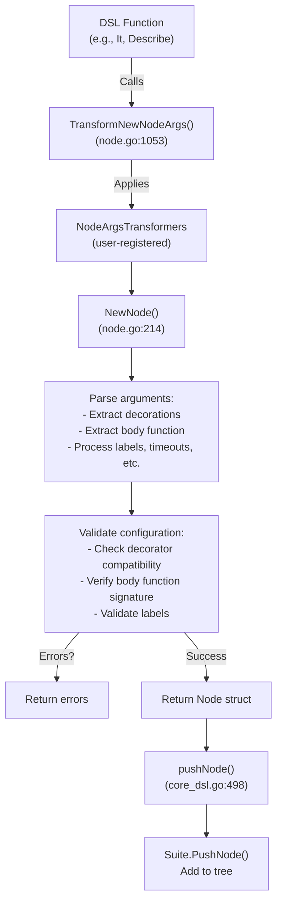

Sources: [vendor/github.com/onsi/ginkgo/v2/internal/node.go:214-499](), [vendor/github.com/onsi/ginkgo/v2/internal/node.go:1047-1078](), [vendor/github.com/onsi/ginkgo/v2/core_dsl.go:496-502]()

### Decoration Types

Nodes support various decorators that modify their behavior:

| Decorator | Type | Purpose |
|-----------|------|---------|
| `Focus` | `focusType` | Mark spec/container to run exclusively |
| `Pending` | `pendingType` | Mark as pending (skip execution) |
| `Serial` | `serialType` | Run serially, not in parallel |
| `Ordered` | `orderedType` | Container with ordered execution |
| `FlakeAttempts(n)` | `FlakeAttempts` | Retry on failure up to n times |
| `MustPassRepeatedly(n)` | `MustPassRepeatedly` | Must pass n times in a row |
| `NodeTimeout(d)` | `NodeTimeout` | Timeout for individual node |
| `SpecTimeout(d)` | `SpecTimeout` | Timeout for entire spec |
| `GracePeriod(d)` | `GracePeriod` | Grace period after timeout |
| `Label(...)` | `Labels` | Attach labels for filtering |
| `Offset(n)` | `Offset` | Adjust code location reporting |
| `SpecPriority(n)` | `SpecPriority` | Set execution priority |

Sources: [vendor/github.com/onsi/ginkgo/v2/internal/node.go:72-98](), [vendor/github.com/onsi/ginkgo/v2/internal/node.go:147-196]()

## Reporter Integration

### Default Reporter

The `DefaultReporter` handles console output and provides the visual feedback during test execution:

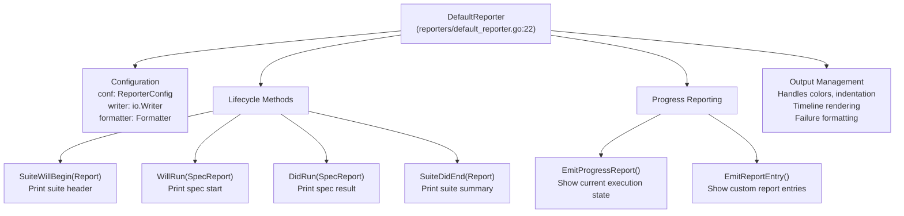

Sources: [vendor/github.com/onsi/ginkgo/v2/reporters/default_reporter.go:22-66](), [vendor/github.com/onsi/ginkgo/v2/reporters/default_reporter.go:69-349]()

## Entry Point: RunSpecs

The `RunSpecs` function is the main entry point that ties everything together:

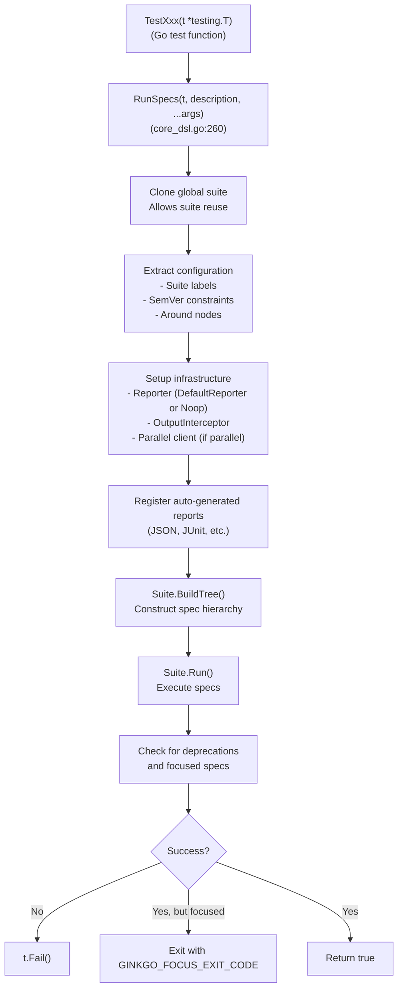

Sources: [vendor/github.com/onsi/ginkgo/v2/core_dsl.go:260-331]()

## Key Interfaces and Types

### GinkgoWriterInterface

`GinkgoWriter` provides output management with automatic buffering and flushing:

```go
// Defined in core_dsl.go:82-92
type GinkgoWriterInterface interface {
    io.Writer
    Print(a ...any)
    Printf(format string, a ...any)
    Println(a ...any)
    TeeTo(writer io.Writer)
    ClearTeeWriters()
}
```

Sources: [vendor/github.com/onsi/ginkgo/v2/core_dsl.go:82-92]()

### SpecContext

`SpecContext` is the context passed to interruptible nodes, extending `context.Context`:

- Provides cancellation signals on timeout or interrupt
- Allows progress reporters to attach additional information
- Can be wrapped with standard context functions (WithTimeout, WithValue, etc.)

Sources: [vendor/github.com/onsi/ginkgo/v2/core_dsl.go:95-102]()

### Report Types

Two main report types exist:

1. **Report** (`types.Report`): Represents the entire suite
   - Contains all spec reports
   - Suite configuration
   - Success/failure status
   - Special failure reasons

2. **SpecReport** (`types.SpecReport`): Represents a single spec
   - State (Passed, Failed, Skipped, etc.)
   - Timing information
   - Failure details
   - Report entries
   - Timeline of events

Sources: [vendor/github.com/onsi/ginkgo/v2/reporting_dsl.go:13-23]()

## Summary

Ginkgo's architecture centers on:

1. **Hierarchical organization**: Tests organized in a tree of Container, Subject, and Setup nodes
2. **Three-phase lifecycle**: Build Top Level → Build Tree → Run
3. **Node-based execution**: Each node type has specific behavior and lifecycle hooks
4. **Flexible decoration**: Nodes can be modified with decorators for focus, timeouts, retries, etc.
5. **Comprehensive reporting**: Integration with reporters for detailed test output

This foundation enables the BDD-style testing patterns that Ginkgo is known for, allowing developers to write expressive, well-organized test suites.

---

