<!-- source: DeepWiki mcp.deepwiki.com · repo NVIDIA/k8s-test-infra · page 5.2 Test Structure and DSL · fetched 2026-10-26 -->

# Test Structure and DSL

<details>
<summary>Relevant source files</summary>

The following files were used as context for generating this wiki page:

- [.github/workflows/nvml-mock-e2e-go.yaml](.github/workflows/nvml-mock-e2e-go.yaml)
- [Makefile](Makefile)
- [README.md](README.md)
- [tests/e2e/README.md](tests/e2e/README.md)
- [tests/e2e/go/e2e_suite_test.go](tests/e2e/go/e2e_suite_test.go)
- [tests/e2e/go/framework/config/config.go](tests/e2e/go/framework/config/config.go)
- [tests/e2e/go/framework/harness/harness.go](tests/e2e/go/framework/harness/harness.go)
- [tests/e2e/go/suite_cluster.go](tests/e2e/go/suite_cluster.go)
- [tests/e2e/go/suite_helm.go](tests/e2e/go/suite_helm.go)
- [vendor/github.com/onsi/ginkgo/v2/README.md](vendor/github.com/onsi/ginkgo/v2/README.md)
- [vendor/github.com/onsi/ginkgo/v2/core_dsl.go](vendor/github.com/onsi/ginkgo/v2/core_dsl.go)
- [vendor/github.com/onsi/ginkgo/v2/internal/global/init.go](vendor/github.com/onsi/ginkgo/v2/internal/global/init.go)
- [vendor/github.com/onsi/ginkgo/v2/internal/node.go](vendor/github.com/onsi/ginkgo/v2/internal/node.go)
- [vendor/github.com/onsi/ginkgo/v2/reporting_dsl.go](vendor/github.com/onsi/ginkgo/v2/reporting_dsl.go)
- [vendor/github.com/onsi/ginkgo/v2/table_dsl.go](vendor/github.com/onsi/ginkgo/v2/table_dsl.go)
- [vendor/github.com/onsi/gomega/CHANGELOG.md](vendor/github.com/onsi/gomega/CHANGELOG.md)
- [vendor/github.com/onsi/gomega/format/format.go](vendor/github.com/onsi/gomega/format/format.go)
- [vendor/github.com/onsi/gomega/gomega_dsl.go](vendor/github.com/onsi/gomega/gomega_dsl.go)
- [vendor/github.com/onsi/gomega/matchers.go](vendor/github.com/onsi/gomega/matchers.go)
- [vendor/github.com/onsi/gomega/matchers/be_a_slice_matcher.go](vendor/github.com/onsi/gomega/matchers/be_a_slice_matcher.go)
- [vendor/github.com/onsi/gomega/matchers/be_an_array_matcher.go](vendor/github.com/onsi/gomega/matchers/be_an_array_matcher.go)
- [vendor/github.com/onsi/gomega/types/types.go](vendor/github.com/onsi/gomega/types/types.go)

</details>


This page documents the Ginkgo Domain-Specific Language (DSL) used in the k8s-test-infra repository to structure E2E and unit tests. It covers the hierarchical test node types (`Describe`, `Context`, `It`), setup and teardown hooks (`BeforeEach`, `AfterEach`), decorators for controlling test execution, and table-driven testing patterns commonly used in the E2E and unit test suites.

This detailed documentation explains how tests are composed, how Ginkgo organizes the execution lifecycle, and how DSL constructs generate rich, maintainable test suites. It also bridges terminology from natural language test descriptions into specific code entities and functions.

For configuration and parallel execution details, see the sibling page [5.3 Configuration and Parallel Execution](). For reporting and output, see [5.4 Test Reporting and Output](). For the Ginkgo framework overview, see [5.1 Ginkgo Framework Overview]().

---

## Node Type Hierarchy

Ginkgo organizes test code into a tree structure of various node types:

- **Container nodes**: logical groups, e.g. `Describe`, `Context`, `When`.
- **Subject nodes**: individual test cases, e.g. `It`, `Specify`.
- **Setup/teardown nodes**: hooks like `BeforeEach`, `AfterEach`.
- **Suite-level hooks**: `BeforeSuite`, `AfterSuite`.
- **Deferred cleanup**: `DeferCleanup` registrations.
- **Reporting nodes**: utilities like `By()` and `AddReportEntry()`.

The following diagram shows the node types and their hierarchical relationships:

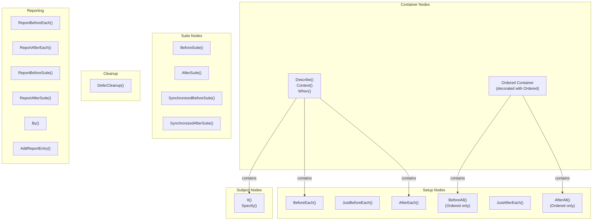

*Sources: [vendor/github.com/onsi/ginkgo/v2/core_dsl.go:546-653](), [vendor/github.com/onsi/ginkgo/v2/internal/node.go:27-70]()*


---

## Container Nodes

Container nodes group tests into hierarchical contexts. They organize the specification into readable, logical sections.

### Core Container Functions

| Function         | Purpose                                        | Alias of    |
|------------------|------------------------------------------------|-------------|
| `Describe(text, body)` | Primary container node                    | -           |
| `Context(text, body)`  | Alias for `Describe` used for context groups | `Describe`  |
| `When(text, body)`     | Alias for `Describe` with "when " prefix  | `Describe`  |
| `FDescribe` / `FContext` / `FWhen` | Focused container (only these run) | -     |
| `PDescribe` / `PContext` / `PWhen` | Pending container (skipped)     | -           |
| `XDescribe` / `XContext` / `XWhen` | Pending alias                 | `PDescribe` |

Containers define test sections and can nest arbitrarily.

### Container Structure Example

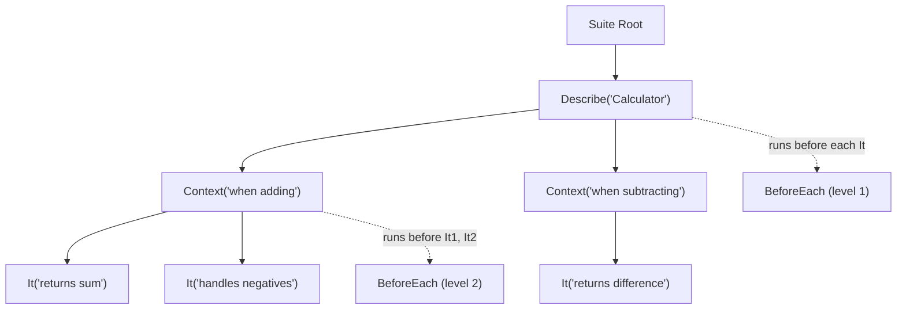

This organizes specs hierarchically for clarity and reuse of setup code.

### Container Execution Flow

At runtime, the body functions of container nodes execute to register child nodes:

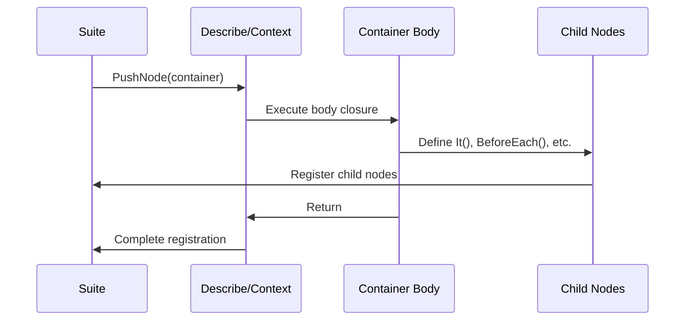

The container body defines the nested test structure dynamically.

*Sources: [vendor/github.com/onsi/ginkgo/v2/core_dsl.go:546-593](), [vendor/github.com/onsi/ginkgo/v2/internal/node.go:187-228](), [vendor/github.com/onsi/ginkgo/v2/internal/suite.go:98-109]()*

---

## Subject Nodes (`It`, `Specify`)

Subject nodes hold the actual test logic and assertions.

### Subject Node Functions

| Function | Description                              |
| -------- | ----------------------------------------|
| `It(text, func)` | Defines a single test case          |
| `Specify(text, func)` | Alias for `It`                  |
| `FIt`, `FSpecify` | Focused variant (only these run) |
| `PIt`, `PSpecify` | Pending variant (skipped)        |
| `XIt`, `XSpecify` | Alias for `PIt`                  |

### Subject Node Function Signatures and Interruptibility

Subject nodes support several function signatures:

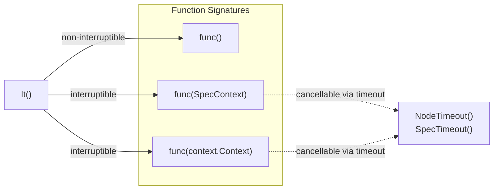

If the provided test function accepts `SpecContext` or `context.Context`, it can be externally cancelled on timeout or interrupt signals.

Example interruptible spec:

```go
It("should complete within timeout", func(ctx SpecContext) {
    // test logic with ctx cancellation support
}, NodeTimeout(30*time.Second))
```

*Sources: [vendor/github.com/onsi/ginkgo/v2/core_dsl.go:605-630](), [vendor/github.com/onsi/ginkgo/v2/internal/node.go:503-525](), [vendor/github.com/onsi/ginkgo/v2/core_dsl.go:94-101](), [vendor/github.com/onsi/ginkgo/v2/internal/node.go:468-472]()*


---

## Setup and Teardown Hooks

Setup and teardown nodes run preparation and cleanup code around tests.

### Hook Types and Execution Order

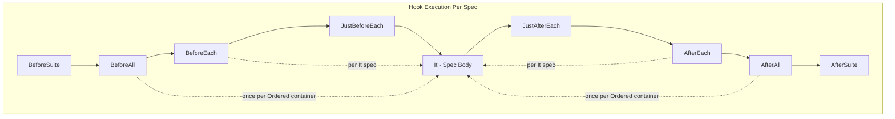

- `BeforeSuite` / `AfterSuite`: Suite-wide setup/teardown, run once.
- `BeforeAll` / `AfterAll`: Run once per `Ordered` container.
- `BeforeEach` / `AfterEach`: Run before/after each spec in container subtree.
- `JustBeforeEach` / `JustAfterEach`: For ordering around `BeforeEach` and `AfterEach`.

### Setup/Teardown Hook API Summary

| Hook Type           | Execution Frequency               | Scope                      | Supports DeferCleanup |
|---------------------|---------------------------------|----------------------------|----------------------|
| `BeforeSuite()`     | Once per suite                   | Suite-wide                 | Yes                  |
| `BeforeAll()`       | Once per Ordered container       | Ordered container only     | Yes                  |
| `BeforeEach()`      | Before each spec                 | Container and descendants  | Yes                  |
| `JustBeforeEach()`  | After `BeforeEach`, before spec | Container and descendants  | Yes                  |
| `AfterEach()`       | After each spec                  | Container and descendants  | Yes                  |
| `JustAfterEach()`   | Before `AfterEach`, after spec  | Container and descendants  | Yes                  |
| `AfterAll()`        | Once per Ordered container       | Ordered container only     | Yes                  |
| `AfterSuite()`      | Once per suite                  | Suite-wide                 | Yes                  |

### DeferCleanup

`DeferCleanup(func())` registers cleanup functions to run after the current hook or spec finishes, ensuring proper resource release.

The timing depends on where it is called:

- Called in `BeforeSuite` ⇒ runs during `AfterSuite`.
- Called in `BeforeAll` ⇒ runs during `AfterAll`.
- Called in `BeforeEach` ⇒ runs during `AfterEach`.
- Called in `It` ⇒ runs during `AfterEach`.

This enables structured resource cleanup without manual tracking.

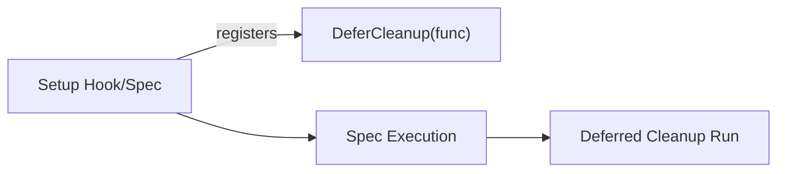

### Synchronized Suite Hooks

For parallel test runs, Ginkgo provides synchronized suite hooks to coordinate setup/teardown across processes:

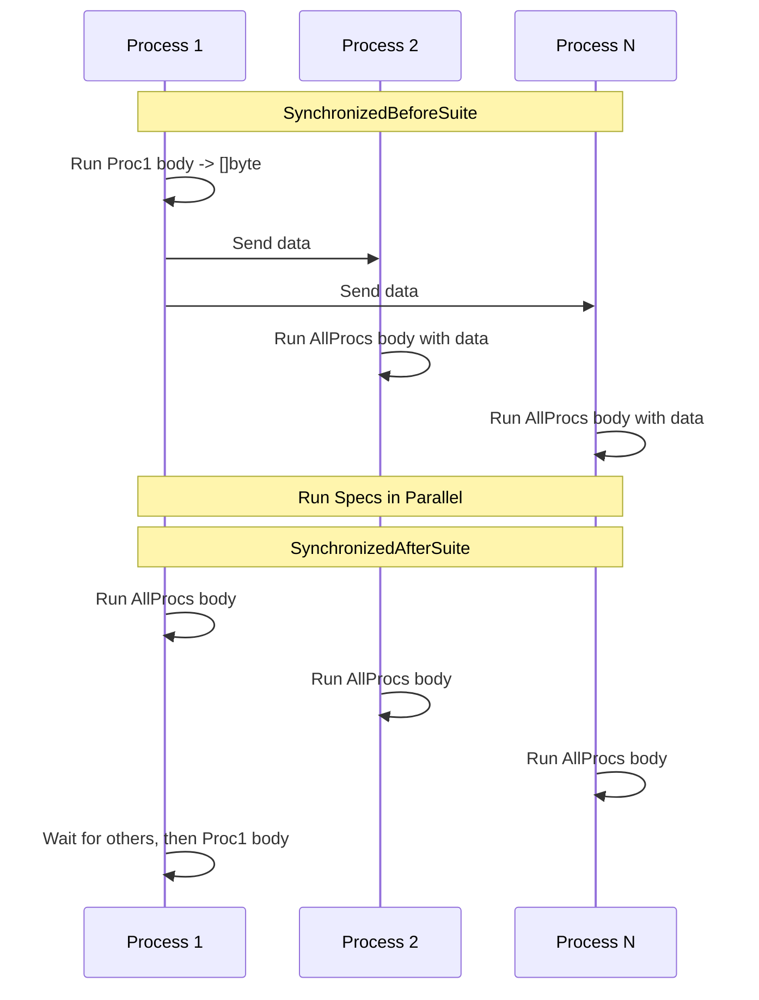

This pattern is used in `./tests/e2e/go/e2e_suite_test.go` to build the shared nvml-mock image once per parallel process group before running tests.

*Sources: [vendor/github.com/onsi/ginkgo/v2/core_dsl.go:666-766](), [vendor/github.com/onsi/ginkgo/v2/internal/node.go:239-254](), [vendor/github.com/onsi/ginkgo/v2/core_dsl.go:693-739]()*


---

## Decorators

Decorators modify node behavior to control execution characteristics like focus, timeouts, retries, ordering, labels, and priorities.

### Decorator Types

```mermaid
graph TB
    subgraph "Focus"
        Focus["Focus (run only these)"]
        Pending["Pending (skip these)"]
    end
    
    subgraph "Execution"
        Serial["Serial (no parallel)"]
        Ordered["Ordered (sequential)"]
        ContinueOnFailure["ContinueOnFailure"]
        OncePerOrdered["OncePerOrdered (setup/teardown)"]
    end
    
    subgraph "Retries"
        FlakeAttempts["FlakeAttempts(n)"]
        MustPassRepeatedly["MustPassRepeatedly(n)"]
    end
    
    subgraph "Timeouts"
        NodeTimeout["NodeTimeout(duration)"]
        SpecTimeout["SpecTimeout(duration)"]
        GracePeriod["GracePeriod(duration)"]
    end
    
    subgraph "Progress"
        PollProgressAfter["PollProgressAfter(d)"]
        PollProgressInterval["PollProgressInterval(d)"]
    end
    
    subgraph "Metadata"
        Labels["Label(strings...)"]
        SemVerConstraint["SemVerConstraint(strings...)"]
        SpecPriority["SpecPriority(int)"]
    end
    
    subgraph "Location"
        Offset["Offset(n)"]
        CodeLocation["types.CodeLocation"]
    end
```

### Decorator Application Rules

| Decorator           | Valid On            | Notes                                                   |
|---------------------|---------------------|---------------------------------------------------------|
| `Focus`             | Containers, It      | Runs only focused specs                                   |
| `Pending`           | Containers, It      | Marks specs as skipped                                   |
| `Serial`            | Containers, It      | Prevents parallel execution; adds `Serial` label         |
| `Ordered`           | Containers          | Containers run sequentially                              |
| `ContinueOnFailure` | Ordered containers  | Continues execution after failures                       |
| `OncePerOrdered`    | Setup/teardown hooks| Runs once per Ordered container                          |
| `FlakeAttempts(n)`  | Containers, It      | Retries on failure (cannot combine with `MustPassRepeatedly`) |
| `MustPassRepeatedly(n)` | Containers, It   | Tests must pass repeatedly (cannot combine with `FlakeAttempts`) |
| `NodeTimeout()`     | Except container    | Timeout per node; requires interruptible test function  |
| `SpecTimeout()`     | It only             | Timeout for entire test; requires interruptible test function |
| `GracePeriod()`     | Except container    | Grace period allowed for cleanup phase                   |
| `Label()`           | Containers, It      | For filtering and organization                           |
| `SemVerConstraint()`| Containers, It      | Filters execution by semantic version constraints       |
| `SpecPriority()`    | Containers, It      | Controls ordering of tests                               |
| `Offset()`, `CodeLocation()` | All        | Advanced control of code location during reporting      |

### Example Usage

```go
Describe("API Client", Label("integration", "api"), func() {
    It("connects successfully",
        func(ctx SpecContext) {
            // test code
        },
        NodeTimeout(5*time.Second),
        FlakeAttempts(3),
    )
    
    It("handles timeout", Serial, func() {
        // runs serially, no parallel execution
    })
})
```

*Sources: [vendor/github.com/onsi/ginkgo/v2/internal/node.go:72-98](), [vendor/github.com/onsi/ginkgo/v2/internal/node.go:261-363]()*


---

## Table-Driven Tests

Ginkgo supports table-driven tests to reduce repetition by defining sets of inputs and expected behaviors.

### Table-Driven Test Structure

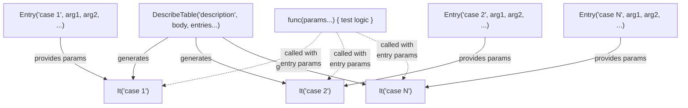

Each `Entry` expands to a separate `It` test executed with unique parameters.

### Table DSL Functions

| Function               | Purpose                             | Generates                       |
|------------------------|-----------------------------------|--------------------------------|
| `DescribeTable()`      | Defines a table-driven test        | Multiple `It` subject nodes    |
| `DescribeTableSubtree()` | Defines table where each entry generates a container subtree | Multiple `Describe` containers |
| `Entry()`              | Test case with parameters          | Parameters to test function    |
| `FEntry()`             | Focused test case                  | Focused subject node           |
| `PEntry()`             | Pending (skipped) test case        | Skipped subject node            |
| `EntryDescription`     | Format description for entries     | Entry name template or callback |

### Entry Description Generation

Entry names are generated using various methods:

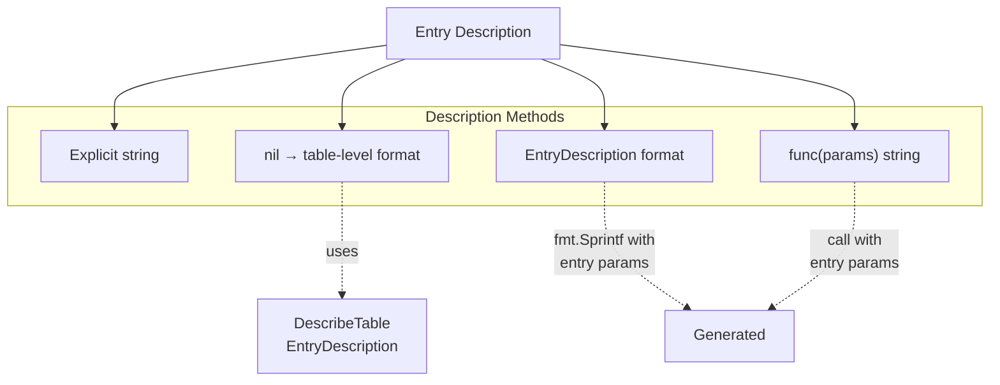

### Table Body Function Signatures

Table body functions accept either plain or interruptible functions, with variadic or fixed parameters:

```go
// Basic, non-interruptible
DescribeTable("basic", func(x int, y string) { ... })

// Interruptible with SpecContext
DescribeTable("with context", func(ctx SpecContext, x int, y string) { ... })

// Variadic parameter support
DescribeTable("variadic", func(first int, rest ...string) { ... })
```

### DescribeTableSubtree

`DescribeTableSubtree` generates a container subtree for each entry, each with its own hooks and specs:

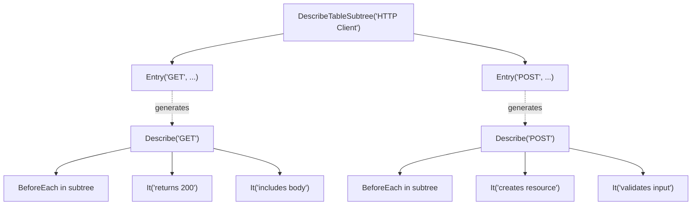

*Sources: [vendor/github.com/onsi/ginkgo/v2/table_dsl.go:13-194](), [vendor/github.com/onsi/ginkgo/v2/table_dsl.go:112-141](), [vendor/github.com/onsi/ginkgo/v2/table_dsl.go:248-378]()*


---

## Reporting and Documentation Helpers

Ginkgo provides utilities to document test steps and attach additional information during test execution.

### Reporting DSL Functions

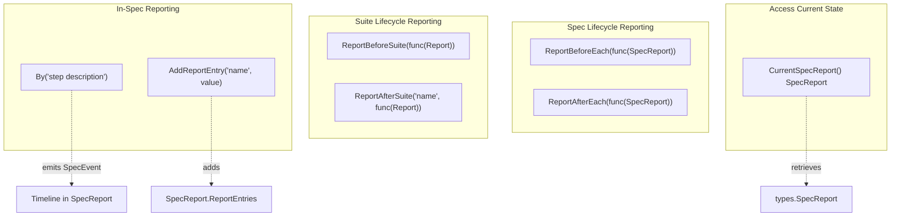

### `By` - Documenting Spec Steps

The `By()` function documents a logical step inside an `It` block, producing timeline events and improving output readability:

```go
It("processes order", func() {
    By("validating input")
    // validation code
    
    By("calculating total")
    // calculation code
    
    By("saving to database", func() {
        // immediate callback execution allowed
    })
})
```

The timeline of `By` calls appears in reports and helps trace test progress.

### `AddReportEntry` - Attaching Additional Data

`AddReportEntry(name string, value any, visibility ...)` attaches arbitrary data to the current spec report. Different visibility options control when it appears:

| Visibility Option               | Shown When               |
| ----------------------------- | ----------------------- |
| `ReportEntryVisibilityAlways` | Always in console output  |
| `ReportEntryVisibilityFailureOrVerbose` | Only on failure or verbose mode (`-v`) |
| `ReportEntryVisibilityNever`  | Only in machine-readable reports |

Example:

```go
It("generates data", func() {
    result := compute()
    AddReportEntry("computation", result) // shows in all reports
    
    AddReportEntry("debug", debugData, ReportEntryVisibilityFailureOrVerbose) // conditional
})
```

### Report Lifecycle Hook Sequence

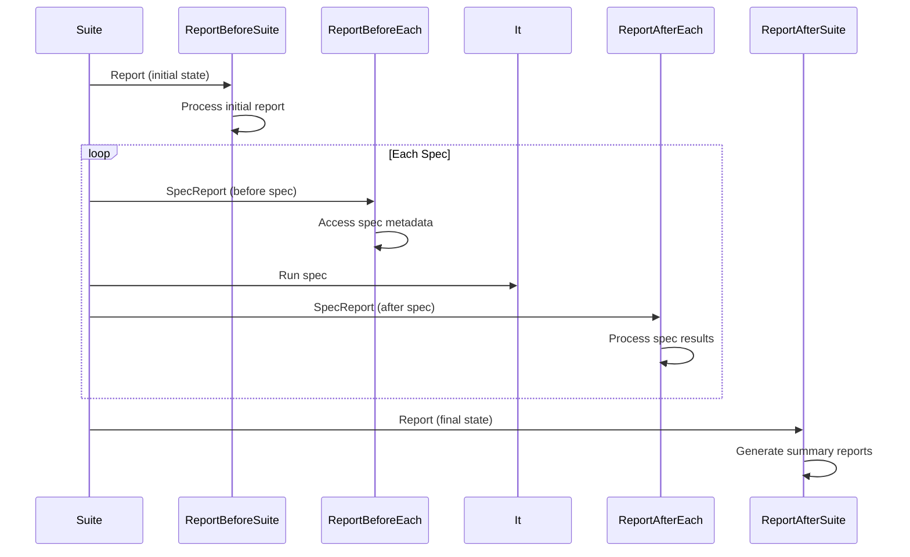

### Accessing `CurrentSpecReport()`

The `CurrentSpecReport()` function retrieves the current spec's complete report object during execution:

```go
BeforeEach(func() {
    report := CurrentSpecReport()
    fmt.Printf("Running spec: %s\n", report.FullText())
    fmt.Printf("Labels: %v\n", report.Labels())
})
```

Fields available in `types.SpecReport` include:

- `LeafNodeText`: The `It` text.
- `ContainerHierarchyTexts`: Parent container texts.
- `State`: Pass/fail/pending status.
- `RunTime`: Duration.
- `ReportEntries`: Attached report entries (via `AddReportEntry`).
- `CapturedGinkgoWriterOutput`: Captured output during the spec.

*Sources: [vendor/github.com/onsi/ginkgo/v2/reporting_dsl.go:1-260](), [vendor/github.com/onsi/ginkgo/v2/internal/suite.go:316-391]()*


---

## DSL Function Call Processing Flow

Understanding the internal flow helps fix test setup errors and write correct specs.

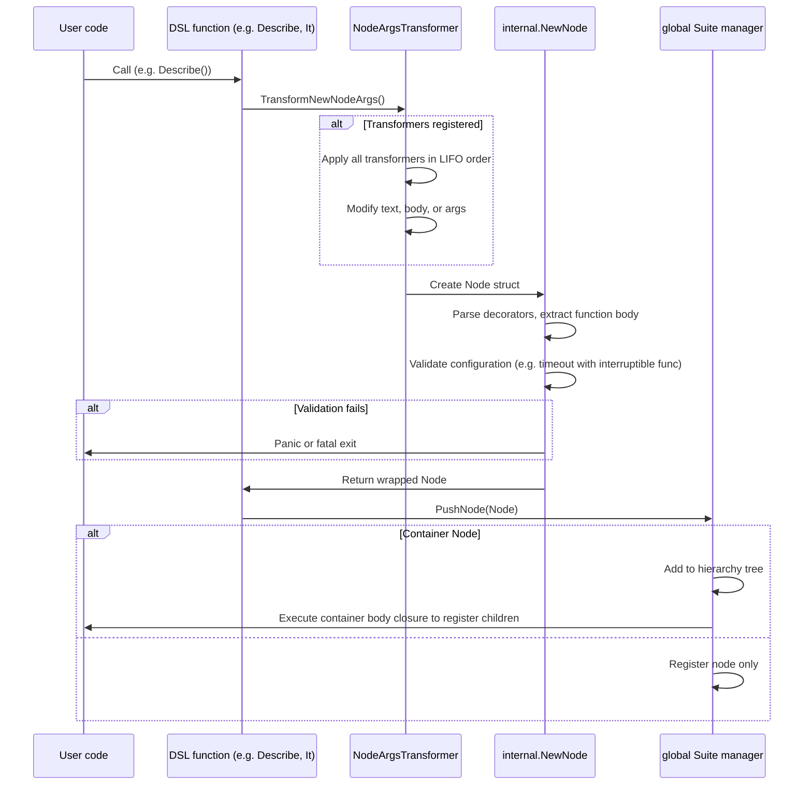

### Decorator Processing Order

When creating nodes, decorators are processed in the following order:

1. **Offset/CodeLocation**: Sets source location for error reporting.
2. **Node-Type Compatibility**: Ensures decorators are valid for the node type.
3. **Label and SemVer Deduplication**: Removes duplicates among labels and version constraints.
4. **Function Extraction**: Identifies the test/cleanup function body; validates interruptibility.
5. **Cross-Decorator Validation**: For example, ensures `Focus` and `Pending` aren't combined.

This guarantees consistent node construction with clear diagnostics.

*Sources: [vendor/github.com/onsi/ginkgo/v2/core_dsl.go:496-502](), [vendor/github.com/onsi/ginkgo/v2/internal/node.go:214-499](), [vendor/github.com/onsi/ginkgo/v2/internal/suite.go:153-228]()*

---

# Summary

This page has explained the comprehensive Ginkgo DSL features used in the NVIDIA k8s-test-infra E2E and unit test suites:

- The hierarchical node types organizing tests.
- Setup and teardown hooks with execution ordering.
- Rich decorators controlling test isolation, timing, and filtering.
- Table-driven tests to efficiently run parameterized scenarios.
- Reporting and documentation helpers embedded in tests.
- The internal DSL function invocation and decorator processing flow.

These constructs enable the project to define expressive, maintainable, and reliable integration and unit tests that integrate smoothly with the Kubernetes test infrastructure and GPU simulation subsystems.


# Diagrams Bridging Natural Language to Code Entities

## 1. Mapping Natural Language Test Structure to Code Entities in tests/e2e/go

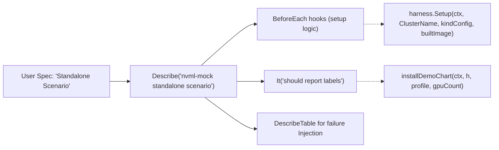

This summarises how natural language test steps map onto container nodes, hooks, and helper functions in Go code under `tests/e2e/go`.

*Sources: [tests/e2e/go/e2e_suite_test.go:52-62](), [tests/e2e/go/suite_helm.go:36-46](), [tests/e2e/README.md:116-131]()*


## 2. Linking Ginkgo DSL Constructs to Internal Node Types

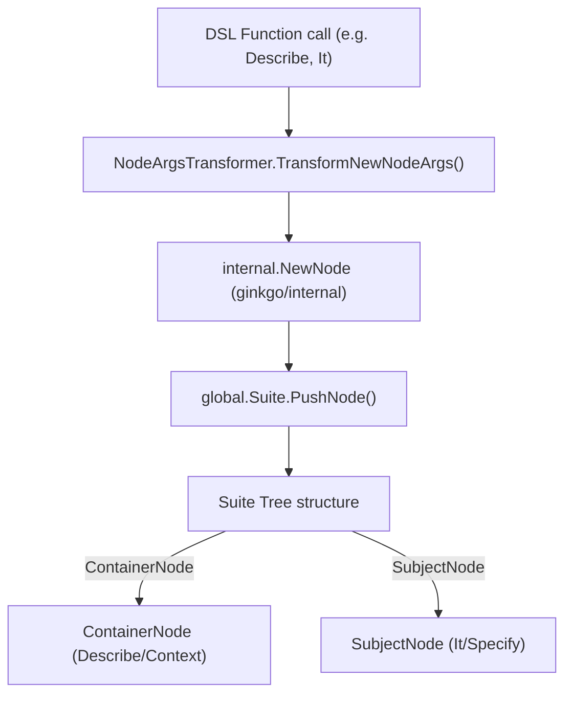

This diagram clarifies how DSL function calls translate into internal Ginkgo node structs organized into the test suite tree.

*Sources: [vendor/github.com/onsi/ginkgo/v2/core_dsl.go:496-502](), [vendor/github.com/onsi/ginkgo/v2/internal/node.go:1047-1078]()*

---

# References

- [vendor/github.com/onsi/ginkgo/v2/core_dsl.go](https://github.com/onsi/ginkgo/tree/v2)
- [vendor/github.com/onsi/ginkgo/v2/internal/node.go](https://github.com/onsi/ginkgo/tree/v2)
- [vendor/github.com/onsi/ginkgo/v2/table_dsl.go](https://github.com/onsi/ginkgo/tree/v2)
- [tests/e2e/go/e2e_suite_test.go](./tests/e2e/go/e2e_suite_test.go)
- [tests/e2e/go/suite_helm.go](./tests/e2e/go/suite_helm.go)
- [tests/e2e/README.md](./tests/e2e/README.md)

---

*End of page 5.2 - Test Structure and DSL.*

---

