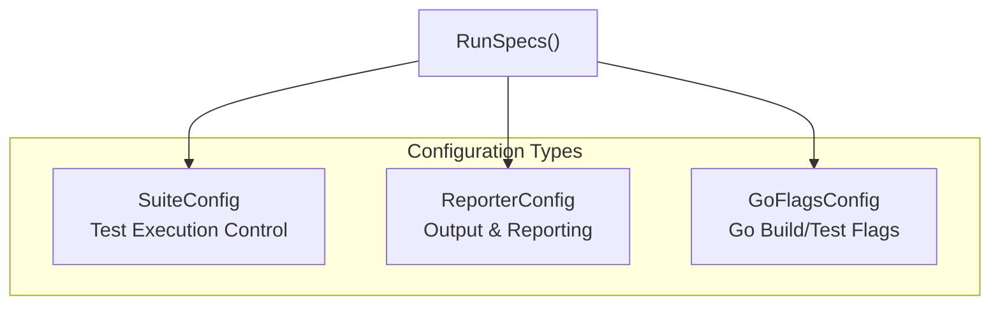
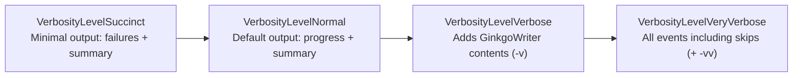
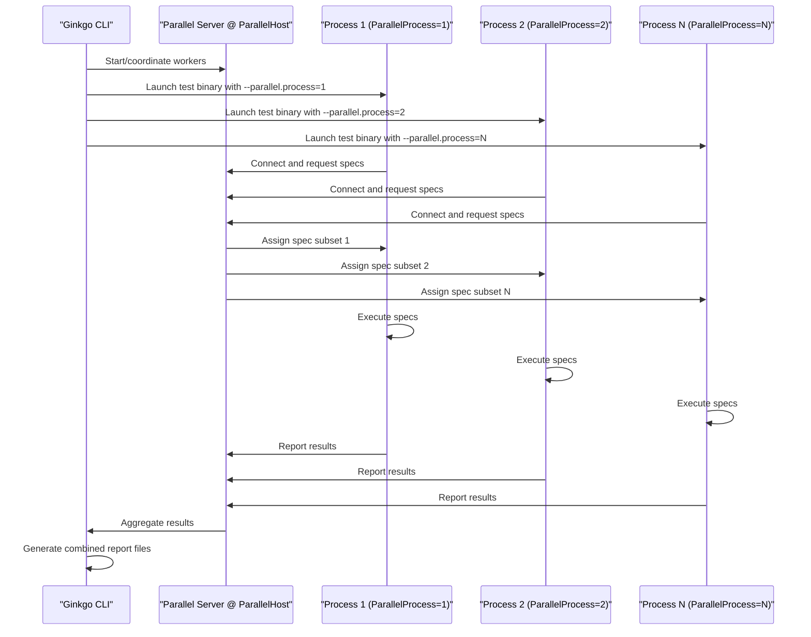
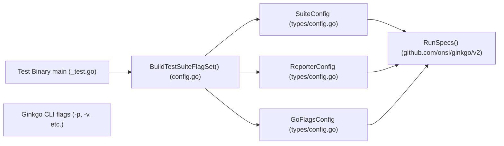
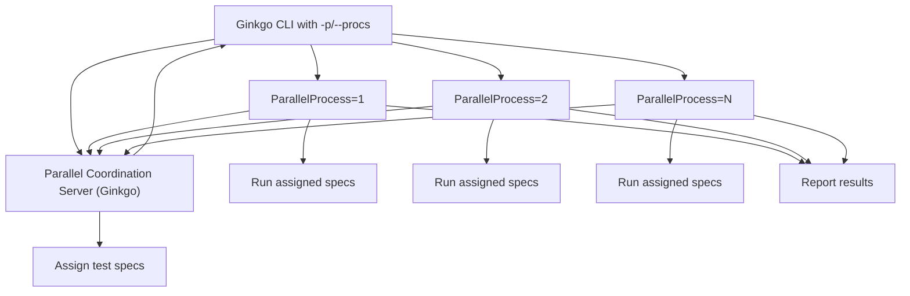

<!-- source: DeepWiki mcp.deepwiki.com · repo NVIDIA/k8s-test-infra · page 5.3 Configuration and Parallel Execution · fetched 2026-10-26 -->

# Configuration and Parallel Execution

<details>
<summary>Relevant source files</summary>

The following files were used as context for generating this wiki page:

- [.github/workflows/nvml-mock-e2e-go.yaml](.github/workflows/nvml-mock-e2e-go.yaml)
- [Makefile](Makefile)
- [README.md](README.md)
- [tests/e2e/README.md](tests/e2e/README.md)
- [tests/e2e/go/e2e_suite_test.go](tests/e2e/go/e2e_suite_test.go)
- [tests/e2e/go/framework/config/config.go](tests/e2e/go/framework/config/config.go)
- [tests/e2e/go/framework/harness/harness.go](tests/e2e/go/framework/harness/harness.go)
- [tests/e2e/go/suite_cluster.go](tests/e2e/go/suite_cluster.go)
- [tests/e2e/go/suite_helm.go](tests/e2e/go/suite_helm.go)
- [vendor/github.com/onsi/ginkgo/v2/ginkgo/run/run_command.go](vendor/github.com/onsi/ginkgo/v2/ginkgo/run/run_command.go)
- [vendor/github.com/onsi/ginkgo/v2/ginkgo/watch/watch_command.go](vendor/github.com/onsi/ginkgo/v2/ginkgo/watch/watch_command.go)
- [vendor/github.com/onsi/ginkgo/v2/internal/suite.go](vendor/github.com/onsi/ginkgo/v2/internal/suite.go)
- [vendor/github.com/onsi/ginkgo/v2/types/config.go](vendor/github.com/onsi/ginkgo/v2/types/config.go)
- [vendor/github.com/onsi/ginkgo/v2/types/errors.go](vendor/github.com/onsi/ginkgo/v2/types/errors.go)

</details>


This page documents the configuration and parallel execution facilities as used in the k8s-test-infra project’s end-to-end (E2E) testing harness. It explains the core Ginkgo configuration types (`SuiteConfig`, `ReporterConfig`), usage patterns, how parallelism and test randomization are configured, and the `SynchronizedBeforeSuite` pattern employed to efficiently share the single image build process across parallel processes.

For foundational knowledge about the Ginkgo framework and test structure, see the related wiki pages [Ginkgo Framework Overview](#5.1) and [Test Structure and DSL](#5.2). For output and reporting details, see [Test Reporting and Output](#5.4).

---

## Configuration Overview

The core configuration for Ginkgo test execution is represented by three main configuration structs:

- **SuiteConfig:** Controls test execution behaviors such as filtering, ordering, parallelism, timing, failure strategies, and randomization.
- **ReporterConfig:** Controls the output formatting, verbosity, and reporting formats (e.g., JSON, JUnit).
- **GoFlagsConfig:** Captures Go-specific build and runtime test flags like race detection and profiling.

These configurations are constructed and passed to the `RunSpecs()` function, which drives the test execution lifecycle.



Sources: [vendor/github.com/onsi/ginkgo/v2/types/config.go:18-122]()

---

## SuiteConfig: Controlling Test Execution

The heart of test execution configuration is the `SuiteConfig` struct, which provides comprehensive control over how specs are selected, ordered, executed, and how failures are handled.

### Core Fields and Meaning

| Field               | Type          | Purpose                                                                                                       | Default                 |
|---------------------|---------------|---------------------------------------------------------------------------------------------------------------|-------------------------|
| `RandomSeed`        | `int64`       | Seed controlling spec order randomization                                                                     | Current Unix timestamp  |
| `RandomizeAllSpecs` | `bool`        | Flag whether to randomize order of all specs (true) or only top-level containers (false)                     | `false`                 |
| `FailFast`          | `bool`        | Immediately stop suite on first failure                                                                        | `false`                 |
| `FailOnPending`     | `bool`        | Cause suite failure if any spec is pending                                                                     | `false`                 |
| `FlakeAttempts`     | `int`         | Number of times to retry a failing spec before failing                                                        | `0`                     |
| `Timeout`           | `time.Duration` | Maximum duration allowed for entire suite execution                                                               | 1 hour                  |
| `GracePeriod`       | `time.Duration` | Time allowed for cleanup after receiving an interrupt                                                          | 30 seconds              |
| `ParallelProcess`   | `int`         | 1-based index of this parallel test process                                                                     | 1 (serial)              |
| `ParallelTotal`     | `int`         | Total number of parallel processes running the suite                                                            | 1 (serial)              |

Randomization controls are used to reorder specs for improved coverage, with a time-based seed default.

### Filtering Mechanisms

`SuiteConfig` supports multiple filtering modes to select which specs run:

- **FocusStrings / SkipStrings:** Regex expressions matched to spec description text, ORed among multiple entries.
- **FocusFiles / SkipFiles:** File and line-based filtering to include or exclude specs by location.
- **LabelFilter:** A Boolean expression on spec labels supporting `!`, `&&`, `||`, grouping, and regex.
- **SemVerFilter:** Semantic version constraints filtering specs annotated by version.

Filtering combinatorics produce the final spec list to run.

### Timeout and Progress

Timeout-related fields control suite runtime limits and progress reporting:

- `Timeout`: Total allowed suite runtime
- `GracePeriod`: Time to wait after interrupt for cleanup
- `PollProgressAfter`: How long to wait before emitting progress reports for long-running specs
- `PollProgressInterval`: Interval at which progress reports are emitted once polling begins
- `OutputInterceptorMode`: Controls output capturing strategy in parallel runs (`dup`, `swap`, or `none`)

Sources: [vendor/github.com/onsi/ginkgo/v2/types/config.go:19-46,34-40](), [vendor/github.com/onsi/ginkgo/v2/types/config.go:297-310]()

---

## ReporterConfig: Output and Reporting Control

The `ReporterConfig` struct configures output verbosity, formatting, and report file generation:

### Verbosity Levels

Four verbosity levels are defined through the `VerbosityLevel` type:



Controlled by boolean flags (`Succinct`, `Verbose`, `VeryVerbose`) which are mutually exclusive.

### Report Formats and Display Options

| Field           | Description                               |
|-----------------|-------------------------------------------|
| `JSONReport`    | Output detailed JSON test report          |
| `GoJSONReport`  | Go test-compatible JSON report             |
| `JUnitReport`   | Output JUnit XML report                     |
| `TeamcityReport`| TeamCity-specific reporting format          |
| `NoColor`       | Disable colored console output              |
| `ShowNodeEvents`| Print spec enter/exit events in timeline   |
| `SilenceSkips`  | Suppress printing skipped tests            |
| `ForceNewlines` | Force newlines after each test output      |
| `GithubOutput`  | Format output for GitHub Actions            |
| `FullTrace`     | Print full failure stacktraces              |

Sources: [vendor/github.com/onsi/ginkgo/v2/types/config.go:87-104,341-376]()

---

## Parallel Test Execution

Ginkgo supports parallel execution by splitting the test suite across multiple processes, each running a subset of specs. Coordination is handled by a parallel server.

### Parallel Configuration Fields

| Field            | Purpose                                                                                         | Default |
|------------------|-------------------------------------------------------------------------------------------------|---------|
| `ParallelTotal`  | Total number of parallel worker processes                                                        | 1       |
| `ParallelProcess`| ID (1-indexed) of this worker process                                                           | 1       |
| `ParallelHost`   | Address of the orchestration server coordinating spec distribution                                | empty   |

### Parallel Execution Model

The CLI invokes multiple test binary processes, each with a distinct `ParallelProcess` ID. The server, located at `ParallelHost`, distributes specs such that:

- Each spec runs exactly once.
- Specs marked `Serial` run exclusively on a single process at a time.
- Specs inside `Ordered` containers execute serially in a linear order within the assigned process.
- Output is captured and replayed to avoid interleaving.



Sources: [vendor/github.com/onsi/ginkgo/v2/types/config.go:42-47,331-338]()

### CLI Control of Parallelism

Users invoke parallel testing via CLI flags:

| CLI Flag           | Maps to Config Field         | Description                                    |
|--------------------|-----------------------------|------------------------------------------------|
| `-p` or `--parallel`| `CLIConfig.Parallel`         | Enable parallel execution with auto process count |
| `--procs=N` or `--nodes=N` | `CLIConfig.Procs`         | Manually specify N parallel worker processes      |

Internally, the CLI sets `SuiteConfig.ParallelTotal`, `SuiteConfig.ParallelProcess`, and `SuiteConfig.ParallelHost` for each worker.

The logic to compute default parallel process count is:

```go
func (g CLIConfig) ComputedProcs() int {
    if g.Procs > 0 {
        return g.Procs // user override
    }
    n := 1
    if g.Parallel {
        n = runtime.GOMAXPROCS(-1) // use all but one core if >4 cores
        if n > 4 {
            n = n - 1
        }
    }
    return n
}
```

Sources: [vendor/github.com/onsi/ginkgo/v2/types/config.go:157-170]()

---

## Single Image Build with `SynchronizedBeforeSuite`

In the k8s-test-infra E2E tests (`tests/e2e/go/e2e_suite_test.go`), the expensive step to build the `nvml-mock` Docker image is controlled via Ginkgo's `SynchronizedBeforeSuite` feature, which runs a setup step exactly once per parallel suite run and shares its result with all parallel processes.

This pattern avoids redundant image builds on each parallel runner process:

- **First Ginkgo process (#1):** Builds the image (`buildImage()`), returning the image reference.
- **Other parallel processes:** Receive the built image reference from the first process without rebuilding.

Example snippet:

```go
var _ = SynchronizedBeforeSuite(func() []byte {
    if config.SkipBuild() {
        return []byte(config.Image())
    }
    ctx, cancel := context.WithTimeout(context.Background(), 20*time.Minute)
    defer cancel()
    buildImage(ctx)
    return []byte(config.Image())
}, func(data []byte) {
    builtImage = string(data)
})
```

Here, `builtImage` is a package-level variable holding the shared image reference used in all tests.

Sources: [tests/e2e/go/e2e_suite_test.go:50-62]()

---

## Configuration Validation

Before test execution, Ginkgo runs `VetConfig()` to validate suite and reporter configuration:

- **Ensures** `ParallelTotal` ≥ 1.
- **Ensures** `1 ≤ ParallelProcess ≤ ParallelTotal`.
- **Validates** `ParallelHost` is set for parallel runs.
- **Disallows** dry-run mode with parallelity enabled.
- **Validates** correctness of `LabelFilter` expressions.
- **Checks** that verbosity flags are mutually exclusive.
- **Ensures** `OutputInterceptorMode` is valid (`dup`, `swap`, `none`).

Errors collected are surfaced as a list.

---

## Flag-Based Configuration Population

Ginkgo's flags populate the configuration structs via three main flag groups:

| Flag Group         | Config Populated       | Key Flags / Flags Example                       |
|--------------------|-----------------------|------------------------------------------------|
| SuiteConfigFlags    | `SuiteConfig`          | `--seed`, `--randomize-all`, `--fail-fast`, `--label-filter`, `--timeout`  |
| ParallelConfigFlags | `SuiteConfig` Parallel fields (internal) | `--parallel.process`, `--parallel.total`, `--parallel.host` (set via CLI) |
| ReporterConfigFlags | `ReporterConfig`       | `-v`, `-vv`, `--succinct`, `--json-report`, `--junit-report`, `--no-color` |
| GoBuildFlags & GoRunFlags | `GoFlagsConfig`     | `--race`, `--cover`, `--cpuprofile`, etc.             |

These flags are combined into a `GinkgoFlagSet` used by the test binary at startup to instantiate the configuration used by `RunSpecs`.

---

## Usage in k8s-test-infra E2E Tests

The Go E2E suite under `tests/e2e/go/e2e_suite_test.go` sets up:

- Environment from environment variables (`E2E_PROFILES`, `E2E_IMAGE`, etc.) via the `config` package.
- A shared Kind cluster with the desired kube context.
- Helm chart installation per GPU profile.
- Parallel execution configured as per Ginkgo CLI flags.
- Synchronization to build the `nvml-mock` image once with `SynchronizedBeforeSuite`.
- Collection of test diagnostics when tests fail.

These leverage the `SuiteConfig` and `ReporterConfig` during the run lifecycle.

---

# Diagrams

### 1. Mapping Natural Language Concepts to Code Entities for Configuration



### 2. Parallel Execution Architecture Entities



---

# Summary

- `SuiteConfig` is the key configuration struct that controls test filtering, ordering, randomization, parallelization, timeouts, and failure behavior.
- `ReporterConfig` controls verbosity and report output formats.
- Parallel testing is managed via process IDs and a coordination server set by the CLI options.
- The `SynchronizedBeforeSuite` feature is leveraged to perform one heavy setup (docker image build) once per parallel suite execution, sharing the result with all workers.
- Config flags populate these structs and are validated before running the test suite.
- This system enables scalable, reproducible, and diagnosable end-to-end testing of k8s-test-infra components.

---

**Sources:**  
- tests/e2e/go/e2e_suite_test.go:40-62  
- vendor/github.com/onsi/ginkgo/v2/types/config.go:18-122, 313-338, 393-476  
- vendor/github.com/onsi/ginkgo/v2/types/config.go:257-390  
- vendor/github.com/onsi/ginkgo/v2/types/config.go:47-55  
- tests/e2e/go/suite_helm.go:6-78  
- tests/e2e/go/framework/config/config.go:3-135  
- .github/workflows/nvml-mock-e2e-go.yaml:10-70 (for high-level parallelism context)

---

