<!-- source: DeepWiki mcp.deepwiki.com · repo NVIDIA/k8s-test-infra · page 5.4 Test Reporting and Output · fetched 2026-10-26 -->

# Test Reporting and Output

<details>
<summary>Relevant source files</summary>

The following files were used as context for generating this wiki page:

- [.golangci.yml](.golangci.yml)
- [go.mod](go.mod)
- [go.sum](go.sum)
- [tests/e2e/go/report_skips_test.go](tests/e2e/go/report_skips_test.go)
- [vendor/github.com/onsi/ginkgo/v2/CHANGELOG.md](vendor/github.com/onsi/ginkgo/v2/CHANGELOG.md)
- [vendor/github.com/onsi/ginkgo/v2/reporters/default_reporter.go](vendor/github.com/onsi/ginkgo/v2/reporters/default_reporter.go)
- [vendor/github.com/onsi/ginkgo/v2/types/version.go](vendor/github.com/onsi/ginkgo/v2/types/version.go)
- [vendor/k8s.io/apimachinery/pkg/api/validation/objectmeta.go](vendor/k8s.io/apimachinery/pkg/api/validation/objectmeta.go)
- [vendor/modules.txt](vendor/modules.txt)

</details>


**Purpose and Scope:**  
This document provides a detailed technical overview of the test reporting and output mechanisms employed in the k8s-test-infra project, which uses the Ginkgo BDD test framework. Key topics include console output formatting, generation of JSON and JUnit machine-readable reports, progress reporting during test execution, and the diagnostic artifact pattern implemented via the `collectOnFailure` mechanism.

---

## Reporter Configuration

The behavior of test output in Ginkgo is governed by the `types.ReporterConfig` structure. This configures both human-readable console output and automatic generation of various machine-readable report formats consumed by CI/CD systems and other tooling.

### ReporterConfig Fields and Control

The `ReporterConfig` controls:

- **Verbosity:** Level of detail in console output (e.g. succinct vs verbose).  
- **Console Formatting:** Flags such as color on/off, full stack trace, and showing node events.  
- **Machine-Readable Reports:** Enable output of JSON, JUnit XML, TeamCity service messages, and Go test JSON reports.  
- **Behavioral Flags:** Affect output suppression such as silencing skipped tests or adjusting for GitHub Actions logs.

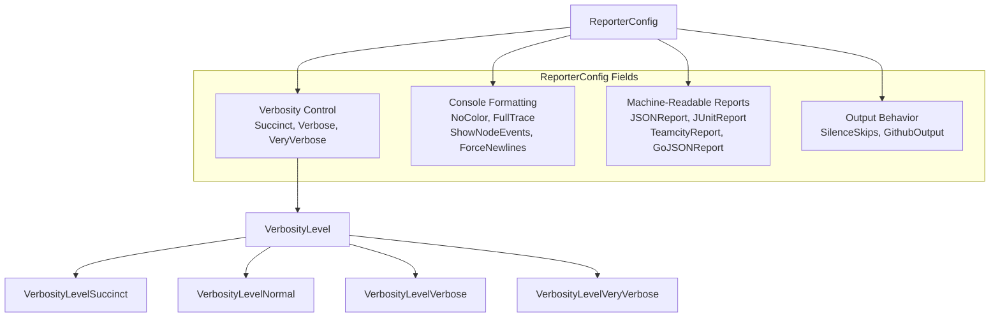

**Sources:** [vendor/github.com/onsi/ginkgo/v2/types/config.go:87-102](), [vendor/github.com/onsi/ginkgo/v2/types/config.go:57-84]()

---

### Verbosity Levels

Ginkgo supports four verbosity levels impacting output:

| Level          | CLI Flag     | Description                      |
|----------------|--------------|--------------------------------|
| **Succinct**   | `--succinct` | Minimal output (test markers)  |
| **Normal**     | Default      | Typical output with summary     |
| **Verbose**    | `-v`         | Includes GinkgoWriter output   |
| **VeryVerbose**| `-vv`        | Max detail including skipped specs and node events |

The `Verbosity()` method on `ReporterConfig` returns the effective verbosity level used by reporters.

**Sources:** [vendor/github.com/onsi/ginkgo/v2/types/config.go:104-113]()

---

### Console Formatting Options

| Option          | CLI Flag           | Purpose                                          |
|-----------------|--------------------|-------------------------------------------------|
| `NoColor`       | `--no-color`       | Disable colored output                           |
| `FullTrace`     | `--trace`          | Show full stack traces on failures               |
| `ShowNodeEvents`| `--show-node-events`| Show node start/end/timeline events              |
| `GithubOutput`  | `--github-output`  | Format output for GitHub Actions workflows       |
| `SilenceSkips`  | `--silence-skips`  | Do not print skipped test information            |
| `ForceNewlines` | `--force-newlines` | Ensure newline after each test                    |

**Sources:** [vendor/github.com/onsi/ginkgo/v2/types/config.go:341-376]()

---

### Machine-Readable Reports Supported

Ginkgo can simultaneously generate multiple report types configured via the `ReporterConfig`:

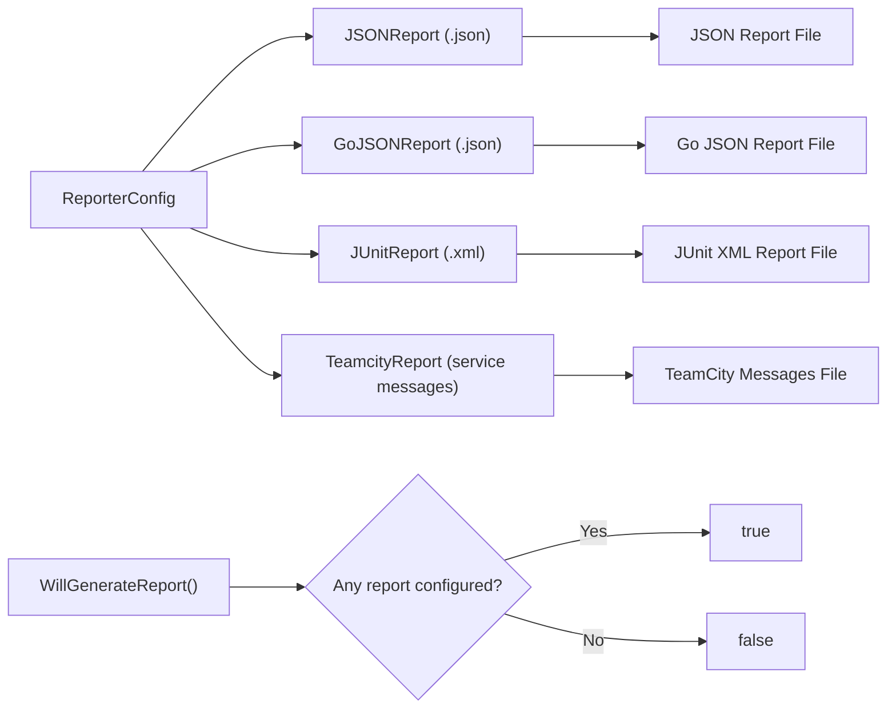

These reports contain comprehensive data about the entire suite:
- Suite metadata (e.g., path, description)
- All individual spec reports including outcome, failures, and timing
- Pre-run and final statistics
- Special suite failure reasons (if any)

**Sources:** [vendor/github.com/onsi/ginkgo/v2/reporting_dsl.go:210-259]()

---

## Console Output and DefaultReporter

### Overview of DefaultReporter

The `DefaultReporter` implements the primary console output interface for Ginkgo tests. It formats and prints suite start/end banners, progress updates, individual spec outcomes, and detailed failure information. It uses color and symbols encoding test state.

Key components of `DefaultReporter`:

- `conf`: ReporterConfig describing output mode and verbosity  
- `writer`: Output destination (usually `os.Stdout`)  
- `formatter`: Formatting helper for colors and text styles  
- `lock`: Mutex to serialize concurrent output  
- Emission state flags to track newlines, delimiters
- Unicode denoters: "•" or "+" for spec success and `↺` or "R" for retries

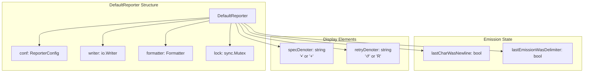

**Sources:** [vendor/github.com/onsi/ginkgo/v2/reporters/default_reporter.go:22-64]()

---

### Reporter Lifecycle and Event Hooks

The reporter interface defines key lifecycle hooks connected to test execution events:

- `SuiteWillBegin(report)`: Called once before suite start; emits suite banner, config info, and seed.
- `WillRun(specReport)`: Invoked before each spec runs; optionally prints spec location.
- `DidRun(specReport)`: After spec finishes; emits pass/fail badge, stack traces, failures.
- `EmitReportEntry(entry)`: Handles user-added arbitrary report entries.
- `EmitProgressReport(progressReport)`: Displays current execution progress when triggered.
- `SuiteDidEnd(report)`: Suite complete; emits summary, failures, and statistics.

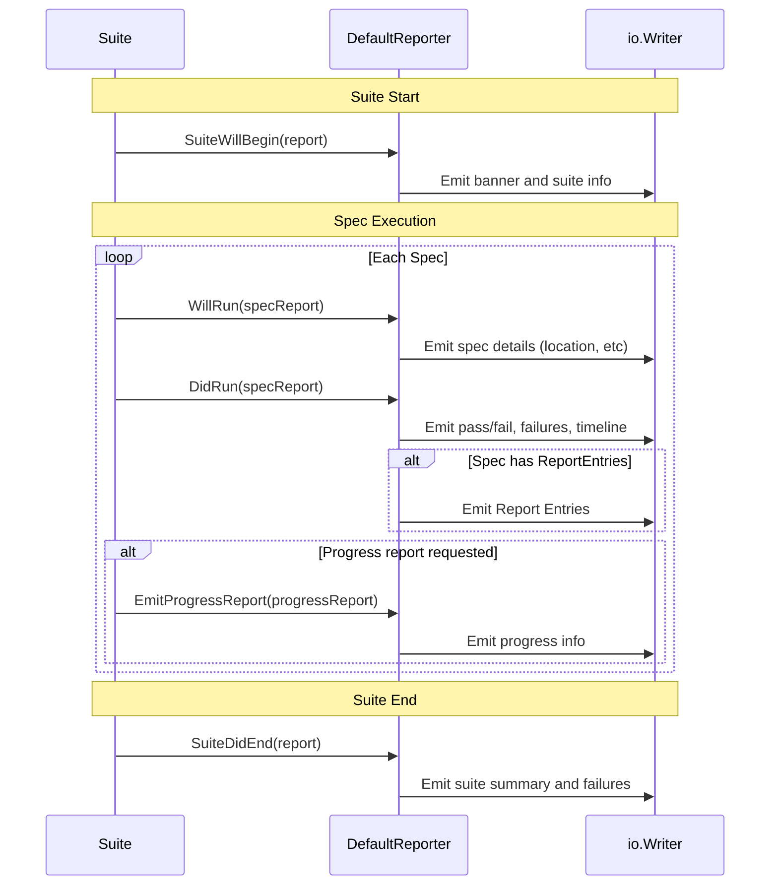

**Sources:** [vendor/github.com/onsi/ginkgo/v2/reporters/default_reporter.go:69-183](), [vendor/github.com/onsi/ginkgo/v2/reporters/default_reporter.go:185-349]()

---

### Spec State Highlighting in Console Output

The default reporter uses colored symbols and labels to represent spec states:

| Spec State            | Color   | Symbol / Header | Description                |
|-----------------------|---------|-----------------|----------------------------|
| **Passed**            | Green   | `•`             | Spec passed successfully   |
| **Failed**            | Red     | `•[FAIL]`       | Spec failed                |
| **Pending**           | Yellow  | `P [PENDING]`   | Marked as pending          |
| **Skipped**           | Cyan    | `S [SKIPPED]`   | Explicitly skipped         |
| **Panicked**          | Magenta | `•[PANICKED!]`  | Panic occurred in spec     |
| **Timed Out**         | Orange  | `•[TIMEDOUT]`   | Spec timed out             |
| **Aborted**           | Coral   | `•[ABORTED]`    | Suite aborted during spec  |
| **Interrupted**       | Orange  | `•[INTERRUPTED]`| Spec interrupted           |

**Sources:** [vendor/github.com/onsi/ginkgo/v2/reporters/default_reporter.go:351-376]()

---

### Emission Methods and Formatting

Internally, the reporter manages output emission with methods such as `emit()`, `emitBlock()`, and `emitDelimiter()`, which serialize access via a mutex and track output formatting state:

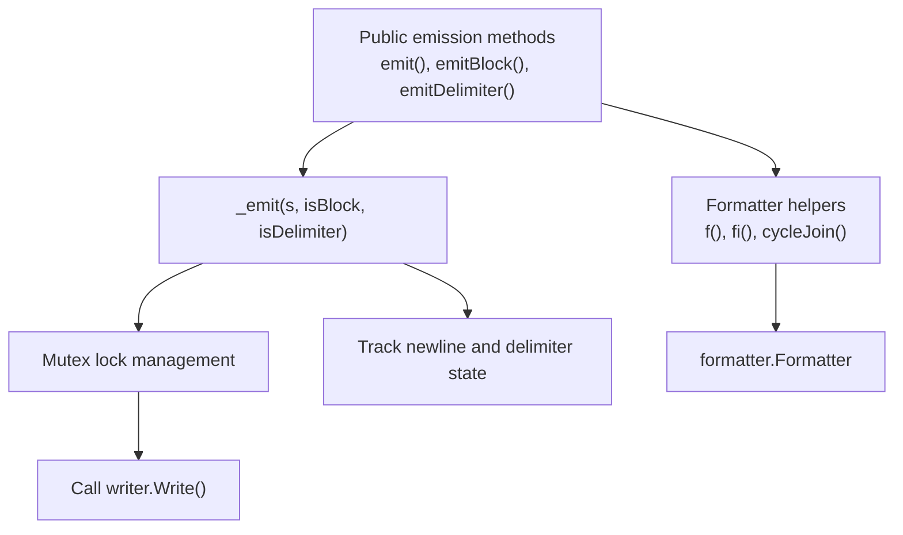

**Sources:** [vendor/github.com/onsi/ginkgo/v2/reporters/default_reporter.go:680-725]()

---

## Machine-Readable Report Generation

When configured, Ginkgo generates multiple formats of machine-readable reports after suite completion. This is done via `ReportAfterSuite` nodes registered automatically if report paths are specified.

### Report Generation Workflow

```mermaid
graph TB
    CONFIG[ReporterConfig] --> CHECK{WillGenerateReport()?}
    
    CHECK -->|Yes| REGISTER[register ReportAfterSuite node]
    REGISTER --> NODE[ReportAfterSuite Node]
    
    subgraph "Report Generation Node Execution"
        NODE --> JSON_CHECK{JSONReport path set?}
        JSON_CHECK -->|Yes| JSON_GEN[Generate JSONReport]
        JSON_GEN --> JSON_FILE[Write JSON file]
        
        NODE --> GOJSON_CHECK{GoJSONReport path set?}
        GOJSON_CHECK -->|Yes| GOJSON_GEN[Generate Go JSON Report]
        GOJSON_GEN --> GOJSON_FILE[Write Go JSON file]
        
        NODE --> JUNIT_CHECK{JUnitReport path set?}
        JUNIT_CHECK -->|Yes| JUNIT_GEN[Generate JUnit Report]
        JUNIT_GEN --> JUNIT_FILE[Write JUnit XML]
        
        NODE --> TEAM_CHECK{TeamcityReport enabled?}
        TEAM_CHECK -->|Yes| TEAM_GEN[Generate TeamCity Messages]
        TEAM_GEN --> TEAM_FILE[Write TeamCity file]
    end
    
    SUITE[Suite Execution] --> COMPLETE[Suite Completed]
    COMPLETE --> NODE
```

**Sources:** [vendor/github.com/onsi/ginkgo/v2/reporting_dsl.go:210-259](), [vendor/github.com/onsi/ginkgo/v2/core_dsl.go:303-305]()

---

### Supported Formats Summary

| Format          | CLI Flag           | File Type          | Description                     |
|-----------------|--------------------|--------------------|---------------------------------|
| JSON            | `--json-report`    | Structured JSON    | Rich suite and specs data       |
| Go JSON         | `--gojson-report`  | Go test compatible | Compatible with `go test -json` |
| JUnit           | `--junit-report`   | XML                | Popular CI/CD test report       |
| TeamCity        | `--teamcity-report`| Service messages    | TeamCity integration            |

All report generators consume the full `types.Report` suite state object.

**Sources:** [vendor/github.com/onsi/ginkgo/v2/reporting_dsl.go:211-236]()

---

## Capturing and Managing Output

Test output is captured from multiple sources and managed carefully to provide consistent, user-friendly logs even under parallel test execution.

### Architecture of Output Capture

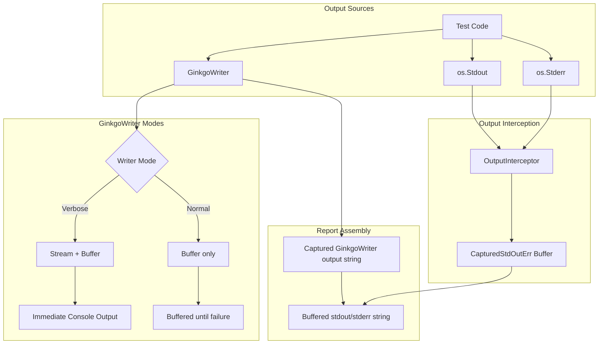

**Sources:** [vendor/github.com/onsi/ginkgo/v2/core_dsl.go:296-301](), [vendor/github.com/onsi/ginkgo/v2/internal/suite.go:358-368]()

---

### Output Interceptor Modes

When running tests in parallel, Ginkgo intercepts standard output and error to avoid interleaving logs between tests. It supports three modes:

| Mode    | Flag Value               | Description                      |
|---------|--------------------------|---------------------------------|
| **dup** | `--output-interceptor-mode=dup`  | Unix-style duplication of file descriptors (default on Unix) |
| **swap**| `--output-interceptor-mode=swap` | Swaps `os.Stdout` and `os.Stderr` (default on Windows) |
| **none**| `--output-interceptor-mode=none` | No interception; direct output  |

**Sources:** [vendor/github.com/onsi/ginkgo/v2/types/config.go:308-309](), [vendor/github.com/onsi/ginkgo/v2/core_dsl.go:278-287]()

---

### Captured Output in Spec Reports

Each spec’s `SpecReport` records:

- `CapturedGinkgoWriterOutput` string — buffered GinkgoWriter logs  
- `CapturedStdOutErr` string — buffered raw stdout and stderr

Their display depends on verbosity and parallelism:

| Output Type            | When Shown in Console                                          |
|------------------------|---------------------------------------------------------------|
| GinkgoWriterOutput     | Always in verbose `-v`, or on failure in normal mode           |
| StdOutErr              | Inline (serial) or separate section (parallel for clarity)     |

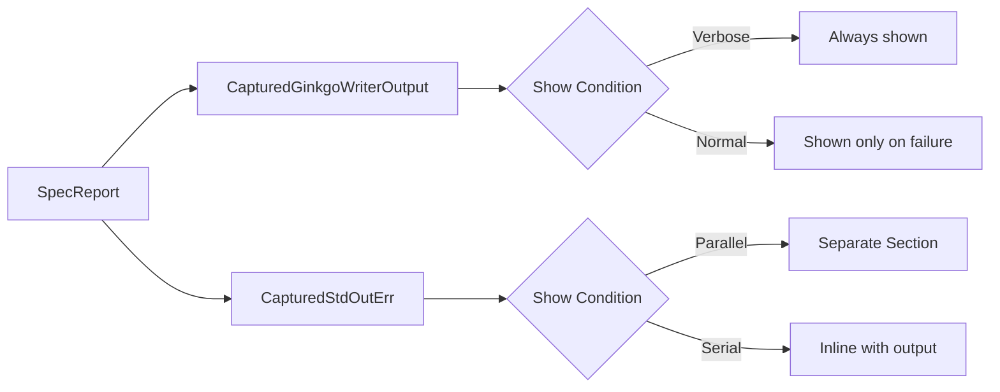

**Sources:** [vendor/github.com/onsi/ginkgo/v2/reporters/default_reporter.go:240-323](), [vendor/github.com/onsi/ginkgo/v2/internal/suite.go:362-364]()

---

## Progress Reporting

Progress reporting provides real-time insight into currently executing specs, useful for diagnosing hangs or long tests.

### ProgressReport Structure

Fields in the `ProgressReport` struct include:

- Message string for user-friendly text  
- Leaf node text and location identifying the current leaf spec  
- Container hierarchy texts reported for context  
- Current node type, text, location for currently running node  
- Current step text and location for stepwise progress  
- Timing info for start times of spec/nodes/steps  
- Captured GinkgoWriter output so far  
- Goroutine info: currently running spec goroutine, highlighted user goroutines, and others  
- Additional user reports attached to progress

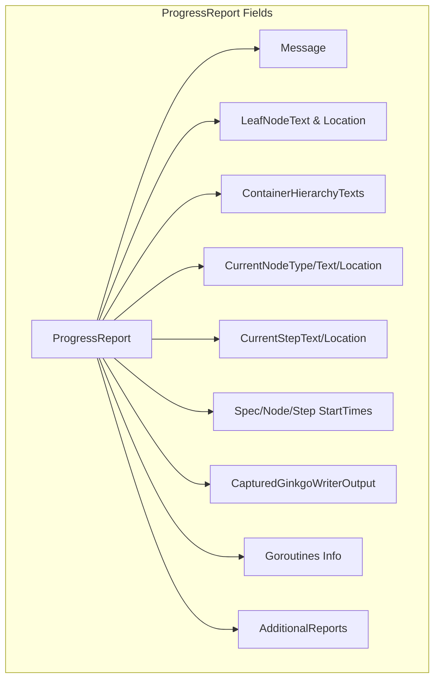

**Sources:** [vendor/github.com/onsi/ginkgo/v2/internal/suite.go:393-412]()

---

### Progress Report Triggering

Progress reports can be:

- **Manually triggered** by runtime signals (SIGUSR1 or Ctrl+\), handled by `handleProgressSignal`  
- **Automatically generated** after a given timeout interval during slow specs via polling

Once triggered, progress report assembly involves acquiring a `selectiveLock` to serialize data collection, gathering goroutine stacks, and querying reporters registered for progress updates.

```mermaid
graph TB
    subgraph "Manual Trigger"
        USER[Signal received<br/>SIGUSR1 or Ctrl+\] --> HANDLER[handleProgressSignal]
        HANDLER --> GENERATE[generateProgressReport]
    end
    
    subgraph "Automatic Trigger"
        SPEC[Spec Execution] --> POLL{PollProgressAfter Timeout?}
        POLL -->|Yes| AUTOPOLL[Periodic Polling]
        AUTOPOLL --> GENERATE
        POLL -->|No| CONTINUE[Continue Execution]
    end
    
    subgraph "Report Generation"
        GENERATE --> LOCK[Acquire selectiveLock]
        LOCK --> COLLECT[Collect Runtime & Goroutine Info]
        COLLECT --> QUERY[Query Progress Reporters]
        QUERY --> BUILD[Assemble ProgressReport]
    end
    
    BUILD --> EMIT[emitProgressReport()]
    EMIT --> REPORTER[reporter.EmitProgressReport()]
    EMIT --> CLIENT{Parallel mode?}
    CLIENT -->|Yes| POST[Post event to other processes]
    CLIENT -->|No| DONE[End]
```

**Sources:** [vendor/github.com/onsi/ginkgo/v2/internal/suite.go:414-432](), [vendor/github.com/onsi/ginkgo/v2/reporters/default_reporter.go:479-488]()

---

### Progress Report Console Output Format

The `DefaultReporter` formats progress reports into a human-readable hierarchical layout:

- Optional message header  
- Container path + leaf spec displayed  
- Current node and timing details  
- Current step info  
- Show recent GinkgoWriter output lines  
- Show stack trace for spec's goroutine  
- Show additional user-supplied reports  
- List goroutine stack traces for highlighted and other goroutines

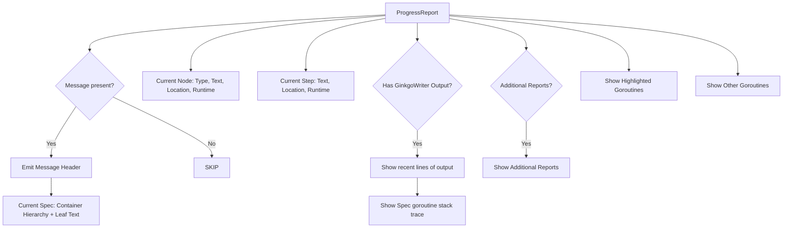

**Sources:** [vendor/github.com/onsi/ginkgo/v2/reporters/default_reporter.go:490-580]()

---

## Report Entries and Custom Reporting

### AddReportEntry API

Tests can attach arbitrary data during execution to the current spec report via `AddReportEntry(name string, ...args)`. Entries support:

- Naming and timestamping  
- Arbitrary associated values extracted from arguments  
- Visibility control to impact when they are shown on console  
- Location in the test code (caller info) and timeline placement

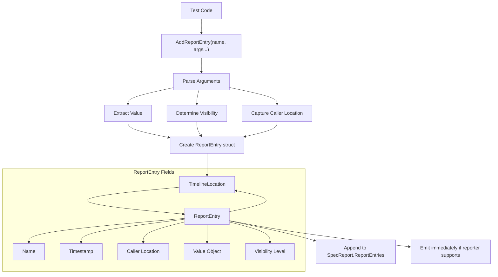

**Sources:** [vendor/github.com/onsi/ginkgo/v2/reporting_dsl.go:78-100](), [vendor/github.com/onsi/ginkgo/v2/internal/suite.go:380-390]()

---

### Visibility Levels for Report Entries

Three levels affect console output display:

| Visibility            | Constant                           | Console Display Behavior               |
|-----------------------|----------------------------------|-------------------------------------|
| **Always**            | `ReportEntryVisibilityAlways`    | Always shown                         |
| **FailureOrVerbose**  | `ReportEntryVisibilityFailureOrVerbose` | Shown on failure or with `-v`  |
| **Never**             | `ReportEntryVisibilityNever`     | Hidden from console, only in reports|

**Sources:** [vendor/github.com/onsi/ginkgo/v2/reporting_dsl.go:66-75](), [vendor/github.com/onsi/ginkgo/v2/reporters/default_reporter.go:582-594]()

---

### Report Lifecycle Hooks

Ginkgo supports multiple report lifecycle hooks to allow injecting custom reporting or diagnostics:

- **Suite-level hooks:**
  - `ReportBeforeSuite(func(Report))` – before the suite starts  
  - `ReportAfterSuite(func(Report))` – after suite completion  

- **Spec-level hooks:**
  - `ReportBeforeEach(func(SpecContext, Report))` – before each spec runs (interruptible)  
  - `ReportAfterEach(func(SpecContext, SpecReport))` – after each spec runs (interruptible)  

These hooks receive either the overall `Report` or individual `SpecReport` objects and cannot contain nested Ginkgo test nodes but are suitable for:

- Producing files (test reports, logs, artifacts)  
- Interfacing with external systems (dashboards, databases)  
- Sending notifications  
- Capturing diagnostics and generating artifacts on failures  
- Cleaning up resources based on test outcome  

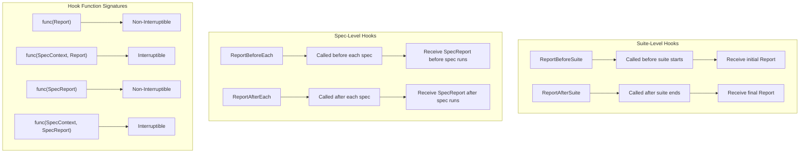

**Sources:** [vendor/github.com/onsi/ginkgo/v2/reporting_dsl.go:103-208]()

---

## The `collectOnFailure` Diagnostic Artifact Pattern

Within the broader E2E test infrastructure (covered in detail in [10.1. E2E Harness Framework]), the `collectOnFailure` pattern is used to automatically capture diagnostic artifacts when a test spec fails.

- When a test fails, registered collectors gather logs, Kubernetes debug files, or system snapshots.
- These artifacts are stored in a temporary directory designated in the test harness.
- The collected diagnostics provide rich debugging context for CI logs and local investigation.

The pattern integrates with the `ReportAfterEach` hook or equivalent to conditionally trigger artifact capture only on failures, minimizing overhead while maximizing insight on flaky or failing specs.

---

# Summary Diagrams Linking Natural Language and Code

### Diagram 1: Ginkgo Reporting Subsystems and Code Entities

```mermaid
graph LR
    A["User Test Code"] -->|Calls| B[Ginkgo Framework]
    B -->|Uses| C[ReportingConfig(types.ReporterConfig)]
    B -->|Invokes| D[DefaultReporter (default_reporter.go)]
    B -->|Generates| E[SpecReport / Report (types)]
    D -->|Writes| F[Console Output (io.Writer)]
    D -->|Calls| G[Formatter (formatter.Formatter)]
    B -->|Emits| H[Machine-Readable Reports]
    H --> I[JSON Report]
    H --> J[JUnit Report]
    H --> K[GoJSON Report]
    H --> L[TeamCity Report]
    
    style C fill:#f9f,stroke:#333,stroke-width:1px
    style D fill:#bbf,stroke:#333,stroke-width:1px
    style E fill:#bfb,stroke:#333,stroke-width:1px
    style H fill:#fbb,stroke:#333,stroke-width:1px
```

---

### Diagram 2: Reporting Output Flow and Diagnostic Collection

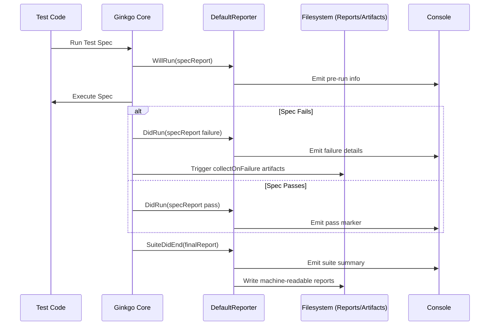

---

This page encompasses all fundamental aspects of test reporting and output employed in the k8s-test-infra codebase leveraging Ginkgo. It covers how console output is formatted and controlled, how multiple default and machine-readable reports are generated, how live progress reporting functions, and the ergonomic diagnostic artifact collection pattern used on failures. Understanding these details is critical for extending, debugging, or customizing test reporting behavior in this project.

**Sources:**  
- [vendor/github.com/onsi/ginkgo/v2/reporters/default_reporter.go:22-725]()  
- [vendor/github.com/onsi/ginkgo/v2/types/config.go:57-113, 87-102, 341-376]()  
- [vendor/github.com/onsi/ginkgo/v2/reporting_dsl.go:14-259]()  
- [vendor/github.com/onsi/ginkgo/v2/core_dsl.go:278-305]()  
- [vendor/github.com/onsi/ginkgo/v2/internal/suite.go:284-368, 393-432]()  
- [tests/e2e/go/report_skips_test.go:16-57]()

---

