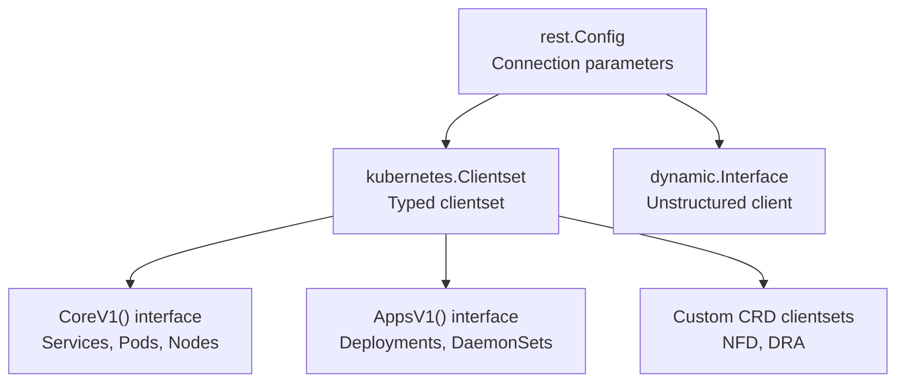
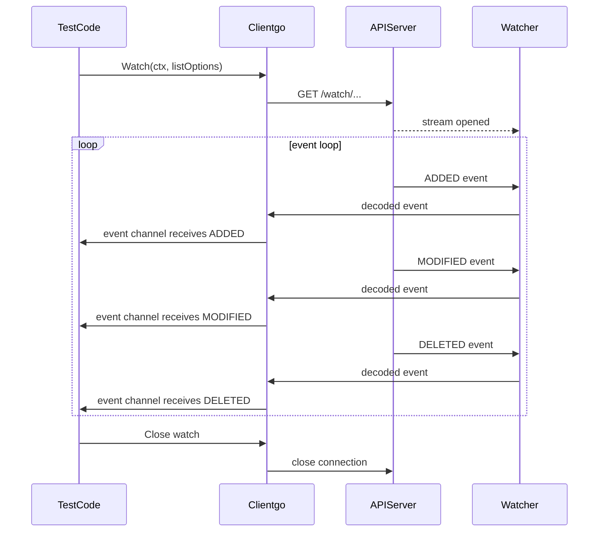
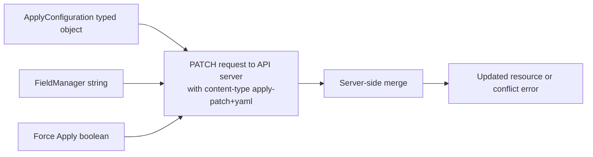
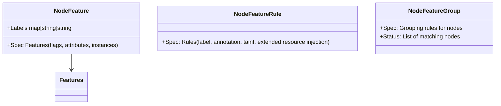
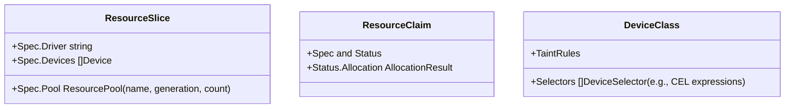
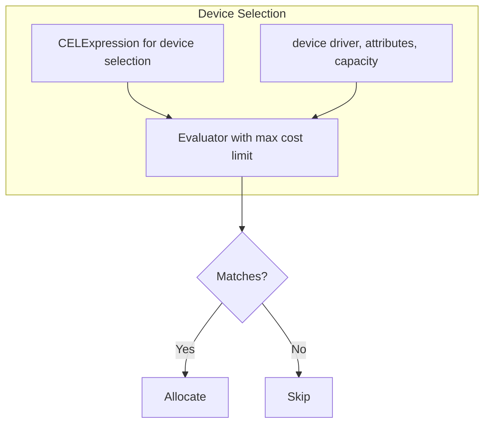
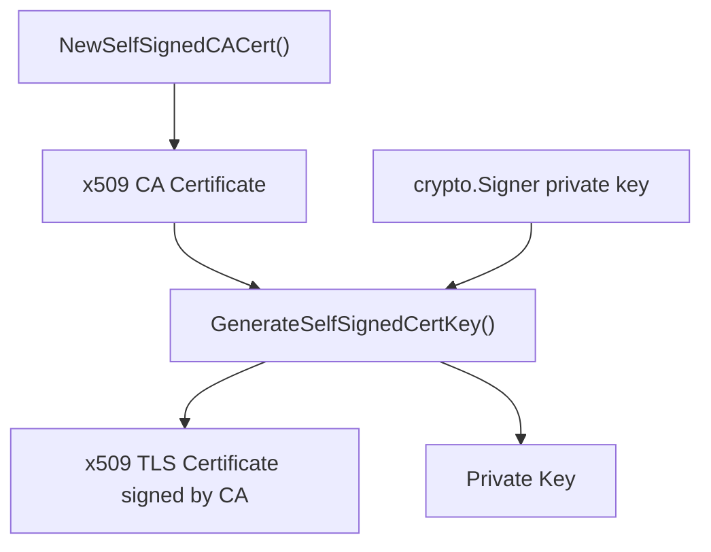
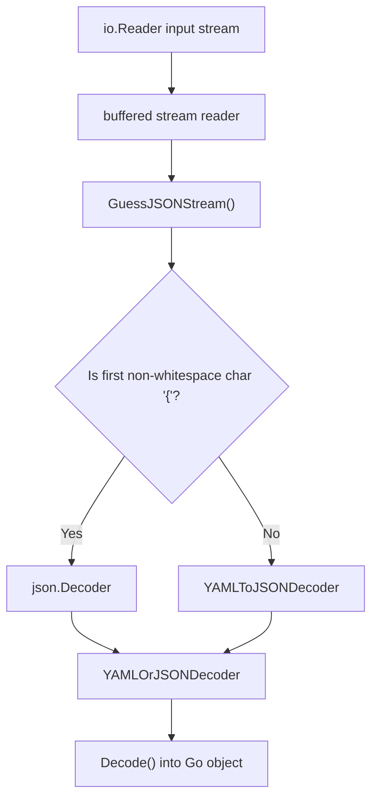
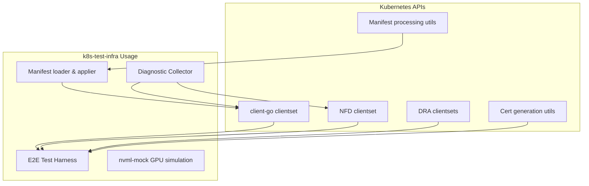

<!-- source: DeepWiki mcp.deepwiki.com · repo NVIDIA/k8s-test-infra · page 6 Kubernetes APIs and Integration · fetched 2026-10-26 -->

# Kubernetes APIs and Integration

Relevant source files

The following files were used as context for generating this wiki page:

- [pkg/diagnostics/collector.go](pkg/diagnostics/collector.go)
- [pkg/diagnostics/extensions.go](pkg/diagnostics/extensions.go)
- [pkg/diagnostics/kubernetes.go](pkg/diagnostics/kubernetes.go)
- [pkg/diagnostics/options.go](pkg/diagnostics/options.go)
- [pkg/kubernetes/kubernetes.go](pkg/kubernetes/kubernetes.go)
- [vendor/k8s.io/api/resource/v1alpha3/generated.proto](vendor/k8s.io/api/resource/v1alpha3/generated.proto)
- [vendor/k8s.io/api/resource/v1alpha3/types.go](vendor/k8s.io/api/resource/v1alpha3/types.go)
- [vendor/k8s.io/api/resource/v1alpha3/types_swagger_doc_generated.go](vendor/k8s.io/api/resource/v1alpha3/types_swagger_doc_generated.go)
- [vendor/k8s.io/api/resource/v1beta1/generated.proto](vendor/k8s.io/api/resource/v1beta1/generated.proto)
- [vendor/k8s.io/api/resource/v1beta1/types.go](vendor/k8s.io/api/resource/v1beta1/types.go)
- [vendor/k8s.io/api/resource/v1beta1/types_swagger_doc_generated.go](vendor/k8s.io/api/resource/v1beta1/types_swagger_doc_generated.go)

This document outlines how the **k8s-test-infra** project interacts with Kubernetes core APIs and specialized Kubernetes Custom Resource Definitions (CRDs). The repository leverages `k8s.io/client-go` to perform CRUD operations, watches, and server-side apply with the K8s API server. Additionally, it integrates with custom APIs for **Node Feature Discovery (NFD)** and **Dynamic Resource Allocation (DRA)**, which are essential to simulate and test GPU device management and node hardware labeling in Kubernetes clusters.

For implementation specifics of these API operations and code usage patterns, each of these topics is covered in corresponding child wiki pages:

- For Kubernetes API operations using client-go, see [Kubernetes Client-Go Operations](#6.1)
- For Node Feature Discovery API and CRDs, see [Node Feature Discovery (NFD) API](#6.2)
- For Dynamic Resource Allocation and device resource APIs, see [Dynamic Resource Allocation (DRA) API](#6.3)
- For TLS certificate generation utilities used in tests, see [Certificate Utilities](#6.4)
- For YAML and JSON manifest loading and decoding helpers, see [YAML and JSON Manifest Processing](#6.5)

---

## Kubernetes Client Dependencies

The project depends on several key Kubernetes client libraries for API interactions:

| Dependency | Purpose |
|------------|---------|
| `k8s.io/client-go` | Core Kubernetes Go client library—used for CRUD, watches, and more |
| `k8s.io/api` | Kubernetes resource type definitions |
| `k8s.io/apimachinery` | Common machinery such as metadata, runtime, and JSON/YAML handling |
| `k8s.io/apiextensions-apiserver` | Support for Custom Resource Definitions |
| `sigs.k8s.io/node-feature-discovery` | Clientsets and API types for NFD |
| `sigs.k8s.io/node-feature-discovery/api/nfd/v1alpha1` | NFD v1alpha1 API versions |

These dependencies ensure typed and efficient interfacing with Kubernetes core and custom APIs.

**Sources:**  
[`pkg/kubernetes/kubernetes.go:18-36`](pkg/kubernetes/kubernetes.go)  
[`pkg/diagnostics/collector.go:20-32`](pkg/diagnostics/collector.go)  

---

## Kubernetes Client-Go Operations

The project uses `k8s.io/client-go` as the primary means for Kubernetes API access. This includes:

- Creating typed clients (`kubernetes.Clientset`) connected to the cluster
- Performing CRUD operations on core resources like Nodes, Pods, Deployments
- Monitoring changes using watches and informers for real-time updates
- Using server-side apply for declarative resource management

### High-Level Client-Go Client Creation Flow

- The `Clientset` is the central interface for typed Kubernetes resource clients.
- Specialized clients exist for CRDs like NFD (`nfdclient.Clientset`) and others.
- The dynamic client allows unstructured manipulation when type is not available or needed.

### CRUD and Watches

Client-go supports all standard Kubernetes operations: Create, Get, List, Update, Patch, Delete, and Watch.

Watching resources establishes a continuous stream from Kubernetes informing the client about resource state changes:

### Server-Side Apply

Server-side apply allows declarative configuration with conflict detection and merging. The client constructs `ApplyConfiguration` typed objects and applies them with a field manager. The Kubernetes API server merges the changes, preserving field ownership.

---

## Node Feature Discovery (NFD) API

**Node Feature Discovery** is a Kubernetes addon aimed at detecting detailed hardware and system features for nodes and labeling them accordingly.

### NFD CRDs Used

The project uses the following main NFD custom resources defined in the `nfd/v1alpha1` API group:

- `NodeFeature` objects represent discovered features per node.
- `NodeFeatureRule` objects define how to translate features into node labels, annotations, and taints.
- `NodeFeatureGroup` allows grouping nodes dynamically based on features.

### Feature Matching

NFD supports expressive feature matching using `FeatureMatcher` which compares feature sets against complex logical expressions and operators like In, NotIn, Exists, Gt, Lt, etc.

Rules use these matchers to decide whether to apply certain labels or taints.

---

## Dynamic Resource Allocation (DRA) API

**Dynamic Resource Allocation** manages specialized device resources, exposing them via Kubernetes APIs for scheduling and allocation.

### Core DRA Resources

- `ResourceSlice`: Represents a portion of device resources, managed by a driver, tied to nodes or node selectors.
- `ResourceClaim`: Requests and records allocation of devices.
- `DeviceClass`: Defines collections of device configurations and selectors.

### Device and Allocation Details

Devices provide attributes and capacities to allow flexible matching and allocation, often expressed through CEL expressions:

The `AllocationResult` in `ResourceClaim.Status` records allocated devices with driver, pool, device name, and condition statuses.

### Device Taints in DRA v1alpha3

DRA introduces device taints similar to node taints to indicate device conditions or scheduling constraints. The `DeviceTaintRule` CRD adds taints to devices matching a selector without modifying `ResourceSlice` objects directly.

---

## Certificate Utilities

The project includes test utilities for generating **self-signed TLS certificates** leveraging `k8s.io/client-go/util/cert`.

### Certificate Generation Flow

- Generate a CA certificate first (10 years validity by default)
- Generate a server cert signed by that CA (with alternate IPs and DNS names)
- Output PEM encoded certificate and key arrays for use in TLS components in tests

---

## YAML and JSON Manifest Processing

The project uses the `k8s.io/apimachinery/pkg/util/yaml` package to load and decode Kubernetes manifests which can be YAML or JSON.

### YAMLOrJSONDecoder Processing

- The decoder autodetects JSON vs YAML input.
- It supports multi-document YAML streams separated by `---`.
- Implements streaming decode into Kubernetes runtime objects.

The buffer size parameter influences detection accuracy.

---

## Summary: How These Pieces Connect

- The test harness combines the Kubernetes client libraries to create, watch, and validate resources.
- NVML-mock interacts with DRA and NFD APIs to simulate GPUs and their discovery.
- Certificate utilities enable secure communication testing.
- YAML/JSON manifest utilities load test specifications, CRDs, and other manifests.

---

This high-level overview introduces the Kubernetes APIs and integrations used in the k8s-test-infra project. For detailed information on each part, consult the child pages:

- [Kubernetes Client-Go Operations](#6.1)
- [Node Feature Discovery (NFD) API](#6.2)
- [Dynamic Resource Allocation (DRA) API](#6.3)
- [Certificate Utilities](#6.4)
- [YAML and JSON Manifest Processing](#6.5)

---

**Sources:**  
- [`pkg/kubernetes/kubernetes.go:18-168`](pkg/kubernetes/kubernetes.go)  
- [`pkg/diagnostics/collector.go:20-114`](pkg/diagnostics/collector.go)  
- [`pkg/diagnostics/extensions.go:18-60`](pkg/diagnostics/extensions.go)  
- [`pkg/diagnostics/kubernetes.go:18-170`](pkg/diagnostics/kubernetes.go)  
- Kubernetes API types and proto files from vendor directory for DRA and NFD APIs.

---

