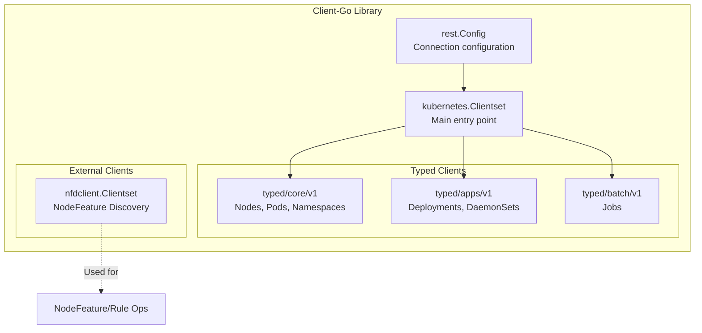
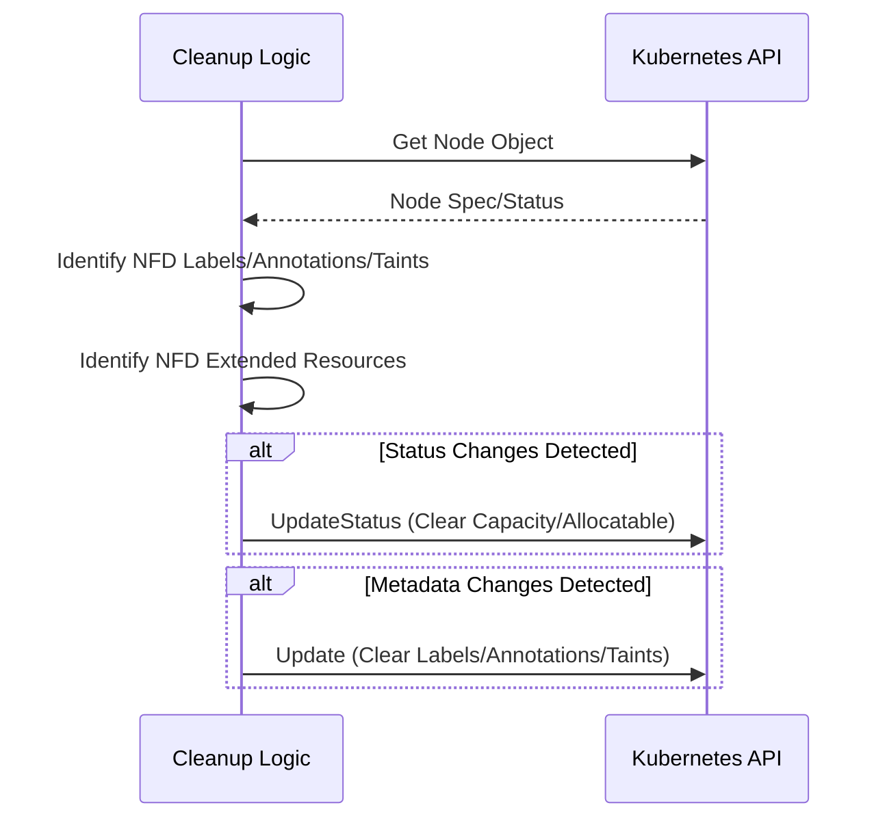
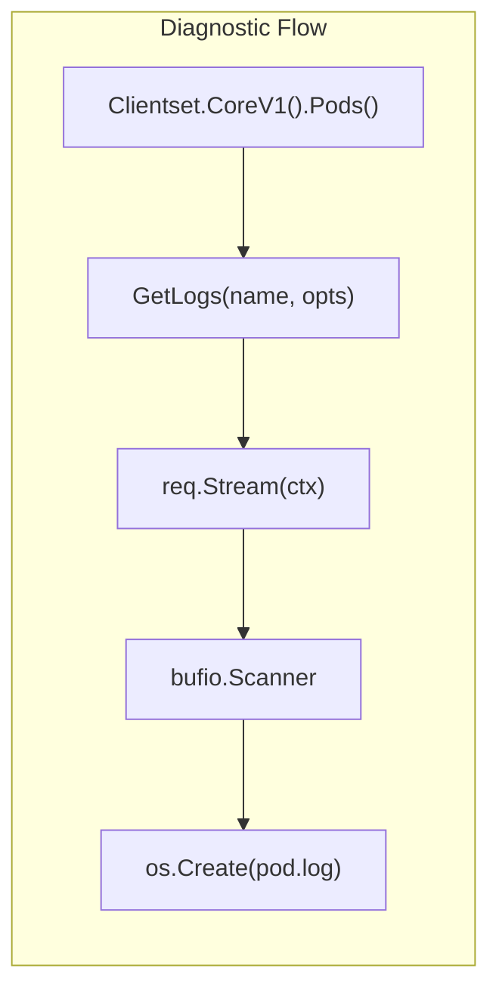

<!-- source: DeepWiki mcp.deepwiki.com · repo NVIDIA/k8s-test-infra · page 6.1 Kubernetes Client-Go Operations · fetched 2026-10-26 -->

# Kubernetes Client-Go Operations

Relevant source files

The following files were used as context for generating this wiki page:

- [pkg/diagnostics/collector.go](pkg/diagnostics/collector.go)
- [pkg/diagnostics/extensions.go](pkg/diagnostics/extensions.go)
- [pkg/diagnostics/kubernetes.go](pkg/diagnostics/kubernetes.go)
- [pkg/diagnostics/options.go](pkg/diagnostics/options.go)
- [pkg/kubernetes/kubernetes.go](pkg/kubernetes/kubernetes.go)
- [vendor/k8s.io/api/core/v1/generated.proto](vendor/k8s.io/api/core/v1/generated.proto)
- [vendor/k8s.io/api/core/v1/types.go](vendor/k8s.io/api/core/v1/types.go)
- [vendor/k8s.io/api/core/v1/types_swagger_doc_generated.go](vendor/k8s.io/api/core/v1/types_swagger_doc_generated.go)
- [vendor/k8s.io/client-go/applyconfigurations/internal/internal.go](vendor/k8s.io/client-go/applyconfigurations/internal/internal.go)

## Purpose and Scope

This page documents how the k8s-test-infra project uses the `k8s.io/client-go` library to interact with Kubernetes API servers. It covers standard CRUD operations, resource watching, server-side apply, and diagnostic collection patterns. This documentation focuses on the operational patterns used in the E2E harness and diagnostic collector for programmatic cluster interactions.

For information about Node Feature Discovery and Dynamic Resource Allocation custom resource APIs, see [Node Feature Discovery (NFD) API](6.2) and [Dynamic Resource Allocation (DRA) API](6.3).

## Client-Go Architecture

The project utilizes `k8s.io/client-go` as its primary interface for cluster management. In addition to standard Kubernetes resources, it integrates specialized clients for Node Feature Discovery (NFD) as seen in diagnostic and cleanup operations [pkg/kubernetes/kubernetes.go:34-35]().

### Client-Go Component Structure

**Sources:** [pkg/kubernetes/kubernetes.go:29-36](), [pkg/diagnostics/options.go:21-24]()

## CRUD Operations

### Resource Interface Pattern

The codebase abstracts common CRUD operations into specialized functions for cluster maintenance and testing. A key example is the filtering of nodes to identify non-control-plane targets using the `CoreV1().Nodes().List` operation [pkg/kubernetes/kubernetes.go:39-40]().

### Common CRUD Operations in k8s-test-infra

| Operation | Implementation | Description |
|-----------|----------------|-------------|
| **List** | `cli.CoreV1().Nodes().List(ctx, metav1.ListOptions{})` | Retrieves all nodes for filtering or iteration [pkg/kubernetes/kubernetes.go:40]() |
| **Get** | `cs.CoreV1().Nodes().Get(ctx, nodeName, metav1.GetOptions{})` | Retrieves a specific node to modify its metadata [pkg/kubernetes/kubernetes.go:79]() |
| **Update** | `cs.CoreV1().Nodes().Update(ctx, node, metav1.UpdateOptions{})` | Persists changes to node labels, annotations, or taints [pkg/kubernetes/kubernetes.go:147]() |
| **UpdateStatus** | `cs.CoreV1().Nodes().UpdateStatus(ctx, node, metav1.UpdateOptions{})` | Specifically used to clear extended resources [pkg/kubernetes/kubernetes.go:140]() |
| **Delete** | `cli.NfdV1alpha1().NodeFeatures(ns).Delete(ctx, name, opts)` | Removes custom resources during test cleanup [pkg/kubernetes/kubernetes.go:187]() |

**Sources:** [pkg/kubernetes/kubernetes.go:39-217]()

### Node Metadata Cleanup Pattern

The `CleanupNode` function demonstrates a complex read-modify-write pattern using `client-go`. It iterates through labels, annotations, and taints, removing those associated with NFD [pkg/kubernetes/kubernetes.go:76-152]().

**Sources:** [pkg/kubernetes/kubernetes.go:76-152]()

## Diagnostic Collection Operations

The `diagnostics` package uses `client-go` to export cluster state to YAML files during test failures. It implements a `Collector` interface where each implementation targets a specific API resource [pkg/diagnostics/collector.go:34-36]().

### Diagnostic Collector Mapping

| Collector Name | Code Entity | API Call Site |
|----------------|-------------|---------------|
| `nodes` | `diagnostics.nodes` | `c.Clientset.CoreV1().Nodes().List()` [pkg/diagnostics/kubernetes.go:55]() |
| `pods` | `diagnostics.pods` | `c.Clientset.CoreV1().Pods(ns).List()` [pkg/diagnostics/kubernetes.go:107]() |
| `daemonsets` | `diagnostics.daemonsets` | `c.Clientset.AppsV1().DaemonSets(ns).List()` [pkg/diagnostics/kubernetes.go:81]() |
| `jobs` | `diagnostics.jobs` | `c.Clientset.BatchV1().Jobs(ns).List()` [pkg/diagnostics/kubernetes.go:125]() |
| `nodeFeature` | `diagnostics.nodeFeatures` | `c.NfdClient.NfdV1alpha1().NodeFeatures(ns).List()` [pkg/diagnostics/extensions.go:36]() |

**Sources:** [pkg/diagnostics/kubernetes.go:30-135](), [pkg/diagnostics/extensions.go:27-59]()

### Log Streaming

Diagnostic collection also involves streaming logs via the `GetLogs` request, which returns a stream that is scanned and written to the artifact directory [pkg/diagnostics/kubernetes.go:149-163]().

**Sources:** [pkg/diagnostics/kubernetes.go:142-169]()

## Server-Side Apply and Watching

While the diagnostic collector focuses on `List` and `Get` operations, the E2E harness utilizes `client-go` for resource lifecycle management.

### Resource Deletion Watch

The `WaitForDeletion` utility implements a polling pattern that effectively mimics a watch for resource removal. It repeatedly executes a check function until it encounters an `IsNotFound` error [pkg/kubernetes/kubernetes.go:221-225]().

### Apply Configurations

The project includes vendored support for server-side apply configurations, allowing declarative updates to complex resources like `MutatingWebhookConfiguration` or `Pod` objects [vendor/k8s.io/client-go/applyconfigurations/internal/internal.go:245-255](). This is primarily used for infrastructure setup during cluster initialization.

**Sources:** [vendor/k8s.io/client-go/applyconfigurations/internal/internal.go:41-245]()

## Error Handling Patterns

The codebase distinguishes between transient errors and terminal states using `k8s.io/apimachinery/pkg/api/errors`:

1.  **NotFound Suppression**: During cleanup, `IsNotFound` errors are explicitly ignored to ensure idempotency [pkg/kubernetes/kubernetes.go:178-181]().
2.  **Retry Loops**: Operations like node metadata cleanup are wrapped in retry loops (5 attempts with 100ms backoff) to handle potential conflicts during parallel test execution [pkg/kubernetes/kubernetes.go:160-165]().

**Sources:** [pkg/kubernetes/kubernetes.go:160-188]()

---

