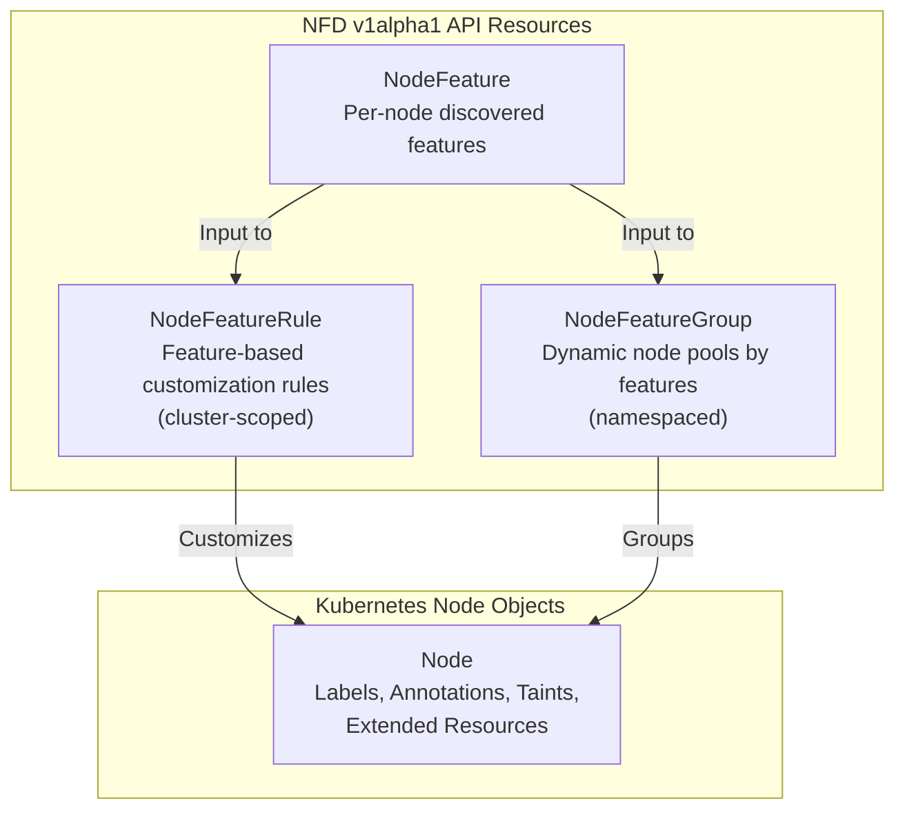
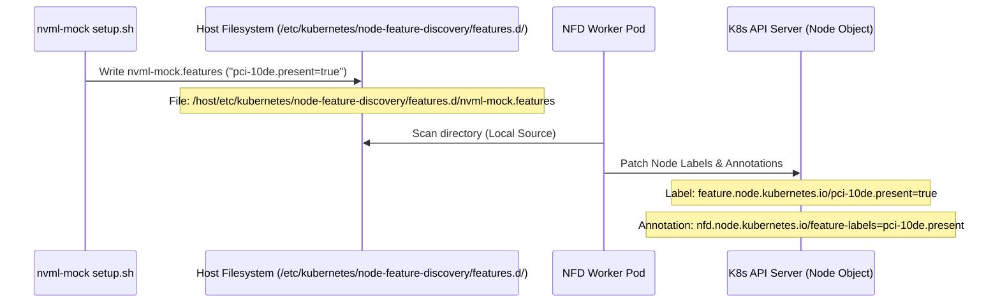
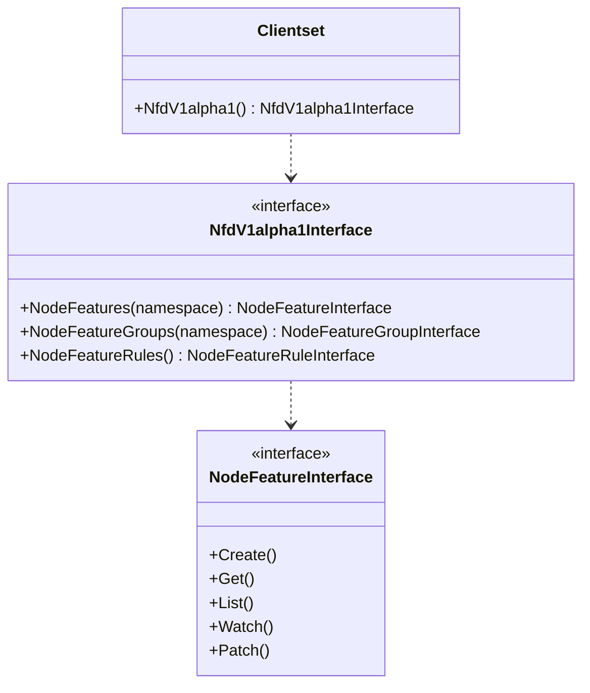

<!-- source: DeepWiki mcp.deepwiki.com · repo NVIDIA/k8s-test-infra · page 6.2 Node Feature Discovery (NFD) API · fetched 2026-10-26 -->

# Node Feature Discovery (NFD) API

Relevant source files

The following files were used as context for generating this wiki page:

- [tests/e2e/go/scenario_nfd_test.go](tests/e2e/go/scenario_nfd_test.go)
- [vendor/sigs.k8s.io/node-feature-discovery/api/generated/clientset/versioned/clientset.go](vendor/sigs.k8s.io/node-feature-discovery/api/generated/clientset/versioned/clientset.go)
- [vendor/sigs.k8s.io/node-feature-discovery/api/generated/clientset/versioned/scheme/doc.go](vendor/sigs.k8s.io/node-feature-discovery/api/generated/clientset/versioned/scheme/doc.go)
- [vendor/sigs.k8s.io/node-feature-discovery/api/generated/clientset/versioned/scheme/register.go](vendor/sigs.k8s.io/node-feature-discovery/api/generated/clientset/versioned/scheme/register.go)
- [vendor/sigs.k8s.io/node-feature-discovery/api/generated/clientset/versioned/typed/nfd/v1alpha1/doc.go](vendor/sigs.k8s.io/node-feature-discovery/api/generated/clientset/versioned/typed/nfd/v1alpha1/doc.go)
- [vendor/sigs.k8s.io/node-feature-discovery/api/generated/clientset/versioned/typed/nfd/v1alpha1/generated_expansion.go](vendor/sigs.k8s.io/node-feature-discovery/api/generated/clientset/versioned/typed/nfd/v1alpha1/generated_expansion.go)
- [vendor/sigs.k8s.io/node-feature-discovery/api/generated/clientset/versioned/typed/nfd/v1alpha1/nfd_client.go](vendor/sigs.k8s.io/node-feature-discovery/api/generated/clientset/versioned/typed/nfd/v1alpha1/nfd_client.go)
- [vendor/sigs.k8s.io/node-feature-discovery/api/generated/clientset/versioned/typed/nfd/v1alpha1/nodefeature.go](vendor/sigs.k8s.io/node-feature-discovery/api/generated/clientset/versioned/typed/nfd/v1alpha1/nodefeature.go)
- [vendor/sigs.k8s.io/node-feature-discovery/api/generated/clientset/versioned/typed/nfd/v1alpha1/nodefeaturegroup.go](vendor/sigs.k8s.io/node-feature-discovery/api/generated/clientset/versioned/typed/nfd/v1alpha1/nodefeaturegroup.go)
- [vendor/sigs.k8s.io/node-feature-discovery/api/nfd/v1alpha1/types.go](vendor/sigs.k8s.io/node-feature-discovery/api/nfd/v1alpha1/types.go)
- [vendor/sigs.k8s.io/node-feature-discovery/api/nfd/v1alpha1/zz_generated.deepcopy.go](vendor/sigs.k8s.io/node-feature-discovery/api/nfd/v1alpha1/zz_generated.deepcopy.go)

## Purpose and Scope

The Node Feature Discovery (NFD) API provides Kubernetes Custom Resource Definitions (CRDs) for hardware feature detection and feature-based node customization. This page documents the v1alpha1 API types, their structure, and how the `nvml-mock` system integrates with NFD to trigger node labeling in E2E test scenarios.

The primary integration path for `nvml-mock` is via **NFD Local Source**, where the mock library writes feature files to the host filesystem, which are then consumed by the NFD daemon to apply labels to the Kubernetes Node object.

**Sources:** [vendor/sigs.k8s.io/node-feature-discovery/api/nfd/v1alpha1/types.go:1-395](), [tests/e2e/go/scenario_nfd_test.go:24-66]()

## Core Custom Resource Definitions

The NFD API defines three primary CRDs that work together to enable feature discovery and node customization:

### NodeFeature
`NodeFeature` is a namespaced resource that holds the complete set of features discovered for a single node. [vendor/sigs.k8s.io/node-feature-discovery/api/nfd/v1alpha1/types.go:40-46]().

| Field | Type | Description |
|-------|------|-------------|
| `spec.features` | `Features` | Complete raw feature data organized by type (flags, attributes, instances) [vendor/sigs.k8s.io/node-feature-discovery/api/nfd/v1alpha1/types.go:52]() |
| `spec.labels` | `map[string]string` | Labels requested to be created on the node [vendor/sigs.k8s.io/node-feature-discovery/api/nfd/v1alpha1/types.go:55]() |

### NodeFeatureRule
`NodeFeatureRule` is a cluster-scoped resource that defines rules for feature-based node customization. [vendor/sigs.k8s.io/node-feature-discovery/api/nfd/v1alpha1/types.go:117-123](). Rules are evaluated against `NodeFeature` objects to automatically apply labels, annotations, or taints.

### NodeFeatureGroup
`NodeFeatureGroup` is a namespaced resource that dynamically groups nodes based on feature matching rules. [vendor/sigs.k8s.io/node-feature-discovery/api/nfd/v1alpha1/types.go:137-147](). It tracks matching nodes in `status.nodes`. [vendor/sigs.k8s.io/node-feature-discovery/api/nfd/v1alpha1/types.go:155-163]().

**Sources:** [vendor/sigs.k8s.io/node-feature-discovery/api/nfd/v1alpha1/types.go:35-179]()

## nvml-mock Integration: The Local Source Flow

In E2E testing, `nvml-mock` uses NFD's "Local Source" capability to trigger node labeling. Instead of interacting with the NFD API directly, the mock setup writes a feature file to a specific host directory which the NFD daemon monitors.

### Data Flow: From Mock to Node Label

**Implementation Details:**
- **Feature File Path**: The file is written to `/host/etc/kubernetes/node-feature-discovery/features.d/nvml-mock.features`. [tests/e2e/go/scenario_nfd_test.go:54]()
- **Feature Content**: The mock writes `pci-10de.present=true`. [tests/e2e/go/scenario_nfd_test.go:117]()
- **Label Transformation**: NFD's local source transforms this line into the label `feature.node.kubernetes.io/pci-10de.present`. [tests/e2e/go/scenario_nfd_test.go:34-36]()
- **Ownership Tracking**: NFD records the labels it manages in the `nfd.node.kubernetes.io/feature-labels` annotation. [tests/e2e/go/scenario_nfd_test.go:44]()

**Sources:** [tests/e2e/go/scenario_nfd_test.go:24-58](), [tests/e2e/go/scenario_nfd_test.go:114-144]()

## Feature Data Model

The NFD API organizes discovered features into three distinct types:

| Feature Type | Code Entity | Description |
|--------------|-------------|-------------|
| **Flags** | `FlagFeatureSet` | Boolean characteristics (presence/absence). [vendor/sigs.k8s.io/node-feature-discovery/api/nfd/v1alpha1/types.go:72-75]() |
| **Attributes** | `AttributeFeatureSet` | Single-valued string characteristics (e.g., version). [vendor/sigs.k8s.io/node-feature-discovery/api/nfd/v1alpha1/types.go:78-81]() |
| **Instances** | `InstanceFeatureSet` | Multi-instance hardware (e.g., multiple GPUs) with multiple attributes per instance. [vendor/sigs.k8s.io/node-feature-discovery/api/nfd/v1alpha1/types.go:83-87]() |

**Sources:** [vendor/sigs.k8s.io/node-feature-discovery/api/nfd/v1alpha1/types.go:58-97]()

## API Client and Generated Code

The project vendors the NFD generated clientset to allow E2E tests to interact with NFD resources.

**Key Components:**
- **Clientset**: The entry point for NFD API operations. [vendor/sigs.k8s.io/node-feature-discovery/api/generated/clientset/versioned/clientset.go:37-40]()
- **DeepCopy**: All NFD types implement `DeepCopy` and `DeepCopyInto` for safe object manipulation within the Kubernetes controller-runtime. [vendor/sigs.k8s.io/node-feature-discovery/api/nfd/v1alpha1/zz_generated.deepcopy.go:29-40]()
- **Typed Clients**: The `v1alpha1` package provides specialized clients for `NodeFeature`, `NodeFeatureRule`, and `NodeFeatureGroup`. [vendor/sigs.k8s.io/node-feature-discovery/api/generated/clientset/versioned/typed/nfd/v1alpha1/nfd_client.go:29-34]()

**Sources:** [vendor/sigs.k8s.io/node-feature-discovery/api/generated/clientset/versioned/clientset.go:31-53](), [vendor/sigs.k8s.io/node-feature-discovery/api/generated/clientset/versioned/typed/nfd/v1alpha1/nodefeature.go:35-51](), [vendor/sigs.k8s.io/node-feature-discovery/api/generated/clientset/versioned/typed/nfd/v1alpha1/nfd_client.go:37-51]()

## E2E Test Verification Logic

The NFD E2E scenario (`scenario_nfd_test.go`) validates the provenance of labels to ensure they are created by NFD and not hardcoded by setup scripts.

1. **Synchronization Barrier**: The test first waits for `nvidia.com/gpu.present` (written by `setup.sh`) to ensure the mock environment is initialized. [tests/e2e/go/scenario_nfd_test.go:96-109]()
2. **Absent Check**: Verifies that the PCI vendor label does *not* exist before NFD is installed. [tests/e2e/go/scenario_nfd_test.go:111]()
3. **Feature File Validation**: Executes `cat` inside the mock pod to verify the `nvml-mock.features` file contains the correct key-value pair. [tests/e2e/go/scenario_nfd_test.go:115-119]()
4. **Ownership Validation**: After installing NFD via Helm, the test checks the node annotation `nfd.node.kubernetes.io/feature-labels` to confirm NFD has claimed ownership of the `pci-10de.present` feature. [tests/e2e/go/scenario_nfd_test.go:141-143]()

**Sources:** [tests/e2e/go/scenario_nfd_test.go:72-144]()

---

