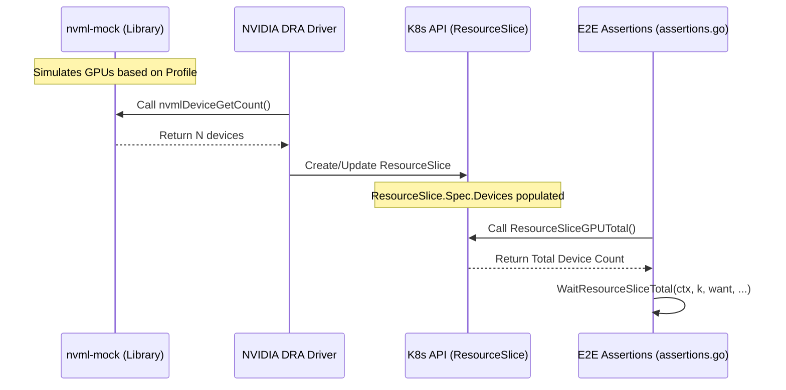
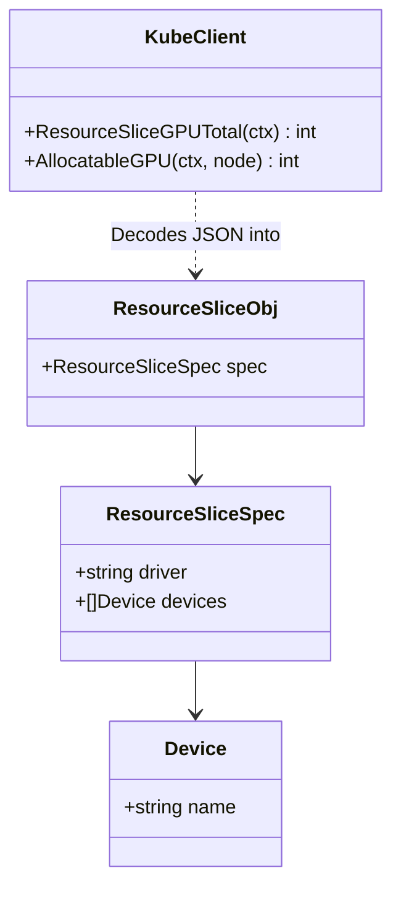

<!-- source: DeepWiki mcp.deepwiki.com · repo NVIDIA/k8s-test-infra · page 6.3 Dynamic Resource Allocation (DRA) API · fetched 2026-10-26 -->

# Dynamic Resource Allocation (DRA) API

Relevant source files

The following files were used as context for generating this wiki page:

- [tests/e2e/VERSION-MATRIX.md](tests/e2e/VERSION-MATRIX.md)
- [tests/e2e/go/assertions/resources.go](tests/e2e/go/assertions/resources.go)
- [tests/e2e/go/framework/helm/helm.go](tests/e2e/go/framework/helm/helm.go)
- [tests/e2e/go/framework/helm/helm_test.go](tests/e2e/go/framework/helm/helm_test.go)
- [tests/e2e/go/framework/kube/kube.go](tests/e2e/go/framework/kube/kube.go)
- [vendor/k8s.io/api/resource/v1alpha3/generated.proto](vendor/k8s.io/api/resource/v1alpha3/generated.proto)
- [vendor/k8s.io/api/resource/v1alpha3/types.go](vendor/k8s.io/api/resource/v1alpha3/types.go)
- [vendor/k8s.io/api/resource/v1alpha3/types_swagger_doc_generated.go](vendor/k8s.io/api/resource/v1alpha3/types_swagger_doc_generated.go)
- [vendor/k8s.io/api/resource/v1beta1/generated.proto](vendor/k8s.io/api/resource/v1beta1/generated.proto)
- [vendor/k8s.io/api/resource/v1beta1/types.go](vendor/k8s.io/api/resource/v1beta1/types.go)
- [vendor/k8s.io/api/resource/v1beta1/types_swagger_doc_generated.go](vendor/k8s.io/api/resource/v1beta1/types_swagger_doc_generated.go)

## Purpose and Scope

This document details the Dynamic Resource Allocation (DRA) API used for device resource management within the `k8s-test-infra` codebase. It focuses on the integration between the `nvml-mock` system and the DRA driver for publishing simulated GPU resources. The system leverages `ResourceSlice`, `ResourceClaim`, and `DeviceClass` objects to manage hardware beyond standard CPU/memory.

---

## Overview

The `nvml-mock` infrastructure simulates GPU hardware that is consumed by the NVIDIA DRA driver. The driver discovers these mock GPUs via the simulated NVML library and publishes them as Kubernetes `ResourceSlice` objects. This allows end-to-end testing of the DRA stack, including the `DynamicResourceAllocation` feature gate, without requiring physical hardware [tests/e2e/VERSION-MATRIX.md:22-22](), [tests/e2e/VERSION-MATRIX.md:60-61]().

**Key Components in Test Infra:**
- **DRA Driver (GPU)**: Version `v0.10.x` is used in CI to discover mock GPUs and publish `ResourceSlices` [tests/e2e/VERSION-MATRIX.md:10-10]().
- **ResourceSlice**: The primary mechanism for the driver to report device availability [vendor/k8s.io/api/resource/v1beta1/types.go:80-91]().
- **Kind Cluster**: Configured with Kubernetes 1.31+ and the `DynamicResourceAllocation` feature gate enabled [tests/e2e/VERSION-MATRIX.md:60-61]().

---

## Resource Management Flow

The following diagram bridges the natural language concepts of device discovery to the specific Kubernetes API entities and test framework components.

### GPU Resource Publishing Data Flow

**Sources:** [tests/e2e/VERSION-MATRIX.md:22-22](), [tests/e2e/go/assertions/resources.go:74-81](), [vendor/k8s.io/api/resource/v1beta1/types.go:103-166]()

---

## Core API Implementation

### ResourceSlice
The `ResourceSlice` represents a pool of devices managed by a common driver. In the `k8s-test-infra` context, the `ResourceSliceSpec` identifies the `nvidia-dra-driver-gpu` and lists the mock devices [vendor/k8s.io/api/resource/v1beta1/types.go:103-113]().

| Field | Code Entity | Purpose |
|-------|-------------|---------|
| `Driver` | `ResourceSliceSpec.Driver` | Identifies the DRA driver (e.g., `gpu.nvidia.com`) [vendor/k8s.io/api/resource/v1beta1/types.go:113-113]() |
| `Devices` | `[]Device` | List of device instances with attributes/capacities [vendor/k8s.io/api/resource/v1beta1/types.go:165-165]() |
| `Pool` | `ResourcePool` | Groups slices belonging to the same resource pool [vendor/k8s.io/api/resource/v1beta1/types.go:118-118]() |

### Device Selection (CEL)
DRA uses the Common Expression Language (CEL) for selecting devices based on attributes. The `CELDeviceSelector` evaluates expressions against device properties [vendor/k8s.io/api/resource/v1alpha3/types.go:33-44]().

**Sources:** [vendor/k8s.io/api/resource/v1beta1/types.go:80-166](), [vendor/k8s.io/api/resource/v1alpha3/types.go:33-87]()

---

## Integration and Testing

The E2E framework provides specialized assertions for DRA resources, implemented in `tests/e2e/go/assertions/resources.go`.

### Kube Client and Resource Tracking

The framework uses a `Client` struct to execute `kubectl` commands and decode JSON output into minimal typed views of Kubernetes objects [tests/e2e/go/framework/kube/kube.go:36-71]().

**Key Testing Functions:**
- `WaitResourceSliceTotal`: Polls the cluster until the summed `ResourceSlice` device count matches the expected number of mock GPUs [tests/e2e/go/assertions/resources.go:74-81]().
- `ResourceSliceGPUTotal`: A `kube.Client` method that aggregates device counts across all `ResourceSlices` [tests/e2e/go/assertions/resources.go:78-78]().

**Sources:** [tests/e2e/go/framework/kube/kube.go:77-138](), [tests/e2e/go/assertions/resources.go:74-81]()

---

## Deployment via Helm

The DRA driver and mock components are deployed using the `helm.Client` wrapper [tests/e2e/go/framework/helm/helm.go:20-25]().

- **DRA Driver Chart**: `nvidia/nvidia-dra-driver-gpu` is installed with specific version pinning in CI [tests/e2e/VERSION-MATRIX.md:10-10]().
- **Wait Mechanism**: The `helm.Release` struct supports a `Wait` flag, ensuring the driver is ready before assertions begin [tests/e2e/go/framework/helm/helm.go:38-38](), [tests/e2e/go/framework/helm/helm.go:107-109]().

**Sources:** [tests/e2e/go/framework/helm/helm.go:28-40](), [tests/e2e/VERSION-MATRIX.md:10-10]()

---

## Feature Gates and Compatibility

The DRA API implementation in this codebase targets `v1beta1` for `ResourceSlice` and `v1alpha3` for `DeviceSelector` [vendor/k8s.io/api/resource/v1beta1/types.go:54-54](), [vendor/k8s.io/api/resource/v1alpha3/types.go:17-17]().

- **Feature Gate**: `DynamicResourceAllocation` must be enabled in the Kind cluster [tests/e2e/VERSION-MATRIX.md:60-60]().
- **CDI**: Container Device Interface (CDI) must be enabled in `containerd` to support DRA device injection [tests/e2e/VERSION-MATRIX.md:61-61]().

**Sources:** [tests/e2e/VERSION-MATRIX.md:59-63](), [vendor/k8s.io/api/resource/v1beta1/types.go:78-79]()

---

