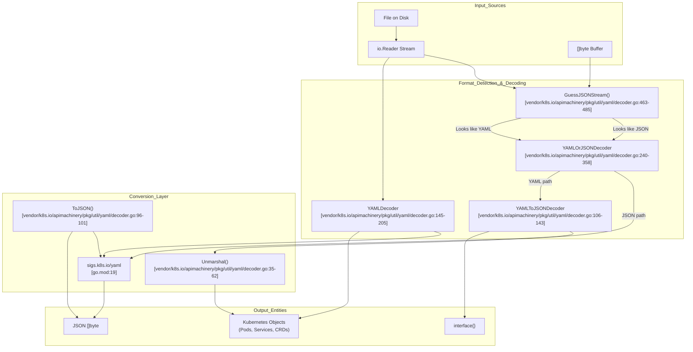
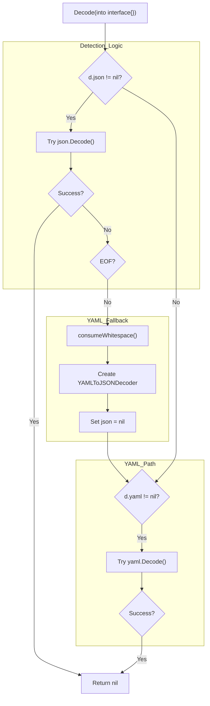
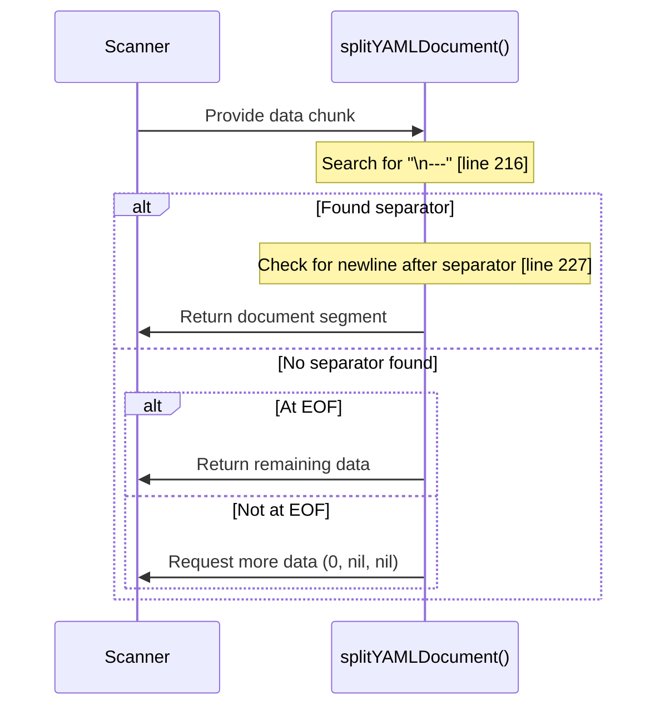

<!-- source: DeepWiki mcp.deepwiki.com · repo NVIDIA/k8s-test-infra · page 6.5 YAML and JSON Manifest Processing · fetched 2026-10-26 -->

# YAML and JSON Manifest Processing

Relevant source files

The following files were used as context for generating this wiki page:

- [go.mod](go.mod)
- [go.sum](go.sum)
- [vendor/github.com/onsi/ginkgo/v2/CHANGELOG.md](vendor/github.com/onsi/ginkgo/v2/CHANGELOG.md)
- [vendor/github.com/onsi/ginkgo/v2/reporters/default_reporter.go](vendor/github.com/onsi/ginkgo/v2/reporters/default_reporter.go)
- [vendor/github.com/onsi/ginkgo/v2/types/version.go](vendor/github.com/onsi/ginkgo/v2/types/version.go)
- [vendor/k8s.io/apimachinery/pkg/api/validation/objectmeta.go](vendor/k8s.io/apimachinery/pkg/api/validation/objectmeta.go)
- [vendor/k8s.io/apimachinery/pkg/util/yaml/decoder.go](vendor/k8s.io/apimachinery/pkg/util/yaml/decoder.go)
- [vendor/modules.txt](vendor/modules.txt)

## Purpose and Scope

This document describes the utilities provided by `k8s.io/apimachinery/pkg/util/yaml` for loading and decoding Kubernetes manifests in YAML or JSON format. These utilities are essential for test infrastructure that needs to load resource definitions from manifests, handle multi-document streams, and automatically detect the format of input data. 

The codebase relies on these utilities to bridge the gap between human-readable YAML configurations and Go-native Kubernetes object structures used in the E2E test harness and the `nvml-mock` configuration system.

---

## Manifest Processing Architecture

The manifest processing system provides automatic format detection, multi-document stream handling, and conversion between YAML and JSON representations of Kubernetes resources. It leverages `sigs.k8s.io/yaml` for the heavy lifting of conversion while providing Kubernetes-specific stream management.

### Data Flow: From Manifest to Entity
The following diagram illustrates how raw input bytes are transformed into code entities like `interface{}` or structured Kubernetes objects.

**Manifest Processing Data Flow**

**Sources:** [vendor/k8s.io/apimachinery/pkg/util/yaml/decoder.go:1-486](), [go.mod:1-20]()

---

## Core Decoder Types

### YAMLOrJSONDecoder

`YAMLOrJSONDecoder` is the primary entry point for processing manifests with unknown format [vendor/k8s.io/apimachinery/pkg/util/yaml/decoder.go:240-256](). It automatically detects whether the input stream contains JSON or YAML and switches to the appropriate internal decoder.

| Field | Type | Purpose |
|-------|------|---------|
| `json` | `*json.Decoder` | Used when stream is detected as JSON |
| `yaml` | `*YAMLToJSONDecoder` | Used when stream is YAML |
| `stream` | `*StreamReader` | Underlying stream reader with rewind capability |

**Key Methods:**
- `NewYAMLOrJSONDecoder(r io.Reader, bufferSize int)`: Creates a new decoder that auto-detects format [vendor/k8s.io/apimachinery/pkg/util/yaml/decoder.go:275-281]().
- `Decode(into interface{})`: Unmarshals the next object from the stream, handling format transitions [vendor/k8s.io/apimachinery/pkg/util/yaml/decoder.go:290-358]().

**Decoding Logic Flow**

**Sources:** [vendor/k8s.io/apimachinery/pkg/util/yaml/decoder.go:290-358]()

### YAMLToJSONDecoder

`YAMLToJSONDecoder` processes YAML documents by converting each to JSON before unmarshaling [vendor/k8s.io/apimachinery/pkg/util/yaml/decoder.go:106-109](). This approach ensures consistency with Kubernetes' JSON-based API machinery.

- **Decode Method:** Reads a YAML document as JSON from the stream [vendor/k8s.io/apimachinery/pkg/util/yaml/decoder.go:125-139]().

### YAMLDecoder

`YAMLDecoder` splits YAML streams into individual documents based on the `---` separator [vendor/k8s.io/apimachinery/pkg/util/yaml/decoder.go:147-151](). It is specifically designed to handle large streams by using a `bufio.Scanner` with a 5MB buffer limit [vendor/k8s.io/apimachinery/pkg/util/yaml/decoder.go:163]().

**Sources:** [vendor/k8s.io/apimachinery/pkg/util/yaml/decoder.go:106-205]()

---

## Conversion Functions

### Direct YAML/JSON Conversion

The package provides high-level functions for converting between YAML and JSON without manually managing decoder state.

| Function | Signature | Purpose |
|----------|-----------|---------|
| `Unmarshal` | `(data []byte, v interface{}) error` | Unmarshals YAML with number preservation [vendor/k8s.io/apimachinery/pkg/util/yaml/decoder.go:38-62](). |
| `UnmarshalStrict` | `(data []byte, v interface{}) error` | Strict unmarshaling that errors on duplicate fields [vendor/k8s.io/apimachinery/pkg/util/yaml/decoder.go:66-90](). |
| `ToJSON` | `(data []byte) ([]byte, error)` | Converts a single YAML document to JSON [vendor/k8s.io/apimachinery/pkg/util/yaml/decoder.go:96-101](). |

**Number Preservation:**
When unmarshaling into `*map[string]interface{}` or `*interface{}`, the utility uses `d.UseNumber()` to ensure numbers are converted to `int64` or `float64` rather than losing precision [vendor/k8s.io/apimachinery/pkg/util/yaml/decoder.go:39-42]().

---

## Multi-Document Stream Processing

### YAML Document Separation

YAML streams use the `---` separator to delimit multiple documents. The decoder handles this using a custom `bufio.SplitFunc` named `splitYAMLDocument` [vendor/k8s.io/apimachinery/pkg/util/yaml/decoder.go:211-238]().

**Separator Detection Sequence**

**Sources:** [vendor/k8s.io/apimachinery/pkg/util/yaml/decoder.go:211-238]()

---

## Format Detection

### GuessJSONStream and IsJSONBuffer

The system detects JSON by identifying an opening brace `{` as the first non-whitespace character in the stream.

- **GuessJSONStream:** Peeks at the beginning of an `io.Reader` to determine if it "looks like" JSON [vendor/k8s.io/apimachinery/pkg/util/yaml/decoder.go:478-485]().
- **IsJSONBuffer:** Checks if a byte slice has the JSON object prefix `{` after trimming whitespace [vendor/k8s.io/apimachinery/pkg/util/yaml/decoder.go:463-466]().

**Sources:** [vendor/k8s.io/apimachinery/pkg/util/yaml/decoder.go:463-485]()

---

## Error Handling

The package defines specialized error types to provide context during parsing failures:

1.  **JSONSyntaxError:** Wraps a standard JSON syntax error and includes the byte `Offset` where the error occurred [vendor/k8s.io/apimachinery/pkg/util/yaml/decoder.go:258-262]().
2.  **YAMLSyntaxError:** Wraps errors returned by the underlying YAML parser [vendor/k8s.io/apimachinery/pkg/util/yaml/decoder.go:271-273]().

---

## Dependencies

The manifest processing logic relies on the following external modules:

| Dependency | Version | Role |
|------------|---------|------|
| `sigs.k8s.io/yaml` | `v1.6.0` | Primary YAML/JSON conversion library [go.mod:19](). |
| `k8s.io/apimachinery` | `v0.36.3` | Provides the `pkg/util/yaml` utility package [go.mod:14](). |

**Sources:** [go.mod:1-20](), [vendor/modules.txt:1-550]()

---

