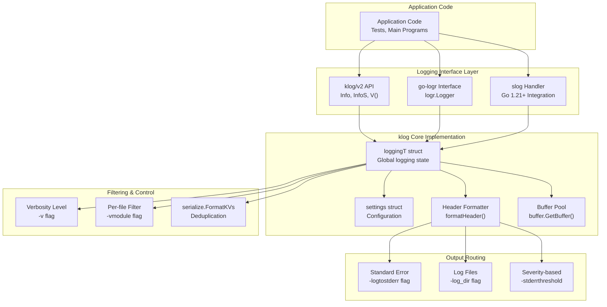
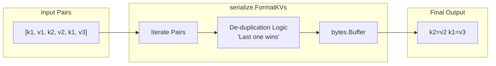

<!-- source: DeepWiki mcp.deepwiki.com · repo NVIDIA/k8s-test-infra · page 7 Logging and Observability · fetched 2026-10-26 -->

# Logging and Observability

Relevant source files

The following files were used as context for generating this wiki page:

- [vendor/k8s.io/klog/v2/README.md](vendor/k8s.io/klog/v2/README.md)
- [vendor/k8s.io/klog/v2/internal/serialize/keyvalues.go](vendor/k8s.io/klog/v2/internal/serialize/keyvalues.go)
- [vendor/k8s.io/klog/v2/internal/serialize/keyvalues_no_slog.go](vendor/k8s.io/klog/v2/internal/serialize/keyvalues_no_slog.go)
- [vendor/k8s.io/klog/v2/internal/serialize/keyvalues_slog.go](vendor/k8s.io/klog/v2/internal/serialize/keyvalues_slog.go)
- [vendor/k8s.io/klog/v2/klog.go](vendor/k8s.io/klog/v2/klog.go)
- [vendor/k8s.io/klog/v2/klogr.go](vendor/k8s.io/klog/v2/klogr.go)
- [vendor/k8s.io/klog/v2/klogr_slog.go](vendor/k8s.io/klog/v2/klogr_slog.go)

This page documents the logging infrastructure and observability practices used in the `k8s-test-infra` repository. It covers the primary logging library (`klog/v2`), configuration options, structured logging patterns, and integration with standard logging interfaces.

For information about test output and reporting, see [Test Reporting and Output](#5.4). For CI/CD observability and monitoring, see [GitHub Actions Workflows](#4.1).

---

## Overview

The `k8s-test-infra` repository uses **klog/v2** as its primary logging library, providing leveled, structured logging with extensive configuration options. The logging system integrates with the `go-logr` interface and supports modern `slog` handlers (Go 1.21+), enabling flexible backend selection and consistent logging patterns across Kubernetes components.

**Key Features:**
- Leveled logging with verbosity controls via `V()` levels [vendor/k8s.io/klog/v2/klog.go:98-99]().
- Structured logging with key-value pairs using `InfoS` and `ErrorS` [vendor/k8s.io/klog/v2/klog.go:21-21]().
- Command-line flag configuration through `InitFlags` [vendor/k8s.io/klog/v2/klog.go:19-19]().
- Per-file/module verbosity filtering via `-vmodule` [vendor/k8s.io/klog/v2/klog.go:100-105]().
- Integration with `go-logr` and `slog` [vendor/k8s.io/klog/v2/klogr_slog.go:36-45]().
- Buffered output routing with `Flush` guarantees [vendor/k8s.io/klog/v2/klog.go:52-53]().

**Sources:** [vendor/k8s.io/klog/v2/klog.go:1-116](), [vendor/k8s.io/klog/v2/klogr_slog.go:36-45]()

---

## Logging Architecture

The following diagram illustrates the logging stack and how different components interact:

### Logging System Stack

**Key Components:**

| Component | Description | Key Code Entities |
|-----------|-------------|-------------------|
| **klog API** | Primary logging interface | `Info()`, `InfoS()`, `V()`, `ErrorS()` |
| **loggingT** | Global logging state manager | `logging` global variable [vendor/k8s.io/klog/v2/klog.go:52-53]() |
| **KV Formatting** | Logic for serializing key-value pairs | `serialize.FormatKVs` [vendor/k8s.io/klog/v2/internal/serialize/keyvalues.go:64-66]() |
| **slog Integration** | Bridges Go standard slog to klog | `slogOutput` [vendor/k8s.io/klog/v2/klogr_slog.go:50-83]() |

**Sources:** [vendor/k8s.io/klog/v2/klog.go:17-37](), [vendor/k8s.io/klog/v2/internal/serialize/keyvalues.go:70-135](), [vendor/k8s.io/klog/v2/klogr_slog.go:50-83]()

---

## Child Pages

For deep technical details on specific logging topics, refer to the following sub-pages:

### [klog Integration](#7.1)
Detailed documentation on:
- **Flag Configuration**: Using `InitFlags` to register klog settings [vendor/k8s.io/klog/v2/klog.go:19-19]().
- **Verbosity Levels**: Managing the `-v` and `-vmodule` flags for fine-grained control [vendor/k8s.io/klog/v2/klog.go:98-105]().
- **Interface Bridging**: How `NewKlogr` creates a `logr.Logger` that targets klog [vendor/k8s.io/klog/v2/klogr.go:33-35]().
- **Contextual Logging**: Passing loggers through `context.Context` using `FromContext` [vendor/k8s.io/klog/v2/klog.go:24-27]().

### [Structured Logging Practices](#7.2)
Detailed documentation on:
- **InfoS/ErrorS Usage**: Best practices for using message strings and key-value pairs [vendor/k8s.io/klog/v2/klog.go:21-21]().
- **Serialization**: How `serialize.FormatKVs` handles de-duplication ("last one wins") [vendor/k8s.io/klog/v2/internal/serialize/keyvalues.go:70-73]().
- **Type Handling**: Serialization logic for `fmt.Stringer`, `error`, and `slog.LogValuer` [vendor/k8s.io/klog/v2/internal/serialize/keyvalues_slog.go:60-100]().
- **Plugin Logging**: Specific patterns used in the `nvml-mock-nri` plugin for container runtime observability.

---

## Structured Log Processing

When using structured logging, klog utilizes the `serialize` package to format output. This includes a de-duplication mechanism where if a key is repeated in the key-value list, the last occurrence is preserved.

### Key-Value Serialization Logic

**Implementation Detail:**
The `FormatKVs` function in `vendor/k8s.io/klog/v2/internal/serialize/keyvalues.go` tracks `obsoleteKV` entries to cut out redundant output from the buffer when a key is overwritten by a subsequent pair [vendor/k8s.io/klog/v2/internal/serialize/keyvalues.go:70-135]().

**Sources:** [vendor/k8s.io/klog/v2/internal/serialize/keyvalues.go:70-167](), [vendor/k8s.io/klog/v2/internal/serialize/keyvalues_slog.go:33-51]()

---

## Logging in Tests

In the `k8s-test-infra` codebase, logging is critical for debugging E2E failures. Tests typically use the `klog.Background()` logger or standard `klog.InfoS` calls. Programs must call `klog.Flush()` before exiting to ensure all buffered logs are written to the output stream [vendor/k8s.io/klog/v2/klog.go:52-53]().

For unit tests, `k8s.io/klog/v2/ktesting` provides per-test output isolation [vendor/k8s.io/klog/v2/klog.go:32-32]().

**Sources:** [vendor/k8s.io/klog/v2/klog.go:32-53](), [vendor/k8s.io/klog/v2/klogr.go:55-59]()

---

