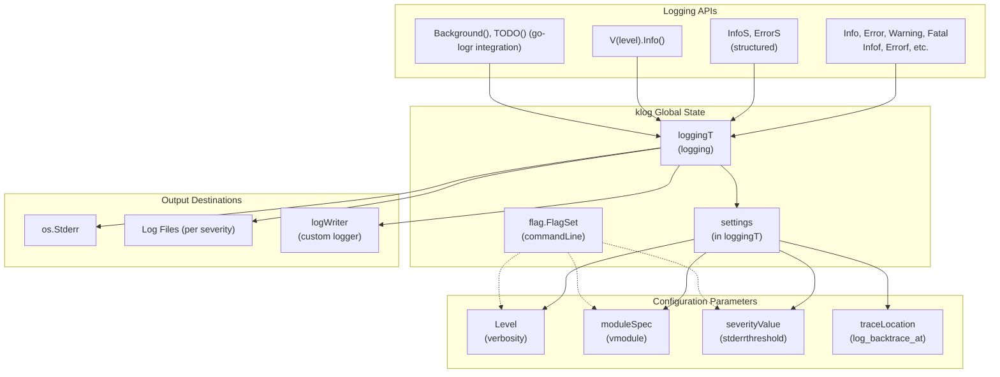
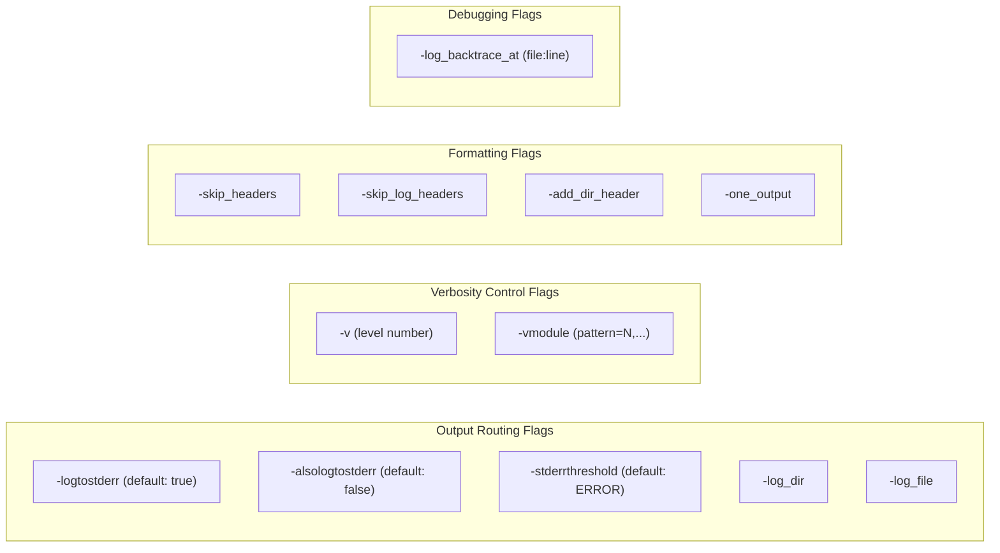
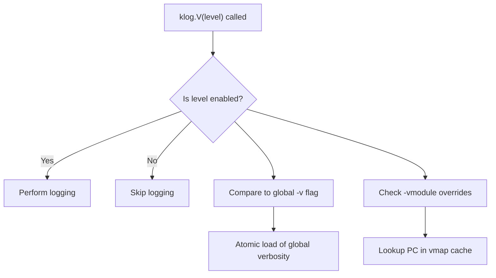
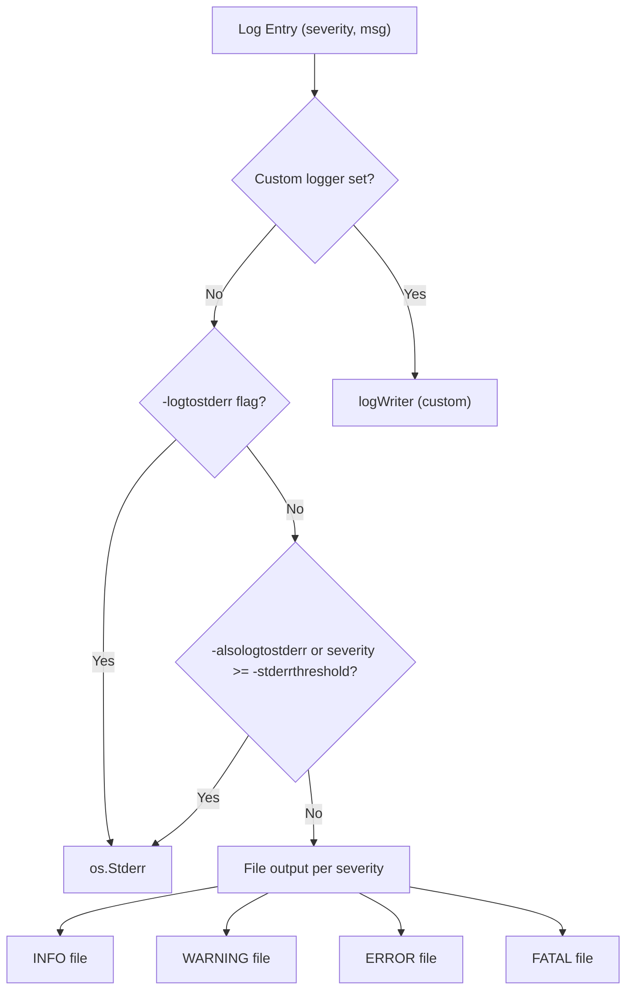
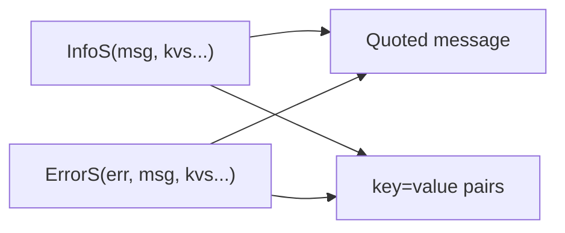
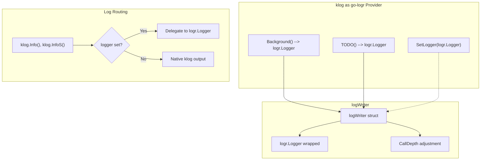
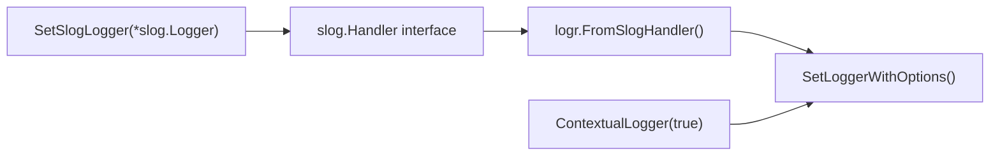
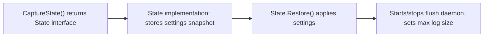

<!-- source: DeepWiki mcp.deepwiki.com · repo NVIDIA/k8s-test-infra · page 7.1 klog Integration · fetched 2026-10-26 -->

# klog Integration

<details>
<summary>Relevant source files</summary>

The following files were used as context for generating this wiki page:

- [vendor/github.com/go-logr/logr/README.md](vendor/github.com/go-logr/logr/README.md)
- [vendor/github.com/go-logr/logr/funcr/funcr.go](vendor/github.com/go-logr/logr/funcr/funcr.go)
- [vendor/github.com/onsi/ginkgo/v2/ginkgo/build/build_command.go](vendor/github.com/onsi/ginkgo/v2/ginkgo/build/build_command.go)
- [vendor/github.com/onsi/ginkgo/v2/ginkgo/internal/compile.go](vendor/github.com/onsi/ginkgo/v2/ginkgo/internal/compile.go)
- [vendor/k8s.io/klog/v2/OWNERS](vendor/k8s.io/klog/v2/OWNERS)
- [vendor/k8s.io/klog/v2/README.md](vendor/k8s.io/klog/v2/README.md)
- [vendor/k8s.io/klog/v2/contextual_slog.go](vendor/k8s.io/klog/v2/contextual_slog.go)
- [vendor/k8s.io/klog/v2/internal/serialize/keyvalues.go](vendor/k8s.io/klog/v2/internal/serialize/keyvalues.go)
- [vendor/k8s.io/klog/v2/internal/serialize/keyvalues_no_slog.go](vendor/k8s.io/klog/v2/internal/serialize/keyvalues_no_slog.go)
- [vendor/k8s.io/klog/v2/internal/serialize/keyvalues_slog.go](vendor/k8s.io/klog/v2/internal/serialize/keyvalues_slog.go)
- [vendor/k8s.io/klog/v2/klog.go](vendor/k8s.io/klog/v2/klog.go)
- [vendor/k8s.io/klog/v2/klogr.go](vendor/k8s.io/klog/v2/klogr.go)
- [vendor/k8s.io/klog/v2/klogr_slog.go](vendor/k8s.io/klog/v2/klogr_slog.go)
- [vendor/k8s.io/klog/v2/safeptr.go](vendor/k8s.io/klog/v2/safeptr.go)

</details>


## Purpose and Scope

This document describes how the k8s-test-infra project uses **klog** (the Kubernetes Logging Library) for logging and observability. It covers the detailed configuration of klog, verbosity levels, output routing, and its integration with modern structured logging interfaces such as **go-logr** and **slog**.

klog is a vendored dependency from `k8s.io/klog/v2` and serves as the primary logging mechanism for test infrastructure components and the nv-ci-bot application within the k8s-test-infra ecosystem.

---

## klog Architecture

klog provides a leveled logging system with multiple output destinations and fine-grained filtering capabilities. The architecture revolves around a global singleton `logging` of type `loggingT` that owns all state including output writers, verbosity settings, location filters, and file handles.



- The `loggingT` struct holds all runtime state: log destinations, filters, verbosity, file handles, mutex for concurrency, and statistics.
- Configuration options are typically set via command-line flags registered on a flag.FlagSet.
- Multiple logging APIs coexist: traditional unstructured logging (Info, Error, etc.), verbosity-controlled logs (`V(level)`), structured logging (`InfoS`), and integration with `go-logr`.

**Sources:** [vendor/k8s.io/klog/v2/klog.go:400-560]()

---

## Configuration and Initialization

### Flag Registration

klog logging flags must be initialized explicitly by calling:

```go
klog.InitFlags(flag.CommandLine)
```

This registers all klog-related flags into the provided `flag.FlagSet`. Flags then need to be parsed via `flag.Parse()` before logging begins.

| Function | Description | Typical Usage |
|----------|-------------|---------------|
| `InitFlags(flagset)` | Register klog CLI flags to a flag set | Called once at program startup |
| `init()` | Internal init (does not register flags) | Automatic |

**Sources:** [vendor/k8s.io/klog/v2/klog.go:436-449]()

### Command-Line Flags Overview

klog offers a rich set of flags controlling output routing, verbosity, formatting, and debugging aids. Flags are categorized as follows:



#### Output Routing Flags

| Flag                 | Type   | Default | Description                                                  |
|----------------------|--------|---------|--------------------------------------------------------------|
| `-logtostderr`       | bool   | true    | Log output goes to stderr rather than files                   |
| `-alsologtostderr`   | bool   | false   | Log to stderr in addition to files                            |
| `-stderrthreshold`   | severity| ERROR  | Severity threshold for logging to stderr                      |
| `-log_dir`           | string | ""      | Directory where to write log files (ignored if -logtostderr) |
| `-log_file`          | string | ""      | Direct log file path (single file, ignored with -logtostderr)|
| `-log_file_max_size` | uint64 | 1800    | Max size (MB) before rotating log files                       |

#### Verbosity Control Flags

| Flag        | Type    | Default | Description                                             |
|-------------|---------|---------|---------------------------------------------------------|
| `-v`        | Level   | 0       | Global verbosity level controlling V-enabled logs       |
| `-vmodule`  | string  | ""      | Per-file verbosity control with glob-patterns           |

The `-vmodule` flag enables specifying verbosity overrides by file name patterns (e.g., `gopher*=3,file=1`).

#### Debugging Flags

| Flag               | Type   | Description                              |
|--------------------|--------|----------------------------------------|
| `-log_backtrace_at` | string | Emit stack trace when given file and line is logged |

#### Formatting Flags

| Flag              | Type   | Description                            |
|-------------------|--------|--------------------------------------|
| `-skip_headers`   | bool   | Skip header prefixes on log lines    |
| `-skip_log_headers`| bool  | Skip headers specifically for files  |
| `-add_dir_header` | bool   | Include directory prefix in log lines|
| `-one_output`     | bool   | Write only to original severity file |

**Sources:** [vendor/k8s.io/klog/v2/klog.go:59-90](), [vendor/k8s.io/klog/v2/klog.go:412-429](), [vendor/k8s.io/klog/v2/klog.go:430]()

---

## Verbosity Levels and Filtering

### Verbosity-Based Logging

klog uses integer levels for verbosity control, where higher numbers mean more verbose output.

Code typically checks:

```go
if klog.V(2) {
    klog.Info("Starting transaction...")
}

klog.V(2).Info("Processed", nItems, "elements")
```

This delays potentially expensive log message generation until the verbosity check passes.

### Verbosity Evaluation Flow



- The global verbosity level is stored atomically.
- Per-file `-vmodule` settings use a compiled cache of program counters to levels for speed.
- The `V()` method returns a `Verbose` object with an `Enabled()` method to avoid log message evaluation when disabled.

### Per-file Filtering (`-vmodule`)

`-vmodule` uses glob patterns to specify different verbosity levels per source file:

| Pattern | Example      | Matches                        |
|---------|--------------|--------------------------------|
| Literal | `file=3`     | Only `file.go`                  |
| Glob    | `gopher*=3`  | `gopher.go`, `gopherflakes.go` |
| Multiple| `recordio=2,file=1,gfs*=3` | Multiple file patterns   |

This allows fine-grained control for troubleshooting specific components.

**Sources:** [vendor/k8s.io/klog/v2/klog.go:44-50](), [vendor/k8s.io/klog/v2/klog.go:217-331]()

---

## Output Routing and Formatting

### Output Routing Logic

Log entries are routed based on configuration and severity:



- If a custom logger is installed, all logs delegate there.
- Otherwise, logs go to stderr if enabled or to per-severity files.
- `-alsologtostderr` controls duplicate logging to stderr alongside files.

### Log Format

klog log lines follow a consistent format, for example:

```
I1204 10:30:45.123456 12345 file.go:42] "User logged in" username="alice" duration="2.5s"
```

Where:

| Symbol  | Meaning                             |
|---------|-----------------------------------|
| `I`     | Severity character (Info)          |
| `1204`  | Month and day (MMDD)               |
| `10:30:45.123456` | Timestamp with microsecond precision |
| `12345` | Thread/Goroutine ID (space-padded)|
| `file.go:42` | Source file and line number     |
| Message | Log text or structured key-value pairs |

### Severity Levels

| Severity      | Numeric | Character | Usage                    |
|---------------|---------|-----------|--------------------------|
| InfoLog       | 0       | `I`       | Informational messages   |
| WarningLog    | 1       | `W`       | Warnings                 |
| ErrorLog      | 2       | `E`       | Errors                   |
| FatalLog      | 3       | `F`       | Fatal errors (exit)      |

**Sources:** [vendor/k8s.io/klog/v2/klog.go:630-680](), [vendor/k8s.io/klog/v2/klog.go:185-189]()

---

## Logging API

### Traditional Logging Functions

klog provides familiar, printf-like functions:

| Function Pattern | Example                                |
|------------------|--------------------------------------|
| `Info(args...)`  | `klog.Info("Server started")`         |
| `Infof(fmt, ...)`| `klog.Infof("Port: %d", port)`        |
| `Infoln(args...)`| `klog.Infoln("Item", value)`          |
| `Warning(args...)`| `klog.Warning("Deprecated API")`     |
| `Error(args...)` | `klog.Error("Failed connection")`    |
| `Fatal(args...)` | `klog.Fatal("Cannot continue")`      |

Each has raw, formatted, and line-ending variants (`X`, `Xf`, `Xln`).

### Structured Logging Functions

For structured logs with key-value pairs:

| Function | Signature                                         |
|----------|-------------------------------------------------|
| `InfoS`  | `InfoS(msg string, keysAndValues ...interface{})` |
| `ErrorS` | `ErrorS(err error, msg string, keysAndValues ...interface{})` |

Example log line with key-value pairs:

```
I1204 10:30:45.123456 12345 file.go:42] "User logged in" username="alice" role="admin" duration="2.5s"
```



### Verbosity-Based API

`V(level)` returns a `Verbose` object with conditional logging:

```go
if klog.V(2) {
    klog.Info("Debug info only when verbosity >= 2")
}

klog.V(3).Infof("Extra details: %v", data)
```

This avoids runtime cost of interpolated messages when verbosity is lower.

**Sources:** [vendor/k8s.io/klog/v2/klog.go:38-50](), [vendor/k8s.io/klog/v2/klog.go:780-825]()

---

## go-logr Integration

klog integrates with the [go-logr](https://github.com/go-logr/logr) API, allowing it to be used as a logr backend or delegate to other logr implementations.

### Architecture Overview



### Key Functions and Usage

| Function              | Description                        | Use Case                             |
|-----------------------|----------------------------------|------------------------------------|
| `Background()`        | Returns global logr.Logger        | Default logger use                  |
| `TODO()`              | Returns temporary logr.Logger     | Placeholder, for incremental use   |
| `SetLogger(logger)`   | Installs custom logr.Logger       | Integrate external logger backend   |
| `SetLoggerWithOptions`| Installs logr.Logger with options | Advanced customization              |

The `logWriter` type adapts between klog and logr with call depth management.

### Logger Options

`loggerOptions` allow control such as:

- enabling contextual logging
- using klog's buffer formatter vs native logr formatting

**Sources:** [vendor/k8s.io/klog/v2/klog.go:17-28](), [vendor/k8s.io/klog/v2/klog.go:450-470]()

---

## slog Integration (Go 1.21+)

With Go 1.21+, klog integrates with the new standard library `log/slog` package providing modern structured logging.

### Integration Flow



- `SetSlogLogger` converts an `*slog.Logger` to a `logr.Logger` adapted for klog.
- It installs this as the global klog logger with contextual logging enabled.

```go
func SetSlogLogger(logger *slog.Logger) {
    SetLoggerWithOptions(logr.FromSlogHandler(logger.Handler()), ContextualLogger(true))
}
```

### slogSink Implementation

The internal `klogger` type implements the `logr.SlogSink` interface for compatibility:

| Method             | Purpose                       |
|--------------------|-------------------------------|
| `Handle(ctx, record)` | Handles a slog.Record upon log |
| `WithAttrs(attrs)`     | Adds attributes (key-values)   |
| `WithGroup(name)`      | Adds grouping to the logger    |

This allows klog to interoperate cleanly with slog-style structured logging.

**Sources:** [vendor/k8s.io/klog/v2/contextual_slog.go:22-35](), [vendor/k8s.io/klog/v2/klogr_slog.go:36-97]()

---

## State Management

### CaptureState and Restore

klog supports capturing its current state snapshot, useful in tests and advanced reconfiguration:



- `CaptureState()` snapshots all global flags and runtime values atomically.
- `State.Restore()` restores those settings and controls the background flush daemon accordingly.

Use case: testing code can isolate klog config changes and restore after tests.

### Flush Control

| Function           | Description                             |
|--------------------|---------------------------------------|
| `Flush()`          | Flush all buffered logs to outputs    |
| `FlushAndExit(c)`  | Flush and then exit the process with code `c` |

Programs should call `Flush()` before exit to ensure all log output is persisted.

**Sources:** [vendor/k8s.io/klog/v2/klog.go:580-630](), [vendor/k8s.io/klog/v2/klog.go:450-460]()

---

## Usage in k8s-test-infra

### Initialization Pattern

The common way to initialize klog in k8s-test-infra is:

```go
import (
    "flag"
    "k8s.io/klog/v2"
)

func main() {
    klog.InitFlags(nil)   // Register klog flags in flag.CommandLine
    flag.Parse()          // Parse all flags
    defer klog.Flush()    // Ensure all logs are flushed on exit
    
    // Main program logic
}
```

### Typical Configuration

Based on Kubernetes ecosystem norms, example configurations include:

| Scenario        | Flags                        | Description                 |
|-----------------|------------------------------|-----------------------------|
| Development     | `-v=4 -logtostderr`           | Verbose output to console    |
| Production      | `-v=2 -log_dir=/var/log`      | Moderate logging to files    |
| Testing         | `-v=5 -logtostderr`           | Maximum verbosity on console |
| CI/CD           | `-v=2 -logtostderr`           | Standard log capture stdout/stderr |

### Integration with Ginkgo Testing

In Ginkgo tests (detailed in section 5), klog is often set to log to GinkgoWriter to capture logs alongside test output:

```go
BeforeEach(func() {
    klog.SetOutput(GinkgoWriter)
})
```

This allows Kubernetes-style logs to appear in test reports.

---

## Performance Considerations

- Verbosity checks use atomic loads and a program counter-based cache (`vmap`) for fast per-callsite verbosity evaluation.
- Buffered output is pooled via `buffer.GetBuffer()` and `buffer.PutBuffer()` for reduced allocations.
- Output stats (line and byte counts) are tracked atomically per severity.
- All global state changes and output are mutex-protected for thread safety.

---

## Thread Safety

klog is safe for concurrent use:

- Global verbosity and severity thresholds use atomic operations.
- Output functions lock the global mutex to serialize access.
- State snapshot and restoration are mutex-protected.

---

## Special Features

- **Stack Traces:** Trigger a stack backtrace on specified file:line via `-log_backtrace_at`.
- **File Rotation:** Log files are auto-rotated once reaching max size configured by `-log_file_max_size`.
- **Safe Pointer Logging:** `SafePtr` helper prevents nil pointer dereference during `fmt.Stringer` calls.

---

## Summary

The integration of klog within k8s-test-infra enables:

- Flexible, flag-driven logging configuration.
- Fine-grained verbosity control globally and per file.
- Multiple destination support: stderr, files, and custom loggers.
- Support for traditional and structured logging APIs.
- Seamless integration with `go-logr` and Go 1.21+ `slog`.
- Thread-safe, performant logging suitable for complex test and CI infrastructure.

This consistent logging foundation ensures observability and diagnostics across the system compatible with Kubernetes ecosystem standards.

---

# References

- Core klog source: [vendor/k8s.io/klog/v2/klog.go:1-1130]()
- go-logr bridge: [vendor/k8s.io/klog/v2/klogr.go:1-110]()
- slog integration: [vendor/k8s.io/klog/v2/klogr_slog.go:1-102](), [vendor/k8s.io/klog/v2/contextual_slog.go:20-38]()
- Key-value serialization with/without slog: [vendor/k8s.io/klog/v2/internal/serialize/keyvalues_slog.go:1-160](), [vendor/k8s.io/klog/v2/internal/serialize/keyvalues_no_slog.go:1-102]()
- klog README explanatory text: [vendor/k8s.io/klog/v2/README.md:1-117]()

---

