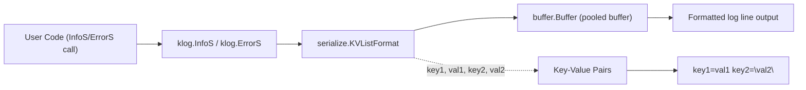
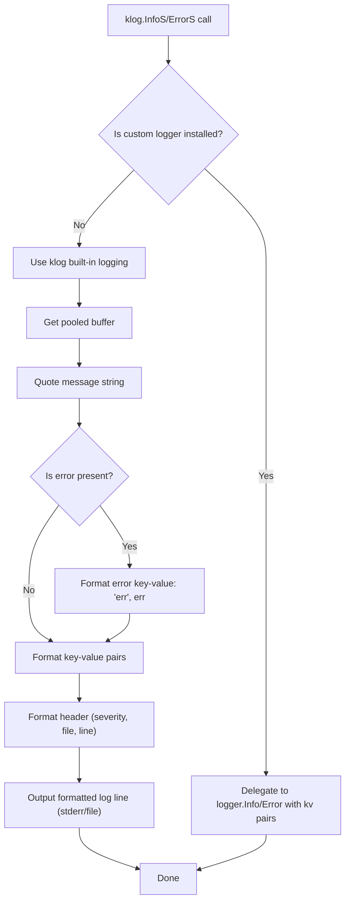
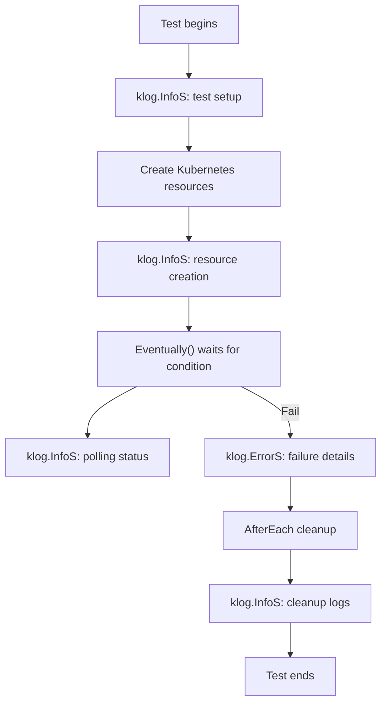
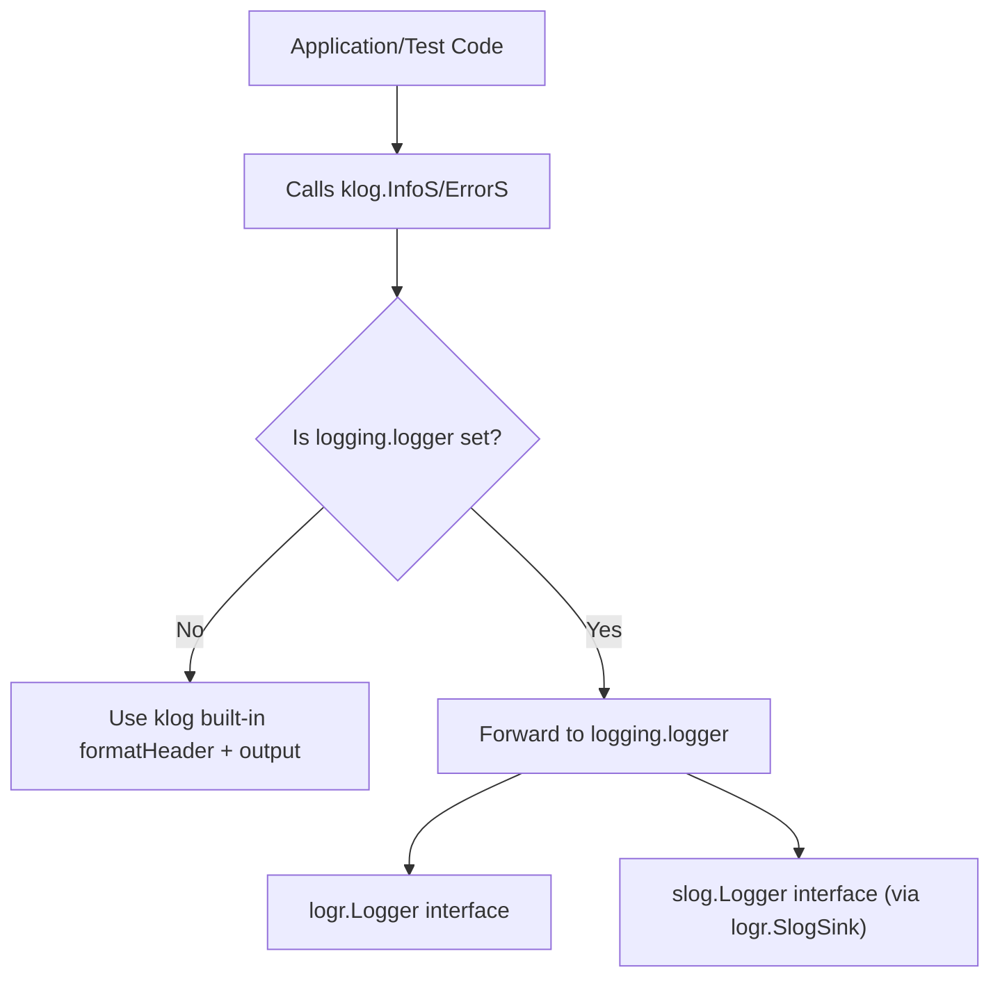
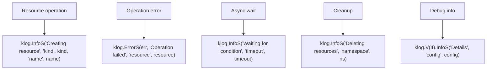
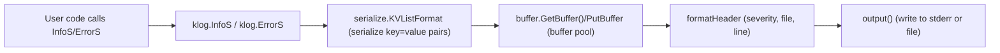
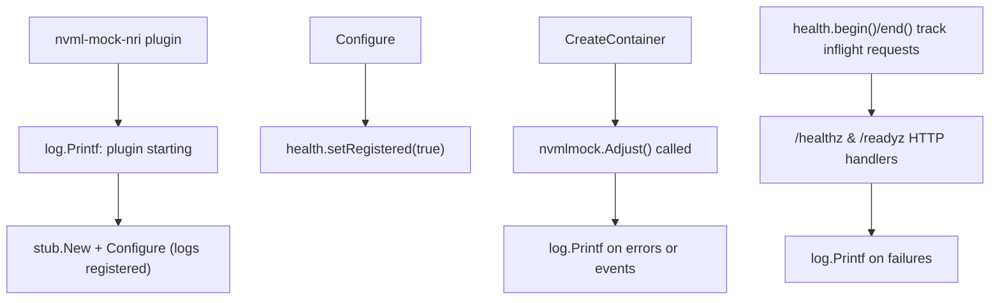

<!-- source: DeepWiki mcp.deepwiki.com · repo NVIDIA/k8s-test-infra · page 7.2 Structured Logging Practices · fetched 2026-10-26 -->

# Structured Logging Practices

<details>
<summary>Relevant source files</summary>

The following files were used as context for generating this wiki page:

- [cmd/nvml-mock-nri/health.go](cmd/nvml-mock-nri/health.go)
- [cmd/nvml-mock-nri/health_test.go](cmd/nvml-mock-nri/health_test.go)
- [cmd/nvml-mock-nri/main.go](cmd/nvml-mock-nri/main.go)
- [deployments/nvml-mock/helm/nvml-mock/templates/nri-daemonset.yaml](deployments/nvml-mock/helm/nvml-mock/templates/nri-daemonset.yaml)
- [deployments/nvml-mock/helm/nvml-mock/tests/nri_daemonset_test.yaml](deployments/nvml-mock/helm/nvml-mock/tests/nri_daemonset_test.yaml)
- [tests/e2e/go/scenario_nri_test.go](tests/e2e/go/scenario_nri_test.go)
- [vendor/k8s.io/klog/v2/README.md](vendor/k8s.io/klog/v2/README.md)
- [vendor/k8s.io/klog/v2/internal/serialize/keyvalues.go](vendor/k8s.io/klog/v2/internal/serialize/keyvalues.go)
- [vendor/k8s.io/klog/v2/internal/serialize/keyvalues_no_slog.go](vendor/k8s.io/klog/v2/internal/serialize/keyvalues_no_slog.go)
- [vendor/k8s.io/klog/v2/internal/serialize/keyvalues_slog.go](vendor/k8s.io/klog/v2/internal/serialize/keyvalues_slog.go)
- [vendor/k8s.io/klog/v2/klog.go](vendor/k8s.io/klog/v2/klog.go)
- [vendor/k8s.io/klog/v2/klogr.go](vendor/k8s.io/klog/v2/klogr.go)
- [vendor/k8s.io/klog/v2/klogr_slog.go](vendor/k8s.io/klog/v2/klogr_slog.go)

</details>


## Purpose and Scope

This page documents structured logging practices employed in the [k8s-test-infra](https://github.com/NVIDIA/k8s-test-infra) repository, focusing on the use of klog's structured logging APIs (`InfoS`, `ErrorS`) for emitting logs with key-value pairs. Structured logging enables better log parsing, filtering, and analysis compared to traditional format string logging.

It covers details of InfoS/ErrorS usage, key-value formatting conventions, and concrete logging examples in both tests and the critical nvml-mock-nri plugin. The content assumes familiarity with Go, Kubernetes logging conventions, and the nvml-mock GPU simulation system.

For klog configuration, verbosity levels, and its integration with go-logr and slog, see [klog Integration (#7.1)].

**Sources:**  
- [vendor/k8s.io/klog/v2/klog.go:1-91]()  
- [cmd/nvml-mock-nri/main.go:4-89]()  
- [tests/e2e/go/scenario_nri_test.go:1-160]()  
- [cmd/nvml-mock-nri/health.go:14-193]()  
- [vendor/k8s.io/klog/v2/klogr_slog.go:20-84]()  

## Structured vs Unstructured Logging

The repository uses klog/v2, which supports both unstructured (printf-style) and structured (key-value pairs) logging.

| Approach       | Function           | Example                                                      | Best Use Case                         |
| -------------- | ------------------ | ------------------------------------------------------------ | ----------------------------------- |
| **Unstructured** | `Info()`, `Infof()`, `Error()`, `Errorf()` | `klog.Infof("processing pod %s in namespace %s", pod, ns)`   | Simple logs, quick debugging, legacy|
| **Structured**   | `InfoS()`, `ErrorS()`                    | `klog.InfoS("Processing pod", "pod", pod, "namespace", ns)` | Production logs, observability, parsing-friendly |

Structured logging outputs a constant message string paired with zero or more key-value pairs, which improves parsing precision, consistency in logs, and aids automated log processing.

## InfoS and ErrorS: Structured Logging APIs

### Function Signatures

The key structured logging calls used are:

```go
// InfoS logs a structured info message.
// msg is a constant message string (no format specifiers).
// keysAndValues are alternating key and value pairs.
func InfoS(msg string, keysAndValues ...interface{})

// ErrorS logs a structured error message.
// err is the error to log (can be nil).
// msg is a constant message string.
// keysAndValues are alternating key and value pairs.
func ErrorS(err error, msg string, keysAndValues ...interface{})
```

The `InfoS` and `ErrorS` APIs discourage printf-style formatting, instead encouraging explicit message strings and contextual key-value pairs.

### Example Usage

```go
klog.InfoS("Pod started", "pod", podName, "namespace", ns)
klog.ErrorS(err, "Failed to create pod", "pod", podName, "namespace", ns)
```

### Key-Value Pair Formatting

Internally, the key-value pairs are serialized into a parseable string of the form:

```
key1=value1 key2="value2" ...
```

All keys are assumed to be strings, and values may be strings, numbers, booleans, durations, errors, or custom types with stringers.



**Sources:**  
- [vendor/k8s.io/klog/v2/klog.go:17-36]()  
- [vendor/k8s.io/klog/v2/klogr_slog.go:50-80]()  

## Structured Logging Data Flow

### Logging Pipeline



- If no logger backend is installed, klog formats and writes logs directly with headers and serialized key-values.  
- With a logger backend (logr or slog), klog delegates to that logger, allowing contextual logging and unified output.

**Sources:**  
- [vendor/k8s.io/klog/v2/klogr_slog.go:50-80]()  
- [vendor/k8s.io/klog/v2/klog.go:652-679]()  

## Key-Value Pair Formatting and Best Practices

### Naming Conventions

| Key Name Category | Examples                        | Notes                                |
|-------------------|--------------------------------|------------------------------------|
| Resource Identifiers | `"pod"`, `"namespace"`, `"node"` | Use singular, lowercase strings    |
| Counts             | `"count"`, `"total"`, `"available"` | Use explicit names, specify units if needed |
| Durations          | `"duration"`, `"timeout"`, `"interval"` | Log as `time.Duration` values      |
| Status             | `"status"`, `"phase"`, `"state"` | Use string constants or enums      |
| Errors             | `"err"`                         | Reserved key for error objects in ErrorS |

### Supported Value Types and Serialization

The serializer handles:

- Strings, quoted if necessary  
- Numeric types (int, float)  
- Booleans as `true`/`false`  
- `time.Duration` serialized as strings (e.g. `"5s"`)  
- Error objects serialized via `.Error()`  
- Pointers safely logged via `SafePtr` (see below)  
- Custom objects implementing `fmt.Stringer` or `logr.Marshaler` serialized appropriately  

### Pointer Safety in Logging

Logging pointers that implement interfaces like `fmt.Stringer` and may be `nil` can cause panics. To avoid this, use:

```go
klog.InfoS("Got object", "obj", klog.SafePtr(obj))
```

`SafePtr` returns `nil` if the pointer is `nil`, otherwise returns the pointer as-is, preventing panics when stringers are called on nil pointers.

**Sources:**  
- [vendor/k8s.io/klog/v2/internal/serialize/keyvalues.go:30-180]()  
- [vendor/k8s.io/klog/v2/safeptr.go:22-34]()  

## Logging Usage in nvml-mock-nri Plugin

The `nvml-mock-nri` plugin is a containerd Node Resource Interface plugin injecting the nvml-mock overlay into containers for GPU simulation.

- Logging is performed primarily via `log.Printf` for startup and lifecycle events.   
- Health events and plugin lifecycle transitions (Configure, CreateContainer) are logged with clear, contextual messages.  
- Error handling logs fatal errors with context before exiting.

Example snippet from `cmd/nvml-mock-nri/main.go`:

```go
log.Printf("nvml-mock-nri: registering plugin %s/%s on %s", *pluginIndex, *pluginName, *socketPath)

p, err := stub.New(p, ... )
if err != nil {
    log.Fatalf("nvml-mock-nri: create stub: %v", err)
}
```

While this code uses `log.Printf` currently, it follows the general structure of including identifying keys and messages.

The readiness and liveness probe health states are tracked with internal state exposed via `/readyz` and `/healthz` HTTP endpoints with failure reasons logged for diagnostics.

**Sources:**  
- [cmd/nvml-mock-nri/main.go:32-89]()  
- [cmd/nvml-mock-nri/health.go:14-193]()  

## Logging in Tests

The end-to-end (E2E) tests utilize structured logging to track the progress and results of operations, allowing better diagnostics on failures.

### Example from NRI Injection Scenario Test

```go
klog.InfoS("Starting test scenario", "scenario", "nvml-mock node-wide NRI")

klog.InfoS("Deploying NRI DaemonSet", "namespace", nvmlMockNamespace, "daemonset", nriNRIDaemonSet)

klog.ErrorS(err, "DaemonSet not ready", "daemonset", nriNRIDaemonSet)
```

These logs include explicit keys for resource types, names, node names, and error objects, matching best practices.

### Test Logging Flow



Logging in tests captures contextual information such as profile names, node names, resource types, and error messages.

**Sources:**  
- [tests/e2e/go/scenario_nri_test.go:53-160]()  

## Integration with go-logr and slog Backends

The klog library supports delegating structured logging calls to external logger implementations compatible with `logr.Logger` and the newer Go 1.21+ `log/slog`.

### Logger Backend Selection



- Without an external logger, klog uses its built-in formatting and outputs to stderr or configured files.  
- With an external logger (logr or slog), klog forwards structured messages to it, enabling attribute chaining, grouping, and backend-specific formatting.

### slog Integration (Go 1.21+)

klog can be configured with a `*slog.Logger` backend using:

```go
klog.SetSlogLogger(slogLogger)
```

This integration enables unified logging across standard library and third-party libraries, retaining attribute and group semantics.

**Sources:**  
- [vendor/k8s.io/klog/v2/klog.go:450-470]()  
- [vendor/k8s.io/klog/v2/klogr_slog.go:20-84]()  
- [vendor/k8s.io/klog/v2/contextual_slog.go:1-31]()  

## Summary of Best Practices

| Aspect              | Recommended Practice                              | Avoid                                    |
|---------------------|-------------------------------------------------|-----------------------------------------|
| Message Strings     | Use constant literal messages, no formatting     | Using `Infof` style formatting           |
| Key Names           | Use stable, meaningful keys ("namespace", "pod")| Varying keys or abbreviations ("ns", "podName") |
| Use Key-Value Pairs | Always pass pairs: `klog.InfoS("msg", "key", val)`| Passing odd number of arguments          |
| Errors              | Use `ErrorS(err, ...)` to log errors explicitly  | Logging errors only in format strings    |
| Pointer Values      | Use `klog.SafePtr` for pointers, especially nils | Passing raw pointers that might panic    |
| Verbosity           | Use `klog.V(level).InfoS` for debug info          | Logging everything at level 0             |

### Common Logging Patterns



### Migration from Unstructured to Structured Logging

| Before (Unstructured)                         | After (Structured)                                         |
|----------------------------------------------|------------------------------------------------------------|
| `klog.Infof("pod %s in ns %s", pod, ns)`     | `klog.InfoS("Pod created", "pod", pod, "namespace", ns)`   |
| `klog.Errorf("error: %v", err)`               | `klog.ErrorS(err, "Creation failed", "pod", pod)`          |
| `klog.V(2).Infof("details: %+v", obj)`        | `klog.V(2).InfoS("Details", "object", obj)`                 |
| `klog.Infof("count: %d", len(items))`          | `klog.InfoS("Processing items", "count", len(items))`       |

Migrating to structured logging improves log filtering, observability pipeline compatibility, and provides consistent context keys.

---

# Diagrams Connecting Natural Language to Code Entities

## Diagram 1: Logging API to Serialization Components



**Sources:**  
- [vendor/k8s.io/klog/v2/klog.go:111-115]()  
- [vendor/k8s.io/klog/v2/klogr_slog.go:66-77]()  

## Diagram 2: nvml-mock-nri Logging and Health Probe Flow



**Sources:**  
- [cmd/nvml-mock-nri/main.go:4-89]()  
- [cmd/nvml-mock-nri/health.go:14-193]()  

---

# Appendix: Code File Locations for Reference

| Topic                     | File and Lines                      |
|---------------------------|-----------------------------------|
| nvml-mock-nri main logic  | `cmd/nvml-mock-nri/main.go:4-89`  |
| nvml-mock-nri health pkg  | `cmd/nvml-mock-nri/health.go:14-193` |
| klog core and structured  | `vendor/k8s.io/klog/v2/klog.go:1-91`, `klogr_slog.go:20-84` |
| E2E tests logging examples| `tests/e2e/go/scenario_nri_test.go:53-160`                    |

This completes the detailed documentation of structured logging practices for k8s-test-infra, including application in tests and the nvml-mock-nri plugin.

---

