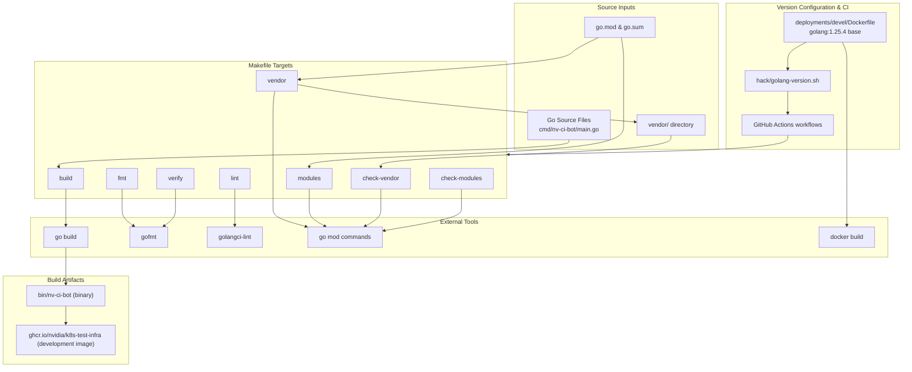
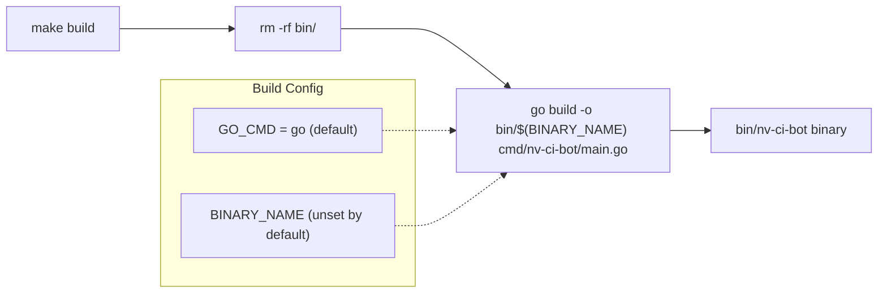
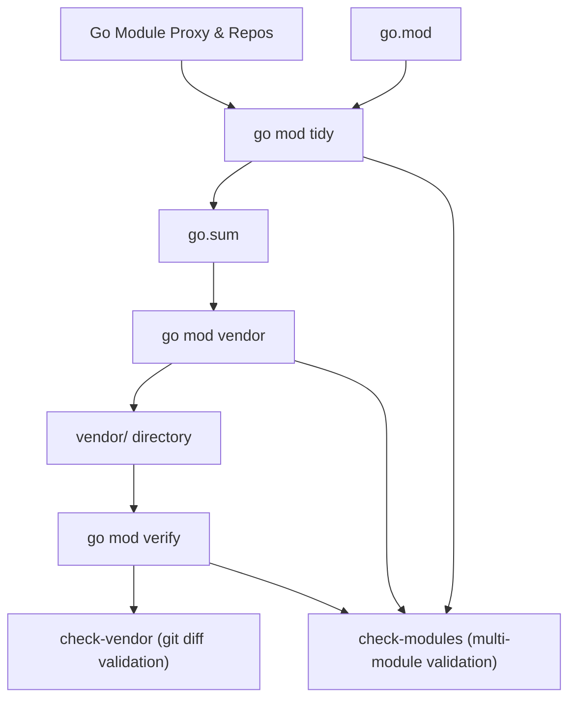
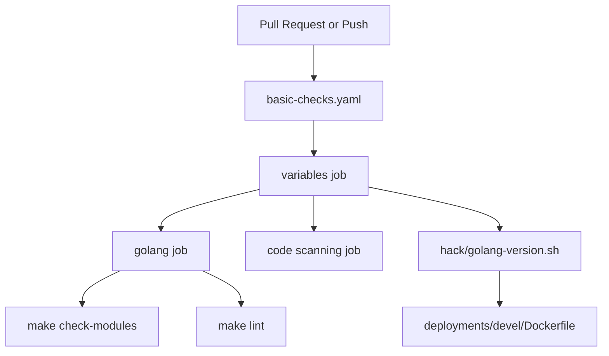
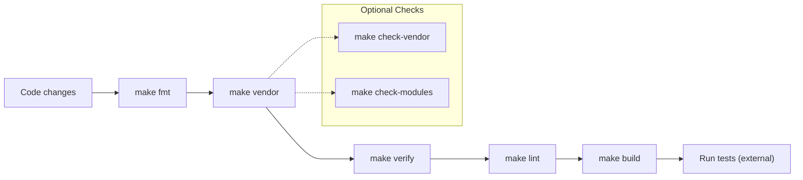

<!-- source: DeepWiki mcp.deepwiki.com · repo NVIDIA/k8s-test-infra · page 8 Build System · fetched 2026-10-26 -->

# Build System

<details>
<summary>Relevant source files</summary>

The following files were used as context for generating this wiki page:

- [.github/workflows/nvml-mock-e2e-go.yaml](.github/workflows/nvml-mock-e2e-go.yaml)
- [Makefile](Makefile)
- [README.md](README.md)
- [deployments/nvml-mock/Dockerfile](deployments/nvml-mock/Dockerfile)
- [pkg/gpu/mockcuda/Makefile](pkg/gpu/mockcuda/Makefile)
- [pkg/gpu/mocknvml/Dockerfile](pkg/gpu/mocknvml/Dockerfile)
- [pkg/gpu/mocknvml/Makefile](pkg/gpu/mocknvml/Makefile)
- [tests/e2e/README.md](tests/e2e/README.md)
- [tests/e2e/go/e2e_suite_test.go](tests/e2e/go/e2e_suite_test.go)
- [tests/e2e/go/framework/config/config.go](tests/e2e/go/framework/config/config.go)
- [tests/e2e/go/framework/harness/harness.go](tests/e2e/go/framework/harness/harness.go)
- [tests/e2e/go/suite_cluster.go](tests/e2e/go/suite_cluster.go)
- [tests/e2e/go/suite_helm.go](tests/e2e/go/suite_helm.go)
- [tests/e2e/spike-nvidia-smi.sh](tests/e2e/spike-nvidia-smi.sh)
- [tests/mocknvml/Dockerfile](tests/mocknvml/Dockerfile)
- [tests/poc-validation/setup-kind-cluster.sh](tests/poc-validation/setup-kind-cluster.sh)

</details>


**Purpose and Scope**:  
This document provides a high-level overview of the build automation system for the k8s-test-infra repository. The system coordinates compilation, dependency management, quality checks, and container image creation. It uses a Makefile as the primary driver, with a consistent Go version enforced via the devel Dockerfile and extracted into CI environments.

This page links to child pages for detailed information on Makefile targets ([Makefile Reference](#8.1)), container images ([Docker Images](#8.2)), and Go version management ([Go Version Management Strategy](#8.3)).

---

## Build System Architecture

The build automation is centered around the `Makefile` which orchestrates commands to produce Go binaries, manage Go module dependencies, enforce formatting and linting standards, and build container images.



*Diagram: Build System Component Relationships*

Sources: [Makefile:1-80](), [deployments/devel/Dockerfile:15-18](), [hack/golang-version.sh:1-23]()

---

## Primary Makefile Targets Overview

The Makefile facilitates common development tasks through a set of phony targets:

| Target        | Purpose                                              | Key Operations                                                    | Exit Behavior                      |
|----------------|------------------------------------------------------|------------------------------------------------------------------|----------------------------------|
| `build`        | Compile main binary                                  | Cleans `bin/`, builds `cmd/nv-ci-bot/main.go`                   | Fails on compilation errors      |
| `vendor`       | Synchronize dependencies                             | Runs `go mod tidy`, `go mod vendor`, `go mod verify`             | Fails on mod errors              |
| `check-vendor` | Verify vendor directory sync with version control   | Runs `vendor` then verifies no unstaged changes                  | Fails if diffs found             |
| `modules`      | Tidy, vendor and verify all Go modules (multi-module support) | Iterates through all `go.mod` files                              | Fails on errors                 |
| `check-modules`| Verify all modules' dependencies are synced         | Runs `modules` then checks git diffs                              | Fails if diffs found             |
| `lint`         | Run static code analysis                             | Executes `golangci-lint run` across all packages                 | Fails if lint issues found      |
| `fmt`          | Format Go source files                               | Runs `gofmt -w -l` to write formatted code                       | Modifies files in place          |
| `verify`       | Check formatting matches `gofmt`                    | Runs `gofmt -w -l -d` and errors if files are out of format      | Fails if formatting needed      |

These targets are designed to be composable and lend themselves to CI workflows enforcing code quality.

Sources: [Makefile:11-82]()

---

## Binary Compilation Process

The key Go binary built by the system is `nv-ci-bot`, compiled from `cmd/nv-ci-bot/main.go`. The `build` target removes existing output binaries, then compiles using the Go compiler defined by `GO_CMD` (defaulting to `go`).



The build target is declared as:

```makefile
build:
	@rm -rf bin
	$(GO_CMD) build -o bin/$(BINARY_NAME) cmd/nv-ci-bot/main.go
```

**Note:** The `BINARY_NAME` variable is referenced but not defined in the Makefile, implying it should be set externally, e.g., `make build BINARY_NAME=nv-ci-bot`.

Sources: [Makefile:29-33]()

---

## Dependency Management Strategy

The project uses a vendoring approach to capture all module dependencies in the `vendor/` directory, ensuring reproducible builds.



- `vendor` target runs `go mod tidy`, `go mod vendor`, and `go mod verify`.
- `check-vendor` runs `vendor` and then verifies that `go.mod`, `go.sum`, and `vendor/` have no uncommitted changes.
- Multi-module targets (`modules` and `check-modules`) apply these operations recursively to all `go.mod` files in the repository, excluding certain paths.

Sources: [Makefile:44-82]()

---

## Code Quality and Formatting Enforcement

Three Makefile targets ensure quality:

- `fmt`: Formats all Go sources in-place with `gofmt`.
- `verify`: Checks formatting without making changes and raises errors if any files need formatting.
- `lint`: Runs `golangci-lint` for static code analysis across all packages.

```makefile
fmt:
	@$(GO_FMT) -w -l $$(find . -name '*.go')

verify:
	@out=`$(GO_FMT) -w -l -d $$(find . -name '*.go')`; \
	if [ -n "$$out" ]; then \
	    echo "$$out"; \
	    exit 1; \
	fi

lint:
	golangci-lint run ./...
```

Sources: [Makefile:34-46]()

---

## Container Image Build

The primary development image for the repository is built from the `deployments/devel/Dockerfile`, which specifies the Go version used throughout the project.

```dockerfile
# deployments/devel/Dockerfile snippet
FROM golang:1.25.4
```

This Dockerfile also serves as the canonical source for the Go version to use in local builds, CI workflows, and image builds.

The `Makefile` defines image-related variables for tagging and pushing images to `ghcr.io/nvidia` under the repository `k8s-test-infra` with version `0.0.1` by default.

Sources: [Makefile:22-26](), [deployments/devel/Dockerfile:15-18]()

---

## Integration with CI/CD Pipelines

The build system is tightly integrated with GitHub Actions workflows, which:

1. Extract the Go version by parsing the `deployments/devel/Dockerfile` using the `hack/golang-version.sh` script.
2. Use this Go version consistently for build jobs.
3. Run Makefile targets such as `check-modules` (multi-module dependency validation) and `lint` (static analysis).



This integration enforces environment consistency, code quality, and dependency integrity on every change.

Sources: [.github/workflows/ci.yaml:1-26](), [.github/workflows/basic-checks.yaml:1-50](), [hack/golang-version.sh:1-23]()

---

## Build System Variables and Configuration

Several variables in the Makefile can be overridden to customize build and image parameters:

| Variable        | Default             | Description                            | Override Example             |
|-----------------|---------------------|------------------------------------|---------------------------|
| `GO_CMD`         | `go`                | Go compiler binary                  | `make build GO_CMD=go1.20`   |
| `GO_FMT`         | `gofmt`             | Go formatter tool                   | `make fmt GO_FMT=goimports`  |
| `VERSION`        | `0.0.1`             | Image version tag                   | `make VERSION=0.0.2`         |
| `IMAGE_REGISTRY` | `ghcr.io/nvidia`    | Container image registry            | `make IMAGE_REGISTRY=docker.io/myorg` |
| `IMAGE_NAME`     | `k8s-test-infra`    | Image repository name               | (Usually not overridden)      |
| `IMAGE_TAG_NAME` | `$(VERSION)`        | Image tag name                     | `make IMAGE_TAG_NAME=latest`  |
| `BINARY_NAME`    | *(undefined)*       | Output binary name for build       | `make build BINARY_NAME=nv-ci-bot` |

The `PROJECT_DIR` holds the Makefile's directory absolute path, mainly for internal use.

Sources: [Makefile:16-29]()

---

## Recommended Build Workflow

For local development or CI, the suggested order of running build system targets is:



- Formatting (`fmt`) normalizes source.
- Dependencies are synchronized (`vendor`), then verified (`verify`).
- Static code analysis is run (`lint`).
- Compilation occurs (`build`).
- Tests are executed separately (see testing infrastructure).

Sources: [Makefile:11-80](), [.github/workflows/basic-checks.yaml:1-50]()

---

## Child Pages

Further technical details are covered in the following child pages:

- [Makefile Reference](#8.1) — Full details on all Makefile targets including cluster lifecycle and e2e scenarios.  
- [Docker Images](#8.2) — Detailed explanations of the key container images, staging, multi-stage builds, and artifacts.  
- [Go Version Management Strategy](#8.3) — How the Go version is defined and extracted consistently across builds and CI.

---

# Summary

The k8s-test-infra build system leverages a Makefile-driven approach coordinated with GitHub Actions. It centralizes dependency management, code quality enforcement, binary compilation, and container image creation into an efficient, repeatable workflow. The consistent Go version is anchored by the devel Dockerfile and extracted dynamically for CI and local builds. This ensures developers and CI produce identical outputs and environments.

This overview has guided through the build architecture, operations, artifacts, and pipelines, with pointers to in-depth child pages for each aspect.

---

**Sources:**  
[Makefile:1-82](), [deployments/devel/Dockerfile:15-18](), [hack/golang-version.sh:1-23](), [.github/workflows/ci.yaml:1-33](), [.github/workflows/basic-checks.yaml:1-50]()

---

