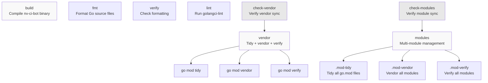
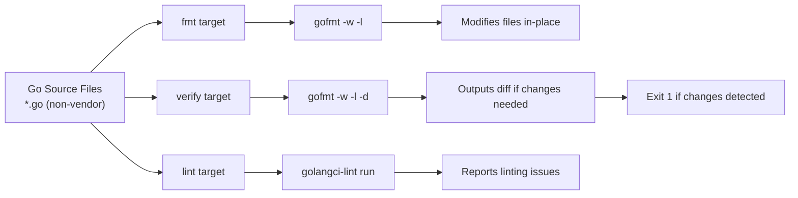
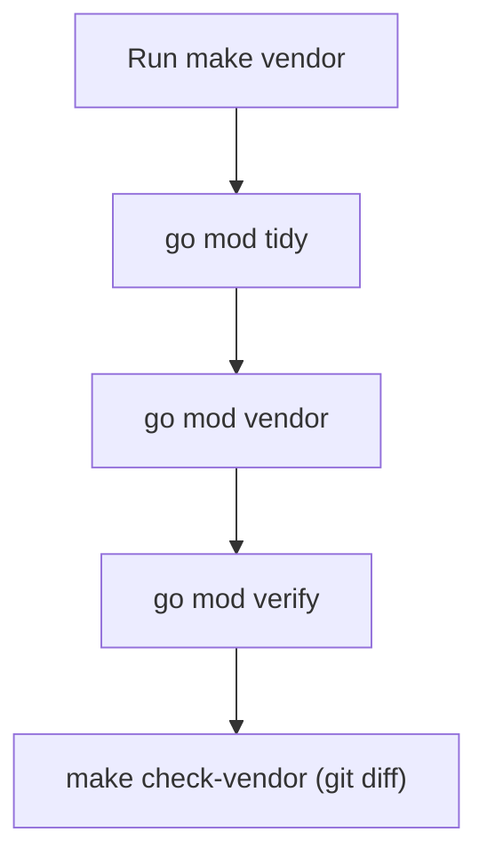
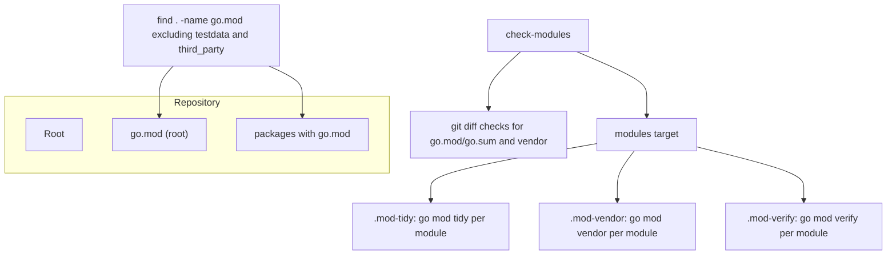
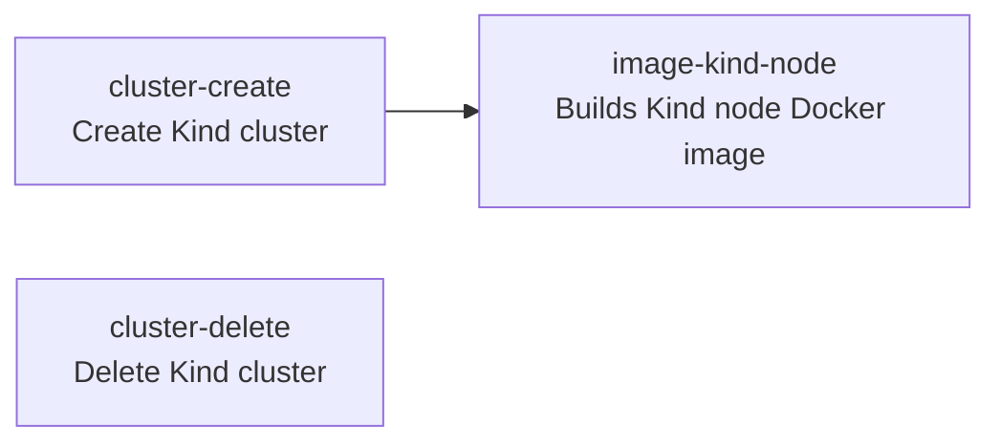
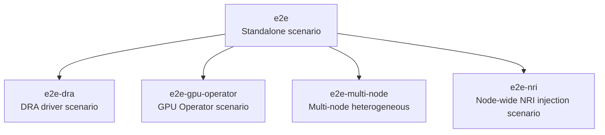
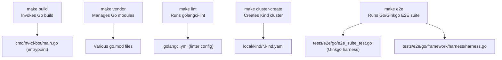
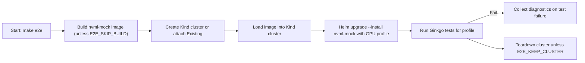

<!-- source: DeepWiki mcp.deepwiki.com · repo NVIDIA/k8s-test-infra · page 8.1 Makefile Reference · fetched 2026-10-26 -->

# Makefile Reference

<details>
<summary>Relevant source files</summary>

The following files were used as context for generating this wiki page:

- [.github/workflows/nvml-mock-e2e-go.yaml](.github/workflows/nvml-mock-e2e-go.yaml)
- [Makefile](Makefile)
- [README.md](README.md)
- [pkg/gpu/mocknvml/README.md](pkg/gpu/mocknvml/README.md)
- [pkg/gpu/mocknvml/bridge/padding.go](pkg/gpu/mocknvml/bridge/padding.go)
- [tests/e2e/README.md](tests/e2e/README.md)
- [tests/e2e/go/e2e_suite_test.go](tests/e2e/go/e2e_suite_test.go)
- [tests/e2e/go/framework/config/config.go](tests/e2e/go/framework/config/config.go)
- [tests/e2e/go/framework/harness/harness.go](tests/e2e/go/framework/harness/harness.go)
- [tests/e2e/go/suite_cluster.go](tests/e2e/go/suite_cluster.go)
- [tests/e2e/go/suite_helm.go](tests/e2e/go/suite_helm.go)

</details>


## Purpose and Scope

This document provides a comprehensive reference for the Makefile in the **k8s-test-infra** repository. The Makefile serves as the primary automation tool, defining targets for:

- Building binaries
- Managing Go modules and vendoring
- Enforcing code quality via formatting and linting
- Managing Kind clusters for test infrastructure
- Running end-to-end (E2E) test scenarios for various integration targets

These targets are designed to support both local developer workflows and continuous integration (CI) pipelines.

For details on related build artifacts like Docker images, see [Docker Images](#8.2). For the Go version management process, see [Go Version Management Strategy](#8.3). For integration with CI/CD workflows and code quality practices, see sections on GitHub Actions and Linting.

**Sources:** [Makefile:1-80]()

---

## Overview

The Makefile defines `.PHONY` targets for common development tasks. It leverages standard Go tools (`go`, `gofmt`, `golangci-lint`), Helm, and Kind to manage the build/test infrastructure.

Key characteristics:

- Supports a multi-module repo structure with vendoring
- Targets optimize for local development and CI usage
- Cluster-related targets manage Kind clusters for E2E tests
- E2E targets invoke Go/Ginkgo test harnesses with scenario labels

**Sources:** [Makefile:11-12]()

---

## Target Dependency Graph



**Sources:** [Makefile:11-80]()

---

## Configuration Variables

The Makefile defines several variables to configure builds and image tagging:

| Variable          | Default                    | Description                          |
|-------------------|----------------------------|------------------------------------|
| `GO_CMD`          | `go`                       | Go compiler command                |
| `GO_FMT`          | `gofmt`                    | Go formatting tool                 |
| `GO_SRC`          | `find . -name '*.go' ...`  | List of Go source files (excluding vendor) |
| `VERSION`         | `0.0.1`                    | Project version                   |
| `IMAGE_REGISTRY`  | `ghcr.io/nvidia`           | Container image registry          |
| `IMAGE_TAG_NAME`  | `$(VERSION)`               | Tag name for images               |
| `IMAGE_NAME`      | `k8s-test-infra`           | Base image name                  |
| `IMAGE_REPO`      | `$(IMAGE_REGISTRY)/$(IMAGE_NAME)` | Full image repository       |
| `IMAGE_TAG`       | `$(IMAGE_REPO):$(IMAGE_TAG_NAME)` | Complete image tag             |
| `PROJECT_DIR`     | Project root directory      | Absolute path to repo root         |

**Sources:** [Makefile:13-29]()

---

## Build Targets

### build

Builds the `nv-ci-bot` binary (CLI tool) from the source entrypoint `cmd/nv-ci-bot/main.go`.

```makefile
build:
	@rm -rf bin
	$(GO_CMD) build -o bin/$(BINARY_NAME) cmd/nv-ci-bot/main.go
```

- Cleans previous build output folder `bin/`
- Builds the Go binary with output path `bin/$(BINARY_NAME)`
- `$(BINARY_NAME)` must be provided at invocation, e.g., `make build BINARY_NAME=nv-ci-bot` or by the CI workflow.

**Usage:**

```bash
make build BINARY_NAME=nv-ci-bot
```

**Sources:** [Makefile:30-32]()

---

## Code Quality Targets



**Sources:** [Makefile:33-46]()

### fmt

Formats all Go source files (excluding vendor) in place using `gofmt`.

```makefile
fmt:
	@$(GO_FMT) -w -l $$(find . -name '*.go')
```

- `-w` writes formatting changes to files
- `-l` lists files that were modified

**Usage:**

```bash
make fmt
```

**Sources:** [Makefile:34-35]()

### verify

Checks if Go source files are properly formatted, but does **not** modify them. Fails if formatting issues are detected.

```makefile
verify:
	@out=`$(GO_FMT) -w -l -d $$(find . -name '*.go')`; \
	if [ -n "$$out" ]; then \
	    echo "$$out"; \
	    exit 1; \
	fi
```

- Uses `-d` to output diffs for files needing formatting
- Exits with failure (1) if any files are not formatted

Typical use: run in CI to enforce formatting rules.

**Usage:**

```bash
make verify
```

**Sources:** [Makefile:37-42]()

### lint

Runs static analysis with `golangci-lint` on all Go packages.

```makefile
lint:
	golangci-lint run ./...
```

- `golangci-lint` integrates multiple linters
- Checks the entire codebase
- Requires `golangci-lint` to be installed

**Usage:**

```bash
make lint
```

**Sources:** [Makefile:43-45]()

---

## Module Management Targets

The Makefile supports two workflows: single-module (root only) and multi-module management.

### Single-Module Workflow

- `vendor` updates dependencies and creates the `vendor/` directory
- `check-vendor` verifies vendoring sync with git



### vendor

Update dependencies and vendor in the root module:

```makefile
vendor:
	go mod tidy
	go mod vendor
	go mod verify
```

Operations:

- `go mod tidy`: cleans and syncs module dependencies
- `go mod vendor`: copies dependencies to `vendor/`
- `go mod verify`: validates checksums of modules

**Usage:**

```bash
make vendor
```

**Sources:** [Makefile:47-50]()

### check-vendor

Ensures vendored dependencies are committed and in sync:

```makefile
check-vendor: vendor
	git diff --quiet HEAD -- go.mod go.sum vendor
```

- Runs `make vendor` first to update vendor
- Uses `git diff --quiet` to detect uncommitted changes
- Exits nonzero if vendor or mod files are out of sync

**Usage:**

```bash
make check-vendor
```

Typically used in CI to enforce consistent vendoring.

**Sources:** [Makefile:52-53]()

---

### Multi-Module Workflow

The repo may have multiple Go modules in subdirectories. The Makefile provides:

- `modules` target to tidy, vendor, and verify all modules recursively
- `check-modules` to verify across all modules that vendoring is in sync



**Sources:** [Makefile:54-79]()

### .mod-tidy

Runs `go mod tidy` for every `go.mod` except in `testdata/` or `third_party/`.

```makefile
.mod-tidy:
	@for mod in $$(find . -name go.mod -not -path "./testdata/*" -not -path "./third_party/*"); do \
	    echo "Tidying $$mod..."; ( \
	        cd $$(dirname $$mod) && go mod tidy \
            ) || exit 1; \
	done
```

This ensures all modules are clean and consistent.

**Sources:** [Makefile:56-62]()

### .mod-vendor

Runs `go mod vendor` for each module except excludes `deployments/` additionally:

```makefile
.mod-vendor:
	@for mod in $$(find . -name go.mod -not -path "./testdata/*" -not -path "./third_party/*" -not -path "./deployments/*"); do \
		echo "Vendoring $$mod..."; ( \
			cd $$(dirname $$mod) && go mod vendor \
			) || exit 1; \
	done
```

Prevent vendoring for deployment-related modules.

**Sources:** [Makefile:65-70]()

### .mod-verify

Runs `go mod verify` for all modules except those in `testdata/` or `third_party/`:

```makefile
.mod-verify:
	@for mod in $$(find . -name go.mod -not -path "./testdata/*" -not -path "./third_party/*"); do \
	    echo "Verifying $$mod..."; ( \
	        cd $$(dirname $$mod) && go mod verify | sed 's/^/  /g' \
	    ) || exit 1; \
	done
```

Indented output improves readability.

**Sources:** [Makefile:71-77]()

### modules

Runs all three steps in a single invocation:

```makefile
modules:  | .mod-tidy .mod-vendor .mod-verify
```

- The `|` syntax makes these order-only prerequisites.
- Calling `make modules` ensures all Go modules are tidy, vendored, and verified.

**Sources:** [Makefile:54]()

### check-modules

Verifies all module files and vendors in git are in sync:

```makefile
check-modules: modules
	@echo "- Checking if go.mod and go.sum are in sync..."
	@git diff --exit-code -- $$(find . -name go.mod -name go.sum)
	@echo "- Checking if the go mod vendor dir is in sync..."
	@git diff --exit-code -- $$(find . -name vendor)
```

- Runs `make modules` first to update state.
- Checks no changes to any `go.mod`, `go.sum`, or `vendor/` are detected in git.
- Failures indicate local changes not committed or vendoring out of date.

Typical usage in CI.

**Sources:** [Makefile:78-83]()

---

## Kind Cluster Management



- `image-kind-node`: Builds the custom Kind node image with NVIDIA container toolkit included unless an environment flag to use a prebuilt image is set.
- `cluster-create`: Creates a Kind cluster using the built node image and a profile-specific cluster config YAML.
- `cluster-delete`: Deletes the Kind cluster by name.

**Sources:** [Makefile:92-139]()

### image-kind-node

Builds the Kind node Docker image unless `KIND_NODE_IMAGE_PREBUILT` environment variable is set:

```makefile
image-kind-node:
	@if [ -n "$$KIND_NODE_IMAGE_PREBUILT" ]; then \
		docker image inspect $(KIND_NODE_IMAGE) >/dev/null 2>&1 || { \
			echo "ERROR: KIND_NODE_IMAGE_PREBUILT is set but $(KIND_NODE_IMAGE) is not in the local docker daemon."; \
			echo "       Ensure a preceding step ran: docker pull <ref> && docker tag <ref> $(KIND_NODE_IMAGE)"; \
			echo "       (Or unset KIND_NODE_IMAGE_PREBUILT to build it locally.)"; \
			exit 1; \
		}; \
		echo "Using pre-built $(KIND_NODE_IMAGE) already present locally"; \
	else \
		docker build -t $(KIND_NODE_IMAGE) ./local/kind; \
	fi
```

- Uses variable `KIND_NODE_IMAGE` defaulting to `kind-node-nv:latest`
- Supports fast CI by using prebuilt images pulled and tagged locally

**Sources:** [Makefile:121-133]()

### cluster-create

Creates Kind cluster with specified name, node image, and config file.

```makefile
cluster-create: image-kind-node
	@kind create cluster --name $(KIND_CLUSTER_NAME) --image $(KIND_NODE_IMAGE) --config $(KIND_CLUSTER_CONFIG)
```

Variables `KIND_CLUSTER_NAME` and `KIND_CLUSTER_CONFIG` default depending on cluster profile:

- `PROFILE=default` → `gpu-test` cluster, config `local/kind/default.kind.yaml`
- `PROFILE=compute-domain` → computed name and config

**Sources:** [Makefile:135-137]()

### cluster-delete

Deletes the Kind cluster by name.

```makefile
cluster-delete:
	@kind delete cluster --name $(KIND_CLUSTER_NAME)
```

**Usage:**

```bash
make cluster-create
make cluster-delete
```

**Sources:** [Makefile:138-139]()

---

## End-to-End Test Targets

These targets execute Go/Ginkgo end-to-end tests. They create or attach to Kind clusters, build and load the nvml-mock Docker image, deploy the nvml-mock Helm chart, and run integration validation scenarios.



**Sources:** [Makefile:140-160]()

### e2e

Runs the standalone e2e demo scenario, defaulting to the `gb200` profile if none specified. The scenario:

- Builds the nvml-mock Docker image (unless `E2E_SKIP_BUILD=true`)
- Creates a Kind cluster (unless `E2E_ATTACH_EXISTING=true`)
- Loads the nvml-mock image into the Kind cluster
- Installs nvml-mock Helm chart with chosen profile(s)
- Runs validation tests (labels, nvidia-smi, NVLink, InfiniBand, PCI sysfs, failure injection)
- Collects diagnostics on failure
- Keeps the cluster by default for debugging

**Usage:**

```bash
make e2e
# or to specify profiles
make e2e E2E_PROFILES="a100 h100"
make e2e E2E_GINKGO_FLAGS='--label-filter="nvidia-smi || nvlink"'
```

**Sources:** [Makefile:149-160](), [tests/e2e/README.md]()

### e2e-dra

Runs the Dynamic Resource Allocation (DRA) e2e scenario:

- Creates kind cluster with DRA config
- Deploys nvml-mock with DRA support
- Installs NVIDIA DRA driver
- Validates DRA resource claims and scheduling

**Sources:** [Makefile:151](), [tests/e2e/README.md]()

### e2e-gpu-operator

Runs the GPU Operator integration scenario:

- Creates kind cluster with GPU Operator config
- Installs NVIDIA container toolkit
- Deploys nvml-mock
- Installs GPU Operator with validation
- Checks GPU device plugin and GFD labels

**Sources:** [Makefile:153](), [tests/e2e/README.md]()

### e2e-multi-node

Runs a multi-node heterogeneous cluster scenario with different GPU profiles:

- Creates cluster with multi-node topology
- Deploys appropriate nvml-mock profiles
- Validates multi-node scheduling and workloads

**Sources:** [Makefile:154](), [tests/e2e/README.md]()

### e2e-nri

Runs the node-wide NRI ambient-injection scenario for node resource injection:

- Validates injecting mock GPUs via containerd NRI plugin without explicit requests
- Confirms node feature labeling provenance integration

**Sources:** [Makefile:155](), [tests/e2e/README.md]()

### Common E2E Invocations

The e2e targets run the Go/Ginkgo suite in the `tests/e2e/go` package with options:

- `E2E_PROFILES`: JSON or space-separated list of GPU profiles (e.g., a100, gb200)
- `E2E_SKIP_BUILD`: skip Docker image build, use pre-built image instead
- `E2E_IMAGE`: the Docker image tag/ref to use
- `E2E_KEEP_CLUSTER`: whether to keep the cluster after tests
- `E2E_GINKGO_FLAGS`: extra `ginkgo` flags such as label filters

These targets are connected to the Go testing harness which owns lifecycle management: cluster creation, image build/load, Helm chart install, test execution, and diagnostics.

**Sources:** [Makefile:143-160](), [tests/e2e/README.md]()

---

## Summary of Makefile Targets

| Target           | Purpose                                                   | Usage Scenario                 |
|------------------|-----------------------------------------------------------|-------------------------------|
| `build`          | Compile `nv-ci-bot` CLI binary                            | Development, CI                |
| `fmt`            | Format Go source files in place                            | Pre-commit, local dev          |
| `verify`         | Check Go source formatting, fail if dirty                 | CI enforcement                 |
| `lint`           | Run `golangci-lint` static analysis                        | CI, local dev                  |
| `vendor`         | Update dependencies & generate vendor dir                  | Development                   |
| `check-vendor`   | Verify vendoring sync with git                             | CI checks                      |
| `modules`        | Tidy, vendor, verify all Go modules recursively            | Development                   |
| `check-modules`  | Verify modules & vendors are synced with git               | CI checks                      |
| `image-kind-node`| Build Kind node image with NVIDIA container toolkit       | Cluster setup                 |
| `cluster-create` | Create Kind cluster with custom node image & config       | Cluster setup/testing         |
| `cluster-delete` | Delete Kind cluster                                        | Clean up                     |
| `e2e`            | Run standalone nvml-mock E2E tests                         | Integration testing           |
| `e2e-dra`        | Run DRA integration e2e scenario                           | Integration testing           |
| `e2e-gpu-operator`| Run GPU Operator integration e2e scenario                  | Integration testing           |
| `e2e-multi-node` | Run multi-node heterogeneous cluster e2e scenario         | Integration testing           |
| `e2e-nri`        | Run node-wide NRI ambient injection e2e scenario          | Integration testing           |

---

## Usage Flow Diagrams Bridging Natural Language to Code

### Makefile Targets to Code Areas



**Sources:** [Makefile:11-160](), [tests/e2e/go/e2e_suite_test.go:6-63](), [tests/e2e/go/framework/harness/harness.go:1-99]()

---

### E2E Test Scenario Workflow (Natural Language to Go Code)



Go code involved:

- `SynchronizedBeforeSuite` builds image ([tests/e2e/go/e2e_suite_test.go:52-62]())
- `setupCluster` creates or attaches cluster ([tests/e2e/go/suite_cluster.go:60-77]())
- `installDemoChart` runs Helm install/upgrade ([tests/e2e/go/suite_helm.go:36-46]())
- Test scenario files run Ginkgo specs ([tests/e2e/go/scenario_standalone_test.go](not cited))
- Diagnostics collection ([tests/e2e/go/suite_cluster.go:44-51]())

**Sources:** [Makefile:143-160](), [tests/e2e/go/e2e_suite_test.go:40-62](), [tests/e2e/go/suite_cluster.go:42-52](), [tests/e2e/go/suite_helm.go:29-47]()

---

## Special Notes

### Missing `BINARY_NAME` in build target

The `build` target references `$(BINARY_NAME)` without defining it in the Makefile. This is intentional. The variable is expected to be provided externally via:

- Environment variable
- Command line argument
- CI workflow configuration

This allows flexible builds for different binaries.

**Sources:** [Makefile:30-32]()

### Vendoring Management Philosophy

Vendoring is used to ensure repeatable builds and to avoid external dependency resolution failures.

- `vendor` updates vendor dir and verifies modules
- `check-vendor` and `check-modules` ensure no drifts in dependencies and vendoring layout
- Multi-module support covers nested Go modules in the repo

**Sources:** [Makefile:44-79]()

---

# End of Makefile Reference

**Sources:**  
- [Makefile:1-160]()  
- [tests/e2e/go/e2e_suite_test.go:6-62]()  
- [tests/e2e/go/suite_cluster.go:42-52]()  
- [tests/e2e/go/suite_helm.go:29-47]()  
- [tests/e2e/README.md:1-140]()

---

