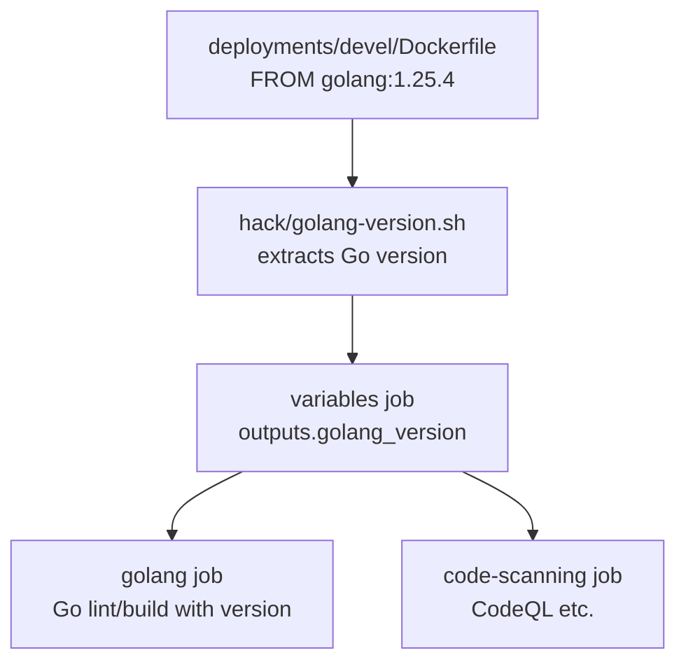
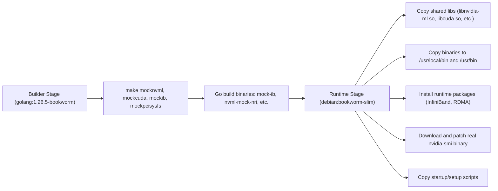
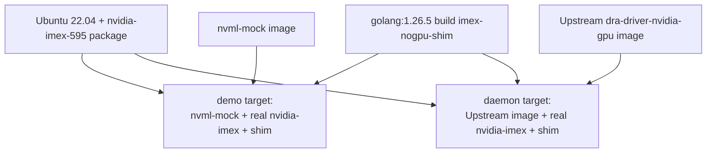

<!-- source: DeepWiki mcp.deepwiki.com · repo NVIDIA/k8s-test-infra · page 8.2 Docker Images · fetched 2026-10-26 -->

# Docker Images

<details>
<summary>Relevant source files</summary>

The following files were used as context for generating this wiki page:

- [cmd/fake-imex/ctl/main.go](cmd/fake-imex/ctl/main.go)
- [cmd/fake-imex/daemon/main.go](cmd/fake-imex/daemon/main.go)
- [cmd/fake-imex/integration_test.go](cmd/fake-imex/integration_test.go)
- [deployments/kind-nvidia-cdi/Dockerfile](deployments/kind-nvidia-cdi/Dockerfile)
- [deployments/kind-nvidia-cdi/Makefile](deployments/kind-nvidia-cdi/Makefile)
- [deployments/kind-nvidia-cdi/containerd-config.toml](deployments/kind-nvidia-cdi/containerd-config.toml)
- [deployments/kind-nvidia-cdi/nvidia-container-runtime.toml](deployments/kind-nvidia-cdi/nvidia-container-runtime.toml)
- [deployments/nvml-mock/Dockerfile](deployments/nvml-mock/Dockerfile)
- [deployments/nvml-mock/Dockerfile.compute-domain-daemon](deployments/nvml-mock/Dockerfile.compute-domain-daemon)
- [docs/demo/compute-domain/README.md](docs/demo/compute-domain/README.md)
- [docs/demo/compute-domain/run.sh](docs/demo/compute-domain/run.sh)
- [pkg/gpu/mockcuda/Makefile](pkg/gpu/mockcuda/Makefile)
- [pkg/gpu/mocknvml/Dockerfile](pkg/gpu/mocknvml/Dockerfile)
- [pkg/gpu/mocknvml/Makefile](pkg/gpu/mocknvml/Makefile)
- [pkg/imexcoord/coord.go](pkg/imexcoord/coord.go)
- [tests/e2e/kind-compute-domain-config.yaml](tests/e2e/kind-compute-domain-config.yaml)
- [tests/e2e/spike-nvidia-smi.sh](tests/e2e/spike-nvidia-smi.sh)
- [tests/mocknvml/Dockerfile](tests/mocknvml/Dockerfile)
- [tests/poc-validation/setup-kind-cluster.sh](tests/poc-validation/setup-kind-cluster.sh)

</details>


## Purpose and Scope

This page describes the Docker images maintained within the k8s-test-infra repository, focusing on the primary images involved in GPU device simulation, cluster integration, and testing: the **development image**, the **nvml-mock image**, the **kind-nvidia-cdi image**, and the **compute-domain-daemon image**. It explains their purposes, how they are built, and details multi-stage builds and binary artifact management.

These images are key components enabling GPU simulation via mock libraries, cluster runtime injection, and fabric simulation for Kubernetes test infrastructure.

---

## Docker Images Overview

| Image                         | Location                                      | Base Image          | Primary Purpose                                                                                     |
|-------------------------------|-----------------------------------------------|---------------------|--------------------------------------------------------------------------------------------------|
| **Development Image**          | `deployments/devel/Dockerfile`                 | `golang:1.25.4`     | Development toolchain and Go version source of truth                                             |
| **nvml-mock Image**            | `deployments/nvml-mock/Dockerfile`              | Multi-stage, `golang:1.26.5-bookworm` and `debian:bookworm-slim` | Core mock NVML library, mock CUDA, mock IB/PCI libs, runtime binaries, and nvidia-smi for GPU simulation |
| **kind-nvidia-cdi Image**      | `deployments/kind-nvidia-cdi/Dockerfile`         | (Not provided here) | Containerized NVIDIA Container Device Interface (CDI) runtime for Kubernetes Kind clusters       |
| **compute-domain-daemon Image** | `deployments/nvml-mock/Dockerfile.compute-domain-daemon` | Multi-stage, Ubuntu 22.04 and `golang:1.26.5` | Simulation overlay for ComputeDomain fabric with real `nvidia-imex` in no-GPU mode              |

---

## Development Image

### Purpose and Design

The **development image** serves two main purposes:

- A consistent **build environment** containing the Go toolchain and dependencies for compiling Go binaries like `nv-ci-bot`.
- The **version management source of truth** for the Go runtime version used throughout the system, enabling reliable dependency and build consistency across CI and local environments.

### Implementation Details

The `deployments/devel/Dockerfile` simply uses:

```dockerfile
FROM golang:1.25.4
```

This minimal image relies on the official Go base image, providing:

- Full Go toolchain
- Reliable and explicit Go version pinning for dependabot automation
- No additional multi-stage logic for simplicity and clarity

### Go Version Extraction and CI Integration

The single-line `FROM golang:<version>` is parsed by the `hack/golang-version.sh` script during CI runs to extract the Go version and propagate it through workflow jobs:

```bash
GOLANG_VERSION=$(grep -E "^FROM golang:.*$" deployments/devel/Dockerfile | grep -oE "[0-9\.]+")
```

This extracted version is then used by GitHub Actions jobs such as lint, build, and scanning to ensure version consistency.

### Diagram: Go Version Propagation Flow



**Sources:** [deployments/devel/Dockerfile:15-17](), [hack/golang-version.sh:16-22](), [.github/workflows/basic-checks.yaml:22-49]()

---

## nvml-mock Image

### Purpose and Scope

The **nvml-mock Docker image** is the central runtime image providing:

- The **mock NVML shared library (`libnvidia-ml.so`)** used to intercept Nvidia GPU API calls for hardware simulation.
- Mock libraries for CUDA (`libcuda.so`), InfiniBand (`libibmocksys.so`, `libibmockumad.so`, `libibmockverbs.so`), and PCI sysfs (`libpcimocksys.so`).
- Compiled Go binaries such as:
  - `mock-ib` — mock InfiniBand daemon/binary
  - `nvml-mock-nri` — NRI plugin for Containerd integration with device injection
  - `nvml-mock-ctl` — CLI tool for runtime GPU simulation control
  - `render-pci-sysfs` — PCI device sysfs rendering helper
  - Fake IMEX daemons and fabric manager binaries used for ComputeDomain simulation
- The **real `nvidia-smi` binary**, extracted from official Nvidia utils, enabling real command compatibility against the mock drivers.

This image is deployed as a DaemonSet in Kubernetes for node-wide injection of GPU device identity and behavior.

### Multi-Stage Build Process

The image is built in two main stages:

1. **Builder Stage** (`golang:1.26.5-bookworm`):

   - Build mock NVML, CUDA, InfiniBand, and PCI system libraries by invoking `make` in their Go package directories.
   - Compile multiple Go binaries for runtime orchestration and simulation control.
   - Output all build artifacts (shared libraries and binaries) to a common `/out` directory and source library paths (`/src/pkg/...`).

2. **Runtime Stage** (`debian:bookworm-slim`):

   - Copy the compiled shared libraries and binaries from the builder stage into appropriate system locations (`/usr/local/lib`, `/usr/local/bin`, `/usr/bin`).
   - Install system packages providing InfiniBand runtime support (`infiniband-diags`, `rdma-core`, etc.)
   - Download and verify the real Nvidia `kubectl` binary for Kubernetes tooling inside the image.
   - Extract the real `nvidia-smi` binary from the Nvidia utils 580.65.06 package and patch its RPATH to enable working with the mock libraries.
   - Copy helper shell scripts for setup and cleanup tasks used at container startup.

#### Excerpt from Build Steps (simplified)

```dockerfile
# Builder stage
FROM golang:1.26.5-bookworm AS builder
WORKDIR /src
COPY go.mod go.sum ./
COPY vendor/ vendor/
COPY pkg/ pkg/
COPY cmd/ cmd/
RUN cd pkg/gpu/mocknvml && make clean && make
RUN cd pkg/gpu/mockcuda && make clean && make
RUN cd pkg/network/mockib && make clean && make
RUN cd pkg/system/mockpcisysfs && make clean && make
RUN mkdir -p /out && go build -o /out/mock-ib ./cmd/mock-ib ... (other binaries)

# Runtime stage
FROM debian:bookworm-slim
COPY --from=builder /src/pkg/gpu/mocknvml/libnvidia-ml.so.* /usr/local/lib/
COPY --from=builder /out/mock-ib /usr/local/bin/mock-ib
COPY --from=builder /out/nvml-mock-nri /usr/local/bin/nvml-mock-nri
# ... other binaries and libs copied ...
RUN apt-get update && apt-get install -y infiniband-diags rdma-core ibverbs-utils
# Download and patch nvidia-smi binary
COPY deployments/nvml-mock/scripts/ /scripts/
RUN chmod +x /scripts/*.sh
```

### Integration of Binary Artifacts and Multi-Layer Organization

- The multi-stage build allows the heavy Golang toolchain and build dependencies to remain out of the final image, optimizing size.
- Shared libraries and runtime executables are carefully placed to respect dynamic loading semantics and LD_PRELOAD mechanisms.
- Real `nvidia-smi` from the Nvidia utilities package integrates seamlessly with the mock library to validate GPU simulation.

### Diagram: nvml-mock Image Build Flow



**Sources:** [deployments/nvml-mock/Dockerfile:15-113]()

---

## kind-nvidia-cdi Image

### Purpose

The **kind-nvidia-cdi image** provides a runtime container to support NVIDIA Container Device Interface (CDI) integration within Kind Kubernetes clusters.

This image includes:

- NVIDIA container runtime configuration (`nvidia-container-runtime.toml`)
- Containerd and CDI runtime configuration (`containerd-config.toml`)
- Supporting binaries and manifest files to enable the proper injection and management of GPU device plugins within containerd when using Kind clusters.

While the detailed Dockerfile content is not included here, the image augments Kind clusters with NVIDIA CDI support to facilitate GPU simulation and injection during testing.

**Sources:** [deployments/kind-nvidia-cdi/Dockerfile](), [deployments/kind-nvidia-cdi/containerd-config.toml]()

---

## compute-domain-daemon Image

### Purpose and Design

The **compute-domain-daemon image** extends the nvml-mock image by overlaying the **real `nvidia-imex` daemon** from the official Ubuntu 22.04 multiverse packages, running in **NO GPU mode**, for simulating NVLink fabric domains in a Kubernetes cluster.

It provides:

- Real `nvidia-imex` and `nvidia-imex-ctl` binaries
- A shim executable `imex-nogpu-shim` that wraps `nvidia-imex` adding a `--nogpu` flag to simulate fabric management without actual GPUs
- Runs on Ubuntu 22.04 base for compatibility with the proprietary driver binaries

This image is primarily used for the **ComputeDomain NVLink fabric simulation**, replacing previous deprecated fake implementations and enabling real gRPC communication over the pod network.

### Multi-Stage Build Details

- **imex Stage**: Ubuntu 22.04 image installs `nvidia-imex-595` package, verifying version, copying real binaries.
- **shim Stage**: Go build on `golang:1.26.5` produces the `imex-nogpu-shim` binary.
- **demo Target**: Builds an overlay image on `nvml-mock` image that installs the real `nvidia-imex` binaries and the shim at their canonical paths, along with configuration files.
- **daemon Target (default)**: Overlays the real `nvidia-imex` and the shim on the official `dra-driver-nvidia-gpu` image from registry.k8s.io, used in the actual DaemonSet deployment.

### Diagram: compute-domain-daemon Image Multi-Stage Build



### Runtime Behavior

- The shim binary emulates `nvidia-imex` but appends `--nogpu` to arguments to run the real upstream daemon without GPU hardware.
- This approach removes reliance on deprecated fake daemons and enables a more faithful fabric simulation for NVLink ComputeDomain testing.
- The `fake-imex` binaries and deprecated code remain present but replaced by this real binary overlay.

**Sources:** [deployments/nvml-mock/Dockerfile.compute-domain-daemon:1-88](), [cmd/fake-imex/daemon/main.go:14-101](), [docs/demo/compute-domain/README.md:1-130]()

---

## Multi-Stage Builds and Binary Artifacts Summary

The project embraces **multi-stage Docker builds** to:

- Isolate compilation of C-shared libraries and Go binaries within fully featured Golang build environments.
- Export minimal runtime images containing only necessary runtime libraries, compiled shared objects, and indispensable binaries.
- Layer proprietary binaries (e.g., real `nvidia-imex`, `nvidia-smi`) from external package repositories into images where allowed, enabling hybrid real/mocked GPU simulation.
- Ensure small footprint, maintainability, and clarity between build and runtime dependencies.

**Key Binary Artifacts:**

| Artifact                | Source Location                          | Role                                                             |
|------------------------|-----------------------------------------|------------------------------------------------------------------|
| `libnvidia-ml.so`       | `pkg/gpu/mocknvml` (built via Makefile)   | Mock NVML shared library for Nvidia API interception             |
| `libcuda.so`            | `pkg/gpu/mockcuda` (built via Makefile)    | Mock CUDA library for simulating CUDA runtime calls              |
| `libibmocksys.so`, `libibmockumad.so`, `libibmockverbs.so` | `pkg/network/mockib`                 | Mock InfiniBand libraries for RDMA simulation                     |
| `libpcimocksys.so`      | `pkg/system/mockpcisysfs`                   | PCI sysfs mock library                                             |
| `mock-ib`, `nvml-mock-nri`, `nvml-mock-ctl`, `render-pci-sysfs` | `cmd/*` directories                   | Support daemons, CLI tools, and runtime plugins for simulation   |
| `nvidia-imex` and `nvidia-imex-ctl` (real binaries) | Ubuntu multiverse packages             | NVLink fabric daemon and control binaries worn for ComputeDomain |
| `imex-nogpu-shim`       | `cmd/imex-nogpu-shim` (Go shim binary)     | Shim that wraps real nvidia-imex with `--nogpu` flag             |
| `nvidia-smi` (real binary) | Extracted from `nvidia-utils-580` package | Official NVIDIA CLI tool used to validate mock behavior            |

**Sources:** [deployments/nvml-mock/Dockerfile:15-113](), [cmd/fake-imex/daemon/main.go:14-101](), [deployments/nvml-mock/Dockerfile.compute-domain-daemon:1-88]()

---

## Code Entity Association Diagrams

### Image-Source Code Mapping: nvml-mock Image Components

```mermaid
graph LR
  subgraph nvml-mock Dockerfile
    Builder[Builder Stage]
    Runtime[Runtime Stage]
  end

  Builder --> MockNVML[Make pkg/gpu/mocknvml (Makefile, Dockerfile)]
  Builder --> MockCUDA[Make pkg/gpu/mockcuda]
  Builder --> MockIB[Make pkg/network/mockib]
  Builder --> MockPCI[Make pkg/system/mockpcisysfs]
  Builder --> BuildBinaries["build cmd/mock-ib, nvml-mock-nri, nvml-mock-ctl, render-pci-sysfs, fake-imex"]
  
  Runtime --> CopyLibs["Copy libnvidia-ml.so*, libcuda.so* etc."]
  Runtime --> CopyBins["Copy mock-ib, nvml-mock-nri, nvml-mock-ctl, nvidia-imex binaries"]
  Runtime --> InstallDeps["Install InfiniBand related packages"]
  Runtime --> DownloadNvidiaSmi["Download and patch real nvidia-smi"]
  
  MockNVML -.-> "pkg/gpu/mocknvml/Makefile" & "Dockerfile"
  MockCUDA -.-> "pkg/gpu/mockcuda/Makefile"
  MockIB -.-> "pkg/network/mockib/Makefile"
  MockPCI -.-> "pkg/system/mockpcisysfs/Makefile"
  BuildBinaries -.-> "cmd/*/main.go files (e.g. cmd/mock-ib/main.go)"
```

### Image-Source Code Mapping: ComputeDomain Daemon Image Components

```mermaid
graph LR
  subgraph compute-domain-daemon Dockerfile
    imex[imex Stage: ubuntu + nvidia-imex-595]
    shim[shim Stage: golang build imex-nogpu-shim]
    nvml_mock[nvml-mock base image]
    demo["demo target: nvml-mock + real nvidia-imex + shim"]
    daemon["daemon target: upstream dra-driver-nvidia + real nvidia-imex + shim"]
  end

  imex --> demo
  shim --> demo
  nvml_mock --> demo
  imex --> daemon
  shim --> daemon
  upstream["upstream dra-driver-nvidia gpu image"] --> daemon

  shim -.-> "cmd/imex-nogpu-shim/"
  imex -.-> "Ubuntu multiverse nvidia-imex-595 package"
  nvml_mock -.-> "deployments/nvml-mock/Dockerfile"
  upstream -.-> "registry.k8s.io/dra-driver-nvidia/dra-driver-nvidia-gpu"
```

---

## Summary

| Image Name             | Purpose                                                | Build Highlights                                           | Key Files / Packages                          |
|------------------------|--------------------------------------------------------|-------------------------------------------------------------|-----------------------------------------------|
| Development Image      | Base Go build environment and Go version management    | Simple single-stage FROM golang:<version>                    | `deployments/devel/Dockerfile`                 |
| nvml-mock Image        | Mock NVML and related shared libs + binaries for GPU simulation in Kubernetes | Multi-stage build compiling mock libraries, binaries, integrating real `nvidia-smi` | `deployments/nvml-mock/Dockerfile`, `pkg/gpu/mocknvml/Makefile` |
| kind-nvidia-cdi Image  | NVIDIA CDI support for Kind clusters                    | Not detailed here                                           | `deployments/kind-nvidia-cdi/` directory       |
| compute-domain-daemon  | ComputeDomain fabric simulation with real `nvidia-imex` in NO GPU mode | Multi-stage overlay layering real IMEX binary and shim on base images | `deployments/nvml-mock/Dockerfile.compute-domain-daemon` |

These Docker images provide a robust, flexible foundation for simulating GPU functionality, device plugin injection, and fabric simulation within Kubernetes test environments built by k8s-test-infra.

**Sources:**  
- [deployments/devel/Dockerfile:15-17]()  
- [deployments/nvml-mock/Dockerfile:15-113]()  
- [pkg/gpu/mocknvml/Makefile:1-145]()  
- [deployments/nvml-mock/Dockerfile.compute-domain-daemon:1-88]()  
- [cmd/fake-imex/daemon/main.go:14-101]()  
- [docs/demo/compute-domain/README.md]()  
- [tests/poc-validation/setup-kind-cluster.sh:1-126]()

---

