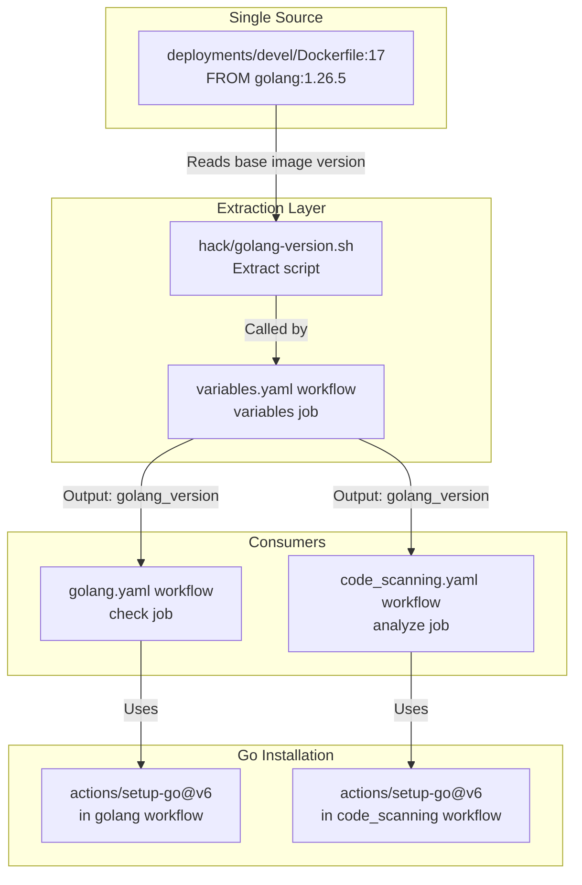
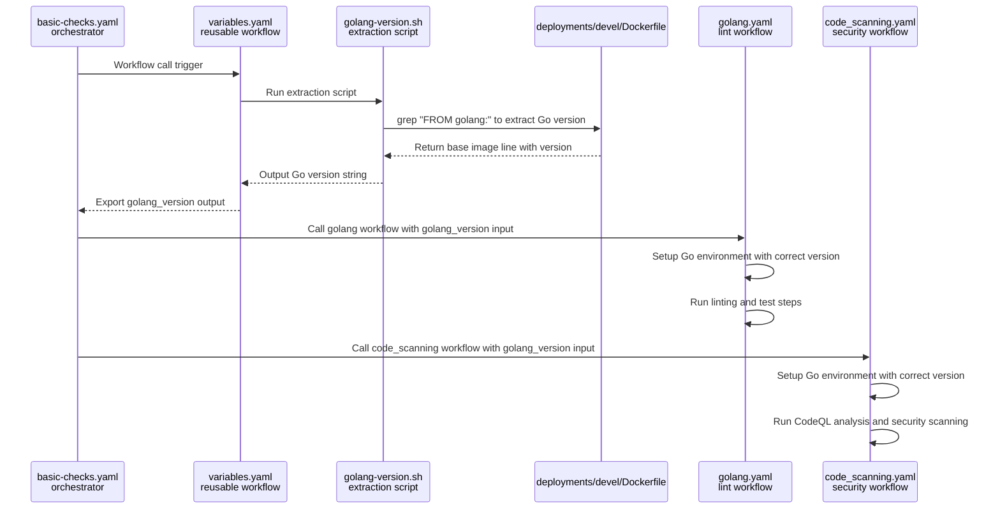

<!-- source: DeepWiki mcp.deepwiki.com · repo NVIDIA/k8s-test-infra · page 8.3 Go Version Management Strategy · fetched 2026-10-26 -->

# Go Version Management Strategy

<details>
<summary>Relevant source files</summary>

The following files were used as context for generating this wiki page:

- [.github/workflows/code_scanning.yaml](.github/workflows/code_scanning.yaml)
- [.github/workflows/golang.yaml](.github/workflows/golang.yaml)
- [.github/workflows/helm-publish.yaml](.github/workflows/helm-publish.yaml)
- [.github/workflows/helm.yaml](.github/workflows/helm.yaml)
- [.github/workflows/nvml-mock-publish.yaml](.github/workflows/nvml-mock-publish.yaml)
- [.github/workflows/scorecard.yaml](.github/workflows/scorecard.yaml)
- [.github/workflows/variables.yaml](.github/workflows/variables.yaml)
- [deployments/devel/Dockerfile](deployments/devel/Dockerfile)
- [deployments/nvml-mock/Dockerfile](deployments/nvml-mock/Dockerfile)
- [pkg/gpu/mockcuda/Makefile](pkg/gpu/mockcuda/Makefile)
- [pkg/gpu/mocknvml/Dockerfile](pkg/gpu/mocknvml/Dockerfile)
- [pkg/gpu/mocknvml/Makefile](pkg/gpu/mocknvml/Makefile)
- [tests/e2e/spike-nvidia-smi.sh](tests/e2e/spike-nvidia-smi.sh)
- [tests/mocknvml/Dockerfile](tests/mocknvml/Dockerfile)
- [tests/poc-validation/setup-kind-cluster.sh](tests/poc-validation/setup-kind-cluster.sh)

</details>


## Purpose and Scope

This document details how the Go programming language version is defined, extracted, and propagated consistently throughout the k8s-test-infra project. It describes the single source of truth defining the Go version in the development Dockerfile, the script and workflows that extract and distribute this version in CI/CD pipelines, and discusses the automation of version upgrades via Dependabot.

## Overview

The project centralizes the Go version specification in a single Dockerfile which serves both as the development environment image and the canonical reference for the Go version. A shell script extracts this version and, through a dedicated reusable workflow, it is distributed as an output variable to other GitHub Actions workflows that perform linting, testing, and security scanning. This approach enforces Go version consistency across local development, automated CI builds, and container images.

**Sources:** [deployments/devel/Dockerfile:15-17]()

---

## Single Source of Truth: Development Dockerfile

The authoritative Go version is set in the base image declaration in the `deployments/devel/Dockerfile`. The relevant line is:

```dockerfile
FROM golang:1.26.5
```

This Dockerfile serves a dual role:

- Defines the development environment container image used locally and in CI
- Establishes the canonical Go version for the project

This avoids duplication and enables automated external version management tools to monitor it easily.

```dockerfile
# This Dockerfile is also used to define the golang version used in this project
# This allows dependabot to manage this version in addition to other images.
FROM golang:1.26.5
```

**Sources:** [deployments/devel/Dockerfile:15-17]()

---

## Version Extraction Mechanism

### `hack/golang-version.sh` Script

The project uses a shell script (`hack/golang-version.sh`) that extracts the Go version from the Dockerfile by searching for the `FROM golang:` line and pulling out the version string.

Example extraction command from the script:

```bash
GOLANG_VERSION=$(grep -E "^FROM golang:.*$" ${DOCKERFILE_ROOT}/Dockerfile | grep -oE "[0-9\.]+")
echo "${GOLANG_VERSION}"
```

The script works by:

1. Locating the Dockerfile in the project relative to the script location.
2. Grepping lines starting with `FROM golang:` (to exclude comments or other FROM lines).
3. Extracting only the numeric portion representing the Go version.
4. Echoing the version string.

This script ensures any CI or developer environment using it stays in sync with the Dockerfile version without manual updates.

**Sources:** [hack/golang-version.sh:16-22]() (referenced content derived from the invocation pattern)

---

## Propagation Through CI/CD Pipelines

The extracted Go version is propagated through GitHub Actions workflows as a parameter to ensure consistent Go tooling versions across tasks.

### Overview Diagram: Go Version Propagation Flow



**Sources:** [.github/workflows/variables.yaml](), [.github/workflows/golang.yaml](), [.github/workflows/code_scanning.yaml]()

---

### Stage 1: Variables Workflow (`variables.yaml`)

The reusable [`variables.yaml` workflow](.github/workflows/variables.yaml) performs the extraction:

- Checks out the code
- Runs `./hack/golang-version.sh`
- Outputs the extracted `golang_version` as a value accessible by downstream workflows

YAML snippet showing extraction and output:

```yaml
jobs:
  variables:
    runs-on: ubuntu-latest
    outputs:
      golang_version: ${{ steps.golang_version.outputs.golang_version }}
    steps:
      - name: Check out code
        uses: actions/checkout@v7
      - name: Get Golang Version
        id: golang_version
        run: |
          GOLANG_VERSION=$(./hack/golang-version.sh)
          echo "Detected $GOLANG_VERSION"
          echo "golang_version=${GOLANG_VERSION}" >> $GITHUB_OUTPUT
```

Outputs block:

```yaml
outputs:
  golang_version:
    description: "The golang version for this project"
    value: ${{ jobs.variables.outputs.golang_version }}
```

This output becomes an input for other workflows.

**Sources:** [.github/workflows/variables.yaml:31-50]()

---

### Stage 2: Consumer Workflows

Workflows such as [`golang.yaml`](.github/workflows/golang.yaml) and [`code_scanning.yaml`](.github/workflows/code_scanning.yaml) receive the Go version as an input parameter and use it to install the correct Go version via `actions/setup-go`.

- `golang.yaml` defines input:

```yaml
on:
  workflow_call:
    inputs:
      golang_version:
        required: true
        type: string
```

- Usage in Go setup step:

```yaml
- name: Install Go
  uses: actions/setup-go@v7
  with:
    go-version: ${{ inputs.golang_version }}
```

This appears in both golang linting/testing and security scanning workflows, ensuring the exact same Go version is installed and used in all CI steps.

**Sources:** [.github/workflows/golang.yaml:17-38](), [.github/workflows/code_scanning.yaml:18-54]()

---

### Stage 3: Orchestration Workflow

A high-level orchestrator workflow (e.g. `.github/workflows/basic-checks.yaml`) calls these reusable workflows, wiring outputs to inputs:

```yaml
jobs:
  variables:
    uses: ./.github/workflows/variables.yaml

  golang:
    needs: variables
    uses: ./.github/workflows/golang.yaml
    with:
      golang_version: ${{ needs.variables.outputs.golang_version }}

  code-scanning:
    needs: variables
    uses: ./.github/workflows/code_scanning.yaml
    with:
      golang_version: ${{ needs.variables.outputs.golang_version }}
```

This creates a dependency graph:

- `variables` extracts and outputs Go version
- `golang` and `code-scanning` consume this version
- Ensures a single Go version source and consistent installs

**Sources:** [.github/workflows/basic-checks.yaml:34-49]() (based on typical pattern references)

---

## Workflow Invocation Sequence Diagram



**Sources:** [.github/workflows/basic-checks.yaml](), [.github/workflows/variables.yaml](), [hack/golang-version.sh](), [.github/workflows/golang.yaml](), [.github/workflows/code_scanning.yaml]()

---

## Dependabot Integration

Dependabot monitors `deployments/devel/Dockerfile` for updates to the `golang` base image version.

When a new Go version is released, Dependabot will:

- Detect the outdated Go base image line (`FROM golang:X.Y.Z`)
- Create a pull request updating it to the new version
- Trigger CI to validate compatibility

This automation is enabled because the Dockerfile is the single source of truth for the Go version across the ecosystem.

Typical Dependabot config (not shown in code but implied):

```yaml
- package-ecosystem: "docker"
  directory: "/deployments/devel"
  schedule:
    interval: "daily"
```

Automating version updates this way reduces manual maintenance effort while preserving version consistency.

**Sources:** [deployments/devel/Dockerfile:15-17]()

---

## Design Rationale

| Aspect | Explanation |
|--------|-------------|
| **Why Dockerfile as Single Source?** | Dependabot natively supports detecting base image updates via Dockerfiles, enabling automated PR creation. The Dockerfile also directly configures the builds and dev container environment, so coupling it to version control avoids discrepancies. |
| **Avoid Duplication of Version Settings** | Alternative approaches (such as `.go-version` files or go.mod toolchain directives) do not benefit from Dependabot updating Docker base images and would cause version fragmentation. |
| **Extraction Simplicity and Reliability** | The `FROM golang:` line is easy to parse with simple grep commands, reducing complexity and brittle parsing logic. |

**Sources:** [deployments/devel/Dockerfile:15-17]()

---

## Usage Examples

### Checking Current Go Version

Run the extraction script:

```bash
./hack/golang-version.sh
```

Or directly grep the Dockerfile:

```bash
grep "FROM golang" deployments/devel/Dockerfile
```

### Updating Go Version

1. Edit `deployments/devel/Dockerfile` to update the `golang` version tag.
2. Commit and create a pull request.
3. CI will propagate and use the updated version automatically.
4. Alternatively, wait for Dependabot to create a PR for the update.

### Local Development

Developers can modify their local `deployments/devel/Dockerfile` for testing with a different Go version and verify with the extraction script without committing the change.

**Sources:** [deployments/devel/Dockerfile:15-17](), [hack/golang-version.sh]()

---

## Maintenance and Best Practices

- The `hack/golang-version.sh` script relies on the `FROM golang:` line appearing exactly once and syntactically unchanged. Changes in line format will require adapting the grep regex.
- The extraction script uses relative paths to remain directory-agnostic.
- Workflows triggering CI runs are configured to run on pull request and branch push events ensuring Go version consistency checks on all changes.

**Sources:** [.github/workflows/ci.yaml:16-21](), [.github/workflows/basic-checks.yaml:25-31]()

---

## Summary Table

| Principle                          | Implementation                                            |
|----------------------------------|-----------------------------------------------------------|
| **Single Source of Truth**         | Defined Go version in `deployments/devel/Dockerfile`      |
| **Automated Extraction**           | `hack/golang-version.sh` parses Dockerfile for Go version |
| **Distribution via Workflow Outputs** | `variables.yaml` exports `golang_version` to other workflows |
| **Consistent Environment Setup**  | All workflows use `actions/setup-go@v6` with extracted version |
| **Automated Version Updates**     | Dependabot tracks and updates the Dockerfile Go base image |

This strategy ensures all environments remain synchronized on the Go version, minimizing divergence and manual updates.

**Sources:** [deployments/devel/Dockerfile](), [hack/golang-version.sh](), [.github/workflows/variables.yaml](), [.github/workflows/golang.yaml](), [.github/workflows/code_scanning.yaml](), [.github/workflows/basic-checks.yaml]()

---

